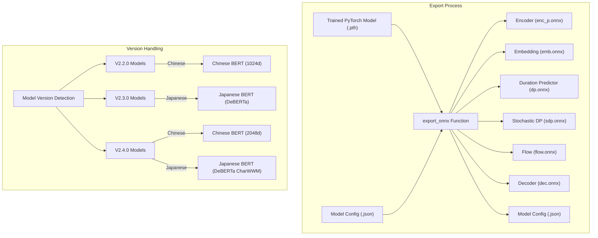
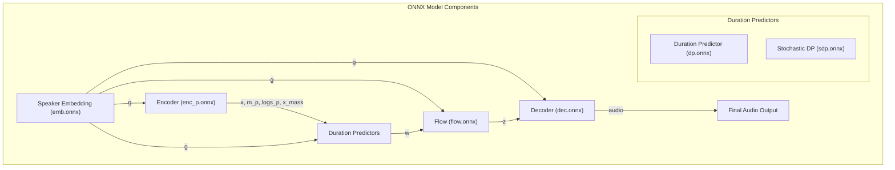
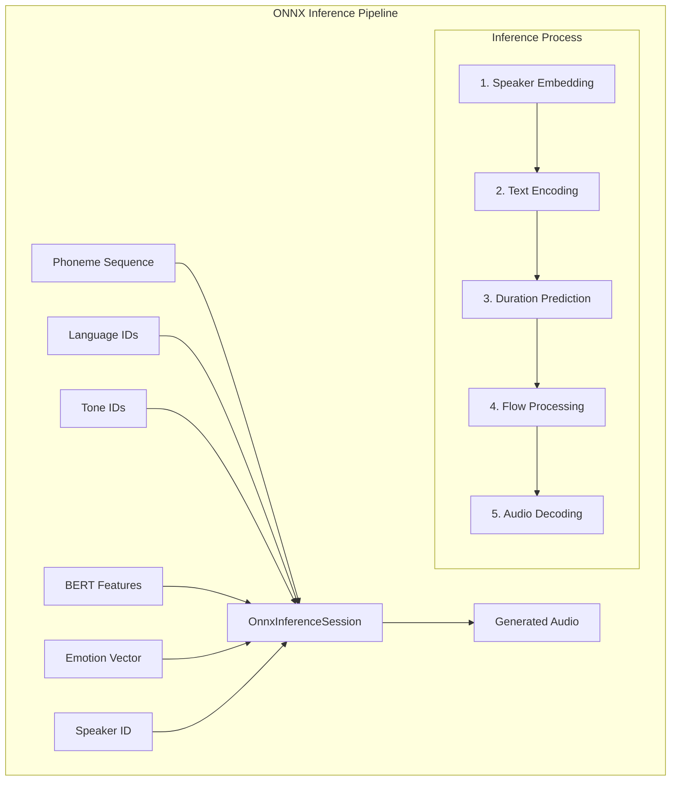
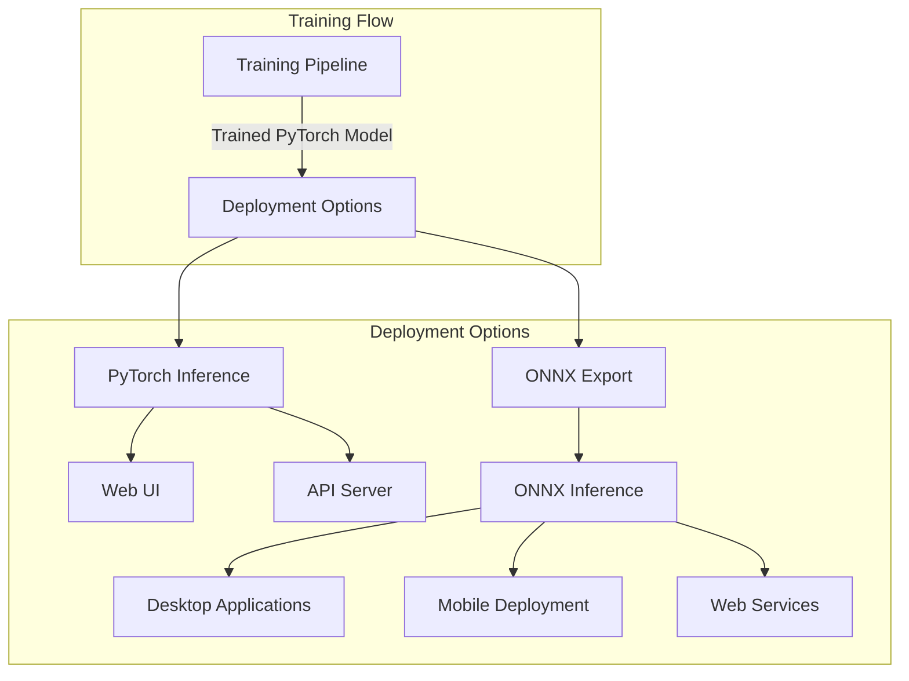

<!-- source: DeepWiki mcp.deepwiki.com · repo fishaudio/Bert-VITS2 · page 6 ONNX Export and Inference · fetched 2026-10-29 -->

# ONNX Export and Inference

<details>
<summary>Relevant source files</summary>

The following files were used as context for generating this wiki page:

- [export_onnx.py](export_onnx.py)
- [onnx_infer.py](onnx_infer.py)
- [onnx_modules/V220_OnnxInference/__init__.py](onnx_modules/V220_OnnxInference/__init__.py)
- [onnx_modules/V230/__init__.py](onnx_modules/V230/__init__.py)
- [onnx_modules/V230/attentions_onnx.py](onnx_modules/V230/attentions_onnx.py)
- [onnx_modules/V230/models_onnx.py](onnx_modules/V230/models_onnx.py)
- [onnx_modules/V230/text/__init__.py](onnx_modules/V230/text/__init__.py)
- [onnx_modules/V230/text/symbols.py](onnx_modules/V230/text/symbols.py)
- [onnx_modules/__init__.py](onnx_modules/__init__.py)

</details>


This page documents the ONNX (Open Neural Network Exchange) export and inference capabilities of Bert-VITS2. ONNX provides a standardized format for machine learning models, allowing you to convert PyTorch models to a format optimized for deployment and faster inference. This guide focuses specifically on exporting trained Bert-VITS2 models to ONNX format and running inference with the exported models.

For information about general inference without ONNX, see [Inference and Deployment](#5).

## Overview of ONNX in Bert-VITS2

Bert-VITS2 provides tools to export trained models to ONNX format, which offers several advantages:

- **Faster inference**: ONNX Runtime is optimized for inference performance
- **Cross-platform compatibility**: Run models on different hardware and operating systems
- **Reduced dependencies**: No need for PyTorch in production environments
- **Model optimization**: Automatic optimization of computational graphs

The ONNX export process in Bert-VITS2 divides the model into multiple components that are exported separately, allowing for more efficient inference.

Sources: [onnx_modules/__init__.py:4-78](), [export_onnx.py:1-15]()

## ONNX Export Process

### Export Architecture



Sources: [onnx_modules/__init__.py:5-44](), [onnx_modules/__init__.py:50-60]()

### Export Configuration

The ONNX export process requires:

1. **Trained model path**: Path to the PyTorch checkpoint file
2. **Config path**: Path to the model configuration file
3. **Export path**: Directory where ONNX models will be saved
4. **Version flags**:
   - `novq`: Whether to disable vector quantization
   - `dev`: Whether to use development version
   - `Extra`: Language-specific configuration ("chinese" or "japanese")

The export process creates a folder structure containing the ONNX model files and a configuration JSON file.

Sources: [export_onnx.py:4-15](), [onnx_modules/__init__.py:4-44]()

### Version Compatibility

Bert-VITS2 supports exporting models from various versions (2.0, 2.1, 2.2, 2.3, and 2.4). The export process automatically detects the model version from the configuration file and uses the appropriate export logic.

```
Version      Features                          BERT Size      Special Configurations
------------ --------------------------------- -------------- ---------------------
2.0          Base model                        1024           -
2.1          VQ support                        1024           novq flag
2.2          Emotion support                   1024           novq, dev flags
2.3          Improved Japanese support         1024           DeBERTa char WWM
2.4          Language-specific optimizations   1024/2048      Chinese/Japanese variants
```

Sources: [onnx_modules/__init__.py:7-33](), [onnx_modules/__init__.py:51-59]()

## ONNX Model Structure

### Components of the Exported Model

The export process splits the Bert-VITS2 SynthesizerTrn model into multiple components:



Sources: [onnx_modules/V230/models_onnx.py:896-1063](), [onnx_modules/V220_OnnxInference/__init__.py:35-42]()

### Model Configuration

Along with the ONNX model files, a JSON configuration file is generated with the following information:

- Model name and type
- Symbol set used for phonetic representation
- Sampling rate
- Character (speaker) list
- Language mapping
- BERT model paths and dimensions
- Emotion model configuration (if enabled)

This configuration file is used by the inference engine to correctly load and use the ONNX models.

Sources: [onnx_modules/__init__.py:61-78]()

## ONNX Inference Pipeline

### Inference Architecture



Sources: [onnx_modules/V220_OnnxInference/__init__.py:35-128](), [onnx_infer.py:1-60]()

### Inference Execution

The `OnnxInferenceSession` class handles the inference process:

1. **Initialization**: Load each ONNX model component
2. **Input Preparation**: Process phoneme sequences, BERT features, etc.
3. **Forward Pass**:
   - Generate speaker embedding
   - Encode text with BERT features
   - Predict durations
   - Apply flow layers for acoustics
   - Decode to waveform
4. **Output**: Return the generated audio waveform

The inference process closely mirrors the original PyTorch model's forward pass but benefits from ONNX Runtime optimizations.

Sources: [onnx_modules/V220_OnnxInference/__init__.py:44-128]()

### Special Inference Operations

Some operations in the original model are not directly supported by ONNX and are reimplemented in the inference code:

- **Path generation**: Creating alignment paths from duration predictions
- **Sequence masking**: Creating and applying masks for variable-length sequences
- **Matrix operations**: Special handling for attention and flow operations

These operations are implemented in pure NumPy to maintain compatibility with ONNX Runtime.

Sources: [onnx_modules/V220_OnnxInference/__init__.py:5-33](), [onnx_modules/V220_OnnxInference/__init__.py:97-111]()

## Using ONNX Export and Inference

### Exporting a Model

To export a trained Bert-VITS2 model to ONNX format:

1. Prepare your trained model and configuration file
2. Create an export script based on `export_onnx.py`
3. Configure the export parameters (model path, export path, etc.)
4. Run the export script

```python
# Example export configuration
export_path = "BertVits2Model"
model_path = "path/to/G_latest.pth"
config_path = "path/to/config.json"
novq = False
dev = False
Extra = "chinese"  # or "japanese"

# Create output directory
if not os.path.exists(f"onnx/{export_path}"):
    os.makedirs(f"onnx/{export_path}")

# Run export
export_onnx(export_path, model_path, config_path, novq, dev, Extra)
```

Sources: [export_onnx.py:4-15]()

### Running Inference with ONNX

To run inference with an exported ONNX model:

1. Initialize the `OnnxInferenceSession` with paths to the exported model components
2. Prepare the input data (phoneme sequence, BERT features, etc.)
3. Call the session to generate audio

```python
# Initialize ONNX session
session = OnnxInferenceSession(
    {
        "enc": "onnx/MyModel/MyModel_enc_p.onnx",
        "emb_g": "onnx/MyModel/MyModel_emb.onnx",
        "dp": "onnx/MyModel/MyModel_dp.onnx",
        "sdp": "onnx/MyModel/MyModel_sdp.onnx",
        "flow": "onnx/MyModel/MyModel_flow.onnx",
        "dec": "onnx/MyModel/MyModel_dec.onnx",
    },
    Providers=["CPUExecutionProvider"]  # or "CUDAExecutionProvider" for GPU
)

# Prepare inputs
phonemes = np.array([...])  # Phoneme sequence
tones = np.zeros_like(phonemes)  # Tone IDs
language = np.zeros_like(phonemes)  # Language IDs
bert_zh = np.random.randn(phonemes.shape[0], 1024)  # Chinese BERT features
bert_jp = np.random.randn(phonemes.shape[0], 1024)  # Japanese BERT features
bert_en = np.random.randn(phonemes.shape[0], 1024)  # English BERT features
emotion = np.random.randn(512, 1)  # Emotion embedding
speaker_id = np.array([0])  # Speaker ID

# Run inference
audio = session(phonemes, tones, language, bert_zh, bert_jp, bert_en, emotion, speaker_id)
```

Sources: [onnx_infer.py:1-60](), [onnx_modules/V220_OnnxInference/__init__.py:44-128]()

## Performance Considerations

### Provider Selection

ONNX Runtime supports different execution providers:

- **CPUExecutionProvider**: Default, works on all systems
- **CUDAExecutionProvider**: For NVIDIA GPUs, significantly faster
- **TensorrtExecutionProvider**: For optimized inference on NVIDIA GPUs
- **DirectMLExecutionProvider**: For Windows DirectX 12 compatible GPUs

Selecting the appropriate provider can significantly impact inference speed.

Sources: [onnx_modules/V220_OnnxInference/__init__.py:36](), [onnx_infer.py:13]()

### Model Optimization

To optimize ONNX models for faster inference:

1. **Quantization**: Convert model weights to lower precision (e.g., FP16 or INT8)
2. **Constant folding**: Pre-compute constant operations
3. **Graph optimization**: Using tools like `onnxruntime.tools.optimization`

These optimizations can significantly reduce model size and improve inference speed.

Sources: [onnx_modules/__init__.py:14](), [onnx_modules/__init__.py:16-26]()

## Relation to Other Components

The ONNX export and inference functionality provides an alternative deployment path for Bert-VITS2 models, complementing the standard PyTorch-based inference covered in the [Inference and Deployment](#5) section.



The ONNX export provides particular advantages for deployment scenarios where:

- Performance is critical
- PyTorch dependencies cannot be installed
- Cross-platform compatibility is required
- Integration with other ONNX-compatible systems is needed

For language-specific model variants, see [ONNX Model Variants](#6.1) for detailed information about optimizations for different languages.

---

