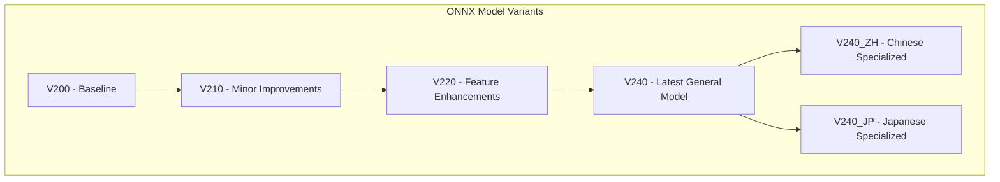
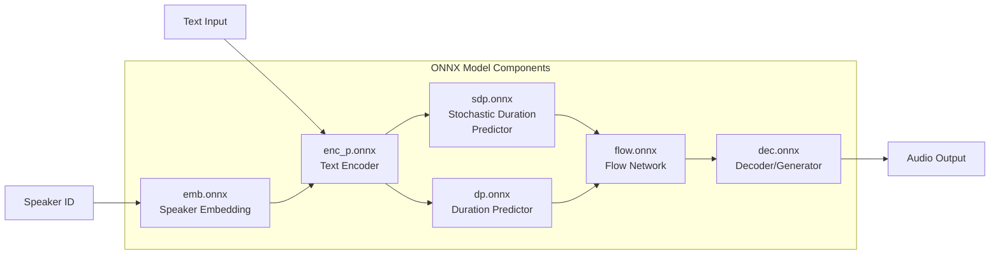
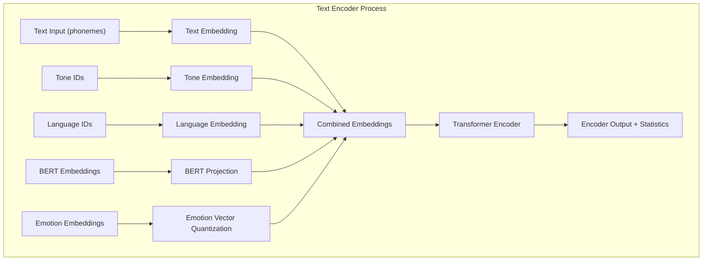
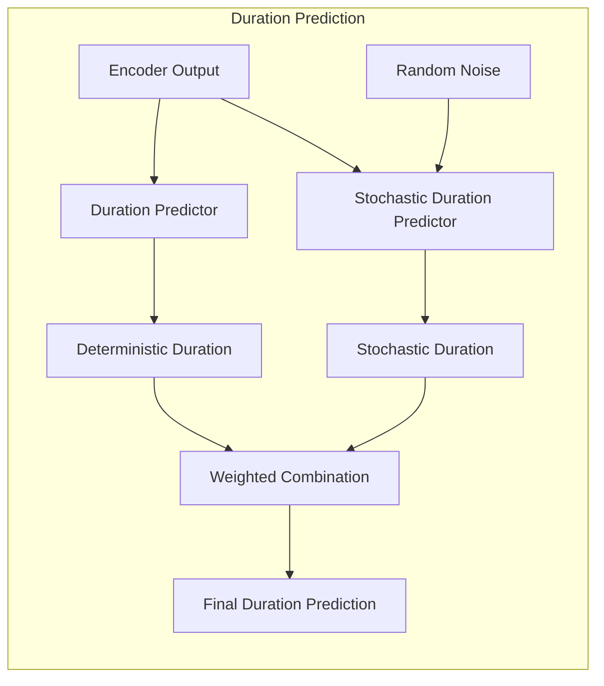
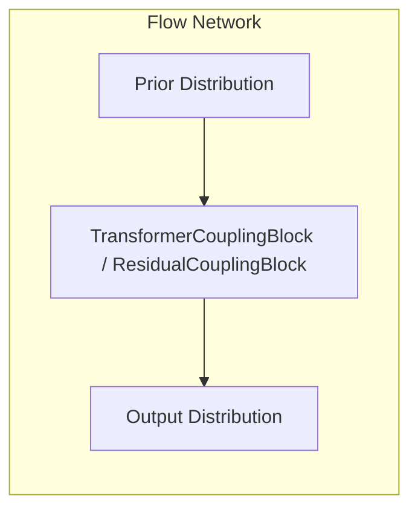
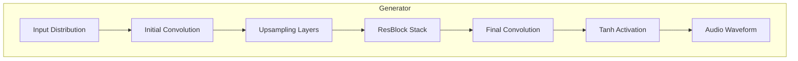
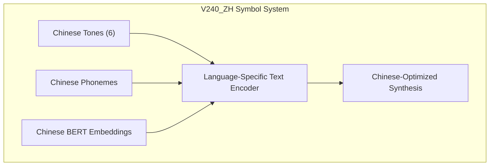
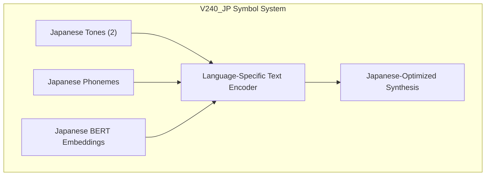
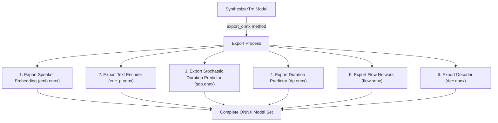

<!-- source: DeepWiki mcp.deepwiki.com · repo fishaudio/Bert-VITS2 · page 6.1 ONNX Model Variants · fetched 2026-10-29 -->

# ONNX Model Variants

Relevant source files

The following files were used as context for generating this wiki page:

- [onnx_modules/V200/__init__.py](onnx_modules/V200/__init__.py)
- [onnx_modules/V210/__init__.py](onnx_modules/V210/__init__.py)
- [onnx_modules/V220/__init__.py](onnx_modules/V220/__init__.py)
- [onnx_modules/V240/__init__.py](onnx_modules/V240/__init__.py)
- [onnx_modules/V240/attentions_onnx.py](onnx_modules/V240/attentions_onnx.py)
- [onnx_modules/V240/models_onnx.py](onnx_modules/V240/models_onnx.py)
- [onnx_modules/V240/text/__init__.py](onnx_modules/V240/text/__init__.py)
- [onnx_modules/V240/text/symbols.py](onnx_modules/V240/text/symbols.py)
- [onnx_modules/V240_JP/__init__.py](onnx_modules/V240_JP/__init__.py)
- [onnx_modules/V240_JP/attentions_onnx.py](onnx_modules/V240_JP/attentions_onnx.py)
- [onnx_modules/V240_JP/models_onnx.py](onnx_modules/V240_JP/models_onnx.py)
- [onnx_modules/V240_JP/text/__init__.py](onnx_modules/V240_JP/text/__init__.py)
- [onnx_modules/V240_JP/text/symbols.py](onnx_modules/V240_JP/text/symbols.py)
- [onnx_modules/V240_ZH/__init__.py](onnx_modules/V240_ZH/__init__.py)
- [onnx_modules/V240_ZH/attentions_onnx.py](onnx_modules/V240_ZH/attentions_onnx.py)
- [onnx_modules/V240_ZH/models_onnx.py](onnx_modules/V240_ZH/models_onnx.py)
- [onnx_modules/V240_ZH/text/__init__.py](onnx_modules/V240_ZH/text/__init__.py)
- [onnx_modules/V240_ZH/text/symbols.py](onnx_modules/V240_ZH/text/symbols.py)

This page documents the different ONNX model variants available in Bert-VITS2 for optimized inference deployment. It covers the version-specific variants, language-specific variants, and the internal components of these ONNX models. For information about the ONNX export process itself, see [ONNX Export and Inference](#6).

## Overview of ONNX Variants

Bert-VITS2 supports multiple ONNX model variants that correspond to different versions of the model architecture and language specializations. These variants allow for optimized inference on specific hardware or for specific language tasks.

Sources: [onnx_modules/V200/__init__.py](), [onnx_modules/V210/__init__.py](), [onnx_modules/V220/__init__.py](), [onnx_modules/V240/__init__.py](), [onnx_modules/V240_ZH/__init__.py](), [onnx_modules/V240_JP/__init__.py]()

## ONNX Model Components

Each ONNX model variant is composed of multiple component models, each handling a specific part of the speech synthesis pipeline. This modular approach allows for more efficient processing and easier debugging.

Sources: [onnx_modules/V240_ZH/models_onnx.py:919-1080](), [onnx_modules/V240_JP/models_onnx.py:919-1080]()

## Component Details

### Text Encoder (enc_p.onnx)

The Text Encoder converts the input text (represented as phonemes, tones, and language IDs) along with BERT embeddings and emotion embeddings into a hidden representation.

Key components:
- `TextEncoder` class processes phonemes, tones, and language IDs
- BERT embeddings (1024/2048-dimensional) are projected to match hidden dimensions
- Emotion embeddings are processed through a Vector Quantize module
- Outputs both the encoded representation and statistics (mean and log variance)

Sources: [onnx_modules/V240_ZH/models_onnx.py:291-382](), [onnx_modules/V240_JP/models_onnx.py:291-383]()

### Duration Predictors (dp.onnx and sdp.onnx)

Duration predictors estimate how long each phoneme should be, which allows the model to control the speaking rate.

Key components:
- `DurationPredictor`: Deterministic predictor with convolutional layers
- `StochasticDurationPredictor`: Adds variability for more natural speech
- Both predictors use the encoder output plus speaker embeddings as inputs
- The final duration is a weighted combination based on `sdp_ratio`

Sources: [onnx_modules/V240_ZH/models_onnx.py:150-257](), [onnx_modules/V240_JP/models_onnx.py:150-257]()

### Flow Network (flow.onnx)

The Flow Network transforms the predicted prior distribution into a more complex distribution through a series of invertible transformations.

Key components:
- `TransformerCouplingBlock`: Uses transformer-based coupling layers for newer models
- `ResidualCouplingBlock`: Uses residual networks for coupling in older models
- Both implement normalizing flows with a stack of invertible transformations
- Used in reverse mode during inference to convert from the prior to the target distribution

Sources: [onnx_modules/V240_ZH/models_onnx.py:84-147](), [onnx_modules/V240_JP/models_onnx.py:84-147](), [onnx_modules/V240_ZH/models_onnx.py:385-428](), [onnx_modules/V240_JP/models_onnx.py:386-428]()

### Decoder/Generator (dec.onnx)

The decoder generates the final audio waveform from the transformed distribution.

Key components:
- `Generator`: Hierarchical architecture with upsampling and residual blocks
- Progressive upsampling increases temporal resolution in multiple stages
- Residual blocks add refinement at each scale
- Produces raw audio waveform directly at 22.05kHz sample rate

Sources: [onnx_modules/V240_ZH/models_onnx.py:472-547](), [onnx_modules/V240_JP/models_onnx.py:473-547]()

## Language-Specific Variants

### V240_ZH (Chinese)

The Chinese-specific variant includes:

- Support for 6 tones (num_zh_tones = 6)
- Chinese-specific phoneme set (zh_symbols)
- BERT embedding dimension handling for Chinese BERT models
- Vector Quantizer configuration tuned for Chinese

Sources: [onnx_modules/V240_ZH/text/symbols.py:1-188](), [onnx_modules/V240_ZH/models_onnx.py:291-382]()

### V240_JP (Japanese)

The Japanese-specific variant includes:

- Support for 2 tones (num_ja_tones = 2)
- Japanese-specific phoneme set (ja_symbols)
- BERT embedding dimension handling for Japanese BERT models
- Different Vector Quantizer configuration (more codebook entries, different dimensions)

Sources: [onnx_modules/V240_JP/text/symbols.py:1-188](), [onnx_modules/V240_JP/models_onnx.py:291-383]()

## Version Comparison

The table below summarizes the key differences between ONNX model versions:

| Version | Key Features | BERT Embedding Handling | VQ Configuration | Notes |
|---------|--------------|-------------------------|------------------|-------|
| V200    | Base model   | Basic integration       | Not present      | Initial ONNX support |
| V210    | Minor improvements | Enhanced integration | Not present    | Stability improvements |
| V220    | Feature enhancements | Better integration | Basic VQ       | Better multilingual support |
| V240    | Latest general | 2048→1024 projection  | Advanced VQ (64 codebooks) | Current general-purpose model |
| V240_ZH | Chinese-optimized | 2048→1024 projection | VQ with 64 codebooks, 32-dim | Optimized for Chinese |
| V240_JP | Japanese-optimized | Direct 1024 projection | VQ with 256 codebooks, 16-dim | Optimized for Japanese |

Sources: [onnx_modules/V240_ZH/models_onnx.py:331-345](), [onnx_modules/V240_JP/models_onnx.py:333-347]()

## ONNX Model Export Process

The ONNX export process is handled by the `export_onnx` method in the `SynthesizerTrn` class. This method exports each component of the model separately to allow for modular inference.

Key characteristics of the export process:
- Each component is exported with dummy inputs to trace the computation graph
- Dynamic axes are defined to support variable-length inputs during inference
- Model is exported with opset_version=16 for compatibility
- Input shapes and dimensions are carefully managed for each component

Sources: [onnx_modules/V240_ZH/models_onnx.py:919-1080](), [onnx_modules/V240_JP/models_onnx.py:920-1082]()

## Selecting the Appropriate ONNX Variant

When choosing an ONNX model variant for deployment, consider:

1. **Language requirements**: 
   - For primarily Chinese text, use V240_ZH
   - For primarily Japanese text, use V240_JP
   - For mixed or other languages, use V240

2. **Model size vs. quality tradeoff**:
   - Newer versions (V240) generally provide better quality but are larger
   - Older versions (V200, V210) may be smaller but with reduced quality

3. **Hardware constraints**:
   - All ONNX models provide better inference performance than PyTorch models
   - Smaller/older versions may run better on limited hardware

4. **Feature requirements**:
   - Newer versions support more features like emotion control
   - Language-specific versions may have better prosody for their target languages

Sources: [onnx_modules/V240_ZH/models_onnx.py](), [onnx_modules/V240_JP/models_onnx.py]()

---

