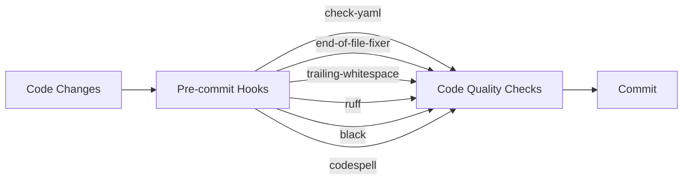
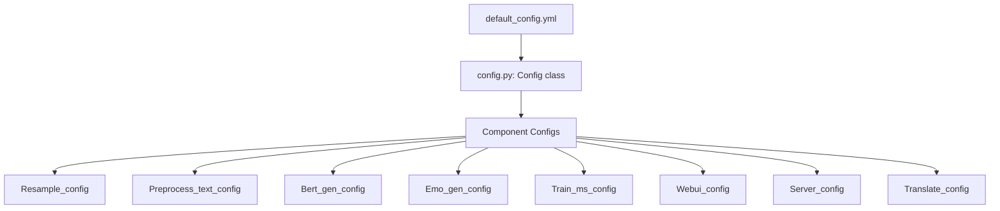
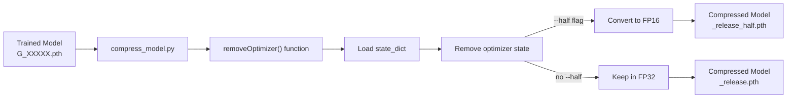
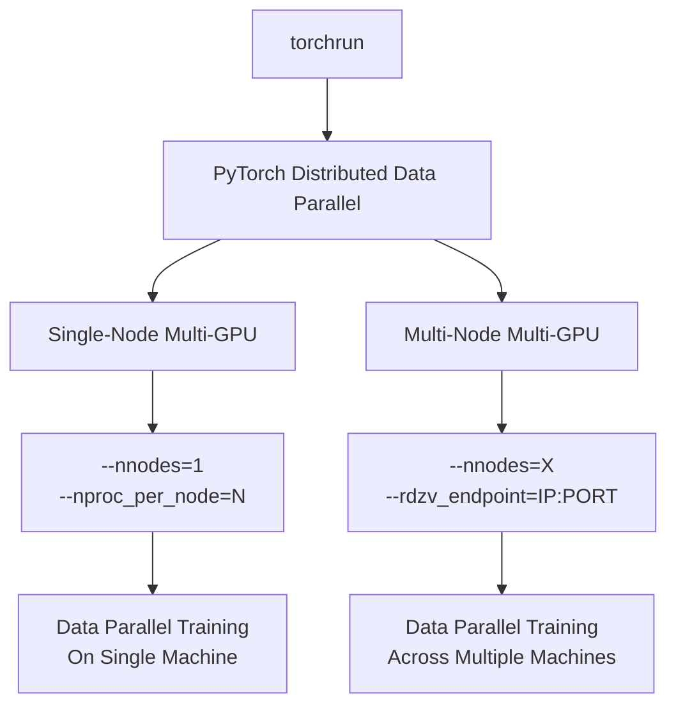
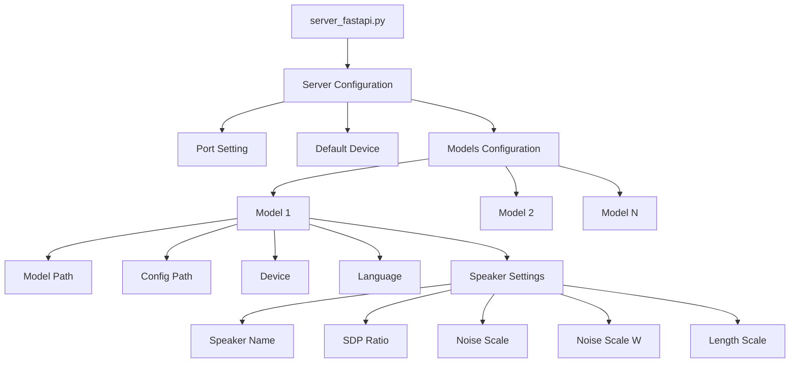

<!-- source: DeepWiki mcp.deepwiki.com · repo fishaudio/Bert-VITS2 · page 7 Development and Customization · fetched 2026-10-29 -->

# Development and Customization

<details>
<summary>Relevant source files</summary>

The following files were used as context for generating this wiki page:

- [.pre-commit-config.yaml](.pre-commit-config.yaml)
- [README.md](README.md)
- [compress_model.py](compress_model.py)
- [config.py](config.py)
- [css/custom.css](css/custom.css)
- [default_config.yml](default_config.yml)
- [run_MnodesAndMgpus.sh](run_MnodesAndMgpus.sh)

</details>


This document provides technical guidance for developers who want to modify, extend, or customize the Bert-VITS2 text-to-speech synthesis system. It covers development environment setup, configuration customization, model compression, distributed training setup, and UI customization. For information about using the trained models for inference, see [Inference and Deployment](#5).

## Development Environment and Code Quality

Bert-VITS2 maintains code quality and consistency through pre-commit hooks that automatically check and format code before each commit.



The pre-commit configuration is defined in [.pre-commit-config.yaml:1-25]() and ensures:
- YAML files are valid
- Files end with a newline
- No trailing whitespace
- Python code follows style guidelines (via ruff and black)
- No spelling errors in code and documentation

Setup instructions:
```bash
pip install pre-commit
pre-commit install
```

Sources: [.pre-commit-config.yaml]()

## Configuration System

Bert-VITS2 uses a structured YAML-based configuration system for customizing all aspects of the project.



The configuration workflow:
1. System looks for `config.yml` specified by the `-y/--yml_config` argument
2. Creates a copy of `default_config.yml` if `config.yml` is not found
3. Loads settings and creates configuration objects for each component

### Key Configuration Components

| Component | Purpose | Key Settings |
|-----------|---------|--------------|
| `dataset_path` | Base directory for data | Path string |
| `resample` | Audio resampling | `sampling_rate`, `in_dir`, `out_dir` |
| `preprocess_text` | Text preprocessing | `transcription_path`, `train_path`, `val_path` |
| `bert_gen` | BERT feature generation | `config_path`, `num_processes`, `device` |
| `emo_gen` | Emotion feature generation | `config_path`, `num_processes`, `device` |
| `train_ms` | Model training | `env`, `base`, `model`, `num_workers` |
| `webui` | Web interface | `device`, `model`, `port`, `share` |
| `server` | API server | `port`, `device`, `models` |

Sources: [default_config.yml:1-177](), [config.py:13-262]()

## Model Compression

For deployment, you can compress models to reduce size using the `compress_model.py` utility:



Usage:
```bash
python compress_model.py -c configs/config.json -i models/G_100000.pth [-o output.pth] [-hf]
```

The compression process:
1. Loads the model state dictionary
2. Removes the optimizer state
3. Optionally converts weights to half precision (FP16)
4. Saves a significantly smaller model suitable for deployment

Sources: [compress_model.py:1-89]()

## Distributed Training

Bert-VITS2 supports distributed training across multiple GPUs and nodes using PyTorch's distributed capabilities.



### Single-Node Multi-GPU Training

For training on multiple GPUs on a single machine:

```bash
torchrun --nnodes=1 --nproc_per_node=NUM_GPUS train_ms.py
```

### Multi-Node Distributed Training

For training across multiple machines:

```bash
# On master node (and all worker nodes)
torchrun --nnodes=TOTAL_NODES --nproc_per_node=GPUS_PER_NODE \
  --rdzv_id=1 --rdzv_backend=c10d --rdzv_endpoint="MASTER_IP:PORT" train_ms.py
```

Note: The distributed training implementation focuses on data parallelism, which effectively increases the batch size. While this accelerates epoch iteration, model checkpoints are saved based on global steps, not epochs.

Sources: [run_MnodesAndMgpus.sh:1-31]()

## Training Configuration

Training parameters are configured through the `train_ms` section in the YAML config:

```yaml
train_ms:
  env:
    MASTER_ADDR: "localhost"
    MASTER_PORT: 10086
    WORLD_SIZE: 1
    LOCAL_RANK: 0
    RANK: 0
  base:
    use_base_model: false
    repo_id: "Stardust_minus/Bert-VITS2"
    model_image: "Bert-VITS2_2.3底模"
  model: "models"
  config_path: "configs/config.json"
  num_workers: 16
  spec_cache: False
  keep_ckpts: 8
```

Key training parameters:
- `env`: Environment variables for distributed training
- `base`: Base model settings for transfer learning
- `model`: Directory for saving checkpoints
- `num_workers`: Data loading worker processes
- `spec_cache`: Cache spectrograms to disk (speeds up training but uses more storage)
- `keep_ckpts`: Number of checkpoint files to keep

Sources: [default_config.yml:71-97]()

## UI Customization

### Web Interface Styling

The web interface appearance can be customized through CSS:

```css
#yml_code {
    height: 600px;
    flex-grow: inherit;
    overflow-y: auto;
}

#json_code {
    height: 600px;
    flex-grow: inherit;
    overflow-y: auto;
}

#gpu_code {
    height: 300px;
    flex-grow: inherit;
    overflow-y: auto;
}
```

These styles control the height and scrolling behavior of code editors and information displays in the web interface.

Sources: [css/custom.css:1-18]()

### WebUI Configuration

The web interface is configured through the `webui` section:

```yaml
webui:
  device: "cuda"  # Inference device
  model: "models/G_8000.pth"  # Model path
  config_path: "configs/config.json"  # Config path
  port: 7860  # Port number
  share: false  # Public sharing option
  debug: false  # Debug mode
  language_identification_library: "langid"  # Language detection library
```

Sources: [default_config.yml:99-115]()

## API Server Customization

The API server for programmatic access to the model can be configured with multiple models and speakers.



Example configuration for multiple models:

```yaml
server:
  port: 5000
  device: "cuda"
  models:
    - model: "path/to/model1.pth"
      config: "path/to/config1.json"
      device: "cuda"
      language: "ZH"
      speakers:
        - speaker: "Speaker1"
          sdp_ratio: 0.2
          noise_scale: 0.6
    - model: "path/to/model2.pth"
      config: "path/to/config2.json"
      device: "cpu"
      language: "JP"
```

This allows for flexible API service customization with different models and speakers available through a single API endpoint.

Sources: [default_config.yml:118-168]()

## Developer Workflow

The typical development workflow for contributing to Bert-VITS2:


When contributing to Bert-VITS2:
1. Follow the established code style enforced by the pre-commit hooks
2. Write clear, descriptive commit messages
3. Test your changes thoroughly
4. Document new features or significant changes
5. Submit pull requests against the main branch

Sources: [README.md:1-46](), [.pre-commit-config.yaml:1-25]()