# Page: Overview

# Overview

<details>
<summary>Relevant source files</summary>

The following files were used as context for generating this wiki page:

- [.pre-commit-config.yaml](.pre-commit-config.yaml)
- [README.md](README.md)
- [configs/config.json](configs/config.json)
- [models.py](models.py)
- [preprocess_text.py](preprocess_text.py)
- [spec_gen.py](spec_gen.py)

</details>


Bert-VITS2 is a text-to-speech (TTS) synthesis system that combines BERT (Bidirectional Encoder Representations from Transformers) embeddings with a modified VITS2 architecture to produce high-quality, natural-sounding speech across multiple languages. The system leverages pre-trained BERT models to enhance text understanding, resulting in improved pronunciation, prosody, and multilingual capabilities.

This page provides a technical overview of the Bert-VITS2 system architecture, explaining its core components and how they interact. For detailed information about installation and setup, see [Installation and Setup](#1.1).

## System Architecture

Bert-VITS2 integrates several sophisticated components into a unified text-to-speech pipeline:

```mermaid
graph TD
    subgraph "Preprocessing"
        TextData["Raw Text Data"] --> PreprocessText["Text Preprocessing"]
        AudioData["Raw Audio Data"] --> Resample["Audio Resampling"]
        PreprocessText --> Filelists["Filelists\n(train.list, val.list)"]
        Resample --> ProcessedAudio["Processed Audio"]
        Filelists --> BertGen["BERT Feature Generation"]
        ProcessedAudio --> SpecGen["Spectrogram Generation"]
        ProcessedAudio --> EmoGen["Emotion Feature Generation"]
    end
    
    subgraph "Model Components"
        subgraph "SynthesizerTrn"
            TextEnc["Text Encoder"]
            DurPred["Duration Predictor"]
            StochDurPred["Stochastic Duration Predictor"]
            Flow["Flow Network"]
            Generator["Generator"]
            
            TextEnc --> DurPred
            TextEnc --> StochDurPred
            TextEnc --> Flow
            Flow --> Generator
        end
        
        subgraph "Discriminators"
            MPDisc["Multi-Period Discriminator"]
            DurDisc["Duration Discriminator"]
            WavLMDisc["WavLM Discriminator"]
        end
    end
    
    subgraph "Training"
        BertGen --> Training["Model Training"]
        SpecGen --> Training
        EmoGen --> Training
        Filelists --> Training
        Training --> TrainedModel["Trained Model\n(checkpoint files)"]
        Training --> Discriminators
    end
    
    subgraph "Inference"
        Text["Input Text"] --> InferTextProc["Text Processing"]
        InferTextProc --> InferBert["BERT Features"]
        InferBert --> TextEnc
        SpkID["Speaker ID"] --> SpeakerEmb["Speaker Embedding"]
        SpeakerEmb --> TextEnc
        SpeakerEmb --> Flow
        SpeakerEmb --> Generator
        DurPred & StochDurPred --> Alignment["Duration Alignment"]
        TextEnc & Alignment --> Flow
        Generator --> OutputAudio["Generated Audio"]
        TrainedModel -.-> SynthesizerTrn
    end
```

Sources: [models.py:811-1074](), [models.py:333-400](), [models.py:490-566]()

## Key Components

### Text Encoder

The `TextEncoder` processes text inputs, integrating phoneme embeddings, tone information, language IDs, and BERT features into a unified representation:

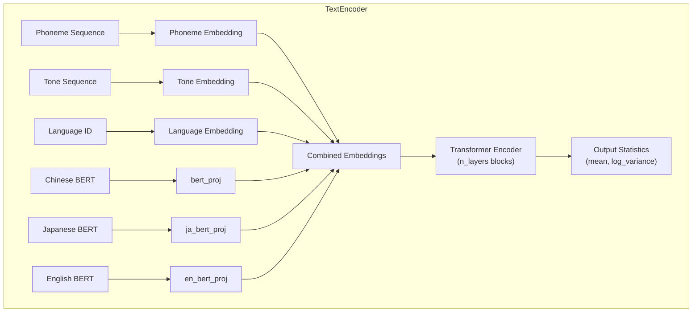

The `TextEncoder` processes sequences of phonemes, tones, and language IDs, then combines them with BERT features for each supported language. The encoder uses transformer architecture with self-attention mechanisms to create context-aware text representations.

Sources: [models.py:333-400]()

### Duration Predictors

Bert-VITS2 uses two duration prediction mechanisms:

1. **DurationPredictor**: A deterministic CNN-based predictor
2. **StochasticDurationPredictor**: A probabilistic flow-based predictor for more natural duration variation

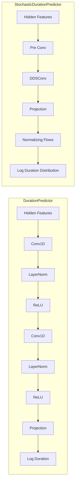

Sources: [models.py:148-299]()

### Flow Network

The Flow Network transforms between posterior and prior distributions using coupling layers:

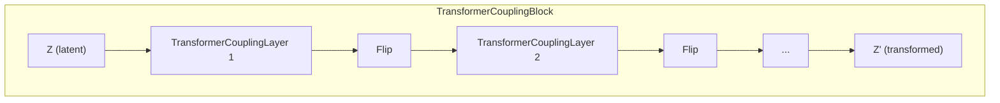

Each coupling layer uses transformer-based networks to transform half of the features conditioned on the other half, enabling complex distribution transformations while maintaining invertibility.

Sources: [models.py:82-146]()

### Generator

The Generator converts latent representations into audio waveforms through a series of upsampling and residual blocks:

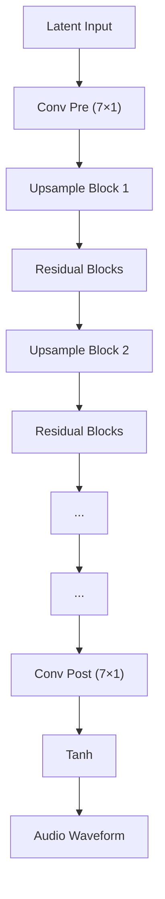

Sources: [models.py:490-566]()

## Multi-Language Support

Bert-VITS2 provides robust support for multiple languages through language-specific BERT models and processing:

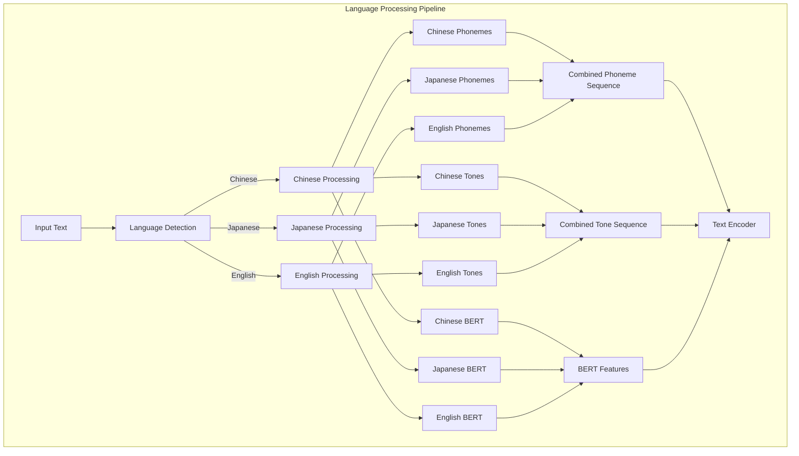

Bert-VITS2 processes text for each language differently, extracting language-appropriate phonemes, tones, and BERT features. The system can handle mixed-language text by processing each language segment separately and then combining the results.

Sources: [models.py:362-364](), [models.py:378-387](), [preprocess_text.py:57-69]()

## Training Pipeline

The training process integrates multiple components to transform raw data into a trained TTS model:

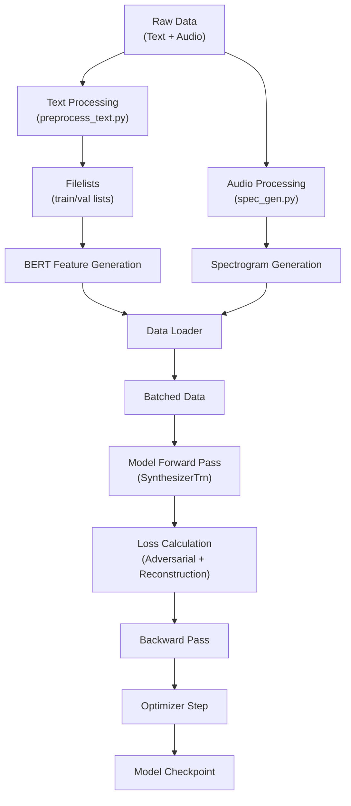

The training pipeline processes raw text and audio data, extracts features, and trains the model using a combination of reconstruction and adversarial losses. Speaker embeddings enable the model to learn multiple voices from a single model.

Sources: [preprocess_text.py:34-137](), [spec_gen.py:31-64]()

## Inference Pipeline

During inference, Bert-VITS2 processes input text to generate speech following these steps:

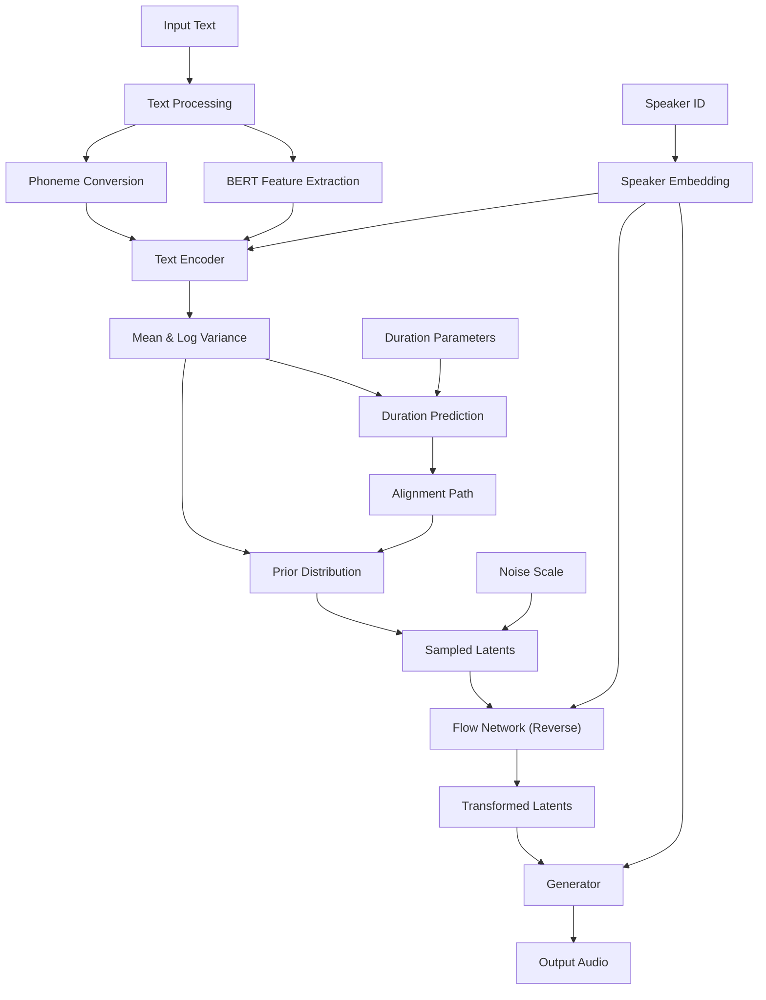

The inference pipeline allows control over various generation parameters:
- `noise_scale`: Controls variation in voice characteristics
- `length_scale`: Controls speech speed
- `noise_scale_w`: Controls duration variation
- `sdp_ratio`: Balances between deterministic and stochastic duration prediction

Sources: [models.py:1026-1074]()

## Configuration System

Bert-VITS2 uses a JSON configuration file to specify model and training parameters:

| Configuration Section | Description | Key Parameters |
|----------------------|-------------|----------------|
| `train` | Training parameters | Learning rate, batch size, loss weights |
| `data` | Data processing settings | Sampling rate, mel channels, speaker IDs |
| `model` | Model architecture | Hidden dimensions, layers, kernel sizes |

The configuration file also defines speaker mappings through the `spk2id` dictionary, which associates speaker names with numeric IDs. During training, the system uses these IDs to learn speaker-specific embeddings.

Sources: [configs/config.json:1-957]()

## Development Tools

Bert-VITS2 includes several development tools to ensure code quality:

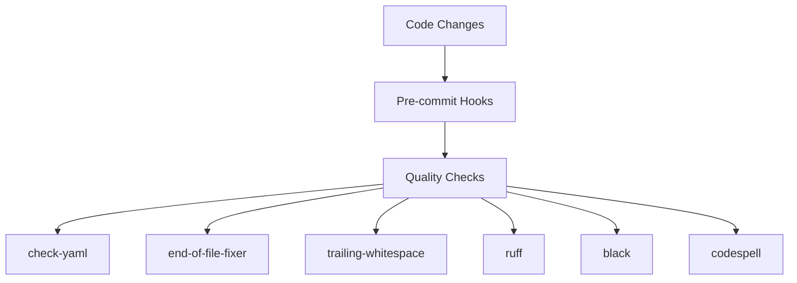

These tools help maintain consistent code style and quality across the codebase.

Sources: [.pre-commit-config.yaml:1-26]()

## Summary

Bert-VITS2 combines the power of BERT embeddings with the VITS2 architecture to create a state-of-the-art multilingual text-to-speech system. Its key innovations include:

1. Integration of language-specific BERT models for improved text understanding
2. Robust multi-language support for Chinese, Japanese, and English
3. Flow-based models for natural speech variation
4. Speaker conditioning for multi-speaker synthesis

The system architecture enables high-quality, natural-sounding speech synthesis with control over voice characteristics, speaking rate, and expressiveness.

---

# Page: Installation and Setup

# Installation and Setup

<details>
<summary>Relevant source files</summary>

The following files were used as context for generating this wiki page:

- [.gitignore](.gitignore)
- [LICENSE](LICENSE)
- [config.py](config.py)
- [default_config.yml](default_config.yml)
- [requirements.txt](requirements.txt)
- [run_MnodesAndMgpus.sh](run_MnodesAndMgpus.sh)
- [text/chinese.py](text/chinese.py)

</details>


This document provides detailed instructions for installing and setting up the Bert-VITS2 environment. Bert-VITS2 is a text-to-speech synthesis system that combines BERT embeddings with a VITS2 architecture to generate high-quality, multi-language speech synthesis. This guide covers environment setup, dependency installation, and initial configuration steps needed before training or using the system.

For information about the underlying model architecture, see [Core Model Architecture](#2), and for the training process, see [Training Pipeline](#3).

## System Requirements

Before installing Bert-VITS2, ensure your system meets these requirements:

- **Operating System**: Windows, Linux, or macOS
- **Python**: Version 3.8 or newer recommended
- **GPU**: NVIDIA GPU with CUDA support strongly recommended for training and faster inference
- **RAM**: Minimum 8GB, 16GB+ recommended for training
- **Storage**: At least 10GB for code, dependencies, and pre-trained models (additional space needed for datasets)

Sources: [requirements.txt](), [default_config.yml]()

## Installation Process

The installation process for Bert-VITS2 involves several steps, as illustrated in the diagram below:

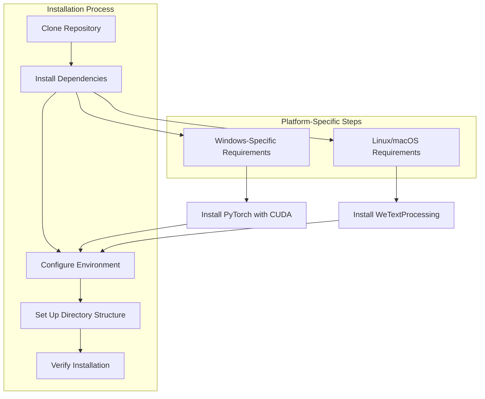

### 1. Clone the Repository

First, clone the Bert-VITS2 repository from GitHub:

```bash
git clone https://github.com/fishaudio/Bert-VITS2.git
cd Bert-VITS2
```

### 2. Install Dependencies

Install the required Python packages using pip:

```bash
pip install -r requirements.txt
```

Note that some packages have platform-specific requirements:
- WeTextProcessing is required for Linux/macOS but not for Windows
- Some packages may require additional system libraries depending on your platform

Sources: [requirements.txt:1-34]()

### 3. Special Platform Considerations

#### Windows

On Windows, ensure you have the correct Visual C++ redistributable installed for some of the audio processing libraries. Additionally, some packages like pyopenjtalk-prebuilt may require specific setup.

#### Linux

Linux users might need to install additional libraries for audio processing:

```bash
# Ubuntu/Debian
sudo apt-get install -y libsndfile1 ffmpeg
```

#### macOS

macOS users might need to install portaudio and ffmpeg:

```bash
# Using Homebrew
brew install portaudio ffmpeg
```

## Configuration Setup

Bert-VITS2 uses YAML configuration files to manage various aspects of the system. The first time you run any script, it will create a `config.yml` file based on the default configuration.

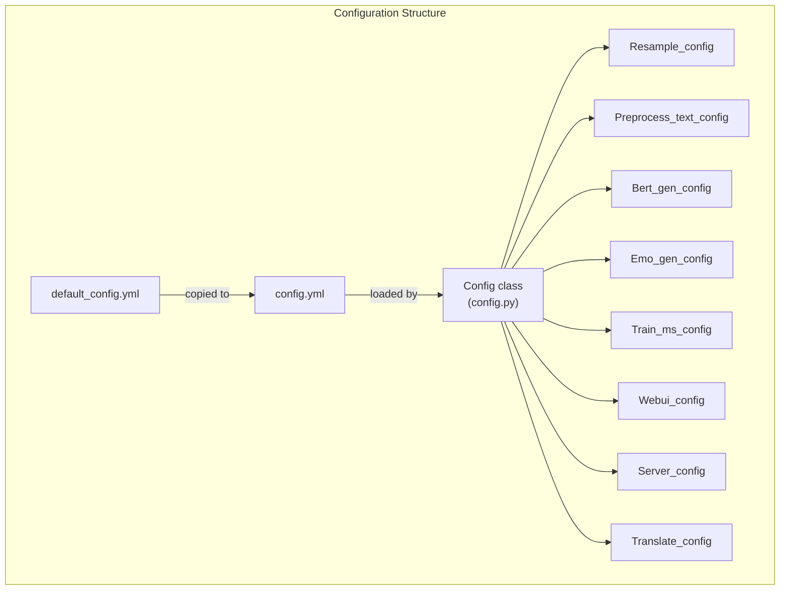

When you first run any component of Bert-VITS2, the system checks for a `config.yml` file, and if it doesn't exist, it copies the default configuration:

```python
if not os.path.isfile(config_path) and os.path.isfile("default_config.yml"):
    shutil.copy(src="default_config.yml", dst=config_path)
    print(f"已根据默认配置文件default_config.yml生成配置文件{config_path}。请按该配置文件的说明进行配置后重新运行。")
    print("如无特殊需求，请勿修改default_config.yml或备份该文件。")
    sys.exit(0)
```

Sources: [config.py:215-221]()

### Key Configuration Settings

Modify your `config.yml` file with these essential settings:

1. **Dataset Path**: Set the base directory for your data
   ```yaml
   dataset_path: "Data/"
   ```

2. **Model Mirror**: Choose a model source (default is HuggingFace)
   ```yaml
   mirror: ""  # Leave empty for HuggingFace, use "openi" for OpenI
   openi_token: ""  # Only needed if using OpenI
   ```

3. **Audio Resampling**: Configure input/output directories and sample rate
   ```yaml
   resample:
     sampling_rate: 44100
     in_dir: "audios/raw"
     out_dir: "audios/wavs"
   ```

4. **Text Processing**: Define input text and output files
   ```yaml
   preprocess_text:
     transcription_path: "filelists/your_dataset.list"
     train_path: "filelists/train.list"
     val_path: "filelists/val.list"
     config_path: "config.json"
   ```

Sources: [default_config.yml:1-44]()

## Directory Structure Setup

Bert-VITS2 expects a specific directory structure for data organization. The main directories are:

| Directory | Purpose | Created Automatically? |
|-----------|---------|------------------------|
| `Data/` | Root directory for datasets | No |
| `Data/audios/raw` | Raw audio files for processing | No |
| `Data/audios/wavs` | Processed audio files | Yes |
| `Data/filelists` | Dataset file lists | No |
| `Data/models` | Trained model checkpoints | Yes |
| `Data/configs` | Model configuration files | No |
| `bert/` | BERT model files | Yes |
| `emotional/` | Emotional embedding files | Yes |

You'll need to manually create the following minimum structure:

```
Bert-VITS2/
├── Data/
│   ├── audios/
│   │   └── raw/          # Place raw audio files here
│   ├── filelists/        # Create your dataset file lists here
│   └── configs/          # Model configuration will be saved here
└── config.yml            # Your configuration file
```

Sources: [.gitignore:162-188](), [default_config.yml:4-7]()

## Data Preparation Workflow

Before training or using Bert-VITS2, you need to prepare your data following this workflow:

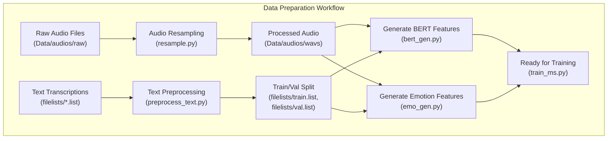

Each step corresponds to a script in the repository:

1. **Audio Resampling**: Process raw audio files to the required format
   ```bash
   python resample.py
   ```

2. **Text Preprocessing**: Clean text and split into training/validation sets
   ```bash
   python preprocess_text.py
   ```

3. **BERT Feature Generation**: Generate BERT embeddings for text
   ```bash
   python bert_gen.py
   ```

4. **Emotion Feature Generation**: Generate emotion embeddings
   ```bash
   python emo_gen.py
   ```

Sources: [default_config.yml:13-119]()

## Multi-Language Support

Bert-VITS2 supports multiple languages including Chinese, Japanese, and English. The system handles language-specific processing in different ways:

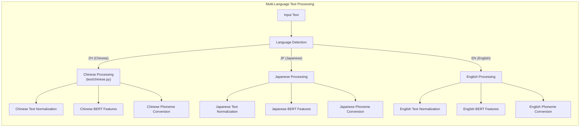

For each language, different processing steps are applied:

- **Chinese**: Uses pypinyin for phoneme conversion and tone handling
- **Japanese**: Uses OpenJTalk for phoneme conversion
- **English**: Uses g2p_en for grapheme-to-phoneme conversion

The text processing modules automatically handle special characters, punctuation, and language-specific rules.

Sources: [text/chinese.py:1-206]()

## Verification and Troubleshooting

To verify your installation is working correctly, run:

```bash
python3 webui.py
```

This should start the Gradio web interface on port 7860 (by default). If everything is set up correctly, you'll be able to access the interface through your browser at `http://localhost:7860`.

### Common Issues and Solutions

1. **CUDA/GPU Problems**:
   - Check that your NVIDIA drivers and CUDA toolkit are properly installed
   - Ensure PyTorch was installed with CUDA support
   - Set `device: "cpu"` in config.yml if no GPU is available

2. **Missing Directories**:
   - Ensure you've created the necessary directory structure
   - Check file permissions if on Linux/macOS

3. **Configuration Errors**:
   - If you encounter errors related to configuration, check that your config.yml has all required fields
   - Compare with default_config.yml to spot any missing settings

4. **Language-Specific Issues**:
   - For Chinese text processing issues, check that pypinyin and jieba are properly installed
   - For Japanese, verify that pyopenjtalk-prebuilt is installed correctly

Sources: [default_config.yml:98-114]()

## Multi-GPU Training Setup

If you have multiple GPUs, you can configure distributed training with the following steps:

```bash
# For multi-GPU on a single machine
torchrun --nnodes=1 --nproc_per_node=NUM_GPUS train_ms.py

# For multi-node training (across multiple machines)
torchrun --nnodes=1:3 --nproc_per_node=NUM_GPUS --rdzv_id=1 --rdzv_backend=c10d --rdzv_endpoint="MASTER_IP:PORT" train_ms.py
```

Where:
- `NUM_GPUS` is the number of GPUs per machine
- `MASTER_IP:PORT` is the IP address and port of the main node

You can also adjust the environment variables in your config.yml:

```yaml
train_ms:
  env:
    MASTER_ADDR: "localhost"
    MASTER_PORT: 10086
    WORLD_SIZE: 1
    LOCAL_RANK: 0
    RANK: 0
```

Sources: [run_MnodesAndMgpus.sh:1-31](), [default_config.yml:71-81]()

## Next Steps

After completing installation and setup, you can:

1. Prepare your dataset following the [Training Pipeline](#3) documentation
2. Train a model using your prepared data
3. Run inference using the web interface or API server
4. Export your trained model to ONNX format for faster inference

This completes the installation and setup guide for Bert-VITS2. For more detailed information about specific components, refer to the appropriate sections in the documentation.

---

# Page: Core Model Architecture

# Core Model Architecture

<details>
<summary>Relevant source files</summary>

The following files were used as context for generating this wiki page:

- [configs/config.json](configs/config.json)
- [hiyoriUI.py](hiyoriUI.py)
- [models.py](models.py)
- [modules.py](modules.py)
- [preprocess_text.py](preprocess_text.py)
- [spec_gen.py](spec_gen.py)

</details>


This page documents the core model architecture of Bert-VITS2, focusing on the main model components, their interactions, and the overall design of the system. For information about training the model, see [Training Pipeline](#3), and for text processing details, see [Multi-Language Text Processing](#4).

## Overview

Bert-VITS2 extends the VITS2 text-to-speech architecture by incorporating BERT embeddings for improved text understanding. The system integrates several key components: a text encoder enhanced with BERT embeddings, flow-based modules for transforming between latent representations, duration predictors for controlling speech timing, and a generator for synthesizing high-quality audio waveforms.

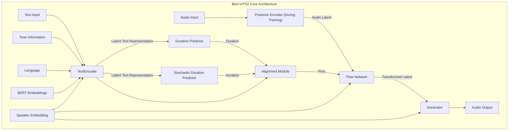

Sources: [models.py:811-936]()

## SynthesizerTrn: The Main Model Class

The `SynthesizerTrn` class serves as the central component that integrates all parts of the model. It initializes the encoders, flow networks, duration predictors, and the generator to form a complete TTS system.

### Initialization

The `SynthesizerTrn` constructor initializes the model with configuration parameters including dimension sizes, network architecture choices, and speaker representation options.

Key parameters include:
- Text representation dimensions
- Hidden channel dimensions
- Filter settings
- Speaker embedding setup
- Flow network configuration

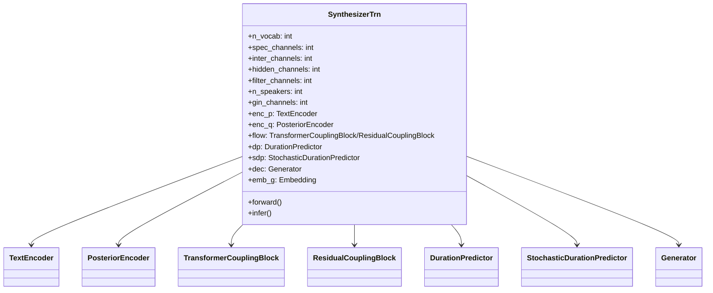

Sources: [models.py:811-936](), [configs/config.json:895-954]()

### Forward and Inference Processes

The `SynthesizerTrn` implements two main methods:

1. **`forward()`**: Used during training to process text and audio inputs, calculate losses, and return intermediate values. The process includes:
   - Text encoding with BERT features
   - Posterior encoding of reference audio
   - Flow-based transformation
   - Duration prediction and alignment
   - Audio generation

2. **`infer()`**: Used during inference to generate audio from text inputs. The process includes:
   - Text encoding
   - Duration prediction
   - Flow transformation (in reverse)
   - Audio generation

Sources: [models.py:937-1074]()

## Text Encoding Pipeline

The `TextEncoder` processes text inputs along with additional contextual information to create a rich latent representation.

### Inputs and Processing Flow

The text encoder takes several inputs:
- Text tokens
- Tone information
- Language identifiers
- BERT embeddings for different languages (Chinese, Japanese, English)
- Speaker conditioning (optional)

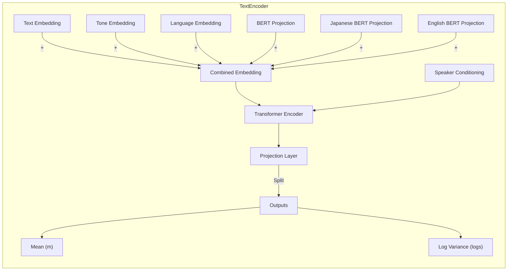

The encoder uses a transformer-based architecture to process the combined embeddings and produce a latent representation with mean and log variance parameters for each position in the sequence.

Sources: [models.py:333-400]()

## Flow-based Modules

Bert-VITS2 employs flow-based models to transform between latent representations. These modules use invertible normalizing flows to map between different probability distributions.

### TransformerCouplingBlock

The `TransformerCouplingBlock` is the primary flow module, using a series of transformer-based coupling layers to transform latent representations.

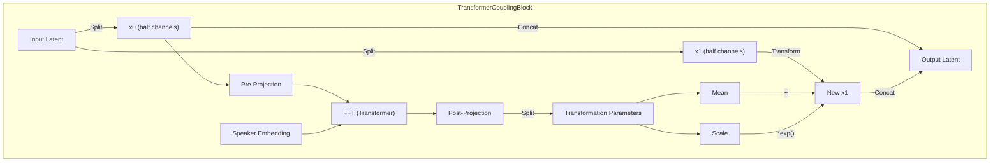

The implementation supports sharing parameters between coupling layers for more efficient computation.

Sources: [models.py:82-145](), [modules.py:519-581]()

### ResidualCouplingBlock

Alternatively, a `ResidualCouplingBlock` can be used, which employs dilated convolutions in its coupling layers instead of transformers.

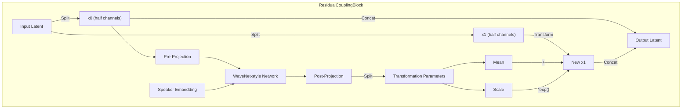

Sources: [models.py:403-446](), [modules.py:403-457]()

## Duration Prediction

Bert-VITS2 implements two duration prediction approaches: a deterministic predictor and a stochastic predictor.

### DurationPredictor

The `DurationPredictor` is a conventional feed-forward network that predicts log durations deterministically.

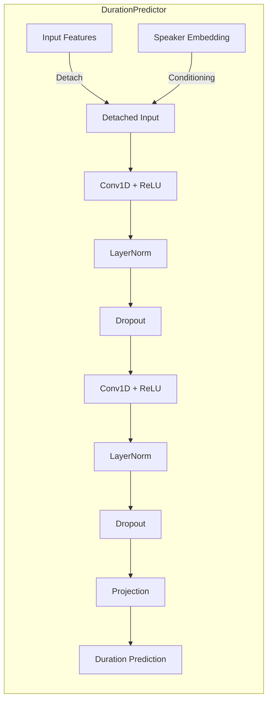

Sources: [models.py:259-299]()

### StochasticDurationPredictor

The `StochasticDurationPredictor` employs a flow-based approach to model the distribution of durations, allowing for sampling diverse duration patterns.

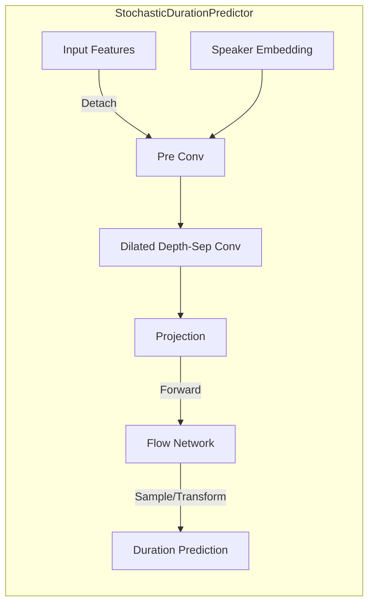

During inference, the stochastic predictor can generate varied durations, which contributes to more natural-sounding speech synthesis.

Sources: [models.py:148-256](), [modules.py:84-130]()

## Generator and Audio Synthesis

The `Generator` converts the transformed latent representations into waveforms through a series of upsampling and residual blocks.

```mermaid
flowchart LR
    subgraph "Generator"
        Input["Latent Input"] --> PreConv["Pre Conv"]
        SpeakerEmb["Speaker Embedding"] --> |"Conditioning"| PreConv
        
        PreConv --> UpsampleBlocks["Upsampling Blocks"]
        UpsampleBlocks --> ResBlocks["Residual Blocks"]
        ResBlocks --> PostConv["Post Conv"]
        PostConv --> Tanh["Tanh Activation"]
        Tanh --> Output["Audio Output"]
    end
```

The generator uses a hierarchical structure with multiple upsampling stages, each followed by residual blocks with different dilation rates. This architecture enables the model to capture patterns at various temporal resolutions.

Sources: [models.py:490-565]()

## Discriminator Components

During training, multiple discriminators provide feedback to improve the quality of generated audio.

### MultiPeriodDiscriminator

The `MultiPeriodDiscriminator` combines several sub-discriminators operating at different temporal periods, helping the model generate coherent structure at multiple timescales.

```mermaid
flowchart TD
    subgraph "MultiPeriodDiscriminator"
        RealAudio["Real Audio"] --> DSc["DiscriminatorS"]
        RealAudio --> DP2["DiscriminatorP (p=2)"]
        RealAudio --> DP3["DiscriminatorP (p=3)"]
        RealAudio --> DP5["DiscriminatorP (p=5)"]
        RealAudio --> DP7["DiscriminatorP (p=7)"]
        RealAudio --> DP11["DiscriminatorP (p=11)"]
        
        GenAudio["Generated Audio"] --> DScG["DiscriminatorS"]
        GenAudio --> DP2G["DiscriminatorP (p=2)"]
        GenAudio --> DP3G["DiscriminatorP (p=3)"]
        GenAudio --> DP5G["DiscriminatorP (p=5)"]
        GenAudio --> DP7G["DiscriminatorP (p=7)"]
        GenAudio --> DP11G["DiscriminatorP (p=11)"]
        
        DSc & DScG & DP2 & DP2G & DP3 & DP3G & DP5 & DP5G & DP7 & DP7G & DP11 & DP11G --> Features["Adversarial Features"]
    end
```

Sources: [models.py:676-700]()

### DurationDiscriminator

The `DurationDiscriminator` specifically evaluates the quality of predicted durations, helping the model generate more natural rhythm and timing.

```mermaid
flowchart LR
    subgraph "DurationDiscriminator"
        Input["Text Features"] --> |"Detach"| Conv1["Conv1D + ReLU"]
        SpeakerEmb["Speaker Embedding"] --> |"Conditioning"| Input
        
        Conv1 --> Norm1["LayerNorm"]
        Norm1 --> Conv2["Conv1D + ReLU"]
        Conv2 --> Norm2["LayerNorm"]
        
        DurProj["Duration Projection"] --> |"Concat with Features"| BidirLSTM["Bidirectional LSTM"]
        
        Norm2 --> BidirLSTM
        BidirLSTM --> OutputLayer["Output Layer (Sigmoid)"]
        OutputLayer --> Probability["Discrimination Probability"]
    end
```

Sources: [models.py:18-79]()

### WavLMDiscriminator

The `WavLMDiscriminator` incorporates a pre-trained WavLM model to provide perceptual feedback on the naturalness of generated speech.

```mermaid
flowchart LR
    subgraph "WavLMDiscriminator"
        WavLMFeatures["WavLM Features"] --> PreProj["Pre-Projection"]
        PreProj --> Conv1["Conv1D + LeakyReLU"]
        Conv1 --> Conv2["Conv1D + LeakyReLU"]
        Conv2 --> Conv3["Conv1D + LeakyReLU"]
        Conv3 --> PostProj["Post-Projection"]
        PostProj --> Output["Discrimination Score"]
    end
```

Sources: [models.py:703-749](), [configs/config.json:948-954]()

## Inference Process

During inference, the `SynthesizerTrn.infer()` method is used to generate speech from text inputs. The process follows these steps:

1. Text encoding with BERT embeddings
2. Duration prediction (using a mixture of deterministic and stochastic predictions)
3. Alignment of text and audio representations
4. Flow-based transformation (in reverse direction)
5. Waveform generation

```mermaid
flowchart TD
    subgraph "Inference Pipeline"
        Text["Text Input"] --> TextEncoder["Text Encoder"]
        Tone["Tone Information"] --> TextEncoder
        Lang["Language Information"] --> TextEncoder
        BertEmb["BERT Embeddings"] --> TextEncoder
        Speaker["Speaker ID"] --> SpeakerEmb["Speaker Embedding"]
        
        SpeakerEmb --> TextEncoder
        TextEncoder --> |"Text Features"| DurPredict["Duration Prediction"]
        DurPredict --> |"Durations"| Alignment["Path Generation (Alignment)"]
        
        TextEncoder --> |"Text Features"| Alignment
        Alignment --> |"Aligned Features"| Flow["Flow Network (Reverse)"]
        SpeakerEmb --> Flow
        
        Flow --> |"Transformed Features"| Generator["Generator"]
        SpeakerEmb --> Generator
        Generator --> Audio["Generated Audio"]
    end
```

The noise scales and duration scaling parameters can be adjusted during inference to control the variability and speed of the generated speech.

Sources: [models.py:1026-1074](), [hiyoriUI.py:197-348]()

## Model Configuration

The model configuration specifies the architecture parameters, including dimensions, layer counts, and module choices.

Key configuration parameters:

| Parameter | Description | Default Value |
|-----------|-------------|---------------|
| inter_channels | Intermediate channel dimensions | 192 |
| hidden_channels | Hidden representation dimensions | 192 |
| filter_channels | Filter dimensions for attention | 768 |
| n_heads | Number of attention heads | 2 |
| n_layers | Number of transformer layers | 6 |
| kernel_size | Convolution kernel size | 3 |
| p_dropout | Dropout probability | 0.1 |
| gin_channels | Speaker embedding dimensions | 512 |
| n_speakers | Number of speakers supported | 850+ |
| use_spk_conditioned_encoder | Whether to condition encoder on speaker | true |
| use_noise_scaled_mas | Whether to use noise-scaled MAS | true |

Sources: [configs/config.json:895-954]()

## Integration with BERT Models

A key feature of Bert-VITS2 is the integration of BERT embeddings to improve text understanding. The `TextEncoder` incorporates these embeddings through projection layers:

```mermaid
flowchart TD
    subgraph "BERT Integration"
        ZhText["Chinese Text"] --> ZhBERT["Chinese BERT"]
        JpText["Japanese Text"] --> JpBERT["Japanese BERT"]
        EnText["English Text"] --> EnBERT["English BERT"]
        
        ZhBERT --> |"1024D Features"| BertProj["bert_proj (Conv1D)"]
        JpBERT --> |"1024D Features"| JaBertProj["ja_bert_proj (Conv1D)"]
        EnBERT --> |"1024D Features"| EnBertProj["en_bert_proj (Conv1D)"]
        
        BertProj & JaBertProj & EnBertProj --> |"hidden_channels"| TextEncoder["Text Encoder Combined Embeddings"]
    end
```

During preprocessing, BERT features are extracted for each text sample and stored for training and inference.

Sources: [models.py:356-364](), [models.py:377-390](), [preprocess_text.py:1-141]()

## End-to-End Architecture

The complete Bert-VITS2 architecture connects all components in an end-to-end pipeline, from text input to audio output.

```mermaid
flowchart TD
    subgraph "Bert-VITS2 Architecture"
        Text["Text Input"] --> PreProc["Text Preprocessing"]
        PreProc --> |"Tokens, Tones, Language"| TextEnc["Text Encoder"]
        
        BertProc["BERT Processing"] --> |"BERT Features"| TextEnc
        Speaker["Speaker ID"] --> SpeakerEmb["Speaker Embedding"]
        SpeakerEmb --> TextEnc
        
        TextEnc --> |"Text Features (m, logs)"| Prior["Prior Distribution"]
        
        Audio["Audio (Training)"]--> SpecGen["Spectrogram Generation"]
        SpecGen --> PosteriorEnc["Posterior Encoder"]
        PosteriorEnc --> |"Audio Features (m, logs)"| Posterior["Posterior Distribution"]
        SpeakerEmb --> PosteriorEnc
        
        Posterior --> |"z"| KLDiv["KL Divergence Loss"]
        Prior --> KLDiv
        
        Posterior --> |"z"| Flow["Flow Network"]
        SpeakerEmb --> Flow
        Flow --> |"z_p"| Alignment["Alignment (MAS)"]
        
        TextEnc --> |"Text Features"| DurPred["Duration Predictors"]
        SpeakerEmb --> DurPred
        DurPred --> |"Duration"| DurLoss["Duration Loss"]
        Alignment --> |"Reference Duration"| DurLoss
        
        Alignment --> |"Expanded Text Features"| SampledFeatures["Sampled Features"]
        SampledFeatures --> Generator["Generator"]
        SpeakerEmb --> Generator
        Generator --> GenAudio["Generated Audio"]
        
        GenAudio --> Discriminators["Discriminators"]
        Audio --> Discriminators
        Discriminators --> AdvLoss["Adversarial Loss"]
    end
```

This integrated system combines the power of pre-trained language models (BERT) with advanced speech synthesis techniques to produce high-quality, expressive speech in multiple languages.

Sources: [models.py:811-1074](), [spec_gen.py:1-88]()

---

# Page: Attention Mechanisms

# Attention Mechanisms

<details>
<summary>Relevant source files</summary>

The following files were used as context for generating this wiki page:

- [attentions.py](attentions.py)
- [commons.py](commons.py)
- [mel_processing.py](mel_processing.py)
- [resample.py](resample.py)

</details>


This document provides a detailed explanation of the attention mechanisms implemented in Bert-VITS2. Attention mechanisms are fundamental components that enable the model to focus on relevant parts of input sequences when generating output features. For information about the overall model architecture, see [Core Model Architecture](#2).

## Overview of Attention in Bert-VITS2

Bert-VITS2 employs various attention mechanisms to effectively process sequential data in both text encoding and audio generation phases. These mechanisms allow the model to dynamically focus on different parts of the input sequence based on context, significantly improving the quality and naturalness of synthesized speech.

Sources: [attentions.py:209-407]()

## Attention Mechanism Architecture

```mermaid
flowchart TD
    subgraph "MultiHeadAttention Implementation"
        input["Input Sequences"] --> convQ["conv_q\nQuery Projection"]
        input --> convK["conv_k\nKey Projection"]
        input --> convV["conv_v\nValue Projection"]
        
        convQ --> QueryHeads["Query Heads\n[batch, n_heads, seq_len, k_channels]"]
        convK --> KeyHeads["Key Heads\n[batch, n_heads, seq_len, k_channels]"]
        convV --> ValueHeads["Value Heads\n[batch, n_heads, seq_len, k_channels]"]
        
        QueryHeads --> Scores["Attention Scores\n(MatMul + Scaling)"]
        KeyHeads --> Scores
        
        Scores --> EnhancedScores{"Enhanced Scores"}
        
        WindowRel["Window-Based\nRelative Attention"] --> EnhancedScores
        ProxBias["Proximal Bias"] --> EnhancedScores
        Masking["Masking\n(Attention Mask)"] --> EnhancedScores
        
        EnhancedScores --> Softmax["Softmax\n(Attention Weights)"]
        Softmax --> WeightedValues["Weighted Values\n(MatMul)"]
        ValueHeads --> WeightedValues
        
        RelValues["Relative Value\nComputations"] --> WeightedOutput["Final Weighted Output"]
        WeightedValues --> WeightedOutput
        
        WeightedOutput --> convO["conv_o\nOutput Projection"]
        convO --> output["Output"]
    end
```

Sources: [attentions.py:209-271](), [attentions.py:273-322]()

## Key Attention Components

Bert-VITS2 implements several specialized attention mechanisms, each serving a specific purpose in the TTS pipeline:

### 1. Multi-Head Attention

The `MultiHeadAttention` class implements the core attention mechanism, dividing the attention computation into multiple heads to capture different aspects of the input sequence relationships.

```mermaid
graph TD
    subgraph "MultiHeadAttention Class"
        direction LR
        MHA["MultiHeadAttention"] --> Query["Query (Q)\nconv_q"]
        MHA --> Key["Key (K)\nconv_k"]
        MHA --> Value["Value (V)\nconv_v"]
        
        Query & Key & Value --> Attention["attention() Method"]
        
        Attention --> OutputProj["Output Projection\nconv_o"]
        OutputProj --> Output["Final Output"]
    end
```

Key properties:
- **Channels**: Input dimensionality 
- **Out Channels**: Output dimensionality
- **N Heads**: Number of attention heads
- **K Channels**: Dimensionality per head (channels / n_heads)

Sources: [attentions.py:209-271]()

### 2. Attention Computation

The core attention computation follows the standard scaled dot-product attention formula but adds several enhancements:

1. **Query, Key, Value Projections**: Linear projections implemented as 1D convolutions
2. **Scaled Dot-Product**: `scores = (Q * K^T) / sqrt(k_channels)`
3. **Optional Enhancements**:
   - Window-based relative attention
   - Proximal bias
   - Masking for causal attention

Sources: [attentions.py:273-322]()

### 3. Window-Based Relative Attention

A significant enhancement in Bert-VITS2 is the window-based relative attention, which provides the model with awareness of relative positions within a limited window.

```mermaid
flowchart LR
    subgraph "Relative Position Processing"
        RelEmb["Relative Embeddings\nemb_rel_k, emb_rel_v"] --> GetRelEmb["_get_relative_embeddings()"]
        GetRelEmb --> RelLogits["Relative Logits\n_matmul_with_relative_keys()"]
        RelLogits --> AbsPos["Absolute Position\n_relative_position_to_absolute_position()"]
        
        AttWeights["Attention Weights"] --> RelPos["Relative Position\n_absolute_position_to_relative_position()"]
        RelPos --> MatMulRel["_matmul_with_relative_values()"]
        MatMulRel --> RelOutput["Relative Output"]
    end
```

Key features:
- Maintains relative position embeddings for both keys and values
- Uses a window size to limit the context of relative positions
- Transforms between relative and absolute position representations

Sources: [attentions.py:324-395]()

### 4. Proximal Bias

For self-attention operations, Bert-VITS2 can apply a proximal bias that encourages attention to nearby positions:

```
Bias(i, j) = -log(1 + |i - j|)
```

This bias decreases as the distance between positions increases, giving preference to local connections.

Sources: [attentions.py:397-406]()

## Integration within Encoder and Decoder

The attention mechanisms are integrated into both the `Encoder` and `Decoder` classes:

### Encoder Architecture

The `Encoder` consists of multiple layers, each containing:
1. Self-attention (`MultiHeadAttention`)
2. Layer normalization
3. Feed-forward network (`FFN`)
4. Another layer normalization

```mermaid
flowchart TB
    subgraph "Encoder Implementation"
        EncoderInput["Input + Mask"] --> Loop["For each layer (n_layers)"]
        
        subgraph "Layer Structure"
            direction TB
            SelfAttn["Self-Attention\nMultiHeadAttention"] --> Drop1["Dropout"]
            Drop1 --> Add1["Add & Norm\n(Residual + LayerNorm)"]
            Add1 --> FFN["Feed-Forward Network\nFFN"]
            FFN --> Drop2["Dropout"]
            Drop2 --> Add2["Add & Norm\n(Residual + LayerNorm)"]
        end
        
        Loop --> EncoderOutput["Encoder Output"]
        
        SpeakerEmb["Speaker Embedding\n(Conditional Layer)"] -.-> Add1
    end
```

Sources: [attentions.py:37-120]()

### Decoder Architecture

The `Decoder` has a more complex structure with three components per layer:
1. Masked self-attention (for causal prediction)
2. Cross-attention between decoder and encoder states
3. Feed-forward network

```mermaid
flowchart TB
    subgraph "Decoder Implementation"
        DecoderInput["Decoder Input + Mask"] --> Loop["For each layer (n_layers)"]
        EncoderOutput["Encoder Output + Mask"] --> Loop
        
        subgraph "Layer Structure"
            direction TB
            SelfAttn["Self-Attention\n(Masked)\nMultiHeadAttention"] --> Drop1["Dropout"]
            Drop1 --> Add1["Add & Norm\n(Residual + LayerNorm)"]
            
            Add1 --> CrossAttn["Cross-Attention\nMultiHeadAttention"]
            EncoderOutput -.-> CrossAttn
            CrossAttn --> Drop2["Dropout"]
            Drop2 --> Add2["Add & Norm\n(Residual + LayerNorm)"]
            
            Add2 --> FFN["Feed-Forward Network\nFFN (Causal)"]
            FFN --> Drop3["Dropout"]
            Drop3 --> Add3["Add & Norm\n(Residual + LayerNorm)"]
        end
        
        Loop --> DecoderOutput["Decoder Output"]
    end
```

Sources: [attentions.py:123-206]()

## Supporting Components

### 1. LayerNorm

A simple layer normalization implementation that operates on the channel dimension:

```
x = F.layer_norm(x, (channels,), gamma, beta, eps)
```

Sources: [attentions.py:12-24]()

### 2. Feed-Forward Network (FFN)

A position-wise feed-forward network consisting of two 1D convolutions with activation in between:

```
x = conv_1(padding(x * mask))
x = activation(x)
x = dropout(x)
x = conv_2(padding(x * mask))
```

The `FFN` supports both causal and non-causal padding modes.

Sources: [attentions.py:409-464]()

## Attention Mechanics in Practice

When processing text and generating speech, the attention mechanisms perform these key functions:

1. **Text Encoding**: Self-attention in the encoder captures relationships between different phonemes/tokens in the input text
2. **Duration Modeling**: Attention helps in predicting how long each phoneme should be in the output speech
3. **Alignment**: Cross-attention in the decoder aligns text representations with acoustic features
4. **Speaker Conditioning**: At a specific layer (default is the 3rd layer), speaker embeddings are injected into the encoder, allowing the attention to adapt to speaker characteristics

The relative positional attention is particularly important for capturing local phonetic context, while the proximal bias helps maintain coherent pronunciation by focusing on nearby phonetic units.

Sources: [attentions.py:37-120](), [attentions.py:123-206]()

## Technical Parameters

| Parameter | Description | Default/Typical Value |
|-----------|-------------|------------------------|
| `hidden_channels` | Dimensionality of the model | 192 |
| `filter_channels` | Dimensionality of FFN inner layer | 768 |
| `n_heads` | Number of attention heads | 2 |
| `n_layers` | Number of encoder/decoder layers | 6 |
| `kernel_size` | Size of convolutional kernels in FFN | 3 |
| `p_dropout` | Dropout probability | 0.1 |
| `window_size` | Window size for relative attention | 4 |
| `proximal_bias` | Whether to use proximal bias | `True` for decoder |
| `proximal_init` | Initialize K weights with Q weights | `True` for decoder |

Sources: [attentions.py:37-56](), [attentions.py:123-144](), [attentions.py:209-233]()

## Relationship to BERT Integration

While the attention mechanisms discussed here form the backbone of sequence processing in Bert-VITS2, they work in conjunction with BERT embeddings. The text encoder processes both phoneme representations and BERT embeddings, allowing the attention layers to leverage semantic information from BERT when generating speech features. For more details on how BERT features are generated and used, see [BERT Feature Generation](#3.2).

Sources: [attentions.py:37-120]()

---

# Page: Loss Functions

# Loss Functions

<details>
<summary>Relevant source files</summary>

The following files were used as context for generating this wiki page:

- [losses.py](losses.py)
- [text/tone_sandhi.py](text/tone_sandhi.py)
- [train_ms.py](train_ms.py)
- [utils.py](utils.py)

</details>


This page documents the loss functions used in Bert-VITS2 for training the text-to-speech synthesis model. Loss functions play a critical role in optimizing the model to generate high-quality speech that closely matches the target audio while maintaining natural pronunciation and prosody.

## Overview of Loss Functions

Bert-VITS2 uses a combination of multiple loss functions to train different components of the model. These loss functions can be categorized into several types:

1. **Generator Losses** - Train the speech synthesis network
2. **Discriminator Losses** - Train adversarial networks to distinguish real from generated audio
3. **Feature Matching Losses** - Ensure generated audio shares similar features with real audio
4. **Regularization Losses** - Constrain the model's behavior and prevent overfitting

```mermaid
flowchart TD
    subgraph "Loss Functions Architecture"
        Generator["Generator Network"] --> MelLoss["Mel Spectrogram Loss"]
        Generator --> DurLoss["Duration Loss"]
        Generator --> KLLoss["KL Divergence Loss"]
        
        RealAudio["Real Audio"] --> MPDisc["Multi-Period Discriminator"]
        GenAudio["Generated Audio"] --> MPDisc
        MPDisc --> DiscLoss["Discriminator Loss"]
        MPDisc --> FeatLoss["Feature Matching Loss"]
        
        subgraph "WavLM-based Losses"
            RealAudio --> WavLMEnc["WavLM Encoder"]
            GenAudio --> WavLMEnc
            WavLMEnc --> WavLMDisc["WavLM Discriminator"]
            WavLMDisc --> WLMDiscLoss["WavLM Discriminator Loss"]
            WavLMEnc --> WLMFeatLoss["WavLM Feature Loss"]
        end
        
        subgraph "Duration Modeling Losses"
            Generator --> DurDisc["Duration Discriminator"]
            DurDisc --> DurDiscLoss["Duration Discriminator Loss"]
        end
    end
```

Sources: [losses.py:1-154](), [train_ms.py:577-600]()

## Core Loss Functions

### Feature Matching Loss

Feature matching loss ensures that the intermediate representations from the discriminator for real and generated samples are similar, which helps stabilize training and produce higher quality results.

```python
def feature_loss(fmap_r, fmap_g):
    loss = 0
    for dr, dg in zip(fmap_r, fmap_g):
        for rl, gl in zip(dr, dg):
            rl = rl.float().detach()
            gl = gl.float()
            loss += torch.mean(torch.abs(rl - gl))
    return loss * 2
```

The feature loss is calculated as the L1 distance between feature maps of real and generated audio, summed across all layers and multiplied by 2.

Sources: [losses.py:6-14]()

### Discriminator Loss

The discriminator loss trains the discriminator network to correctly classify real audio samples as real (target=1) and generated samples as fake (target=0). It uses a mean squared error (MSE) loss.

```python
def discriminator_loss(disc_real_outputs, disc_generated_outputs):
    loss = 0
    r_losses = []
    g_losses = []
    for dr, dg in zip(disc_real_outputs, disc_generated_outputs):
        dr = dr.float()
        dg = dg.float()
        r_loss = torch.mean((1 - dr) ** 2)
        g_loss = torch.mean(dg**2)
        loss += r_loss + g_loss
        r_losses.append(r_loss.item())
        g_losses.append(g_loss.item())
    return loss, r_losses, g_losses
```

Sources: [losses.py:17-30]()

### Generator Loss

The generator loss trains the generator to produce audio that the discriminator will classify as real. It uses an adversarial loss where the generator tries to maximize the discriminator's prediction for generated samples.

```python
def generator_loss(disc_outputs):
    loss = 0
    gen_losses = []
    for dg in disc_outputs:
        dg = dg.float()
        l = torch.mean((1 - dg) ** 2)
        gen_losses.append(l)
        loss += l
    return loss, gen_losses
```

Sources: [losses.py:33-42]()

### KL Divergence Loss

KL (Kullback-Leibler) divergence loss is used for the probabilistic modeling aspects of Bert-VITS2. It regularizes the latent space distribution to be close to a prior distribution, which is important for the flow-based decoder.

```python
def kl_loss(z_p, logs_q, m_p, logs_p, z_mask):
    """
    z_p, logs_q: [b, h, t_t]
    m_p, logs_p: [b, h, t_t]
    """
    z_p = z_p.float()
    logs_q = logs_q.float()
    m_p = m_p.float()
    logs_p = logs_p.float()
    z_mask = z_mask.float()

    kl = logs_p - logs_q - 0.5
    kl += 0.5 * ((z_p - m_p) ** 2) * torch.exp(-2.0 * logs_p)
    kl = torch.sum(kl * z_mask)
    l = kl / torch.sum(z_mask)
    return l
```

Sources: [losses.py:45-60]()

## WavLM-based Losses

Bert-VITS2 incorporates WavLM, a self-supervised learning model for speech, to improve speech quality. The `WavLMLoss` class implements several loss functions based on WavLM features.

```mermaid
flowchart LR
    subgraph "WavLMLoss Components"
        RealAudio["Real Audio"] --> Resample["Resample to 16kHz"]
        GenAudio["Generated Audio"] --> Resample
        
        Resample --> WavLM["WavLM Model"]
        WavLM --> HiddenStates["Hidden States"]
        
        HiddenStates --> FeatureCompare["Feature Comparison\n(forward method)"]
        HiddenStates --> WavLMDisc["WavLM Discriminator"]
        
        WavLMDisc --> DiscLoss["Discriminator Loss\n(discriminator method)"]
        WavLMDisc --> GenLoss["Generator Loss\n(generator method)"]
    end
```

The `WavLMLoss` class has three main components:

1. **Feature Matching (forward method)** - Computes L1 loss between WavLM embeddings of real and generated audio
2. **Discriminator Loss** - Trains the WavLM discriminator to distinguish real from generated embeddings
3. **Generator Loss** - Trains the generator to produce audio with embeddings that fool the WavLM discriminator

Sources: [losses.py:63-153](), [train_ms.py:351-356](), [train_ms.py:577-600]()

## Training Process and Loss Combination

During training, all losses are carefully combined to train different components of the model. The training loop in `train_ms.py` orchestrates this process:

1. **Discriminator Training**:
   - Calculate discriminator losses for the Multi-Period Discriminator
   - If using Duration Discriminator, calculate its losses
   - Optimize discriminator parameters

2. **WavLM Discriminator Training**:
   - Calculate WavLM discriminator loss
   - Optimize WavLM discriminator parameters

3. **Generator Training**:
   - Calculate all generator losses: mel loss, duration loss, KL loss, feature matching loss, adversarial loss, and WavLM losses
   - Combine losses into a single generator loss
   - Optimize generator parameters

```mermaid
sequenceDiagram
    participant G as Generator
    participant D as Multi-Period Discriminator
    participant DD as Duration Discriminator
    participant WD as WavLM Discriminator
    
    Note over G,WD: Forward Pass
    G->>G: Generate audio from text input
    G->>D: Feed generated audio to discriminator
    G->>DD: Feed duration predictions to duration discriminator
    G->>WD: Feed generated audio to WavLM discriminator
    
    Note over G,WD: Discriminator Optimization
    D->>D: Calculate discriminator loss
    D->>D: Optimize discriminator parameters
    DD->>DD: Calculate duration discriminator loss
    DD->>DD: Optimize duration discriminator parameters
    WD->>WD: Calculate WavLM discriminator loss
    WD->>WD: Optimize WavLM discriminator parameters
    
    Note over G,WD: Generator Optimization
    G->>G: Calculate all generator losses
    G->>G: Combine losses (mel, duration, KL, feature matching, adversarial, WavLM)
    G->>G: Optimize generator parameters
```

Sources: [train_ms.py:394-734]()

## Loss Combination in the Code

The total generator loss is a combination of multiple components:

```python
loss_gen_all = (
    loss_gen     # Adversarial loss
    + loss_fm    # Feature matching loss
    + loss_mel   # Mel spectrogram L1 loss
    + loss_dur   # Duration prediction loss
    + loss_kl    # KL divergence loss
    + loss_lm    # WavLM feature matching loss
    + loss_lm_gen # WavLM generator loss
)

# Add duration discriminator loss if used
if net_dur_disc is not None:
    loss_gen_all += loss_dur_gen
```

This combined loss is then used to update the generator parameters through backpropagation.

Sources: [train_ms.py:587-599]()

## Visualization and Monitoring

During training, loss values are logged and visualized using TensorBoard. The scalar values for different loss components are logged separately to monitor their individual behavior.

```python
scalar_dict = {
    "loss/g/total": loss_gen_all,
    "loss/d/total": loss_disc_all,
    "loss/wd/total": loss_slm,
    "learning_rate": lr,
    "grad_norm_d": grad_norm_d,
    "grad_norm_g": grad_norm_g,
    "grad_norm_dur": grad_norm_dur,
    "grad_norm_wd": grad_norm_wd,
}
scalar_dict.update(
    {
        "loss/g/fm": loss_fm,
        "loss/g/mel": loss_mel,
        "loss/g/dur": loss_dur,
        "loss/g/kl": loss_kl,
        "loss/g/lm": loss_lm,
        "loss/g/lm_gen": loss_lm_gen,
    }
)
```

Monitoring these losses helps diagnose training issues and identify when the model has converged.

Sources: [train_ms.py:620-648](), [utils.py:144-160]()

## Conclusion

The loss functions in Bert-VITS2 form a complex but effective system for training the text-to-speech model. By combining multiple loss components, the model can learn to generate high-quality, natural-sounding speech that accurately reflects the input text. The adversarial training approach with multiple discriminators helps improve the naturalness of the synthesized speech, while the feature matching and regularization losses ensure stability and consistency during training.

---

# Page: Training Pipeline

# Training Pipeline

<details>
<summary>Relevant source files</summary>

The following files were used as context for generating this wiki page:

- [data_utils.py](data_utils.py)
- [text/__init__.py](text/__init__.py)
- [train_ms.py](train_ms.py)
- [utils.py](utils.py)

</details>


The Training Pipeline in Bert-VITS2 orchestrates the complete process of training the multi-lingual text-to-speech synthesis model. This document provides a comprehensive guide to the training workflow, from data loading to model optimization. For information about data processing specifics, see [Data Processing](#3.1), and for BERT feature generation, see [BERT Feature Generation](#3.2).

## Overview of the Training Pipeline

The Bert-VITS2 training pipeline combines distributed training capabilities with a sophisticated data handling system to efficiently train the TTS model across multiple languages. The pipeline manages the complexities of processing paired text-audio data, handling BERT embeddings, and optimizing multiple neural network components simultaneously.

```mermaid
flowchart TB
    subgraph "Initialization"
        config["Configuration Loading"]
        dist["Distributed Training Setup"]
        dataset["Dataset Preparation"]
        models["Model Initialization"]
    end

    subgraph "Data Flow"
        loader["TextAudioSpeakerLoader"]
        sampler["DistributedBucketSampler"]
        collate["TextAudioSpeakerCollate"]
        batch["Batched Data"]
    end

    subgraph "Training Loop"
        forward["Forward Pass"]
        loss["Loss Calculation"]
        backward["Backward Pass"]
        optimize["Optimizer Step"]
        log["Metrics Logging"]
        checkpoint["Checkpoint Saving"]
    end

    subgraph "Evaluation"
        eval_forward["Inference"]
        spectrograms["Generate Spectrograms"]
        audio["Generate Audio"]
        visualize["Visualize Results"]
    end

    config --> models
    dist --> sampler
    dataset --> loader
    loader --> sampler
    sampler --> collate
    collate --> batch
    batch --> forward
    forward --> loss
    loss --> backward
    backward --> optimize
    optimize --> log
    log --> checkpoint
    checkpoint --> eval_forward
    eval_forward --> spectrograms
    spectrograms --> audio
    audio --> visualize
    visualize --> forward
```

Sources: [train_ms.py:54-392](), [data_utils.py:16-49]()

## Model Components in Training

The training pipeline manages multiple model components that work together during the training process.

```mermaid
flowchart TB
    subgraph "Models"
        net_g["SynthesizerTrn\n(Generator)"]
        net_d["MultiPeriodDiscriminator"]
        net_dur_disc["DurationDiscriminator"]
        net_wd["WavLMDiscriminator"]
    end

    subgraph "Optimizers"
        optim_g["Generator Optimizer"]
        optim_d["Discriminator Optimizer"]
        optim_dur_disc["Duration Disc. Optimizer"]
        optim_wd["WavLM Disc. Optimizer"]
    end

    subgraph "Schedulers"
        sched_g["Generator Scheduler"]
        sched_d["Discriminator Scheduler"]
        sched_dur_disc["Duration Disc. Scheduler"]
        sched_wd["WavLM Disc. Scheduler"]
    end

    net_g --> optim_g
    net_d --> optim_d
    net_dur_disc --> optim_dur_disc
    net_wd --> optim_wd
    
    optim_g --> sched_g
    optim_d --> sched_d
    optim_dur_disc --> sched_dur_disc
    optim_wd --> sched_wd
```

Sources: [train_ms.py:194-242](), [train_ms.py:334-348]()

## Data Loading Pipeline

The data loading pipeline is responsible for preparing training data for the model, handling various preprocessing steps and ensuring efficient batch processing.

```mermaid
flowchart LR
    filelists["Training/Validation Filelists"] --> loader["TextAudioSpeakerLoader"]
    
    subgraph "TextAudioSpeakerLoader"
        filter["Text Length Filtering"]
        audio_proc["Audio Processing"]
        text_proc["Text Processing"]
        bert_load["BERT Feature Loading"]
    end
    
    loader --> sampler["DistributedBucketSampler"]
    sampler --> collate["TextAudioSpeakerCollate"]
    
    subgraph "TextAudioSpeakerCollate"
        padding["Zero-padding"]
        batch_prep["Batch Preparation"]
    end
    
    collate --> dataloader["DataLoader"]
    dataloader --> training["Training Loop"]
```

Sources: [data_utils.py:16-182](), [train_ms.py:127-146]()

### Data Structure and Processing

The Bert-VITS2 training pipeline processes text-audio pairs with speaker identities and language information. The table below shows the key components in the data processing flow:

| Component | Description | Implementation |
|-----------|-------------|----------------|
| Text Processing | Converts text to phoneme sequences and language IDs | `cleaned_text_to_sequence` in `text/__init__.py` |
| Audio Processing | Loads audio and computes spectrograms | `get_audio` in `TextAudioSpeakerLoader` |
| BERT Features | Loads pre-computed BERT embeddings for text | `get_text` in `TextAudioSpeakerLoader` |
| Padding | Zero-pads inputs to consistent lengths | `TextAudioSpeakerCollate` class |
| Bucketing | Groups samples by length for efficient batching | `DistributedBucketSampler` class |

Sources: [data_utils.py:84-172](), [text/__init__.py:6-18]()

## Training Process

The training process in Bert-VITS2 follows a GAN-like approach with multiple models being trained simultaneously.

```mermaid
sequenceDiagram
    participant Data as Data Loader
    participant G as Generator (SynthesizerTrn)
    participant D as Discriminators
    participant Opt as Optimizers
    participant Log as Logger

    Data->>G: Batch (text, audio, speaker, etc.)
    G->>G: Forward pass
    G->>D: Generated audio
    D->>D: Discriminate real/fake
    D->>Opt: Update discriminators
    G->>Opt: Update generator
    G->>Log: Log metrics & save checkpoint
    
    Note over G,D: Every eval_interval steps
    G->>G: Evaluation
    G->>Log: Save generated samples
```

Sources: [train_ms.py:394-737]()

### Forward Pass

During the forward pass, the generator takes text, spectrograms, speaker IDs, tone, language, and BERT embeddings as input and produces:

1. Synthesized audio (`y_hat`)
2. Duration predictions (`l_length`)
3. Attention weights (`attn`)
4. Latent variables (`z`, `z_p`, etc.)
5. Hidden representations (`hidden_x`, `logw`, etc.)

Sources: [train_ms.py:459-506]()

### Loss Calculation

The training objectives include multiple loss components:

| Loss Component | Description | Applied To |
|----------------|-------------|------------|
| Discriminator Loss | Adversarial loss for discriminators | Discriminators |
| Duration Discriminator Loss | Loss for duration prediction | Duration Discriminator |
| Generator Loss | Adversarial loss for generator | Generator |
| Feature Matching Loss | Loss for feature matching | Generator |
| Mel Spectrogram Loss | L1 loss between real and generated mel spectrograms | Generator |
| Duration Loss | Loss for duration prediction | Generator |
| KL Loss | KL divergence for prior matching | Generator |
| WavLM Loss | Loss based on WavLM embeddings | WavLM Discriminator |

Sources: [train_ms.py:507-599]()

### Optimization

The optimization process involves updating each model component separately:

1. Duration Discriminator update (if used)
2. Discriminator update
3. WavLM Discriminator update
4. Generator update

The pipeline uses gradient scaling with automatic mixed precision to improve training efficiency.

Sources: [train_ms.py:539-607]()

## Checkpoint Management

The training pipeline includes a comprehensive checkpoint system for saving and loading models:

```mermaid
flowchart TD
    train["Training Loop"] --> check{"Checkpoint\nInterval?"}
    check -->|Yes| save["Save Checkpoints"]
    check -->|No| continue["Continue Training"]
    
    save --> g["Save Generator\n(G_*.pth)"]
    save --> d["Save Discriminator\n(D_*.pth)"]
    save --> wd["Save WavLM Disc\n(WD_*.pth)"]
    save --> dur["Save Duration Disc\n(DUR_*.pth)"]
    
    save --> clean["Clean Old Checkpoints"]
    
    subgraph "Loading Process"
        load["Load Checkpoint"] --> state["Load State Dict"]
        state --> compat["Handle Version Compatibility"]
        compat --> resume["Resume Training"]
    end
```

Sources: [train_ms.py:695-732](), [utils.py:65-120](), [utils.py:123-141]()

### Checkpoint File Structure

Each checkpoint contains:
- Model state dictionary
- Optimizer state dictionary
- Current learning rate
- Current iteration number

The checkpoint files follow a naming convention with the global step number (e.g., `G_10000.pth` for the generator checkpoint at step 10,000).

Sources: [utils.py:123-141](), [utils.py:271-317]()

## Evaluation During Training

The training pipeline periodically evaluates the model on validation data to monitor training progress.

```mermaid
flowchart LR
    trigger["Evaluation Interval"] --> eval["Evaluation Function"]
    
    subgraph "Evaluation Process"
        input["Validation Data"] --> inference["Model Inference"]
        inference --> spec["Generate Spectrograms"]
        inference --> audio["Generate Audio"]
        spec --> visual["Visualize Results"]
        audio --> log["Log Samples"]
    end
    
    eval --> continue["Continue Training"]
```

During evaluation:
1. The generator is set to evaluation mode
2. A forward pass is performed on validation data
3. Audio samples are generated with and without stochastic duration prediction
4. Mel spectrograms are visualized
5. Audio samples are saved for auditory evaluation

Sources: [train_ms.py:742-835]()

## Distributed Training

Bert-VITS2 supports distributed training across multiple GPUs using PyTorch's DistributedDataParallel (DDP).

```mermaid
flowchart TD
    init["Initialize Process Group"] --> rank["Get Rank & World Size"]
    rank --> device["Set Local GPU Device"]
    device --> wrap["Wrap Models with DDP"]
    wrap --> dataparallel["Distributed Training"]
    
    subgraph "Data Parallel Components"
        sampler["DistributedBucketSampler"]
        models["DDP-Wrapped Models"]
        all_reduce["Gradient All-Reduce"]
    end
```

Key aspects of the distributed training implementation:
- Uses environment variables for configuration
- Automatically selects the appropriate backend (NCCL for Linux, Gloo for Windows)
- Creates a DistributedBucketSampler to handle data distribution across GPUs
- Wraps all models with DistributedDataParallel for efficient gradient synchronization

Sources: [train_ms.py:54-82](), [train_ms.py:250-258](), [data_utils.py:277-404]()

## Configuration and Hyperparameters

The training pipeline is controlled by a configuration system that loads parameters from a JSON file. Key configuration sections include:

| Section | Description | Examples |
|---------|-------------|----------|
| train | Training parameters | learning rate, batch size, segment size |
| data | Data parameters | sampling rate, hop length, filter length |
| model | Model architecture | hidden channels, kernel size, number of layers |
| env | Environment variables | MASTER_ADDR, MASTER_PORT, WORLD_SIZE |

Sources: [train_ms.py:83-116](), [utils.py:331-339]()

## Logging and Visualization

The training pipeline includes comprehensive logging and visualization features for monitoring training progress:

- Textual logging to a file using Python's logging module
- TensorBoard integration for tracking metrics over time
- Visualization of spectrograms and attention matrices
- Audio sample logging for auditory evaluation

Sources: [train_ms.py:609-693](), [utils.py:144-161](), [utils.py:170-224]()

## Training Script Execution Flow

The complete training pipeline execution follows this general flow:

```mermaid
flowchart TB
    start["Script Start"] --> run["run() Function"]
    run --> env["Set Environment Variables"]
    env --> dist["Initialize Distributed Training"]
    dist --> config["Load Configuration"]
    config --> data["Setup Data Loading"]
    data --> models["Initialize Models"]
    models --> optim["Setup Optimizers"]
    optim --> resume{"Load Checkpoints\n(if available)"}
    resume --> train["Training Loop"]
    train --> epoch["For Each Epoch"]
    epoch --> batch["For Each Batch"]
    batch --> forward["Forward Pass"]
    forward --> backward["Backward Pass"]
    backward --> update["Update Parameters"]
    update --> log{"Logging Interval?"}
    log -->|Yes| logstep["Log Metrics"]
    log -->|No| eval{"Evaluation Interval?"}
    logstep --> eval
    eval -->|Yes| evalstep["Evaluate Model"]
    eval -->|No| nextbatch["Next Batch"]
    evalstep --> save["Save Checkpoints"]
    save --> nextbatch
    nextbatch --> batch
    batch --> next_epoch["Next Epoch"]
    next_epoch --> epoch
```

Sources: [train_ms.py:54-392](), [train_ms.py:394-740]()

## Conclusion

The Bert-VITS2 training pipeline is a sophisticated system that manages the complexities of training a multi-lingual text-to-speech synthesis model. It handles data loading, model optimization, checkpoint management, evaluation, and distributed training in an integrated manner, allowing for efficient training across multiple languages.

The pipeline's modular design, with separate classes for data loading, batching, and model components, makes it flexible and extensible. The use of distributed training, automatic mixed precision, and bucketed sampling improves training efficiency, while the comprehensive logging and visualization features aid in monitoring training progress.

---

# Page: Data Processing

# Data Processing

<details>
<summary>Relevant source files</summary>

The following files were used as context for generating this wiki page:

- [compress_model.py](compress_model.py)
- [css/custom.css](css/custom.css)
- [data_utils.py](data_utils.py)
- [text/__init__.py](text/__init__.py)

</details>


This page documents how Bert-VITS2 processes and loads audio and text data for training the text-to-speech (TTS) synthesis model. It covers the entire data processing pipeline from raw text and audio files to batched training data.

For information about generating BERT features specifically, see [BERT Feature Generation](#3.2).

## Data Processing Pipeline Overview

The data processing pipeline in Bert-VITS2 transforms raw text and audio data into tensor representations suitable for model training. The pipeline handles three main types of data:

1. **Text data**: Processed into phoneme sequences with language and tone information
2. **Audio data**: Converted to spectrograms
3. **Speaker information**: Mapped to numeric IDs

```mermaid
flowchart TB
    RawData["Raw Data Files"] --> FileList["File Lists\n(train.list, val.list)"]
    
    FileList --> TextAudioLoader["TextAudioSpeakerLoader\n(data_utils.py)"]
    
    subgraph "Text Processing"
        TextAudioLoader --> TextNorm["Text Normalization"]
        TextNorm --> PhonemConv["Phoneme Conversion"]
        PhonemConv --> BertFeat["BERT Feature Loading"]
    end
    
    subgraph "Audio Processing"
        TextAudioLoader --> AudioLoad["Audio Loading"]
        AudioLoad --> AudioNorm["Audio Normalization"]
        AudioNorm --> SpectGen["Spectrogram Generation"]
    end
    
    BertFeat & SpectGen --> DataFiltering["Data Filtering\n(_filter method)"]
    
    DataFiltering --> Sampler["DistributedBucketSampler"]
    Sampler --> Collate["TextAudioSpeakerCollate"]
    
    Collate --> BatchedData["Batched Data\nfor Training"]
```

Sources: [data_utils.py:16-182]()

## Dataset Loading and Initialization

The `TextAudioSpeakerLoader` class is the primary data loading class that implements PyTorch's `Dataset` interface. It's responsible for loading and processing audio, speaker ID, and text data.

```mermaid
classDiagram
    class TextAudioSpeakerLoader {
        +audiopaths_sid_text
        +max_wav_value
        +sampling_rate
        +filter_length
        +hop_length
        +win_length
        +spk_map
        +use_mel_spec_posterior
        +__init__(audiopaths_sid_text, hparams)
        +_filter()
        +get_audio_text_speaker_pair()
        +get_audio(filename)
        +get_text(text, word2ph, phone, tone, language_str, wav_path)
        +get_sid(sid)
        +__getitem__(index)
        +__len__()
    }
```

The initialization process loads data file paths, sets up audio processing parameters, and applies filtering based on text length:

```python
# Simplified initialization flow
1. Load file lists using load_filepaths_and_text()
2. Set up audio processing parameters from hparams
3. Randomize data order with a fixed seed
4. Filter data using _filter() method
```

Sources: [data_utils.py:16-48]()

## Data Format and Filtering

Bert-VITS2 expects data in a specific format. Each entry in the file list contains:

| Field | Description |
| ----- | ----------- |
| `_id` | Path to audio file |
| `spk` | Speaker identifier |
| `language` | Language code (ZH/JP/EN) |
| `text` | Raw text content |
| `phones` | Space-separated phoneme sequences |
| `tone` | Space-separated tone information |
| `word2ph` | Word-to-phoneme alignment information |

During initialization, the `_filter` method filters data based on text length constraints and prepares data for processing:

```mermaid
flowchart TB
    DataEntries["Raw Data Entries"] --> FilterLoop["Loop Through Entries"]
    
    subgraph "Filtering Process (_filter method)"
        FilterLoop --> LengthCheck{"Length Check\nmin_text_len <= len(phones) <= max_text_len"}
        LengthCheck -->|"Yes"| Process["Process and Keep Entry"]
        LengthCheck -->|"No"| Skip["Skip Entry"]
        
        Process --> StoreLength["Store Audio Length for Bucketing"]
    end
    
    Process --> FilteredData["Filtered Data"]
    Skip --> SkippedCount["Count Skipped Entries"]
```

Sources: [data_utils.py:50-83]()

## Audio Processing

The `get_audio` method handles audio file processing, which includes:

1. Loading audio using `load_wav_to_torch`
2. Verifying sampling rate matches the target
3. Normalizing audio values
4. Generating or loading spectrograms

```mermaid
flowchart TB
    AudioFile["Audio File (.wav)"] --> LoadAudio["load_wav_to_torch()"]
    LoadAudio --> CheckSR{"Sampling Rate\nMatches Target?"}
    
    CheckSR -->|"No"| Error["Raise ValueError"]
    CheckSR -->|"Yes"| Normalize["Normalize Audio\naudio/max_wav_value"]
    
    Normalize --> CheckCache{"Cached Spectrogram\nExists?"}
    
    CheckCache -->|"Yes"| LoadSpec["Load Cached Spectrogram"]
    CheckCache -->|"No"| GenSpec["Generate Spectrogram"]
    
    GenSpec --> UsesMel{"use_mel_spec_posterior?"}
    UsesMel -->|"Yes"| MelSpec["Generate Mel Spectrogram\nmel_spectrogram_torch()"]
    UsesMel -->|"No"| LinearSpec["Generate Linear Spectrogram\nspectrogram_torch()"]
    
    MelSpec & LinearSpec --> SqueezeSpec["Remove Batch Dimension"]
    SqueezeSpec --> CacheEnabled{"spec_cache\nenabled?"}
    
    CacheEnabled -->|"Yes"| SaveSpec["Save Spectrogram to File"]
    CacheEnabled -->|"No"| SkipCache["Skip Caching"]
    
    SaveSpec & SkipCache & LoadSpec --> ReturnData["Return Spectrogram and Normalized Audio"]
```

Sources: [data_utils.py:98-138]()

## Text Processing and BERT Feature Loading

The `get_text` method processes text data and loads BERT features:

1. Converts phonemes, tones, and language information to tensor representations
2. Adds blank tokens if configured
3. Loads pre-computed BERT embeddings from disk

```python
# Key processing steps:
1. Convert phonemes, tones, and language codes to integer sequences
2. Add blank tokens if add_blank is True
3. Load BERT embeddings from .bert.pt files
4. Handle language-specific BERT features
```

The BERT feature loading uses a language-specific approach:
- For Chinese (ZH): Uses ZH BERT, with random placeholders for JP and EN
- For Japanese (JP): Uses JP BERT, with random placeholders for ZH and EN
- For English (EN): Uses EN BERT, with random placeholders for ZH and JP

Sources: [data_utils.py:140-172](), [text/__init__.py:6-30]()

## Batch Processing and Collation

The `TextAudioSpeakerCollate` class handles batch preparation:

1. Groups individual samples into batches
2. Zero-pads variable-length sequences to match the longest in the batch
3. Preserves length information for proper masking during training

```mermaid
flowchart TB
    Samples["Individual Samples"] --> SortByLength["Sort Batch by Spectrogram Length"]
    
    SortByLength --> FindMaxLengths["Find Maximum Lengths\n(text, spec, wave)"]
    
    FindMaxLengths --> AllocateTensors["Allocate Zero-Filled Tensors"]
    
    AllocateTensors --> FillTensors["Fill Tensors with Data\n(Preserving Original Lengths)"]
    
    FillTensors --> BatchedData["Return Batched Data with Length Information"]
```

The collation process handles:
- Text sequences (phonemes)
- Tone information
- Language IDs
- Spectrograms
- Waveforms
- Speaker IDs
- BERT embeddings for various languages

Sources: [data_utils.py:185-274]()

## Length-Based Bucketing for Efficient Training

The `DistributedBucketSampler` class implements a sophisticated batching strategy by:

1. Grouping samples into "buckets" based on similar lengths
2. Creating balanced batches within each bucket
3. Supporting distributed training across multiple GPUs

```mermaid
flowchart TB
    Lengths["Sample Lengths"] --> CreateBuckets["Create Buckets\n_create_buckets()"]
    
    subgraph "Bucket Creation"
        CreateBuckets --> BucketAssignment["Assign Samples to Buckets\n_bisect()"]
        BucketAssignment --> EnsureNonEmpty["Ensure Non-Empty Buckets"]
        EnsureNonEmpty --> CalculateSamples["Calculate Samples Per Bucket"]
    end
    
    subgraph "Batch Generation"
        CalculateSamples --> ShuffleBuckets["Shuffle Buckets if shuffle=True"]
        ShuffleBuckets --> PadBuckets["Pad Buckets to be Evenly Divisible"]
        PadBuckets --> DistributedSplit["Split Across GPUs\nrank/num_replicas"]
        DistributedSplit --> FormBatches["Form Batches of batch_size"]
        FormBatches --> ShuffleBatches["Shuffle Batch Order if shuffle=True"]
    end
    
    ShuffleBatches --> BatchIndices["Batch Indices for DataLoader"]
```

Key benefits of bucketing:
- Minimizes padding within batches
- Improves memory efficiency
- Increases training throughput
- Supports distributed training

Sources: [data_utils.py:277-404]()

## Complete Data Flow

The complete data flow from raw files to training batches can be summarized as:

```mermaid
flowchart TB
    RawFiles["Raw Files\n(Audio & Text)"] --> FileList["Generated File Lists"]
    
    FileList --> DatasetInit["Dataset Initialization\nTextAudioSpeakerLoader"]
    
    DatasetInit --> FilterData["Filter Data\n_filter()"]
    
    FilterData --> DataLoader["PyTorch DataLoader"]
    
    DataLoader --> Sampler["Length-Based Sampling\nDistributedBucketSampler"]
    
    Sampler --> Collate["Batch Collation\nTextAudioSpeakerCollate"]
    
    Collate --> BatchedData["Batched Training Data"]
    
    BatchedData --> Model["Training Model\nSynthesizerTrn"]
```

This pipeline efficiently prepares data for the Bert-VITS2 training process, handling the complexities of variable-length sequences and multi-language processing.

Sources: [data_utils.py](), [text/__init__.py]()

---

# Page: BERT Feature Generation

# BERT Feature Generation

<details>
<summary>Relevant source files</summary>

The following files were used as context for generating this wiki page:

- [bert/bert_models.json](bert/bert_models.json)
- [bert_gen.py](bert_gen.py)
- [text/chinese_bert.py](text/chinese_bert.py)
- [text/japanese_bert.py](text/japanese_bert.py)

</details>


## Introduction

BERT Feature Generation is a critical preprocessing step in the Bert-VITS2 pipeline that creates BERT (Bidirectional Encoder Representations from Transformers) embeddings for input text. These embeddings provide rich contextual representations of text data that significantly enhance the language understanding capabilities of the TTS system. This page documents the BERT feature generation process across multiple languages and how these features integrate into the training pipeline.

For information about the overall training pipeline, see [Training Pipeline](#3), and for text processing details, see [Multi-Language Text Processing](#4).

Sources: [bert_gen.py:1-81]()

## BERT Models Architecture

Bert-VITS2 uses different pre-trained BERT models for each supported language to generate contextually rich embeddings:

```mermaid
flowchart TD
    subgraph "BERT Models"
        A["Input Text"] --> B{"Language Detection"}
        B -->|"Chinese"| C["chinese-roberta-wwm-ext-large"]
        B -->|"Japanese"| D["deberta-v2-large-japanese-char-wwm"]
        B -->|"English"| E["deberta-v3-large"]
        
        C --> F["Chinese BERT Features"]
        D --> G["Japanese BERT Features"]
        E --> H["English BERT Features"]
        
        F & G & H --> I["Phone-level BERT Embeddings\n(2048 dimensions)"]
    end
```

The models are loaded from the `./bert/` directory, with configuration specified in the `bert_models.json` file.

Sources: [bert/bert_models.json:1-14](), [text/chinese_bert.py:7-10](), [text/japanese_bert.py:8-11]()

## BERT Feature Generation Process

The feature generation process converts text input into phone-level BERT embeddings that align with the phonetic representation used by the TTS model.

```mermaid
flowchart LR
    A["Training Data Files"] --> B["bert_gen.py"]
    B --> C{"For Each Text Line"}
    
    subgraph "process_line Function"
        C --> D["Parse text, phones,\ntone, word2ph"]
        D --> E["Convert to sequences"]
        E --> F{"Check for existing\nBERT features"}
        F -->|"Not found"| G["Call get_bert()"]
        G --> H["Save as .bert.pt file"]
        F -->|"Found"| I["Load existing\nBERT features"]
    end
    
    J["Multiprocessing Pool"] --> C
```

The BERT feature generation supports multiprocessing to speed up preprocessing of large datasets, with configurable number of processes and device selection.

Sources: [bert_gen.py:12-47](), [bert_gen.py:49-81]()

## BERT Feature Extraction

The core feature extraction process follows these steps:

1. Text is passed to the appropriate language-specific BERT model
2. Hidden states from the model's deeper layers are extracted
3. Word-level features are mapped to phone-level features using word-to-phone alignment information

```mermaid
flowchart TD
    A["get_bert() Function"] --> B["Language-specific\nget_bert_feature()"]
    
    subgraph "BERT Feature Extraction"
        B --> C["Tokenize text"]
        C --> D["Run through BERT model"]
        D --> E["Extract hidden states\nfrom layers -3:-2"]
        E --> F["Map word-level features\nto phone-level"]
        F --> G["Return phone-level features\n(Tensor of shape [2048, n_phones])"]
    end
    
    subgraph "Word-to-Phone Mapping"
        H["Word-level features"] --> I["Repeat each word feature\naccording to word2ph"]
        I --> J["Concatenate all repeated\nfeatures"]
    end
```

The `word2ph` array specifies how many phones each word corresponds to, allowing the system to align word-level BERT features with phone-level representations needed by the model.

Sources: [text/chinese_bert.py:15-60](), [text/japanese_bert.py:16-65]()

## Language-Specific Processing

### Chinese BERT Processing

For Chinese text, the system uses the `chinese-roberta-wwm-ext-large` model, which is a RoBERTa model pre-trained on Chinese text with whole word masking.

Key aspects of Chinese BERT processing:
- Uses a character-level tokenizer appropriate for Chinese text
- Extracts features from the third-to-last layer of the model
- Maps word-level features to phone-level using the `word2ph` alignment information

Sources: [text/chinese_bert.py:1-61]()

### Japanese BERT Processing

Japanese text processing uses the `deberta-v2-large-japanese-char-wwm` model and includes an additional step to convert text to separated katakana.

```mermaid
flowchart TD
    A["Japanese Text Input"] --> B["text2sep_kata()\nConvert to separated katakana"]
    B --> C["Tokenize with DeBERTa tokenizer"]
    C --> D["Process through DeBERTa model"]
    D --> E["Extract hidden states"]
    E --> F["Map to phone-level using word2ph"]
```

The Japanese processing pipeline ensures proper handling of Japanese-specific characters and phonetic structure.

Sources: [text/japanese_bert.py:1-65]()

## Style Transfer Feature

Both Chinese and Japanese BERT processing modules include a style transfer capability that allows blending features from a style reference text with the content text.

Key components of style transfer:
- Optional `style_text` parameter allows specifying a reference style text
- `style_weight` (default 0.7) controls the blend ratio between content and style
- Style features are extracted using the same BERT model
- The mean of style features is computed and mixed with content features

This enables controlling the speaking style by injecting characteristics from a reference text.

Sources: [text/chinese_bert.py:15-53](), [text/japanese_bert.py:16-58]()

## Device Management and Optimization

The BERT feature generation system includes smart device management for optimal performance:

| Feature | Description |
|---------|-------------|
| Device Configuration | Configurable via `config.bert_gen_config.device` |
| Multi-Device Support | Option to distribute processing across available GPUs |
| MPS Support | Automatic detection of Apple Silicon MPS availability |
| Model Caching | BERT models are loaded once per device and cached in a dictionary |
| Parallel Processing | Multiprocessing pool for batch generation of features |

The implementation automatically handles the appropriate device selection based on available hardware and configuration.

Sources: [bert_gen.py:14-22](), [text/chinese_bert.py:22-31](), [text/japanese_bert.py:26-35]()

## Integration with Training Pipeline

BERT features are generated during preprocessing and then seamlessly integrated into the training pipeline:

```mermaid
flowchart LR
    subgraph "Preprocessing"
        A["Raw Text"] --> B["Text Preprocessing"]
        B --> C["BERT Feature Generation"]
        C --> D[".bert.pt files"]
    end
    
    subgraph "Training"
        D --> E["DataLoader"]
        E --> F["SynthesizerTrn\nText Encoder"]
        F --> G["Training Loop"]
    end
```

During training, the pre-computed BERT features are loaded directly from the `.bert.pt` files, which improves training efficiency by avoiding redundant computation of the same features in each epoch.

Sources: [bert_gen.py:38-46]()

## Command-Line Usage

The BERT feature generation can be run as a standalone preprocessing step using the `bert_gen.py` script:

```bash
python bert_gen.py -c path/to/config.json --num_processes 4
```

Configuration options:
- `-c, --config`: Path to the model configuration file
- `--num_processes`: Number of parallel processes to use (default from config)

The script processes all text in both training and validation files, generating and saving BERT features for each line.

Sources: [bert_gen.py:51-81]()

---

# Page: Multi-Language Text Processing

# Multi-Language Text Processing

<details>
<summary>Relevant source files</summary>

The following files were used as context for generating this wiki page:

- [bert/bert-base-japanese-v3/README.md](bert/bert-base-japanese-v3/README.md)
- [bert/bert-base-japanese-v3/config.json](bert/bert-base-japanese-v3/config.json)
- [bert/bert-base-japanese-v3/vocab.txt](bert/bert-base-japanese-v3/vocab.txt)
- [bert/bert-large-japanese-v2/tokenizer_config.json](bert/bert-large-japanese-v2/tokenizer_config.json)
- [text/bert_utils.py](text/bert_utils.py)
- [text/cleaner.py](text/cleaner.py)
- [text/english_bert_mock.py](text/english_bert_mock.py)
- [text/symbols.py](text/symbols.py)
- [tools/classify_language.py](tools/classify_language.py)
- [tools/sentence.py](tools/sentence.py)

</details>


## Purpose and Scope

This document explains the multi-language text processing pipeline within Bert-VITS2, a text-to-speech synthesis system that supports multiple languages. It covers the language detection, text normalization, phoneme conversion, and BERT feature extraction processes that occur before audio synthesis.

For details on BERT feature generation, see [BERT Feature Generation](#3.2). For language-specific text processing implementations, see the related pages for [Chinese Text Processing](#4.1), [Japanese Text Processing](#4.2), and [English Text Processing](#4.3).

## Overview of Multi-Language Support

Bert-VITS2 supports multiple languages through a modular architecture that handles language detection, text normalization, phoneme conversion, and BERT feature extraction in a language-specific manner. The system currently supports Chinese (ZH), Japanese (JP), and English (EN) as the primary languages.

### Multi-Language Processing Architecture

```mermaid
flowchart TB
    InputText["Input Text"] --> LanguageDetection["Language Detection\nclassify_language()"]
    LanguageDetection --> SingleLang["Single Language Track"]
    LanguageDetection --> MixedLang["Mixed Language Track"]
    
    SingleLang --> LanguageNorm["Language-Specific Normalization\ntext_normalize()"]
    MixedLang --> LanguageMarkup["Language Markup\nmarkup_language()"]
    LanguageMarkup --> SegmentProcessing["Process Individual Language Segments"]
    
    LanguageNorm --> Phonemes["Phoneme Conversion\ng2p()"]
    SegmentProcessing --> Phonemes
    
    Phonemes --> BertFeatures["BERT Feature Extraction\nget_bert_feature()"]
    
    BertFeatures --> PhonemeAlignment["Phoneme-BERT Alignment\nvia word2ph"]
    
    PhonemeAlignment --> OutputFeatures["Processed Text Features"]
    
    subgraph "Language Module Selection"
        LanguageModuleMap["language_module_map\nZH → chinese\nJP → japanese\nEN → english"]
    end
    
    LanguageNorm -.-> LanguageModuleMap
    Phonemes -.-> LanguageModuleMap
    BertFeatures -.-> LanguageModuleMap
```

Sources: [text/cleaner.py](), [tools/sentence.py](), [tools/classify_language.py]()

## Language Detection and Classification

The system uses language detection libraries to determine the language of input text. This detection enables proper text processing and feature extraction for each language.

### Language Detection System

```mermaid
flowchart LR
    subgraph "Language Identification Libraries"
        direction TB
        LangId["langid\nDefault option"]
        FastLid["fastlid/fasttext\nAlternative option"]
    end
    
    InputText["Input Text"] --> ConfigCheck["Check language_identification_library\nin config"]
    ConfigCheck --> LangLibrary["Select Language Library"]
    LangLibrary --> LangId
    LangLibrary --> FastLid
    
    LangId --> FilterLanguages["Filter Target Languages"]
    FastLid --> FilterLanguages
    FilterLanguages --> Classifier["Classify Text\nclassify_language()"]
    
    Classifier --> OutputLang["Detected Language\n(zh, ja, en, etc.)"]
    
    subgraph "Special Case: Chinese vs Japanese"
        ZhJaInput["Chinese/Japanese Text"] --> UnicodeCheck["Check Unicode Ranges\nclassify_zh_ja()"]
        UnicodeCheck --> JapaneseChars["Check for Japanese-specific characters\n0x3040-0x309F, 0x30A0-0x30FF"]
        JapaneseChars --> LangOutput["Output 'ja' or 'zh'"]
    end
```

Sources: [tools/classify_language.py]()

### Language Support Table

The system defines language-specific symbols and mappings:

| Language | Code | ID | Symbols Count | Tones | Example Symbols |
|----------|------|----|--------------|----|-----------------|
| Chinese  | ZH   | 0  | 72           | 6  | a, ai, an, ang, ao, b, c, ch... |
| Japanese | JP   | 1  | 57           | 2  | N, a, a:, b, by, ch, d, dy... |
| English  | EN   | 2  | 42           | 4  | aa, ae, ah, ao, aw, ay, b, ch... |

Sources: [text/symbols.py]()

## Text Segmentation and Mixed Language Processing

For mixed-language text, the system segments the input into language-specific chunks and processes each separately.

### Mixed Language Processing Workflow

```mermaid
flowchart TB
    InputText["Mixed Language Text"] --> PatternSplit["Split by Punctuation\nre.split(pattern, text)"]
    PatternSplit --> CheckTargetLangs["Check Target Languages"]
    
    CheckTargetLangs --> AlphaSegmentation{"Is target [en, zh] or [en, ja]\nor [en, ja, zh]?"}
    AlphaSegmentation -->|Yes| SplitAlphaNonAlpha["Split Alpha/Non-Alpha\nsplit_alpha_nonalpha()"]
    AlphaSegmentation -->|No| SkipSplit["Use Original Segments"]
    
    SplitAlphaNonAlpha --> ProcessSegments["Process Each Segment"]
    SkipSplit --> ProcessSegments
    
    ProcessSegments --> DetectLanguage["Detect Language\nclassify_language()"]
    DetectLanguage --> AddMarkup["Add Language Markup\n[ZH], [JP], [EN]"]
    
    AddMarkup --> OutputMarkupText["Marked-up Text\nwith Language Tags"]
    
    subgraph "Example"
        ExInput["Input: 'Hello, 你好, こんにちは'"]
        ExSplit["Split: ['Hello', '你好', 'こんにちは']"]
        ExDetect["Detect: ['en', 'zh', 'ja']"]
        ExMarkup["Output: '[EN]Hello[EN][ZH]你好[ZH][JP]こんにちは[JP]'"]
        
        ExInput --> ExSplit --> ExDetect --> ExMarkup
    end
```

Sources: [tools/sentence.py](), [tools/classify_language.py]()

## Text Cleaning and Normalization Process

The system uses a modular approach for text cleaning, with separate modules for each supported language.

### Text Cleaning Pipeline

```mermaid
flowchart TB
    InputText["Input Text"] --> LanguageSelection["Select Language Module\nlanguage_module_map"]
    
    LanguageSelection -->|"ZH"| ChineseModule["chinese module"]
    LanguageSelection -->|"JP"| JapaneseModule["japanese module"]
    LanguageSelection -->|"EN"| EnglishModule["english module"]
    
    ChineseModule --> ChineseNorm["Chinese Normalization\ntext_normalize()"]
    JapaneseModule --> JapaneseNorm["Japanese Normalization\ntext_normalize()"]
    EnglishModule --> EnglishNorm["English Normalization\ntext_normalize()"]
    
    ChineseNorm --> ChineseG2P["Chinese G2P\ng2p()"]
    JapaneseNorm --> JapaneseG2P["Japanese G2P\ng2p()"]
    EnglishNorm --> EnglishG2P["English G2P\ng2p()"]
    
    ChineseG2P --> OutputPhoneTone["Phones, Tones, Word2ph"]
    JapaneseG2P --> OutputPhoneTone
    EnglishG2P --> OutputPhoneTone
    
    subgraph "BERT Feature Extraction (Optional)"
        OutputPhoneTone --> BertExtraction["Get BERT Features\nget_bert_feature()"]
        BertExtraction --> OutputBert["BERT Features"]
    end
```

Sources: [text/cleaner.py]()

## BERT Feature Integration

The system extracts BERT features for each language using language-specific BERT models. These features enhance the prosody and naturalness of generated speech.

### BERT Feature Extraction System

```mermaid
flowchart TB
    InputText["Normalized Text"] --> LanguageModule["Language Module"]
    LanguageModule --> BertFeature["get_bert_feature()"]
    
    subgraph "BERT Models by Language"
        ZhBert["Chinese BERT Model"]
        JpBert["Japanese BERT Model\nbert-base-japanese-v3"]
        EnBert["English BERT Model\ndeberta-v3-large"]
    end
    
    BertFeature -->|"ZH"| ZhBert
    BertFeature -->|"JP"| JpBert
    BertFeature -->|"EN"| EnBert
    
    ZhBert --> BertEmbeddings["BERT Embeddings"]
    JpBert --> BertEmbeddings
    EnBert --> BertEmbeddings
    
    Word2ph["word2ph Mapping"] --> PhonemeAlignment["Phoneme-level Alignment"]
    BertEmbeddings --> PhonemeAlignment
    
    PhonemeAlignment --> RepeatFeatures["Repeat Word Embeddings\nfor Each Phoneme"]
    RepeatFeatures --> OutputFeatures["Phone-level BERT Features"]
```

Sources: [text/cleaner.py](), [text/english_bert_mock.py](), [bert/bert-base-japanese-v3/README.md]()

## Symbol System and Phoneme Representation

The system uses a unified set of phoneme symbols across all supported languages, while maintaining language-specific subsets.

### Symbol System Architecture

```mermaid
flowchart TB
    subgraph "Language-Specific Symbols"
        ZhSymbols["zh_symbols\n72 phonemes"]
        JaSymbols["ja_symbols\n57 phonemes"]
        EnSymbols["en_symbols\n42 phonemes"]
    end
    
    ZhSymbols --> CombineSymbols["normal_symbols\n(sorted unique set)"]
    JaSymbols --> CombineSymbols
    EnSymbols --> CombineSymbols
    
    CombineSymbols --> AddSpecial["Add Special Symbols\n(pad, punctuation, etc.)"]
    AddSpecial --> FinalSymbols["symbols\nFull Symbol Set"]
    
    subgraph "Tone System"
        ZhTones["num_zh_tones: 6"]
        JaTones["num_ja_tones: 2"]
        EnTones["num_en_tones: 4"]
        
        ZhTones --> CombineTones["num_tones\nTotal: 12"]
        JaTones --> CombineTones
        EnTones --> CombineTones
    end
    
    subgraph "Language ID System"
        LangMap["language_id_map\nZH: 0, JP: 1, EN: 2"]
        ToneStartMap["language_tone_start_map\nZH: 0, JP: 6, EN: 8"]
    end
```

Sources: [text/symbols.py]()

## Language Processing Workflow

The following diagram illustrates the complete workflow from raw text input to processed features ready for the TTS model:

```mermaid
flowchart TB
    subgraph "Input Processing"
        InputText["Raw Text Input"] --> InputMode{"Processing Mode"}
        InputMode -->|"Single Language"| SpecifyLang["Specify Language\n(ZH, JP, EN)"]
        InputMode -->|"Auto Detect"| DetectLanguage["Detect Language\nclassify_language()"]
        InputMode -->|"Mixed Language"| MarkupLanguage["Markup with Language Tags\nmarkup_language()"]
    end
    
    SpecifyLang --> CleanText["clean_text()\ntext_cleaner.py"]
    DetectLanguage --> CleanText
    MarkupLanguage --> SplitByLanguage["Split by Language\nsplit_by_language()"]
    SplitByLanguage --> ProcessEachSegment["Process Each Segment"]
    ProcessEachSegment --> CleanText
    
    CleanText --> NormalizedText["Normalized Text"]
    CleanText --> Phonemes["Phoneme Sequence"]
    CleanText --> Tones["Tone Sequence"]
    CleanText --> Word2ph["Word-to-Phoneme Mapping"]
    
    NormalizedText --> BertFeatureExtraction["BERT Feature Extraction\nclean_text_bert()"]
    Word2ph --> BertFeatureExtraction
    
    Phonemes --> TextToSequence["text_to_sequence()\nConvert to IDs"]
    Tones --> TextToSequence
    
    BertFeatureExtraction --> PhoneBertFeature["Phone-level BERT Features"]
    TextToSequence --> PhoneIDs["Phone ID Sequence"]
    
    PhoneBertFeature --> FinalOutput["Processed Features for TTS Model"]
    PhoneIDs --> FinalOutput
```

Sources: [text/cleaner.py](), [tools/sentence.py](), [tools/classify_language.py]()

## Conclusion

The multi-language text processing system in Bert-VITS2 provides a flexible framework for handling text in different languages. By using language-specific processing modules and BERT models, it accurately converts text into phonetic and linguistic features that can be used by the TTS model to generate natural-sounding speech in multiple languages. The system handles both single-language input and mixed-language text, making it versatile for various use cases.

---

# Page: Chinese Text Processing

# Chinese Text Processing

<details>
<summary>Relevant source files</summary>

The following files were used as context for generating this wiki page:

- [.gitignore](.gitignore)
- [LICENSE](LICENSE)
- [losses.py](losses.py)
- [requirements.txt](requirements.txt)
- [text/chinese.py](text/chinese.py)
- [text/tone_sandhi.py](text/tone_sandhi.py)

</details>


## Purpose and Scope

This document details the Chinese text processing component within Bert-VITS2, explaining how Chinese text is normalized, segmented, converted to phonemes, and prepared for synthesis. This processing is critical for generating natural-sounding Chinese speech with correct pronunciation and intonation. For information about text processing for other languages, see [Japanese Text Processing](#4.2) or [English Text Processing](#4.3).

## Overview

Chinese text processing in Bert-VITS2 involves several key steps: text normalization, word segmentation, grapheme-to-phoneme (G2P) conversion, tone sandhi application, and BERT feature extraction. The system handles nuances specific to Chinese phonology such as tone changes in connected speech and proper phonetic representation.

```mermaid
flowchart TD
    A["Raw Chinese Text"] --> B["Text Normalization"]
    B --> C["Word Segmentation"]
    C --> D["G2P Conversion"]
    D --> E["Tone Sandhi Processing"]
    E --> F["Phoneme Sequence"]
    
    B1["Original Text"] --> G["BERT Feature Extraction"]
    F --> H["Final Representation"]
    G --> H
    
    style B fill:#f9f9f9
    style C fill:#f9f9f9
    style D fill:#f9f9f9
    style E fill:#f9f9f9
    style G fill:#f9f9f9
```

Sources: [text/chinese.py:1-82](), [text/chinese.py:180-192]()

## Text Normalization

Text normalization converts raw Chinese text into a standardized format suitable for further processing. This includes:

1. Converting Chinese numbers to their spoken form
2. Standardizing punctuation marks
3. Removing unwanted characters

The system uses either:
- `WeTextProcessing` library's normalizer (preferred method when available)
- `cn2an` as a fallback option for number conversion

```python
# Punctuation standardization mapping
rep_map = {
    "：": ",",
    "；": ",",
    "，": ",",
    "。": ".",
    # More mappings...
}
```

The `text_normalize` function applies these transformations sequentially:

```mermaid
flowchart LR
    A["Raw Text"] --> B["Number Normalization\n(normalizer)"]
    B --> C["Punctuation Replacement\n(replace_punctuation)"]
    C --> D["Normalized Text"]
```

Sources: [text/chinese.py:9-62](), [text/chinese.py:67-77](), [text/chinese.py:182-185]()

## Grapheme-to-Phoneme Conversion

The G2P conversion transforms Chinese characters into phonetic representations using pinyin (the romanization system for Mandarin Chinese) and further maps these to phoneme symbols that the TTS model can process.

### Process Flow

```mermaid
flowchart TD
    A["Chinese Text"] --> B["Text Segmentation\n(jieba)"]
    B --> C["Initial-Final Extraction\n(pypinyin)"]
    C --> D["Tone Sandhi Application"]
    D --> E["Pinyin to Phoneme Mapping"]
    E --> F["Final Phoneme Sequence"]
    
    subgraph "Detailed Conversion"
        C1["Extract Initials\n(consonants)"]
        C2["Extract Finals with Tones\n(vowels + tone)"]
        D1["Apply Tone Modification Rules"]
        E1["Map to OpenCPOP Symbol Set"]
    end
    
    C --> C1
    C --> C2
    C1 --> D1
    C2 --> D1
    D1 --> E1
```

Sources: [text/chinese.py:80-89](), [text/chinese.py:92-179]()

### Key Components

1. **Sentence Splitting**: Divides text into sentences at punctuation marks
2. **Word Segmentation**: Uses `jieba` for word segmentation with POS tagging
3. **Initial-Final Extraction**: 
   - Extracts initials (consonants) and finals (vowels with tones) using `pypinyin`
   - Handles special cases like neutral tones
4. **Phoneme Mapping**: Maps pinyin to phoneme symbols using the `opencpop-strict.txt` mapping file

Phoneme conversion results in three key outputs:
- `phones`: The sequence of phoneme symbols
- `tones`: The tone for each phoneme (0-5)
- `word2ph`: Mapping from words to phoneme counts (for alignment)

Sources: [text/chinese.py:92-179]()

## Tone Sandhi Processing

Tone sandhi refers to the phenomenon where tones change based on adjacent tones. This is particularly important in Chinese, where the meaning of words can change depending on tone.

### ToneSandhi Class

The `ToneSandhi` class in `tone_sandhi.py` handles tone modifications according to linguistic rules. The system implements several key sandhi rules:

```mermaid
flowchart TD
    A["Word with Tones"] --> B{"Apply Rules"}
    
    B -->|"'不' Rule"| C["bu4 → bu2 before Tone 4"]
    B -->|"'一' Rule"| D["yi1 → yi2 before Tone 4\nyi1 → yi4 before other tones"]
    B -->|"Third Tone Rule"| E["Two consecutive 3rd tones\nFirst becomes 2nd tone"]
    B -->|"Neutral Tone Rule"| F["Words ending with\nparticles become neutral"]
    
    C --> G["Modified Tones"]
    D --> G
    E --> G
    F --> G
```

The system addresses several complex cases:
- **Third Tone Sandhi**: When two third-tone syllables occur in sequence, the first changes to a second tone
- **"不" (bu) Sandhi**: "不" changes from fourth tone to second tone when followed by another fourth tone
- **"一" (yi) Sandhi**: "一" changes tone based on the following syllable
- **Neutral Tone Words**: Certain grammatical particles and word endings become neutral tone (tone 5)

Sources: [text/tone_sandhi.py:22-776]()

### Tone Sandhi Application

The tone sandhi rules are applied during the G2P conversion process:

1. Word segmentation results are pre-merged to handle special cases
2. Tones are modified according to the rules
3. The modified tones are integrated into the final phoneme sequence

Sources: [text/chinese.py:63-65](), [text/chinese.py:100-122](), [text/tone_sandhi.py:759-776]()

## BERT Feature Extraction

Chinese BERT features are extracted to provide additional contextual information to the synthesis model, which helps in generating more natural prosody and intonation.

```mermaid
flowchart LR
    A["Chinese Text"] --> B["BERT Model"]
    C["word2ph Mapping"] --> D["Feature Alignment"]
    B --> E["BERT Embeddings"]
    D --> F["Aligned BERT Features"]
    E --> F
    F --> G["Final Features for TTS Model"]
```

The `get_bert_feature` function handles this process, taking the normalized text and the word-to-phoneme mapping as input, and returning BERT features aligned with the phoneme sequence.

Sources: [text/chinese.py:188-191]()

## Integration with Bert-VITS2

The Chinese text processing pipeline integrates with the rest of the Bert-VITS2 system as follows:

```mermaid
flowchart TD
    A["User Input Text"] --> B{"Language Detection"}
    B -->|"Chinese"| C["Chinese Processing Pipeline"]
    B -->|"Other"| D["Other Language Processing"]
    
    C --> E["text_normalize()"]
    E --> F["g2p()"]
    F --> G["get_bert_feature()"]
    
    G --> H["Bert-VITS2 Model"]
    H --> I["Speech Synthesis"]
    
    subgraph "Code Entities"
        E1["text_normalize\ntext/chinese.py"]
        F1["g2p\ntext/chinese.py"]
        G1["get_bert_feature\ntext/chinese.py"]
    end
    
    E --- E1
    F --- F1
    G --- G1
```

The complete pipeline for Chinese text processing is encapsulated in `text/chinese.py` and can be divided into these main functions:

1. `text_normalize`: Normalizes the raw Chinese text
2. `g2p`: Converts Chinese characters to phonemes with tone information
3. `get_bert_feature`: Extracts BERT features for the text

During inference or training, these functions are called in sequence to process Chinese text for the Bert-VITS2 model.

Sources: [text/chinese.py:1-204]()

## Chinese-Specific Challenges and Solutions

### Word Segmentation and Ambiguity

Chinese lacks explicit word boundaries, making word segmentation crucial. The system uses `jieba` for word segmentation, with special handling for cases that might affect pronunciation:

| Challenge | Example | Solution |
|-----------|---------|----------|
| Merging "不" with following word | "不要" → ("不","要") → "不要" | `_merge_bu` function |
| Merging "一" in reduplication patterns | "看一看" → ("看","一","看") → "看一看" | `_merge_yi` function |
| Handling continuous third tones | "很好听" → ("很好", "听") | `_merge_continuous_three_tones` functions |

Sources: [text/tone_sandhi.py:619-739]()

### Special Word Lists

The system maintains two special word lists for tone sandhi processing:

1. **Words that must have neutral endings**: Words where the final syllable should always be neutral tone
2. **Words that must not have neutral endings**: Words where the final syllable should never be neutral tone 

These lists cover hundreds of common words in Chinese to ensure correct pronunciation.

Sources: [text/tone_sandhi.py:24-445]()

## Performance and Limitations

### Performance Considerations

- Chinese processing is more computationally intensive than other languages due to tone sandhi rules
- BERT feature extraction adds significant processing time
- The system includes fallback mechanisms for when certain libraries are unavailable

### Known Limitations

- Rare or specialized terms may have incorrect segmentation or pronunciation
- The system focuses on Mandarin Chinese and may not handle other Chinese dialects correctly
- Some tone sandhi rules are simplified approximations of complex linguistic phenomena

## Conclusion

The Chinese text processing pipeline in Bert-VITS2 handles the unique challenges of Chinese text-to-speech synthesis through a comprehensive approach to normalization, phoneme conversion, and tone processing. By incorporating linguistic knowledge about tone sandhi and leveraging BERT for contextual understanding, the system produces natural-sounding Chinese speech with correct pronunciation and intonation.

Sources: [text/chinese.py:1-204](), [text/tone_sandhi.py:1-776]()

---

# Page: Japanese Text Processing

# Japanese Text Processing

<details>
<summary>Relevant source files</summary>

The following files were used as context for generating this wiki page:

- [text/chinese_bert.py](text/chinese_bert.py)
- [text/japanese.py](text/japanese.py)
- [text/japanese_bert.py](text/japanese_bert.py)

</details>


## Purpose and Scope

This document details the Japanese text processing components within Bert-VITS2, focusing on the conversion of Japanese text into phonetic representations suitable for the text-to-speech synthesis pipeline. This includes text normalization, grapheme-to-phoneme (G2P) conversion, accent handling, and BERT feature extraction specific to Japanese. For information about text processing in other languages, see [Chinese Text Processing](#4.1) or [English Text Processing](#4.3).

## Overview

The Japanese text processing pipeline transforms raw Japanese text input into phoneme sequences with appropriate accent information, which are then converted to BERT embeddings for use in the speech synthesis model.

```mermaid
flowchart TD
    A["Japanese Text Input"] --> B["Text Normalization\n(text_normalize)"]
    B --> C["Text to Katakana\n(text2sep_kata)"]
    C --> D["Katakana to Phoneme\n(kata2phoneme)"]
    D --> E["Accent Extraction\n(get_accent)"]
    C --> F["BERT Tokenization"]
    
    subgraph "Phoneme Processing"
        D --> G["Handle Long Vowels\n(handle_long)"]
        G --> H["Align Tones\n(align_tones)"]
        H --> I["Word-to-Phoneme Mapping\n(distribute_phone)"]
    end
    
    F --> J["BERT Feature Extraction\n(get_bert_feature)"]
    I --> K["Final Phoneme Sequence"]
    H --> K
    
    K --> L["SynthesizerTrn Model Input"]
    J --> L
```

Sources: [text/japanese.py:679-706](), [text/japanese_bert.py:16-65]()

## Text Normalization

Japanese text normalization includes several key steps before phonetic conversion:

1. **Unicode Normalization**: Converts all characters to NFKC form, ensuring consistent character representation
2. **Number to Word Conversion**: Transforms numeric expressions into their Japanese word equivalents
3. **Punctuation Replacement**: Maps various punctuation marks to a standardized form
4. **Character Filtering**: Removes unsupported characters

```python
# Example normalized text transformation:
# Input: "hello,こんにちは、世界ー！……"
# Output after normalization: "こんにちは,世界ー!"
```

The text normalization process uses regular expressions to identify and convert patterns like numbers with separators, currency symbols, and alphabetic characters to their Japanese equivalents.

Sources: [text/japanese.py:604-610](), [text/japanese.py:515-523](), [text/japanese.py:588-601]()

## Grapheme-to-Phoneme Conversion

### Text to Katakana

The first step in phoneme conversion uses pyOpenJTalk to parse Japanese text and extract the pronunciation information (in katakana) and word boundaries:

```mermaid
flowchart LR
    A["Japanese Text"] --> B["pyOpenJTalk\nFrontend Processor"]
    B --> C["Word Segmentation"]
    B --> D["Pronunciation Extraction\n(Katakana)"]
    B --> E["Accent Information"]
    
    C --> F["Separated Words"]
    D --> G["Katakana Pronunciation"]
    E --> H["Accent Sequence"]
    
    F & G & H --> I["text2sep_kata Output"]
```

Sources: [text/japanese.py:383-413]()

### Katakana to Phoneme

The system uses a comprehensive mapping system to convert katakana characters to their phonetic representation:

1. The `hiragana_map` dictionary contains mappings for various hiragana character combinations
2. Katakana is first converted to hiragana using `jaconv.kata2hira`
3. The hiragana is then converted to phonemes using the mapping

Special cases include:
- Long vowel marks ("ー")
- Geminate consonants ("っ"/"ッ")
- Special symbol tokens

Sources: [text/japanese.py:17-311](), [text/japanese.py:314-348](), [text/japanese.py:351-373]()

### Long Vowel Handling

The system handles Japanese long vowels (marked with "ー") by extending the previous vowel:

```python
# Example transformations:
# "カー" → "k a a"
# "トーキョー" → "t o o ky o o"
```

Sources: [text/japanese.py:622-630]()

## Accent and Tone Processing

### Accent Extraction

Accent information is extracted from the pyOpenJTalk output using the label format:

```mermaid
flowchart LR
    A["Label from pyOpenJTalk"] --> B["Extract Phoneme"]
    A --> C["Extract A1 Value"]
    A --> D["Extract A2 Value"]
    A --> E["Extract Next A2 Value"]
    
    B & C & D & E --> F["Determine Accent Pattern"]
    F --> G["Falling Tone (-1)"] 
    F --> H["Rising Tone (1)"]
    F --> I["Flat Tone (0)"]
```

The system detects three accent patterns:
- Falling tone: When A1=0 and the next A2 = current A2 + 1
- Rising tone: When A2=1 and the next A2=2
- Flat tone: Otherwise

Sources: [text/japanese.py:416-441]()

### Tone Alignment

The tone information is aligned with the phoneme sequence to create the final tone pattern for each phoneme in the utterance:

1. For each phoneme group, match phonemes with their corresponding accent values
2. Convert relative accent positions to absolute pitch patterns
3. Ensure all tones are within the valid range (0-1)

Sources: [text/japanese.py:636-655]()

## BERT Feature Extraction

The Japanese BERT feature extraction uses a DeBERTa-v2-large model specifically pre-trained for Japanese:

```mermaid
flowchart TB
    A["Japanese Text"] --> B["Text2sep_kata\n(Extract Word Boundaries)"]
    B --> C["BERT Tokenizer"]
    C --> D["DeBERTa-v2-large-japanese\nHidden States"]
    
    E["Word-to-Phoneme Mapping"] --> F["Feature Repetition"]
    D --> F
    
    subgraph "Optional Style Transfer"
        G["Style Text"] --> H["Style BERT Features"]
        H --> I["Style Mean Vector"]
        I --> J["Weighted Style Mixing"]
        F --> J
    end
    
    F --> K["Final Phone-level Features"]
    J --> K
```

Key features:
- Uses pre-trained DeBERTa-v2-large-japanese-char-wwm model
- Extracts hidden states from the third-from-last layer
- Maps word-level features to phone-level by repeating features according to word-to-phoneme alignment
- Supports optional style transfer by mixing with style text embeddings

Sources: [text/japanese_bert.py:1-65]()

## Main Processing Function (g2p)

The primary function that orchestrates Japanese text processing is `g2p`, which:

1. Normalizes input text
2. Converts text to separated words and katakana
3. Tokenizes words for BERT processing
4. Converts katakana to phonemes
5. Handles long vowels
6. Aligns tones with phonemes
7. Creates word-to-phoneme mapping

The function returns:
- Phoneme sequence (including boundary tokens)
- Tone sequence
- Word-to-phoneme mapping (for BERT feature alignment)

```python
# Example output:
# phones: ["_", "k", "o", "N", "n", "i", "ch", "i", "w", "a", "_"]
# tones: [0, 0, 0, 0, 1, 1, 1, 0, 0, 0, 0]
# word2ph: [1, 5, 5, 1]
```

Sources: [text/japanese.py:678-706]()

## Integration with Multi-Language System

The Japanese text processing module integrates with the broader multi-language architecture of Bert-VITS2:

```mermaid
flowchart LR
    A["Input Text"] --> B{"Language Detection"}
    B -->|"Japanese"| C["Japanese Processing\n(text/japanese.py)"]
    B -->|"Chinese"| D["Chinese Processing"]
    B -->|"English"| E["English Processing"]
    
    C --> F["Japanese BERT\n(japanese_bert.py)"]
    D --> G["Chinese BERT"]
    E --> H["English BERT"]
    
    F & G & H --> I["BERT Features"]
    
    C --> J["Japanese Phonemes"]
    D --> K["Chinese Phonemes"]
    E --> L["English Phonemes"]
    
    J & K & L --> M["Unified Phoneme Representation"]
    
    I & M --> N["Common TTS Pipeline"]
```

When processing Japanese text:
1. The language detection system routes Japanese text to the appropriate processing module
2. The Japanese-specific `g2p` function handles the text-to-phoneme conversion
3. `japanese_bert.py` extracts BERT features using the Japanese pre-trained model
4. The resulting phonemes and BERT features are passed to the common TTS pipeline

Sources: [text/japanese.py:678-706](), [text/japanese_bert.py:16-65]()

## Special Character Handling

### Alphanumeric and Symbol Conversion

Japanese text often contains alphanumeric characters and symbols. The system converts these to their Japanese pronunciation using a predefined mapping:

| Character | Japanese Pronunciation |
|-----------|------------------------|
| a-z       | エー, ビー, シー, etc.   |
| #         | シャープ                |
| %         | パーセント              |
| Greek letters | アルファ, ベータ, etc. |

Sources: [text/japanese.py:444-506]()

### Punctuation Normalization

The system normalizes various Japanese and standard punctuation marks to a common set:

| Original | Normalized |
|----------|------------|
| 。       | .          |
| 、       | ,          |
| ！       | !          |
| ？       | ?          |
| …        | ...        |
| "        | '          |

This normalization ensures consistent handling of punctuation across different text inputs.

Sources: [text/japanese.py:548-585]()

## Performance Considerations

When working with Japanese text processing:

1. **Memory Usage**: The DeBERTa-v2 model requires significant memory (>1GB)
2. **Initialization Time**: First-time loading of the BERT model can take several seconds
3. **Processing Speed**: Complex sentences with mixed scripts may require additional processing time

The system employs several optimizations:
- Caching BERT models per device
- Efficient phoneme distribution algorithms
- Vectorized tone alignment

Sources: [text/japanese_bert.py:14-35](), [text/japanese.py:613-619]()

---

# Page: English Text Processing

# English Text Processing

<details>
<summary>Relevant source files</summary>

The following files were used as context for generating this wiki page:

- [oldVersion/V200/text/english.py](oldVersion/V200/text/english.py)
- [oldVersion/V210/emo_gen.py](oldVersion/V210/emo_gen.py)
- [oldVersion/V210/text/english.py](oldVersion/V210/text/english.py)
- [oldVersion/V220/text/english.py](oldVersion/V220/text/english.py)
- [onnx_modules/V200/text/english.py](onnx_modules/V200/text/english.py)
- [text/bert_utils.py](text/bert_utils.py)
- [text/cleaner.py](text/cleaner.py)
- [text/english.py](text/english.py)
- [text/english_bert_mock.py](text/english_bert_mock.py)

</details>


This document describes the English text processing system in Bert-VITS2, which transforms raw English text into phonemes and extracts BERT features for high-quality speech synthesis. For information on other language processing systems, see [Chinese Text Processing](#4.1) and [Japanese Text Processing](#4.2).

## Overview

The English text processing pipeline transforms raw English text input into phoneme sequences with associated tone information and generates corresponding BERT embeddings. This process forms a critical foundation for natural-sounding English speech synthesis.

```mermaid
flowchart LR
    Text["Raw English Text"] --> TextNorm["text_normalize()"]
    TextNorm --> G2P["g2p()"]
    G2P --> PhoneTone["Phonemes & Tones"]
    G2P --> WordPhAlignment["Word-to-Phoneme\nAlignment"]
    Text --> BERT["get_bert_feature()"]
    WordPhAlignment --> BERT
    BERT --> BERTFeatures["BERT Features"]
    
    PhoneTone & BERTFeatures --> SynthModel["Speech Synthesis\nModel"]
```

Sources: [text/english.py:421-476](), [text/english.py:479-482](), [text/cleaner.py:7-19]()

## Components and Flow

### 1. Text Normalization

Raw English text undergoes normalization through the `text_normalize()` function which:

- Converts numbers to their written form (e.g., "123" → "one hundred twenty three")
- Expands abbreviations 
- Standardizes punctuation
- Ensures proper spacing around punctuation

```mermaid
flowchart TD
    Input["English Input"] --> NumberNorm["normalize_numbers()"]
    NumberNorm --> PunctReplace["replace_punctuation()"]
    PunctReplace --> SpaceAdjust["Add Spaces\nAround Punctuation"]
    SpaceAdjust --> NormalizedText["Normalized Text"]
    
    subgraph "Number Normalization"
        Numbers["Numbers"] --> |"_remove_commas()"| NoCommas["Remove Commas"]
        Numbers --> |"_expand_ordinal()"| Ordinals["Expand Ordinals\n(1st→first)"]
        Numbers --> |"_expand_decimal_point()"| Decimals["Decimals\n(1.5→one point five)"]
        Numbers --> |"_expand_dollars()"| Currency["Currency\n($5→five dollars)"]
        Numbers --> |"_expand_number()"| Words["Convert to Words"]
    end
```

Sources: [text/english.py:234-376]()

### 2. Grapheme-to-Phoneme (G2P) Conversion

The `g2p()` function converts normalized text to phoneme sequences:

1. Splits text into words and punctuation
2. For each word:
   - Looks up in CMU Dictionary if available
   - Falls back to G2P-en library for words not in dictionary
3. Processes phonemes and assigns appropriate tone values
4. Creates alignment between words and phonemes

```mermaid
flowchart TD
    Text["Normalized Text"] --> TextToWords["text_to_words()"]
    TextToWords --> WordsLoop["Process Each Word"]
    
    WordsLoop --> CheckDict{"In CMU\nDictionary?"}
    CheckDict -->|"Yes"| UseCMU["Use CMU Dict\nPronunciation"]
    CheckDict -->|"No"| UseG2P["Use g2p_en\nLibrary"]
    
    UseCMU --> RefinePhones["refine_syllables()"]
    UseG2P --> ProcessPhones["Process Each Phone"]
    ProcessPhones --> RefineTones["refine_ph()"]
    
    RefinePhones & RefineTones --> PhoneProcessing["Post-process\nPhonemes"]
    PhoneProcessing --> AlignPhones["distribute_phone()"]
    AlignPhones --> FinalOutput["Phonemes, Tones,\nWord2ph Alignment"]
```

Sources: [text/english.py:214-232](), [text/english.py:376-476]()

#### CMU Dictionary Integration

Bert-VITS2 integrates the CMU Pronouncing Dictionary for English words, caching it for quick lookup:

| Component | Description |
|-----------|-------------|
| Dictionary Path | `./text/cmudict.rep` |
| Cache Path | `./text/cmudict_cache.pickle` |
| Dictionary Format | Word → Syllable groups → Phonemes |
| Phoneme Format | ARPA format with tone numbers |

Sources: [text/english.py:111-213]()

### 3. Phoneme and Tone Processing

Each phoneme undergoes processing to:

1. Normalize phoneme representation to lowercase
2. Extract tone information (stress patterns from ARPA format)
3. Map to symbols that the model recognizes
4. Add boundary tokens (`_`) at beginning and end of sequence

Example of tone extraction:
```
"AH0" → phoneme: "ah", tone: 1
"IY1" → phoneme: "iy", tone: 2
```

Sources: [text/english.py:214-232]()

### 4. Word-to-Phoneme Alignment

The `distribute_phone()` function aligns phonemes with words, creating a mapping needed for BERT feature extraction:

```mermaid
flowchart LR
    subgraph "Word Tokenization Example"
        direction TB
        Word["'Hello'"] --> T1["'H'"]
        Word --> T2["'ello'"]
    end
    
    subgraph "Phoneme Sequence"
        direction TB
        P1["'h'"]
        P2["'eh'"]
        P3["'l'"]
        P4["'ow'"]
    end
    
    subgraph "distribute_phone()"
        direction TB
        Count["4 phonemes"] --> Dist["2 tokens"]
        Dist --> Map["[2, 2]"]
    end
    
    Word -.-> Count
    Map -.-> Result["Each token gets\nassigned phonemes"]
```

Sources: [text/english.py:376-386]()

### 5. BERT Feature Extraction

The `get_bert_feature()` function extracts contextualized embeddings using DeBERTa-v3-large:

1. Tokenizes text with DeBERTa tokenizer
2. Processes through the DeBERTa model to obtain hidden states
3. Uses the word-to-phoneme mapping to expand BERT features to phoneme level
4. Optionally blends with style embeddings from a reference text

```mermaid
flowchart TD
    Text["English Text"] --> Tokenize["DeBERTa\nTokenizer"]
    Word2ph["Word2ph Mapping"] --> RepeatFeatures["Repeat Features\nfor Each Phoneme"]
    
    Tokenize --> Model["DeBERTa-v3-large\nModel"]
    Model --> HiddenStates["Hidden States\nLayers -3:-2"]
    HiddenStates --> WordFeatures["Word-level\nFeatures"]
    
    WordFeatures --> RepeatFeatures
    RepeatFeatures --> PhonemeFeatures["Phoneme-level\nBERT Features"]
    
    StyleText["Optional\nStyle Text"] -.-> StyleModel["DeBERTa Model"]
    StyleModel -.-> StyleFeatures["Style Features"]
    StyleFeatures -.-> Blend["Feature Blending"]
    PhonemeFeatures -.-> Blend
    Blend -.-> BlendedFeatures["Style-Influenced\nBERT Features"]
```

Sources: [text/english_bert_mock.py:9-61]()

## Special Text Handling

### Number Normalization

The English processing module includes specialized functions for converting various number formats:

| Function | Purpose | Example |
|----------|---------|---------|
| `_expand_ordinal()` | Convert ordinal numbers | "1st" → "first" |
| `_expand_number()` | Convert cardinal numbers | "42" → "forty two" |
| `_expand_decimal_point()` | Convert decimal numbers | "3.14" → "three point one four" |
| `_expand_dollars()` | Convert currency | "$5.25" → "five dollars, twenty five cents" |

Sources: [text/english.py:308-367]()

### Punctuation Handling

Punctuation is standardized using a replacement map, which ensures consistency in the phoneme sequence:

```python
# Example punctuation replacements
"：" → ","
"。" → "."
"！" → "!"
"？" → "?"
```

Sources: [text/english.py:116-154]()

## Integration with Text Processing Pipeline

The English text processing module is integrated into Bert-VITS2's multi-language system through the `cleaner.py` interface:

```mermaid
flowchart LR
    Text["Input Text"] --> LanguageID["Language\nIdentification"]
    LanguageID --> |"EN"| TextNorm["english.text_normalize()"]
    LanguageID --> |"ZH"| ZHProc["chinese.text_normalize()"]
    LanguageID --> |"JP"| JPProc["japanese.text_normalize()"]
    
    TextNorm --> G2P["english.g2p()"]
    G2P --> Phonemes["Phonemes & Tones"]
    
    Text --> BERTProc["clean_text_bert()"]
    BERTProc --> BERTFeatures["BERT Features"]
    
    Phonemes & BERTFeatures --> TTS["Text-to-Speech\nSynthesis"]
```

Sources: [text/cleaner.py:1-26]()

## BERT Model Integration

The English text processing module uses DeBERTa-v3-large for feature extraction:

| Component | Description |
|-----------|-------------|
| Model Path | `./bert/deberta-v3-large` |
| Tokenizer | `DebertaV2Tokenizer` |
| Feature Extraction | Hidden states from layers -3:-2 |
| Device Handling | Supports CPU, CUDA, and MPS (for Mac) |

Sources: [text/english_bert_mock.py:9-61](), [text/english.py:13-15]()

## Conclusion

The English text processing system in Bert-VITS2 provides a comprehensive pipeline for converting English text to phoneme sequences with appropriate tone information and contextualized BERT features. This foundation enables high-quality and expressive English speech synthesis.

---

# Page: Inference and Deployment

# Inference and Deployment

<details>
<summary>Relevant source files</summary>

The following files were used as context for generating this wiki page:

- [for_deploy/infer.py](for_deploy/infer.py)
- [infer.py](infer.py)
- [oldVersion/V210/__init__.py](oldVersion/V210/__init__.py)
- [oldVersion/V210/text/tone_sandhi.py](oldVersion/V210/text/tone_sandhi.py)
- [oldVersion/V220/__init__.py](oldVersion/V220/__init__.py)
- [oldVersion/V220/text/tone_sandhi.py](oldVersion/V220/text/tone_sandhi.py)
- [slm/wavlm-base-plus/.gitattributes](slm/wavlm-base-plus/.gitattributes)
- [slm/wavlm-base-plus/README.md](slm/wavlm-base-plus/README.md)
- [webui.py](webui.py)

</details>


This document provides a detailed guide on how to perform inference with trained Bert-VITS2 models and deploy them for production use. It covers the inference pipeline architecture, model loading process, version compatibility, and various deployment options. For information about training the models, see [Training Pipeline](#3).

## 1. Inference Architecture

The inference pipeline in Bert-VITS2 transforms input text into synthesized speech through several processing stages. The core pipeline handles multi-language support, speaker management, and various customization parameters.

### Inference Pipeline Overview

```mermaid
flowchart LR
    subgraph "Input Processing"
        Text["Input Text"] --> TextProcessing["Text Processing"]
        TextProcessing --> Phonemes["Phoneme Conversion"]
        TextProcessing --> Tones["Tone Extraction"]
        TextProcessing --> LangIDs["Language ID Assignment"]
        Phonemes & Tones & LangIDs --> BertFeatures["BERT Feature Extraction"]
    end

    subgraph "Model Inference"
        BertFeatures --> ModelInput["Model Input Preparation"]
        SpeakerID["Speaker ID"] --> SpeakerEmb["Speaker Embedding"]
        EmotionRef["Emotion/Reference"] --> EmotionEmb["Emotion Embedding"]
        ModelInput & SpeakerEmb & EmotionEmb --> NetG["SynthesizerTrn Model"]
        NetG --> AudioOut["Raw Audio Output"]
    end

    subgraph "Post-Processing"
        AudioOut --> Normalization["Audio Normalization"]
        Normalization --> FinalAudio["Final Audio"]
    end
```

Sources: [infer.py:151-332](), [webui.py:44-88]()

### Multi-Language Inference Process

The system supports inferring text that contains multiple languages, automatically handling the appropriate processing for each language segment.

```mermaid
flowchart TD
    Input["Input Text"] --> LangDetect{"Language \nDetection"}
    
    LangDetect -->|"Single Language"| SingleProc["Single Language Processing"]
    LangDetect -->|"Mix Format"| MixProc["Mixed Language Processing"]
    LangDetect -->|"Auto Detect"| AutoProc["Auto Language Detection"]
    
    SingleProc --> GetText["get_text() Function"]
    MixProc --> TextSplit["Split Text by Language"]
    TextSplit --> GetTextMulti["Multiple get_text() Calls"]
    AutoProc --> LangSplit["split_by_language()"]
    LangSplit --> GetTextMulti
    
    GetText --> BertEmb["BERT Embeddings"]
    GetTextMulti --> BertEmb
    
    BertEmb --> Infer["Model Inference"]
    Infer --> Audio["Generated Audio"]
```

Sources: [infer.py:335-437](), [webui.py:225-316]()

## 2. Model Loading and Version Compatibility

Bert-VITS2 includes a sophisticated version compatibility system that enables models trained with different versions to be used with the current codebase.

```mermaid
flowchart TD
    ModelPath["Model Path"] --> LoadModel["Load Model\nget_net_g()"]
    Config["Config.json"] --> LoadModel
    
    LoadModel --> VersionCheck{"Check Version"}
    
    VersionCheck -->|"Latest Version"| CurrentModel["Current Model\nSynthesizerTrn"]
    VersionCheck -->|"Older Version"| VersionMap["Version Mapping\nSynthesizerTrnMap"]
    
    VersionMap --> V220["V220SynthesizerTrn"]
    VersionMap --> V210["V210SynthesizerTrn"]
    VersionMap --> V200["V200SynthesizerTrn"]
    VersionMap --> V111["V111SynthesizerTrn"]
    VersionMap --> V110["V110SynthesizerTrn"]
    VersionMap --> V101["V101SynthesizerTrn"]
    
    V220 & V210 & V200 & V111 & V110 & V101 --> LoadCheckpoint["Load Checkpoint\nutils.load_checkpoint()"]
    CurrentModel --> LoadCheckpoint
    
    LoadCheckpoint --> ModelReady["Model Ready for Inference"]
```

Sources: [infer.py:84-104](), [infer.py:39-55]()

During inference, the system selects the appropriate inference function based on the model version:

```mermaid
flowchart TD
    TextInput["Text Input"] --> InferFunction["infer() Function"]
    ModelVersion["Model Version"] --> InferFunction
    
    InferFunction --> VersionCheck{"Check Version"}
    
    VersionCheck -->|"2.3 (Latest)"| CurrentInfer["Current Version Inference"]
    VersionCheck -->|"2.2"| V220Infer["V220.infer()"]
    VersionCheck -->|"2.1"| V210Infer["V210.infer()"]
    VersionCheck -->|"2.0.x"| V200Infer["V200.infer()"]
    VersionCheck -->|"1.1.x"| V11xInfer["V11x.infer()"]
    VersionCheck -->|"1.0.x"| V10xInfer["V10x.infer()"]
    
    CurrentInfer & V220Infer & V210Infer & V200Infer & V11xInfer & V10xInfer --> AudioOutput["Audio Output"]
```

Sources: [infer.py:151-259](), [infer.py:170-193]()

## 3. Text Processing for Inference

When converting text to speech, Bert-VITS2 processes the input through multiple stages to prepare it for the model:

```mermaid
flowchart LR
    Text["Input Text"] --> CleanText["Clean Text\nclean_text()"]
    CleanText --> Sequence["Text to Sequence\ncleaned_text_to_sequence()"]
    
    Sequence --> Phone["Phoneme Sequence"]
    Sequence --> Tone["Tone Sequence"]
    Sequence --> Lang["Language ID Sequence"]
    
    Phone & Tone & Lang --> AddBlank["Add Blank Tokens\ncommons.intersperse()"]
    
    AddBlank --> GetBert["Get BERT Features\nget_bert()"]
    
    GetBert --> BertFeatures["BERT Features"]
    AddBlank --> Tensors["Convert to Tensors"]
    
    BertFeatures & Tensors --> ModelInput["Model Input"]
```

Sources: [infer.py:107-148]()

## 4. Deployment Options

Bert-VITS2 provides multiple deployment options to suit different use cases.

### Web UI

The Web UI offers an interactive interface for text-to-speech synthesis with various customization options:

```mermaid
flowchart TD
    WebUI["webui.py\nGradio Interface"] --> TextInput["Text Input Area"]
    WebUI --> SpeakerSelection["Speaker Selection"]
    WebUI --> Parameters["Parameter Controls\n(SDP, Noise, Length)"]
    WebUI --> LanguageSelection["Language Selection"]
    WebUI --> PromptMode["Prompt Mode\n(Text/Audio)"]
    
    TextInput & SpeakerSelection & Parameters & LanguageSelection & PromptMode --> GenerateButton["Generate Audio Button"]
    
    GenerateButton --> TTS["tts_fn() Function"]
    TTS --> ProcessText["process_text() Function"]
    ProcessText --> GenerateAudio["generate_audio() Function"]
    GenerateAudio --> Infer["infer() Function"]
    
    Infer --> AudioOutput["Audio Output"]
    AudioOutput --> Display["Display in Web UI"]
```

Sources: [webui.py:403-569](), [webui.py:319-356]()

### Language Handling in Web UI

The Web UI supports several language modes:

1. **Single Language Mode**: Process text in a single language (ZH, JP, EN)
2. **Mix Mode**: Process text with explicit language tags
3. **Auto Mode**: Automatically detect languages in text

```mermaid
flowchart TD
    Text["Text Input"] --> Language{"Language\nSelection"}
    
    Language -->|"ZH/JP/EN"| SingleLang["Single Language Processing"]
    Language -->|"mix"| MixLang["Mixed Language Format\n[speaker]<lang>text"]
    Language -->|"auto"| AutoLang["Auto Language Detection"]
    
    SingleLang --> GenerateAudio["generate_audio()"]
    MixLang --> ProcessMix["process_mix()"]
    ProcessMix --> GenerateAudioMultilang["generate_audio_multilang()"]
    AutoLang --> ProcessAuto["process_auto()"]
    ProcessAuto --> GenerateAudioMultilang
    
    GenerateAudio & GenerateAudioMultilang --> FinalAudio["Final Audio"]
```

Sources: [webui.py:206-242](), [webui.py:245-316]()

### API Server

For programmatic access, Bert-VITS2 includes a FastAPI server for integration with other applications.

## 5. Inference Parameters

Bert-VITS2 provides several parameters to customize the generated speech:

| Parameter | Description | Default Value | Range |
|-----------|-------------|---------------|-------|
| SDP Ratio | Controls stochastic duration predictor influence | 0.5 | 0.0-1.0 |
| Noise Scale | Controls variation in the output | 0.6 | 0.1-2.0 |
| Noise Scale W | Controls variation in the phoneme duration | 0.9 | 0.1-2.0 |
| Length Scale | Controls the speed of speech | 1.0 | 0.1-2.0 |

Sources: [webui.py:443-454](), [infer.py:151-173]()

### Text Style and Emotion Control

Bert-VITS2 supports two methods for controlling the speaking style and emotion:

1. **Text Prompt**: Using text descriptions to guide the speaking style
2. **Audio Prompt**: Using a reference audio to guide the speaking style

```mermaid
flowchart TD
    Input["Input"] --> PromptMode{"Prompt\nMode"}
    
    PromptMode -->|"Text Prompt"| TextPrompt["Text Description\n(e.g., 'Happy')"]
    PromptMode -->|"Audio Prompt"| AudioPrompt["Reference Audio"]
    
    TextPrompt --> StyleEmb["Style Embedding"]
    AudioPrompt --> LoadAudio["Load Audio\nload_audio()"]
    LoadAudio --> AudioEmb["Audio Embedding"]
    
    StyleEmb & AudioEmb --> Inference["Model Inference"]
    Inference --> Output["Generated Audio"]
```

Sources: [webui.py:428-442](), [webui.py:332-339]()

## 6. Version Compatibility Details

Bert-VITS2 supports multiple versions with different features. The current architecture allows seamless use of models trained with previous versions.

| Version | Features | Added Components |
|---------|----------|------------------|
| 2.3 | Latest version | Current inference pipeline |
| 2.2 | CLAP-Enhanced audio generation | Audio and text prompt feature |
| 2.1 | Emotion and multi-language optimization | Emotion embedding support |
| 2.0.x | Multi-language support | Chinese, Japanese, English support |
| 1.1.x | Improved Chinese support | Japanese fixes in 1.1.1-fix |
| 1.0.x | Basic Chinese TTS | Initial VITS implementation |

Sources: [infer.py:1-9](), [infer.py:39-55](), [infer.py:170-193]()

## 7. ONNX Export and Inference

For production deployments requiring faster inference, models can be exported to ONNX format. For detailed information on ONNX export, see [ONNX Export and Inference](#6).

## 8. Performance Considerations

When deploying Bert-VITS2 for inference, consider the following:

1. **Memory Usage**: The model requires significant GPU memory, especially for larger models
2. **Batch Processing**: For processing long texts, use the splitting functionality in the Web UI
3. **GPU vs. CPU**: GPU provides significantly faster inference; CPU mode is available but much slower
4. **Version Compatibility**: Newer versions may include optimizations for faster inference

Sources: [webui.py:36-42](), [infer.py:290-332]()

---

# Page: Web Interface

# Web Interface

<details>
<summary>Relevant source files</summary>

The following files were used as context for generating this wiki page:

- [infer.py](infer.py)
- [webui.py](webui.py)

</details>


The Web Interface provides an interactive front-end for Bert-VITS2, enabling users to generate speech from text without requiring programming knowledge. This document explains the architecture, components, and usage of the Gradio-based web UI implementation for text-to-speech synthesis. For information about programmatic access through the API Server, see [API Server](#5.2).

## Overview

The Bert-VITS2 web interface provides a user-friendly way to interact with the text-to-speech engine. It offers various controls for adjusting speech generation parameters, supports multiple languages, and provides features like text translation, style customization, and batch processing.

```mermaid
flowchart TD
    subgraph "Web Interface Components"
        WebUI["webui.py"]
        UI["Gradio UI Components"]
        Infer["Inference Functions"]
        TextProcess["Text Processing"]
    end
    
    subgraph "External Components"
        Model["Trained TTS Model"]
        BERT["BERT Models"]
        Config["Configuration"]
    end
    
    User["User"] --> WebUI
    WebUI --> UI
    UI --> TextProcess
    TextProcess --> Infer
    Infer --> Model
    Infer --> BERT
    Config --> WebUI
    
    Model -.-> Audio["Generated Audio"]
    Audio -.-> User
```

Sources: [webui.py:1-570]()

## Interface Architecture

The web interface is built using Gradio, a Python library for creating web-based interfaces for machine learning models. The interface loads pre-trained Bert-VITS2 models and provides a UI for text input, parameter adjustment, and audio output.

```mermaid
flowchart LR
    subgraph "Web Interface Architecture"
        Config["config.webui_config"] --> WebUI["webui.py"]
        WebUI --> ModelLoading["get_net_g()"]
        ModelLoading --> ModelInstance["SynthesizerTrn"]
        
        WebUI --> GradioApp["Gradio Application"]
        
        GradioApp --> TextInput["Text Input Components"]
        GradioApp --> Parameters["Parameter Controls"]
        GradioApp --> Buttons["Action Buttons"]
        GradioApp --> AudioOutput["Audio Output"]
        
        TextInput --> ProcessFunctions["Text Processing Functions"]
        Parameters --> InferFunctions["Inference Functions"]
        Buttons --> CallbackFunctions["Button Callbacks"]
        
        ProcessFunctions --> InferFunctions
        InferFunctions --> ModelInstance
        ModelInstance --> AudioOutput
    end
```

Sources: [webui.py:19-22](), [webui.py:389-399](), [webui.py:403-504]()

## Core Components

The web interface consists of several key components that work together to provide text-to-speech functionality:

### Model Loading

When the web UI starts, it loads the trained model specified in the configuration:

```mermaid
sequenceDiagram
    participant WebUI as "webui.py"
    participant Config as "config.py"
    participant Infer as "infer.py"
    participant Model as "SynthesizerTrn"
    
    WebUI->>Config: Read configuration
    WebUI->>Infer: get_net_g(model_path, version, device, hps)
    Infer->>Model: Load model architecture
    Model-->>Infer: Return initialized model
    Infer->>Model: Load weights from checkpoint
    Infer-->>WebUI: Return loaded model
```

Sources: [webui.py:395-398](), [infer.py:84-104]()

### UI Components

The Gradio interface is organized into two main columns:

1. **Input Column**:
   - Text input area for entering content to synthesize
   - Speaker selection dropdown
   - Prompt mode selection (Text/Audio)
   - Parameter sliders (SDP Ratio, Noise, Noise_W, Length)
   - Language selection
   - Generation buttons

2. **Output Column**:
   - Style text customization
   - Text slicing controls
   - Status information display
   - Audio playback widget

Sources: [webui.py:404-503]()

### Text Processing Functions

The interface includes several functions for processing text before synthesis:

| Function | Purpose |
|----------|---------|
| `process_text()` | Main text processing function that handles different language modes |
| `process_mix()` | Processes text in mixed language mode |
| `process_auto()` | Automatically detects language in text segments |
| `format_utils()` | Reformats text to match mixed language format |
| `translate()` | Translates Chinese text to Japanese |

Sources: [webui.py:134-245](), [webui.py:361-368]()

### Audio Generation Functions

These functions handle the actual audio synthesis process:

| Function | Purpose |
|----------|---------|
| `generate_audio()` | Generates audio for single language input |
| `generate_audio_multilang()` | Generates audio for mixed language input |
| `tts_fn()` | Main function called when the generate button is clicked |
| `tts_split()` | Handles splitting text into paragraphs and sentences |

Sources: [webui.py:44-131](), [webui.py:319-358]()

## Text Processing Capabilities

The web interface supports multiple text processing modes to handle different language inputs:

### Single Language Mode

For single language input (ZH, JP, or EN), the text is directly processed and sent to the model for synthesis.

### Mixed Language Mode

The mixed language mode allows users to specify different languages within the input text using a specific format:
```
[speaker]<language_code>text content <another_language>more text
```

Example:
```
[speaker1]<zh>你好，こんにちは！ <jp>こんにちは，世界。
```

Sources: [webui.py:408-416](), [webui.py:245-283]()

### Auto Language Detection

The auto language detection mode automatically identifies language segments within the input text and processes them accordingly without requiring manual language tags.

```mermaid
flowchart TD
    Input["Input Text"] --> Mode{"Language Mode"}
    Mode -->|"Single Language"| SingleProcess["process_text()"]
    Mode -->|"Mixed Language"| MixProcess["process_mix()"]
    Mode -->|"Auto Detection"| AutoProcess["process_auto()"]
    
    SingleProcess --> GenerateAudio["generate_audio()"]
    MixProcess --> GenerateMultiLang["generate_audio_multilang()"]
    AutoProcess --> GenerateMultiLang
    
    GenerateAudio --> Audio["Generated Audio"]
    GenerateMultiLang --> Audio
```

Sources: [webui.py:227-242](), [webui.py:284-298]()

## Parameter Controls

The web interface provides several parameters to control the speech synthesis quality and style:

| Parameter | Description | Range | Default |
|-----------|-------------|-------|---------|
| SDP Ratio | Controls the stochastic duration predictor ratio | 0.0 - 1.0 | 0.5 |
| Noise | Controls the noise level (affects voice variation) | 0.1 - 2.0 | 0.6 |
| Noise_W | Controls the noise width (affects pronunciation clarity) | 0.1 - 2.0 | 0.9 |
| Length | Controls the speech speed (higher values = slower speech) | 0.1 - 2.0 | 1.0 |
| Style Weight | Controls the influence of the style text on the output | 0.0 - 1.0 | 0.7 |

Sources: [webui.py:443-457](), [webui.py:467-474]()

## Special Features

### Text Slicing

The interface supports two text slicing modes:

1. **Paragraph Slicing**: Splits text into paragraphs for processing
2. **Sentence Slicing**: Further splits paragraphs into sentences

These options help in processing long texts and adding appropriate pauses between sentences and paragraphs.

```mermaid
flowchart TD
    Input["Input Text"] --> Paragraphs["Split into Paragraphs"]
    Paragraphs --> SliceOption{"Slice by Sentence?"}
    SliceOption -->|"Yes"| Sentences["Split into Sentences"]
    SliceOption -->|"No"| ProcessParagraphs["Process Paragraphs"]
    
    Sentences --> ProcessSentences["Process Sentences"]
    ProcessSentences --> AddSentencePause["Add Sentence Pauses"]
    AddSentencePause --> AddParagraphPause["Add Paragraph Pauses"]
    
    ProcessParagraphs --> AddParagraphPause
    
    AddParagraphPause --> Combine["Combine Audio"]
```

Sources: [webui.py:134-203](), [webui.py:477-494]()

### Style Text Blending

The interface allows blending the semantic features of an auxiliary "style text" with the main text, which can help achieve specific emotional tones or speaking styles.

Sources: [webui.py:460-474](), [infer.py:107-122]()

### Audio Prompting

Instead of using text to describe the desired style, users can upload an audio sample as a reference for the voice style to emulate.

Sources: [webui.py:428-442](), [webui.py:332-341]()

## Usage Flow

The typical usage flow of the web interface involves:

1. Entering text in the input field
2. Selecting a speaker from the dropdown
3. Choosing a language mode (ZH, JP, EN, mix, or auto)
4. Adjusting synthesis parameters as needed
5. Clicking "Generate Audio" to create the speech
6. Listening to the result and making further adjustments if necessary

```mermaid
sequenceDiagram
    actor User
    participant WebUI as "Web Interface"
    participant Infer as "Inference Engine"
    participant Model as "TTS Model"
    
    User->>WebUI: Enter text input
    User->>WebUI: Select speaker
    User->>WebUI: Choose language
    User->>WebUI: Adjust parameters
    User->>WebUI: Click "Generate Audio"
    WebUI->>WebUI: process_text()
    WebUI->>Infer: Call infer() or infer_multilang()
    Infer->>Model: Forward pass through model
    Model-->>Infer: Return raw audio data
    Infer-->>WebUI: Return processed audio
    WebUI-->>User: Play generated audio
```

Sources: [webui.py:504-520](), [webui.py:319-358](), [infer.py:151-332]()

## Running the Web Interface

The web interface can be launched by running the `webui.py` script, which will start a local server and automatically open the interface in the default web browser.

```
python webui.py
```

The interface will be accessible at `http://127.0.0.1:<port>`, where the port is specified in the configuration (default is typically 7860).

Sources: [webui.py:567-569]()

## Configuration Options

The web interface behavior can be customized through the `config.webui_config` settings:

| Setting | Description |
|---------|-------------|
| `device` | Device to use for inference (cuda, cpu, mps) |
| `model` | Path to the model checkpoint |
| `config_path` | Path to the model configuration file |
| `port` | Port to run the web server on |
| `share` | Whether to create a public URL using Gradio's sharing feature |
| `debug` | Enable debug-level logging |

Sources: [webui.py:31-33](), [webui.py:391-393](), [webui.py:569]()

---

# Page: API Server

# API Server

<details>
<summary>Relevant source files</summary>

The following files were used as context for generating this wiki page:

- [text/japanese.py](text/japanese.py)
- [tools/classify_language.py](tools/classify_language.py)
- [tools/sentence.py](tools/sentence.py)

</details>


The API Server in Bert-VITS2 provides programmatic access to the text-to-speech synthesis capabilities through a FastAPI-based HTTP server. It enables developers to integrate Bert-VITS2's voice synthesis into external applications without needing to use the Web Interface. For information about the Web Interface, see [Web Interface](#5.1).

## System Architecture

The API Server is positioned as a key deployment option within the Bert-VITS2 ecosystem, serving as an alternative to the Gradio-based Web Interface.

### Relationship with Other Components

```mermaid
flowchart TD
    subgraph "Client Applications"
        Client["External Application"]
    end
    
    subgraph "API Server Components"
        ServerFastAPI["server_fastapi.py\nFastAPI Application"]
        TextProcessor["Text Processing Pipeline"]
        ModelManager["Model Loading & Management"]
    end
    
    subgraph "Core Inference Components"
        InferModule["infer.py\nInference Module"]
        SynthModel["SynthesizerTrn Model"]
        BertFeatureExtractor["BERT Feature Extraction"]
    end
    
    Client -- "HTTP Request\n(Text, Speaker ID, etc.)" --> ServerFastAPI
    ServerFastAPI --> TextProcessor
    TextProcessor --> BertFeatureExtractor
    TextProcessor --> ModelManager
    ModelManager --> InferModule
    InferModule --> SynthModel
    SynthModel -- "Generated Audio" --> ServerFastAPI
    ServerFastAPI -- "Audio Response\n(WAV/MP3)" --> Client
```

Sources: Inference/Deployment section from system architecture diagrams

## Text Processing Pipeline

Before synthesis, input text undergoes several processing steps to prepare it for the TTS model.

```mermaid
flowchart TD
    Input["Input Text"] --> LanguageDetection["Language Detection\nclassify_language()"]
    LanguageDetection --> LanguageCheck{Single or\nMultiple Languages?}
    
    LanguageCheck -- "Single Language" --> SingleLanguageProcess["Language-specific Processing"]
    LanguageCheck -- "Multiple Languages" --> TextSplitting["Split by Language\nsplit_by_language()"]
    
    TextSplitting --> LanguageMarkup["Apply Language Tags\nmarkup_language()"]
    SingleLanguageProcess --> SentenceSplit["Sentence Splitting\nsentence_split()"]
    LanguageMarkup --> SentenceSplit
    
    SentenceSplit --> PhonemeConversion["Phoneme Conversion\ne.g., g2p() for Japanese"]
    PhonemeConversion --> BertFeatures["BERT Feature Extraction"]
    BertFeatures --> ModelInput["Prepared Input for Model"]
```

Sources: [tools/sentence.py:17-56](), [tools/sentence.py:59-94](), [tools/sentence.py:97-116](), [tools/classify_language.py:115-139]()

## Language Detection and Processing

The API Server implements sophisticated language detection and handling mechanisms to support multilingual text-to-speech synthesis.

### Language Detection Flow

```mermaid
flowchart TD
    Text["Input Text"] --> DetectionMethod{"Language Detection\nMethod"}
    
    DetectionMethod -- "Auto (Default)" --> AutoDetect["classify_language()\nUses langid or fastlid"]
    DetectionMethod -- "Manual Selection" --> ManualLang["Use Specified Language"]
    DetectionMethod -- "Mix Mode" --> MixedLang["Process as Mixed Language"]
    
    AutoDetect --> TargetCheck{"Target Languages\nSpecified?"}
    TargetCheck -- "Yes" --> FilterLangs["Filter to Supported Languages"]
    TargetCheck -- "No" --> AllLangs["Use All Supported Languages"]
    
    FilterLangs --> SplitCheck{"Mixed Text?"}
    AllLangs --> SplitCheck
    
    SplitCheck -- "Yes" --> SplitText["split_alpha_nonalpha()\nSeparate Asian/Latin Text"]
    SplitCheck -- "No" --> ProcessWhole["Process as Single Language"]
    
    SplitText --> ApplyTags["Apply Language Tags\n[ZH], [JA], [EN], etc."]
    ProcessWhole --> LanguageSpecific["Language-Specific Processing"]
    
    ManualLang --> LanguageSpecific
    MixedLang --> ApplyTags
    
    ApplyTags --> FinalText["Marked Text for Synthesis"]
    LanguageSpecific --> FinalText
```

Sources: [tools/classify_language.py:115-139](), [tools/classify_language.py:142-160](), [tools/classify_language.py:163-171](), [tools/sentence.py:119-151]()

## API Endpoints and Usage

The API server provides several endpoints for text-to-speech synthesis with different configuration options.

### Endpoint Structure

| Endpoint | Method | Purpose |
|----------|--------|---------|
| `/voice/vits` | POST | Basic TTS synthesis |
| `/voice/multi-speaker` | POST | TTS synthesis with speaker selection |
| `/version` | GET | Get API version information |
| `/models` | GET | List available models |
| `/speakers` | GET | List available speakers |

### Request Parameters

| Parameter | Type | Description |
|-----------|------|-------------|
| `text` | string | Input text for synthesis |
| `speaker` | integer | Speaker ID |
| `language` | string | Language code (zh, ja, en) or "auto", "mix" |
| `length` | float | Speech length/speed factor |
| `noise` | float | Noise scale parameter |
| `noisew` | float | Noise width parameter |
| `max_len` | integer | Maximum sentence length for splitting |

## Sample Workflow

The typical request flow through the API server illustrates how the various components interact to produce synthesized speech.

```mermaid
sequenceDiagram
    participant Client as "Client Application"
    participant API as "server_fastapi.py"
    participant TextProc as "Text Processor"
    participant LangDetect as "Language Detector"
    participant BertFeat as "BERT Feature Extractor"
    participant Model as "SynthesizerTrn Model"
    
    Client->>API: POST /voice/vits (text, speaker_id, etc.)
    API->>TextProc: Process text input
    TextProc->>LangDetect: Detect/classify language
    LangDetect-->>TextProc: Return language classification
    
    alt Auto language detection
        TextProc->>TextProc: Apply language markup
    else Mixed language handling
        TextProc->>TextProc: Split by language boundaries
        TextProc->>TextProc: Apply language tags to segments
    end
    
    TextProc->>TextProc: Split into manageable sentences
    TextProc-->>API: Return processed text
    
    API->>BertFeat: Extract BERT features
    BertFeat-->>API: Return BERT embeddings
    
    API->>Model: Forward processed text and parameters
    Model->>Model: Generate audio waveform
    Model-->>API: Return synthesized speech
    
    API->>Client: Return audio response
```

Sources: Inference Pipeline section from system architecture diagrams

## Language-Specific Processing Example (Japanese)

The API server includes specialized processing for different languages. For instance, Japanese text undergoes a complex conversion process before synthesis.

```mermaid
flowchart TD
    JapaneseText["Japanese Input Text"] --> TextNormalize["text_normalize()\nNormalize Text"]
    TextNormalize --> NumberConversion["japanese_convert_numbers_to_words()\nConvert Numbers to Words"]
    NumberConversion --> PunctuationReplacement["replace_punctuation()\nStandardize Punctuation"]
    PunctuationReplacement --> TextToKata["text2sep_kata()\nConvert to Katakana"]
    TextToKata --> Phonemization["g2p()\nText to Phoneme Conversion"]
    Phonemization --> AccentExtraction["get_accent()\nExtract Accent Information"]
    AccentExtraction --> PhonemeAlignment["align_tones()\nAlign Phonemes with Tones"]
    PhonemeAlignment --> FinalPhonemes["Final Phoneme Sequence with Tones"]
```

Sources: [text/japanese.py:313-348](), [text/japanese.py:351-373](), [text/japanese.py:383-413](), [text/japanese.py:678-706]()

## Client Integration Example

Below is a simple example showing how a client application might interact with the API server:

```python
import requests
import io
from scipy.io.wavfile import write

# API server endpoint
url = "http://localhost:8000/voice/vits"

# Request parameters
payload = {
    "text": "こんにちは、世界！Hello, world!",
    "speaker": 0,
    "language": "auto",
    "length": 1.0,
    "noise": 0.6,
    "noisew": 0.8,
    "max_len": 50
}

# Send request to API
response = requests.post(url, json=payload)

# Handle audio response
if response.status_code == 200:
    # Convert response to audio file
    audio_data = io.BytesIO(response.content)
    write("output.wav", 22050, audio_data)
    print("Audio generated successfully")
else:
    print(f"Error: {response.status_code}, {response.text}")
```

## Error Handling and Limitations

The API server implements several error handling mechanisms to address common issues:

1. **Text length limitations**: Very long texts are automatically split into manageable segments
2. **Language compatibility**: Speaker and language compatibility checks prevent mismatched synthesis attempts
3. **Parameter validation**: Inference parameters are validated before processing to prevent errors
4. **Model loading errors**: Graceful handling of model loading failures with appropriate error messages
5. **BERT feature extraction failures**: Fallback mechanisms for when BERT feature extraction fails

## Conclusion

The API Server provides a robust and flexible interface for integrating Bert-VITS2's text-to-speech capabilities into external applications. By exposing the model's functionality through standardized HTTP endpoints, it enables developers to create advanced voice synthesis applications without needing to directly interact with the underlying model architecture.

For more information about the compatibility between different versions of the API server and models, see [Version Compatibility](#5.3).

---

# Page: Version Compatibility

# Version Compatibility

<details>
<summary>Relevant source files</summary>

The following files were used as context for generating this wiki page:

- [for_deploy/infer.py](for_deploy/infer.py)
- [infer.py](infer.py)
- [oldVersion/V210/__init__.py](oldVersion/V210/__init__.py)
- [oldVersion/V210/text/tone_sandhi.py](oldVersion/V210/text/tone_sandhi.py)
- [oldVersion/V220/__init__.py](oldVersion/V220/__init__.py)
- [oldVersion/V220/text/tone_sandhi.py](oldVersion/V220/text/tone_sandhi.py)
- [slm/wavlm-base-plus/.gitattributes](slm/wavlm-base-plus/.gitattributes)
- [slm/wavlm-base-plus/README.md](slm/wavlm-base-plus/README.md)
- [webui.py](webui.py)

</details>


This document explains how Bert-VITS2 manages compatibility between different model versions, ensuring that models trained with older versions can still be used with the latest codebase. It covers the version detection system, model loading mechanisms, inference compatibility, and version-specific features. For information about inference and deployment in general, see [Inference and Deployment](#5).

## Version Management System Overview

Bert-VITS2 uses a version management system that aligns with GitHub release versions. Each trained model is associated with a specific version number corresponding to the Bert-VITS2 release it was trained with. The system loads appropriate model architectures, symbols, and inference methods based on the model's declared version.

```mermaid
flowchart TB
    ModelFile["Trained Model\n(checkpoint file)"] --> LoadModel["Model Loading"]
    LoadModel --> CheckVersion["Version Detection"]
    CheckVersion --> |"v1.x"| V1Map["v1.x Model\nCompatibility Layer"]
    CheckVersion --> |"v2.0-2.0.2"| V2Map["v2.0 Model\nCompatibility Layer"]
    CheckVersion --> |"v2.1"| V21Map["v2.1 Model\nCompatibility Layer"]
    CheckVersion --> |"v2.2"| V22Map["v2.2 Model\nCompatibility Layer"] 
    CheckVersion --> |"v2.3 (latest)"| CurrentVersion["Current Version Implementation"]
    V1Map & V2Map & V21Map & V22Map & CurrentVersion --> ModelInstance["Loaded Model Instance"]
    ModelInstance --> InferenceStage["Inference Pipeline"]
```

Sources: [infer.py:1-55](). [webui.py:396-399]()

## Version Declaration and Detection

### Version Declaration in Models

Each model must declare its version in its `config.json` file:

```json
{
  "version": "2.3",
  "other_parameters": "..."
}
```

If no version is specified, the system assumes the model was trained with the latest version.

### Version Detection Process

During model loading, the system checks for a version field in the hyperparameters loaded from the model's config file. If not found, it defaults to the latest version.

```mermaid
flowchart LR
    Config["config.json"] --> LoadHPS["Load Hyperparameters"]
    LoadHPS --> CheckVer{"Has version\nfield?"}
    CheckVer -->|"Yes"| UseDecVer["Use Declared\nVersion"]
    CheckVer -->|"No"| UseLatestVer["Use Latest\nVersion"]
    UseDecVer & UseLatestVer --> LoadAppropriate["Load Appropriate\nModel Implementation"]
```

Sources: [infer.py:84-104](). [webui.py:394-397]()

## Version Mapping System

The system maintains mappings between version numbers and their corresponding implementations for:

1. Model architectures (SynthesizerTrn)
2. Symbol sets
3. Inference methods

These mappings ensure that each model is loaded and used with the correct implementation.

### SynthesizerTrn Model Mapping

Each version is mapped to the appropriate model implementation:

| Version | Implementation |
|---------|---------------|
| 2.2 | V220SynthesizerTrn |
| 2.1 | V210SynthesizerTrn |
| 2.0-2.0.2 | V200SynthesizerTrn |
| 1.1.1 | V111SynthesizerTrn |
| 1.1, 1.1.0 | V110SynthesizerTrn |
| 1.0, 1.0.0, 1.0.1 | V101SynthesizerTrn |

### Symbol Set Mapping

Each version uses a specific set of symbols for text processing:

| Version | Symbol Set |
|---------|------------|
| 2.2 | V220symbols |
| 2.1 | V210symbols |
| 2.0-2.0.2 | V200symbols |
| 1.1.1 | V111symbols |
| 1.1, 1.1.0 | V110symbols |
| 1.0, 1.0.0, 1.0.1 | V101symbols |

### Inference Method Mapping

Different inference strategies are used based on the model version:

| Version Group | Description | Implementation Map |
|---------------|-------------|-------------------|
| v2.2 | Parameter position changes | inferMap_V4 |
| v2.1 | Added emotion, reference audio, skip options | inferMap_V3 |
| v2.0-v1.1.1 | Multilingual support (ZH, JP, EN) | inferMap_V2 |
| v1.0-v1.0.1 | Chinese-only support | inferMap_V1 |

Sources: [infer.py:42-70](). [infer.py:170-193]()

## Version-Specific Inference

The inference process adapts to different versions by:

1. Selecting the appropriate inference function for the version
2. Handling version-specific parameters
3. Managing differences in parameter ordering and requirements

```mermaid
flowchart TD
    InferStart["Inference Start"] --> CheckVersion{"Check Model\nVersion"}
    CheckVersion -->|"v2.2"| UseV4["Use V4 Inference\n(Changed parameters)"]
    CheckVersion -->|"v2.1"| UseV3["Use V3 Inference\n(Added emotion, ref audio)"]
    CheckVersion -->|"v2.0-v1.1.1"| UseV2["Use V2 Inference\n(Multilingual)"]
    CheckVersion -->|"v1.0-v1.0.1"| UseV1["Use V1 Inference\n(Chinese only)"]
    CheckVersion -->|"Latest"| UseCurrent["Use Current\nImplementation"]
    UseV4 & UseV3 & UseV2 & UseV1 & UseCurrent --> ReturnAudio["Return\nGenerated Audio"]
```

### Key Differences Between Versions

| Version | Key Changes |
|---------|------------|
| 2.3 (latest) | Current implementation |
| 2.2 | CLAP-enhanced prompt audio generation, parameter position changes |
| 2.1 | Added emotion and multi-language optimization features |
| 2.0-2.0.2 | Added multilingual support (ZH, JP, EN) |
| 1.1.1-fix | 1.1.1 with Japanese language fixes |
| 1.1.1, 1.1, 1.1.0 | Enhanced Chinese support |
| 1.0, 1.0.0, 1.0.1 | Initial Chinese-only version |

Sources: [infer.py:151-259](). [oldVersion/V210/__init__.py:1-3](), [oldVersion/V220/__init__.py:1-3]()

## Model Loading Mechanism

The `get_net_g` function is central to version compatibility, handling model loading for all versions:

```mermaid
flowchart LR
    LoadStart["Model Loading\nStart"] --> CheckVersion{"Is Latest\nVersion?"}
    CheckVersion -->|"No"| LoadOldVersion["Load Mapped\nSynthesizerTrn"]
    CheckVersion -->|"Yes"| LoadCurrentVersion["Load Current\nSynthesizerTrn"]
    LoadOldVersion & LoadCurrentVersion --> LoadCheckpoint["Load Checkpoint\nWeights"]
    LoadCheckpoint --> ReturnModel["Return Loaded\nModel"]
```

The function:
1. Determines the appropriate model architecture based on version
2. Initializes the model with version-specific parameters
3. Loads the checkpoint weights into the model
4. Returns the ready-to-use model

Sources: [infer.py:84-104]()

## Version Compatibility in the Web UI

The web UI also incorporates version compatibility handling:

1. Loads the hyperparameters from the config file
2. Detects the model version or defaults to latest
3. Loads the appropriate model using `get_net_g`
4. Uses compatibility-aware inference functions

```mermaid
flowchart TD
    WebUIStart["WebUI Start"] --> LoadConfig["Load Config File"]
    LoadConfig --> GetVersion["Get Version or\nDefault to Latest"]
    GetVersion --> LoadModel["Load Appropriate\nModel via get_net_g()"]
    LoadModel --> SetupUI["Setup Gradio UI"]
    SetupUI --> UserInput["User Provides Text\nand Parameters"]
    UserInput --> CallInfer["Call Version-Aware\nInference Function"]
    CallInfer --> ReturnAudio["Return Generated\nAudio to User"]
```

Sources: [webui.py:391-399](). [webui.py:67-85]()

## Multilingual Compatibility

The version system also handles differences in language support across versions:

- v1.0-v1.0.1: Chinese only
- v1.1-v2.2: Chinese, Japanese, English
- Latest: Enhanced multilingual features with improved mixing

The `infer_multilang` function provides version-compatible multilingual text synthesis.

```mermaid
flowchart TB
    TextInput["Mixed Language\nText Input"] --> ProcessText["Process Text by\nLanguage Segments"]
    ProcessText --> GetFeatures["Get BERT Features\nfor Each Language"]
    GetFeatures --> ConcatFeatures["Concatenate\nFeatures"]
    ConcatFeatures --> VersionSpecificInfer{"Version-Specific\nInference"}
    VersionSpecificInfer -->|"v1.x"| ChineseOnly["Chinese-Only\nInference"]
    VersionSpecificInfer -->|"v2.0+"| MultiLang["Multilingual\nInference"]
    ChineseOnly & MultiLang --> ReturnAudio["Return Audio"]
```

Sources: [infer.py:335-437](). [webui.py:91-131]()

## Best Practices for Version Compatibility

### When Training Models

1. Always specify the version in your config.json file
2. Train models with the same version you intend to use for inference
3. Document which version was used for training

### When Using Pre-trained Models

1. Check the model's version in its config.json
2. Use the appropriate version-compatible inference method
3. Be aware of version-specific features or limitations

### When Updating Your Codebase

1. The version compatibility layer allows using older models with newer code
2. If experiencing issues, ensure you're using the correct version declarations
3. Some new features may not be available with older model versions

Sources: [infer.py:1-9]()

## Known Limitations

- Version 1.x models support only Chinese language
- Special versions like "1.1.1-fix" have specific compatibility adjustments
- Emotion features are only available in v2.1 and later
- CLAP-enhanced audio prompts are only available in v2.2 and later
- Parameter order and names may change between versions

This version compatibility system ensures that models trained with any released version of Bert-VITS2 can be used for inference with the current codebase, preserving investment in model training across version updates.

Sources: [infer.py:1-9](). [infer.py:165-193]()

---

# Page: ONNX Export and Inference

# ONNX Export and Inference

<details>
<summary>Relevant source files</summary>

The following files were used as context for generating this wiki page:

- [export_onnx.py](export_onnx.py)
- [onnx_infer.py](onnx_infer.py)
- [onnx_modules/V220_OnnxInference/__init__.py](onnx_modules/V220_OnnxInference/__init__.py)
- [onnx_modules/V230/__init__.py](onnx_modules/V230/__init__.py)
- [onnx_modules/V230/attentions_onnx.py](onnx_modules/V230/attentions_onnx.py)
- [onnx_modules/V230/models_onnx.py](onnx_modules/V230/models_onnx.py)
- [onnx_modules/V230/text/__init__.py](onnx_modules/V230/text/__init__.py)
- [onnx_modules/V230/text/symbols.py](onnx_modules/V230/text/symbols.py)
- [onnx_modules/__init__.py](onnx_modules/__init__.py)

</details>


This page documents the ONNX (Open Neural Network Exchange) export and inference capabilities of Bert-VITS2. ONNX provides a standardized format for machine learning models, allowing you to convert PyTorch models to a format optimized for deployment and faster inference. This guide focuses specifically on exporting trained Bert-VITS2 models to ONNX format and running inference with the exported models.

For information about general inference without ONNX, see [Inference and Deployment](#5).

## Overview of ONNX in Bert-VITS2

Bert-VITS2 provides tools to export trained models to ONNX format, which offers several advantages:

- **Faster inference**: ONNX Runtime is optimized for inference performance
- **Cross-platform compatibility**: Run models on different hardware and operating systems
- **Reduced dependencies**: No need for PyTorch in production environments
- **Model optimization**: Automatic optimization of computational graphs

The ONNX export process in Bert-VITS2 divides the model into multiple components that are exported separately, allowing for more efficient inference.

Sources: [onnx_modules/__init__.py:4-78](), [export_onnx.py:1-15]()

## ONNX Export Process

### Export Architecture

```mermaid
flowchart TD
    subgraph "Export Process"
        A["Trained PyTorch Model (.pth)"] --> B["export_onnx Function"]
        C["Model Config (.json)"] --> B
        B --> D1["Encoder (enc_p.onnx)"]
        B --> D2["Embedding (emb.onnx)"]
        B --> D3["Duration Predictor (dp.onnx)"]
        B --> D4["Stochastic DP (sdp.onnx)"]
        B --> D5["Flow (flow.onnx)"]
        B --> D6["Decoder (dec.onnx)"]
        B --> E["Model Config (.json)"]
    end
    
    subgraph "Version Handling"
        V["Model Version Detection"]
        V220["V2.2.0 Models"]
        V230["V2.3.0 Models"]
        V240["V2.4.0 Models"]
        V --> V220
        V --> V230
        V --> V240
        V220 --"Chinese"--> CH1["Chinese BERT (1024d)"]
        V230 --"Japanese"--> JP1["Japanese BERT (DeBERTa)"]
        V240 --"Chinese"--> CH2["Chinese BERT (2048d)"]
        V240 --"Japanese"--> JP2["Japanese BERT (DeBERTa CharWWM)"]
    end
```

Sources: [onnx_modules/__init__.py:5-44](), [onnx_modules/__init__.py:50-60]()

### Export Configuration

The ONNX export process requires:

1. **Trained model path**: Path to the PyTorch checkpoint file
2. **Config path**: Path to the model configuration file
3. **Export path**: Directory where ONNX models will be saved
4. **Version flags**:
   - `novq`: Whether to disable vector quantization
   - `dev`: Whether to use development version
   - `Extra`: Language-specific configuration ("chinese" or "japanese")

The export process creates a folder structure containing the ONNX model files and a configuration JSON file.

Sources: [export_onnx.py:4-15](), [onnx_modules/__init__.py:4-44]()

### Version Compatibility

Bert-VITS2 supports exporting models from various versions (2.0, 2.1, 2.2, 2.3, and 2.4). The export process automatically detects the model version from the configuration file and uses the appropriate export logic.

```
Version      Features                          BERT Size      Special Configurations
------------ --------------------------------- -------------- ---------------------
2.0          Base model                        1024           -
2.1          VQ support                        1024           novq flag
2.2          Emotion support                   1024           novq, dev flags
2.3          Improved Japanese support         1024           DeBERTa char WWM
2.4          Language-specific optimizations   1024/2048      Chinese/Japanese variants
```

Sources: [onnx_modules/__init__.py:7-33](), [onnx_modules/__init__.py:51-59]()

## ONNX Model Structure

### Components of the Exported Model

The export process splits the Bert-VITS2 SynthesizerTrn model into multiple components:

```mermaid
flowchart LR
    subgraph "ONNX Model Components"
        direction LR
        A["Encoder (enc_p.onnx)"] --> |"x, m_p, logs_p, x_mask"| C["Duration Predictors"]
        B["Speaker Embedding (emb.onnx)"] --> |"g"| A
        B --> |"g"| C
        B --> |"g"| D["Flow (flow.onnx)"]
        B --> |"g"| E["Decoder (dec.onnx)"]
        
        subgraph "Duration Predictors"
            C1["Duration Predictor (dp.onnx)"]
            C2["Stochastic DP (sdp.onnx)"]
        end
        
        C --> |"w"| D
        D --> |"z"| E
        E --> |"audio"| F["Final Audio Output"]
    end
```

Sources: [onnx_modules/V230/models_onnx.py:896-1063](), [onnx_modules/V220_OnnxInference/__init__.py:35-42]()

### Model Configuration

Along with the ONNX model files, a JSON configuration file is generated with the following information:

- Model name and type
- Symbol set used for phonetic representation
- Sampling rate
- Character (speaker) list
- Language mapping
- BERT model paths and dimensions
- Emotion model configuration (if enabled)

This configuration file is used by the inference engine to correctly load and use the ONNX models.

Sources: [onnx_modules/__init__.py:61-78]()

## ONNX Inference Pipeline

### Inference Architecture

```mermaid
flowchart TD
    subgraph "ONNX Inference Pipeline"
        A["Phoneme Sequence"] --> B["OnnxInferenceSession"]
        L["Language IDs"] --> B
        T["Tone IDs"] --> B
        BR["BERT Features"] --> B
        EM["Emotion Vector"] --> B
        S["Speaker ID"] --> B
        
        subgraph "Inference Process"
            B1["1. Speaker Embedding"]
            B2["2. Text Encoding"]
            B3["3. Duration Prediction"]
            B4["4. Flow Processing"]
            B5["5. Audio Decoding"]
            
            B1 --> B2
            B2 --> B3
            B3 --> B4
            B4 --> B5
        end
        
        B --> C["Generated Audio"]
    end
```

Sources: [onnx_modules/V220_OnnxInference/__init__.py:35-128](), [onnx_infer.py:1-60]()

### Inference Execution

The `OnnxInferenceSession` class handles the inference process:

1. **Initialization**: Load each ONNX model component
2. **Input Preparation**: Process phoneme sequences, BERT features, etc.
3. **Forward Pass**:
   - Generate speaker embedding
   - Encode text with BERT features
   - Predict durations
   - Apply flow layers for acoustics
   - Decode to waveform
4. **Output**: Return the generated audio waveform

The inference process closely mirrors the original PyTorch model's forward pass but benefits from ONNX Runtime optimizations.

Sources: [onnx_modules/V220_OnnxInference/__init__.py:44-128]()

### Special Inference Operations

Some operations in the original model are not directly supported by ONNX and are reimplemented in the inference code:

- **Path generation**: Creating alignment paths from duration predictions
- **Sequence masking**: Creating and applying masks for variable-length sequences
- **Matrix operations**: Special handling for attention and flow operations

These operations are implemented in pure NumPy to maintain compatibility with ONNX Runtime.

Sources: [onnx_modules/V220_OnnxInference/__init__.py:5-33](), [onnx_modules/V220_OnnxInference/__init__.py:97-111]()

## Using ONNX Export and Inference

### Exporting a Model

To export a trained Bert-VITS2 model to ONNX format:

1. Prepare your trained model and configuration file
2. Create an export script based on `export_onnx.py`
3. Configure the export parameters (model path, export path, etc.)
4. Run the export script

```python
# Example export configuration
export_path = "BertVits2Model"
model_path = "path/to/G_latest.pth"
config_path = "path/to/config.json"
novq = False
dev = False
Extra = "chinese"  # or "japanese"

# Create output directory
if not os.path.exists(f"onnx/{export_path}"):
    os.makedirs(f"onnx/{export_path}")

# Run export
export_onnx(export_path, model_path, config_path, novq, dev, Extra)
```

Sources: [export_onnx.py:4-15]()

### Running Inference with ONNX

To run inference with an exported ONNX model:

1. Initialize the `OnnxInferenceSession` with paths to the exported model components
2. Prepare the input data (phoneme sequence, BERT features, etc.)
3. Call the session to generate audio

```python
# Initialize ONNX session
session = OnnxInferenceSession(
    {
        "enc": "onnx/MyModel/MyModel_enc_p.onnx",
        "emb_g": "onnx/MyModel/MyModel_emb.onnx",
        "dp": "onnx/MyModel/MyModel_dp.onnx",
        "sdp": "onnx/MyModel/MyModel_sdp.onnx",
        "flow": "onnx/MyModel/MyModel_flow.onnx",
        "dec": "onnx/MyModel/MyModel_dec.onnx",
    },
    Providers=["CPUExecutionProvider"]  # or "CUDAExecutionProvider" for GPU
)

# Prepare inputs
phonemes = np.array([...])  # Phoneme sequence
tones = np.zeros_like(phonemes)  # Tone IDs
language = np.zeros_like(phonemes)  # Language IDs
bert_zh = np.random.randn(phonemes.shape[0], 1024)  # Chinese BERT features
bert_jp = np.random.randn(phonemes.shape[0], 1024)  # Japanese BERT features
bert_en = np.random.randn(phonemes.shape[0], 1024)  # English BERT features
emotion = np.random.randn(512, 1)  # Emotion embedding
speaker_id = np.array([0])  # Speaker ID

# Run inference
audio = session(phonemes, tones, language, bert_zh, bert_jp, bert_en, emotion, speaker_id)
```

Sources: [onnx_infer.py:1-60](), [onnx_modules/V220_OnnxInference/__init__.py:44-128]()

## Performance Considerations

### Provider Selection

ONNX Runtime supports different execution providers:

- **CPUExecutionProvider**: Default, works on all systems
- **CUDAExecutionProvider**: For NVIDIA GPUs, significantly faster
- **TensorrtExecutionProvider**: For optimized inference on NVIDIA GPUs
- **DirectMLExecutionProvider**: For Windows DirectX 12 compatible GPUs

Selecting the appropriate provider can significantly impact inference speed.

Sources: [onnx_modules/V220_OnnxInference/__init__.py:36](), [onnx_infer.py:13]()

### Model Optimization

To optimize ONNX models for faster inference:

1. **Quantization**: Convert model weights to lower precision (e.g., FP16 or INT8)
2. **Constant folding**: Pre-compute constant operations
3. **Graph optimization**: Using tools like `onnxruntime.tools.optimization`

These optimizations can significantly reduce model size and improve inference speed.

Sources: [onnx_modules/__init__.py:14](), [onnx_modules/__init__.py:16-26]()

## Relation to Other Components

The ONNX export and inference functionality provides an alternative deployment path for Bert-VITS2 models, complementing the standard PyTorch-based inference covered in the [Inference and Deployment](#5) section.

```mermaid
flowchart TD
    subgraph "Training Flow"
        Train["Training Pipeline"] --> |"Trained PyTorch Model"| Deploy["Deployment Options"]
    end
    
    subgraph "Deployment Options"
        Deploy --> D1["PyTorch Inference"]
        Deploy --> D2["ONNX Export"]
        D1 --> E1["Web UI"]
        D1 --> E2["API Server"]
        D2 --> E3["ONNX Inference"]
        E3 --> F1["Desktop Applications"]
        E3 --> F2["Mobile Deployment"]
        E3 --> F3["Web Services"]
    end
```

The ONNX export provides particular advantages for deployment scenarios where:

- Performance is critical
- PyTorch dependencies cannot be installed
- Cross-platform compatibility is required
- Integration with other ONNX-compatible systems is needed

For language-specific model variants, see [ONNX Model Variants](#6.1) for detailed information about optimizations for different languages.

---

# Page: ONNX Model Variants

# ONNX Model Variants

<details>
<summary>Relevant source files</summary>

The following files were used as context for generating this wiki page:

- [onnx_modules/V200/__init__.py](onnx_modules/V200/__init__.py)
- [onnx_modules/V210/__init__.py](onnx_modules/V210/__init__.py)
- [onnx_modules/V220/__init__.py](onnx_modules/V220/__init__.py)
- [onnx_modules/V240/__init__.py](onnx_modules/V240/__init__.py)
- [onnx_modules/V240/attentions_onnx.py](onnx_modules/V240/attentions_onnx.py)
- [onnx_modules/V240/models_onnx.py](onnx_modules/V240/models_onnx.py)
- [onnx_modules/V240/text/__init__.py](onnx_modules/V240/text/__init__.py)
- [onnx_modules/V240/text/symbols.py](onnx_modules/V240/text/symbols.py)
- [onnx_modules/V240_JP/__init__.py](onnx_modules/V240_JP/__init__.py)
- [onnx_modules/V240_JP/attentions_onnx.py](onnx_modules/V240_JP/attentions_onnx.py)
- [onnx_modules/V240_JP/models_onnx.py](onnx_modules/V240_JP/models_onnx.py)
- [onnx_modules/V240_JP/text/__init__.py](onnx_modules/V240_JP/text/__init__.py)
- [onnx_modules/V240_JP/text/symbols.py](onnx_modules/V240_JP/text/symbols.py)
- [onnx_modules/V240_ZH/__init__.py](onnx_modules/V240_ZH/__init__.py)
- [onnx_modules/V240_ZH/attentions_onnx.py](onnx_modules/V240_ZH/attentions_onnx.py)
- [onnx_modules/V240_ZH/models_onnx.py](onnx_modules/V240_ZH/models_onnx.py)
- [onnx_modules/V240_ZH/text/__init__.py](onnx_modules/V240_ZH/text/__init__.py)
- [onnx_modules/V240_ZH/text/symbols.py](onnx_modules/V240_ZH/text/symbols.py)

</details>


This page documents the different ONNX model variants available in Bert-VITS2 for optimized inference deployment. It covers the version-specific variants, language-specific variants, and the internal components of these ONNX models. For information about the ONNX export process itself, see [ONNX Export and Inference](#6).

## Overview of ONNX Variants

Bert-VITS2 supports multiple ONNX model variants that correspond to different versions of the model architecture and language specializations. These variants allow for optimized inference on specific hardware or for specific language tasks.

```mermaid
graph TD
    subgraph "ONNX Model Variants"
        V200["V200 - Baseline"]
        V210["V210 - Minor Improvements"]
        V220["V220 - Feature Enhancements"]
        V240["V240 - Latest General Model"]
        V240_ZH["V240_ZH - Chinese Specialized"]
        V240_JP["V240_JP - Japanese Specialized"]
    end

    V200 --> V210
    V210 --> V220
    V220 --> V240
    V240 --> V240_ZH
    V240 --> V240_JP
```

Sources: [onnx_modules/V200/__init__.py](), [onnx_modules/V210/__init__.py](), [onnx_modules/V220/__init__.py](), [onnx_modules/V240/__init__.py](), [onnx_modules/V240_ZH/__init__.py](), [onnx_modules/V240_JP/__init__.py]()

## ONNX Model Components

Each ONNX model variant is composed of multiple component models, each handling a specific part of the speech synthesis pipeline. This modular approach allows for more efficient processing and easier debugging.

```mermaid
graph LR
    subgraph "ONNX Model Components"
        emb["emb.onnx
        Speaker Embedding"]
        enc_p["enc_p.onnx
        Text Encoder"]
        sdp["sdp.onnx
        Stochastic Duration
        Predictor"]
        dp["dp.onnx
        Duration Predictor"]
        flow["flow.onnx
        Flow Network"]
        dec["dec.onnx
        Decoder/Generator"]
    end

    Input["Text Input"] --> enc_p
    SpeakerID["Speaker ID"] --> emb
    emb --> enc_p
    enc_p --> sdp
    enc_p --> dp
    sdp & dp --> flow
    flow --> dec
    dec --> Audio["Audio Output"]
```

Sources: [onnx_modules/V240_ZH/models_onnx.py:919-1080](), [onnx_modules/V240_JP/models_onnx.py:919-1080]()

## Component Details

### Text Encoder (enc_p.onnx)

The Text Encoder converts the input text (represented as phonemes, tones, and language IDs) along with BERT embeddings and emotion embeddings into a hidden representation.

```mermaid
graph TD
    subgraph "Text Encoder Process"
        x["Text Input (phonemes)"]
        tone["Tone IDs"]
        lang["Language IDs"]
        bert["BERT Embeddings"]
        emo["Emotion Embeddings"]
        
        x --> embed["Text Embedding"]
        tone --> tone_embed["Tone Embedding"]
        lang --> lang_embed["Language Embedding"]
        bert --> bert_proj["BERT Projection"]
        emo --> emo_vq["Emotion Vector Quantization"]
        
        embed & tone_embed & lang_embed & bert_proj & emo_vq --> combined["Combined Embeddings"]
        combined --> encoder["Transformer Encoder"]
        encoder --> output["Encoder Output + Statistics"]
    end
```

Key components:
- `TextEncoder` class processes phonemes, tones, and language IDs
- BERT embeddings (1024/2048-dimensional) are projected to match hidden dimensions
- Emotion embeddings are processed through a Vector Quantize module
- Outputs both the encoded representation and statistics (mean and log variance)

Sources: [onnx_modules/V240_ZH/models_onnx.py:291-382](), [onnx_modules/V240_JP/models_onnx.py:291-383]()

### Duration Predictors (dp.onnx and sdp.onnx)

Duration predictors estimate how long each phoneme should be, which allows the model to control the speaking rate.

```mermaid
graph LR
    subgraph "Duration Prediction"
        x["Encoder Output"] --> DP["Duration Predictor"]
        x --> SDP["Stochastic Duration Predictor"]
        
        z["Random Noise"] --> SDP
        
        DP --> logw_dp["Deterministic Duration"]
        SDP --> logw_sdp["Stochastic Duration"]
        
        logw_dp & logw_sdp --> combine["Weighted Combination"]
        combine --> final_duration["Final Duration Prediction"]
    end
```

Key components:
- `DurationPredictor`: Deterministic predictor with convolutional layers
- `StochasticDurationPredictor`: Adds variability for more natural speech
- Both predictors use the encoder output plus speaker embeddings as inputs
- The final duration is a weighted combination based on `sdp_ratio`

Sources: [onnx_modules/V240_ZH/models_onnx.py:150-257](), [onnx_modules/V240_JP/models_onnx.py:150-257]()

### Flow Network (flow.onnx)

The Flow Network transforms the predicted prior distribution into a more complex distribution through a series of invertible transformations.

```mermaid
graph LR
    subgraph "Flow Network"
        z_p["Prior Distribution"] --> flow["TransformerCouplingBlock / ResidualCouplingBlock"]
        flow --> z["Output Distribution"]
    end
```

Key components:
- `TransformerCouplingBlock`: Uses transformer-based coupling layers for newer models
- `ResidualCouplingBlock`: Uses residual networks for coupling in older models
- Both implement normalizing flows with a stack of invertible transformations
- Used in reverse mode during inference to convert from the prior to the target distribution

Sources: [onnx_modules/V240_ZH/models_onnx.py:84-147](), [onnx_modules/V240_JP/models_onnx.py:84-147](), [onnx_modules/V240_ZH/models_onnx.py:385-428](), [onnx_modules/V240_JP/models_onnx.py:386-428]()

### Decoder/Generator (dec.onnx)

The decoder generates the final audio waveform from the transformed distribution.

```mermaid
graph TD
    subgraph "Generator"
        z["Input Distribution"] --> conv_pre["Initial Convolution"]
        conv_pre --> upsampling["Upsampling Layers"]
        upsampling --> resblocks["ResBlock Stack"]
        resblocks --> conv_post["Final Convolution"]
        conv_post --> tanh["Tanh Activation"]
        tanh --> audio["Audio Waveform"]
    end
```

Key components:
- `Generator`: Hierarchical architecture with upsampling and residual blocks
- Progressive upsampling increases temporal resolution in multiple stages
- Residual blocks add refinement at each scale
- Produces raw audio waveform directly at 22.05kHz sample rate

Sources: [onnx_modules/V240_ZH/models_onnx.py:472-547](), [onnx_modules/V240_JP/models_onnx.py:473-547]()

## Language-Specific Variants

### V240_ZH (Chinese)

The Chinese-specific variant includes:

- Support for 6 tones (num_zh_tones = 6)
- Chinese-specific phoneme set (zh_symbols)
- BERT embedding dimension handling for Chinese BERT models
- Vector Quantizer configuration tuned for Chinese

```mermaid
graph TD
    subgraph "V240_ZH Symbol System"
        zh_tone["Chinese Tones (6)"]
        zh_phonemes["Chinese Phonemes"]
        zh_bert["Chinese BERT Embeddings"]
        
        zh_tone & zh_phonemes & zh_bert --> TextEncoder["Language-Specific Text Encoder"]
        TextEncoder --> SynthesizerTrn["Chinese-Optimized Synthesis"]
    end
```

Sources: [onnx_modules/V240_ZH/text/symbols.py:1-188](), [onnx_modules/V240_ZH/models_onnx.py:291-382]()

### V240_JP (Japanese)

The Japanese-specific variant includes:

- Support for 2 tones (num_ja_tones = 2)
- Japanese-specific phoneme set (ja_symbols)
- BERT embedding dimension handling for Japanese BERT models
- Different Vector Quantizer configuration (more codebook entries, different dimensions)

```mermaid
graph TD
    subgraph "V240_JP Symbol System"
        ja_tone["Japanese Tones (2)"]
        ja_phonemes["Japanese Phonemes"]
        ja_bert["Japanese BERT Embeddings"]
        
        ja_tone & ja_phonemes & ja_bert --> TextEncoder["Language-Specific Text Encoder"]
        TextEncoder --> SynthesizerTrn["Japanese-Optimized Synthesis"]
    end
```

Sources: [onnx_modules/V240_JP/text/symbols.py:1-188](), [onnx_modules/V240_JP/models_onnx.py:291-383]()

## Version Comparison

The table below summarizes the key differences between ONNX model versions:

| Version | Key Features | BERT Embedding Handling | VQ Configuration | Notes |
|---------|--------------|-------------------------|------------------|-------|
| V200    | Base model   | Basic integration       | Not present      | Initial ONNX support |
| V210    | Minor improvements | Enhanced integration | Not present    | Stability improvements |
| V220    | Feature enhancements | Better integration | Basic VQ       | Better multilingual support |
| V240    | Latest general | 2048→1024 projection  | Advanced VQ (64 codebooks) | Current general-purpose model |
| V240_ZH | Chinese-optimized | 2048→1024 projection | VQ with 64 codebooks, 32-dim | Optimized for Chinese |
| V240_JP | Japanese-optimized | Direct 1024 projection | VQ with 256 codebooks, 16-dim | Optimized for Japanese |

Sources: [onnx_modules/V240_ZH/models_onnx.py:331-345](), [onnx_modules/V240_JP/models_onnx.py:333-347]()

## ONNX Model Export Process

The ONNX export process is handled by the `export_onnx` method in the `SynthesizerTrn` class. This method exports each component of the model separately to allow for modular inference.

```mermaid
flowchart TD
    SynthesizerTrn["SynthesizerTrn Model"] --> |export_onnx method| ExportProcess["Export Process"]
    
    ExportProcess --> emb["1. Export Speaker Embedding (emb.onnx)"]
    ExportProcess --> enc_p["2. Export Text Encoder (enc_p.onnx)"]
    ExportProcess --> sdp["3. Export Stochastic Duration Predictor (sdp.onnx)"]
    ExportProcess --> dp["4. Export Duration Predictor (dp.onnx)"]
    ExportProcess --> flow["5. Export Flow Network (flow.onnx)"]
    ExportProcess --> dec["6. Export Decoder (dec.onnx)"]
    
    emb & enc_p & sdp & dp & flow & dec --> OnnxModels["Complete ONNX Model Set"]
```

Key characteristics of the export process:
- Each component is exported with dummy inputs to trace the computation graph
- Dynamic axes are defined to support variable-length inputs during inference
- Model is exported with opset_version=16 for compatibility
- Input shapes and dimensions are carefully managed for each component

Sources: [onnx_modules/V240_ZH/models_onnx.py:919-1080](), [onnx_modules/V240_JP/models_onnx.py:920-1082]()

## Selecting the Appropriate ONNX Variant

When choosing an ONNX model variant for deployment, consider:

1. **Language requirements**: 
   - For primarily Chinese text, use V240_ZH
   - For primarily Japanese text, use V240_JP
   - For mixed or other languages, use V240

2. **Model size vs. quality tradeoff**:
   - Newer versions (V240) generally provide better quality but are larger
   - Older versions (V200, V210) may be smaller but with reduced quality

3. **Hardware constraints**:
   - All ONNX models provide better inference performance than PyTorch models
   - Smaller/older versions may run better on limited hardware

4. **Feature requirements**:
   - Newer versions support more features like emotion control
   - Language-specific versions may have better prosody for their target languages

Sources: [onnx_modules/V240_ZH/models_onnx.py](), [onnx_modules/V240_JP/models_onnx.py]()

---

# Page: Development and Customization

# Development and Customization

<details>
<summary>Relevant source files</summary>

The following files were used as context for generating this wiki page:

- [.pre-commit-config.yaml](.pre-commit-config.yaml)
- [README.md](README.md)
- [compress_model.py](compress_model.py)
- [config.py](config.py)
- [css/custom.css](css/custom.css)
- [default_config.yml](default_config.yml)
- [run_MnodesAndMgpus.sh](run_MnodesAndMgpus.sh)

</details>


This document provides technical guidance for developers who want to modify, extend, or customize the Bert-VITS2 text-to-speech synthesis system. It covers development environment setup, configuration customization, model compression, distributed training setup, and UI customization. For information about using the trained models for inference, see [Inference and Deployment](#5).

## Development Environment and Code Quality

Bert-VITS2 maintains code quality and consistency through pre-commit hooks that automatically check and format code before each commit.

```mermaid
flowchart LR
    A["Code Changes"] --> B["Pre-commit Hooks"]
    B -->|"check-yaml"| C["Code Quality Checks"]
    B -->|"end-of-file-fixer"| C
    B -->|"trailing-whitespace"| C
    B -->|"ruff"| C
    B -->|"black"| C
    B -->|"codespell"| C
    C --> D["Commit"]
```

The pre-commit configuration is defined in [.pre-commit-config.yaml:1-25]() and ensures:
- YAML files are valid
- Files end with a newline
- No trailing whitespace
- Python code follows style guidelines (via ruff and black)
- No spelling errors in code and documentation

Setup instructions:
```bash
pip install pre-commit
pre-commit install
```

Sources: [.pre-commit-config.yaml]()

## Configuration System

Bert-VITS2 uses a structured YAML-based configuration system for customizing all aspects of the project.

```mermaid
flowchart TD
    A["default_config.yml"] --> B["config.py: Config class"]
    B --> C["Component Configs"]
    
    C --> D["Resample_config"]
    C --> E["Preprocess_text_config"]
    C --> F["Bert_gen_config"]
    C --> G["Emo_gen_config"]
    C --> H["Train_ms_config"]
    C --> I["Webui_config"]
    C --> J["Server_config"]
    C --> K["Translate_config"]
```

The configuration workflow:
1. System looks for `config.yml` specified by the `-y/--yml_config` argument
2. Creates a copy of `default_config.yml` if `config.yml` is not found
3. Loads settings and creates configuration objects for each component

### Key Configuration Components

| Component | Purpose | Key Settings |
|-----------|---------|--------------|
| `dataset_path` | Base directory for data | Path string |
| `resample` | Audio resampling | `sampling_rate`, `in_dir`, `out_dir` |
| `preprocess_text` | Text preprocessing | `transcription_path`, `train_path`, `val_path` |
| `bert_gen` | BERT feature generation | `config_path`, `num_processes`, `device` |
| `emo_gen` | Emotion feature generation | `config_path`, `num_processes`, `device` |
| `train_ms` | Model training | `env`, `base`, `model`, `num_workers` |
| `webui` | Web interface | `device`, `model`, `port`, `share` |
| `server` | API server | `port`, `device`, `models` |

Sources: [default_config.yml:1-177](), [config.py:13-262]()

## Model Compression

For deployment, you can compress models to reduce size using the `compress_model.py` utility:

```mermaid
flowchart LR
    A["Trained Model\nG_XXXXX.pth"] --> B["compress_model.py"]
    B --> C["removeOptimizer() function"]
    C --> D["Load state_dict"]
    D --> E["Remove optimizer state"]
    E -->|"--half flag"| F["Convert to FP16"]
    E -->|"no --half"| G["Keep in FP32"]
    F --> H["Compressed Model\n_release_half.pth"]
    G --> I["Compressed Model\n_release.pth"]
```

Usage:
```bash
python compress_model.py -c configs/config.json -i models/G_100000.pth [-o output.pth] [-hf]
```

The compression process:
1. Loads the model state dictionary
2. Removes the optimizer state
3. Optionally converts weights to half precision (FP16)
4. Saves a significantly smaller model suitable for deployment

Sources: [compress_model.py:1-89]()

## Distributed Training

Bert-VITS2 supports distributed training across multiple GPUs and nodes using PyTorch's distributed capabilities.

```mermaid
flowchart TD
    A["torchrun"] --> B["PyTorch Distributed Data Parallel"]
    
    B --> C["Single-Node Multi-GPU"]
    B --> D["Multi-Node Multi-GPU"]
    
    C --> E["--nnodes=1\n--nproc_per_node=N"]
    D --> F["--nnodes=X\n--rdzv_endpoint=IP:PORT"]
    
    E --> G["Data Parallel Training\nOn Single Machine"]
    F --> H["Data Parallel Training\nAcross Multiple Machines"]
```

### Single-Node Multi-GPU Training

For training on multiple GPUs on a single machine:

```bash
torchrun --nnodes=1 --nproc_per_node=NUM_GPUS train_ms.py
```

### Multi-Node Distributed Training

For training across multiple machines:

```bash
# On master node (and all worker nodes)
torchrun --nnodes=TOTAL_NODES --nproc_per_node=GPUS_PER_NODE \
  --rdzv_id=1 --rdzv_backend=c10d --rdzv_endpoint="MASTER_IP:PORT" train_ms.py
```

Note: The distributed training implementation focuses on data parallelism, which effectively increases the batch size. While this accelerates epoch iteration, model checkpoints are saved based on global steps, not epochs.

Sources: [run_MnodesAndMgpus.sh:1-31]()

## Training Configuration

Training parameters are configured through the `train_ms` section in the YAML config:

```yaml
train_ms:
  env:
    MASTER_ADDR: "localhost"
    MASTER_PORT: 10086
    WORLD_SIZE: 1
    LOCAL_RANK: 0
    RANK: 0
  base:
    use_base_model: false
    repo_id: "Stardust_minus/Bert-VITS2"
    model_image: "Bert-VITS2_2.3底模"
  model: "models"
  config_path: "configs/config.json"
  num_workers: 16
  spec_cache: False
  keep_ckpts: 8
```

Key training parameters:
- `env`: Environment variables for distributed training
- `base`: Base model settings for transfer learning
- `model`: Directory for saving checkpoints
- `num_workers`: Data loading worker processes
- `spec_cache`: Cache spectrograms to disk (speeds up training but uses more storage)
- `keep_ckpts`: Number of checkpoint files to keep

Sources: [default_config.yml:71-97]()

## UI Customization

### Web Interface Styling

The web interface appearance can be customized through CSS:

```css
#yml_code {
    height: 600px;
    flex-grow: inherit;
    overflow-y: auto;
}

#json_code {
    height: 600px;
    flex-grow: inherit;
    overflow-y: auto;
}

#gpu_code {
    height: 300px;
    flex-grow: inherit;
    overflow-y: auto;
}
```

These styles control the height and scrolling behavior of code editors and information displays in the web interface.

Sources: [css/custom.css:1-18]()

### WebUI Configuration

The web interface is configured through the `webui` section:

```yaml
webui:
  device: "cuda"  # Inference device
  model: "models/G_8000.pth"  # Model path
  config_path: "configs/config.json"  # Config path
  port: 7860  # Port number
  share: false  # Public sharing option
  debug: false  # Debug mode
  language_identification_library: "langid"  # Language detection library
```

Sources: [default_config.yml:99-115]()

## API Server Customization

The API server for programmatic access to the model can be configured with multiple models and speakers.

```mermaid
flowchart TD
    A["server_fastapi.py"] --> B["Server Configuration"]
    
    B --> C["Port Setting"]
    B --> D["Default Device"]
    B --> E["Models Configuration"]
    
    E --> F["Model 1"]
    E --> G["Model 2"]
    E --> H["Model N"]
    
    F --> I["Model Path"]
    F --> J["Config Path"]
    F --> K["Device"]
    F --> L["Language"]
    F --> M["Speaker Settings"]
    
    M --> N["Speaker Name"]
    M --> O["SDP Ratio"]
    M --> P["Noise Scale"]
    M --> Q["Noise Scale W"]
    M --> R["Length Scale"]
```

Example configuration for multiple models:

```yaml
server:
  port: 5000
  device: "cuda"
  models:
    - model: "path/to/model1.pth"
      config: "path/to/config1.json"
      device: "cuda"
      language: "ZH"
      speakers:
        - speaker: "Speaker1"
          sdp_ratio: 0.2
          noise_scale: 0.6
    - model: "path/to/model2.pth"
      config: "path/to/config2.json"
      device: "cpu"
      language: "JP"
```

This allows for flexible API service customization with different models and speakers available through a single API endpoint.

Sources: [default_config.yml:118-168]()

## Developer Workflow

The typical development workflow for contributing to Bert-VITS2:

```mermaid
flowchart LR
    A["Fork Repository"] --> B["Create Feature Branch"]
    B --> C["Make Code Changes"]
    C --> D["Run Pre-commit Hooks"]
    D --> E["Test Changes"]
    E --> F["Submit Pull Request"]
```

When contributing to Bert-VITS2:
1. Follow the established code style enforced by the pre-commit hooks
2. Write clear, descriptive commit messages
3. Test your changes thoroughly
4. Document new features or significant changes
5. Submit pull requests against the main branch

Sources: [README.md:1-46](), [.pre-commit-config.yaml:1-25]()