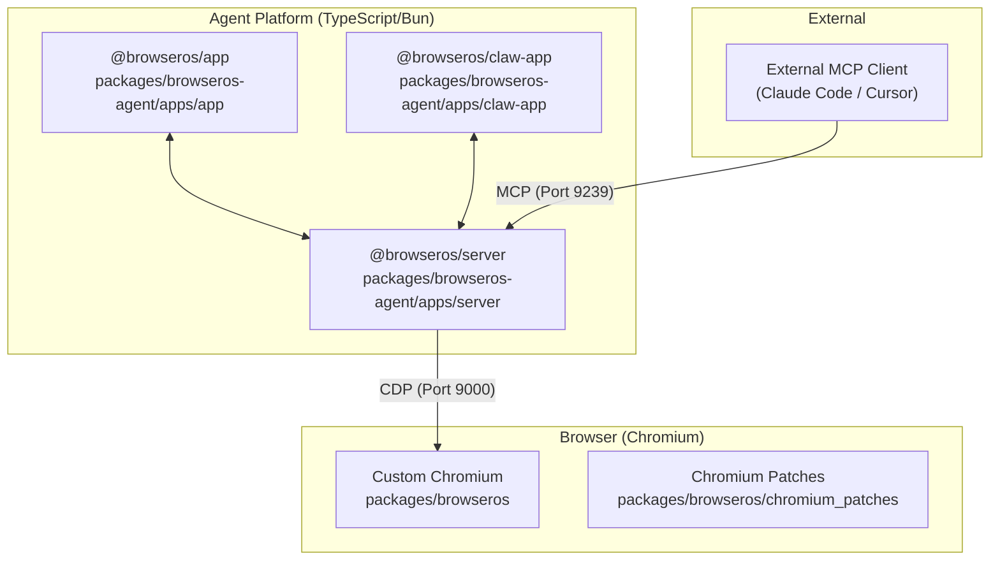
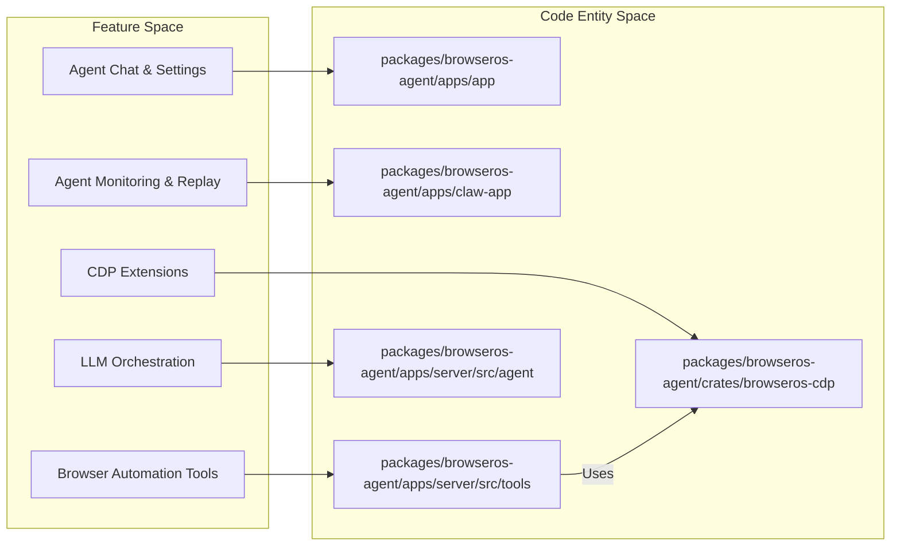

<!-- source: DeepWiki mcp.deepwiki.com · repo browseros-ai/BrowserOS · page 1 Overview · fetched 2026-10-29 -->

# Overview

Relevant source files

The following files were used as context for generating this wiki page:

- [.gitattributes](.gitattributes)
- [README.md](README.md)
- [docs/contributing.mdx](docs/contributing.mdx)
- [docs/images/checks-passed.png](docs/images/checks-passed.png)
- [docs/images/contributing--architecture.png](docs/images/contributing--architecture.png)
- [docs/images/hero-dark.png](docs/images/hero-dark.png)
- [docs/images/hero-light.png](docs/images/hero-light.png)
- [docs/images/switcher.png](docs/images/switcher.png)
- [docs/index.mdx](docs/index.mdx)
- [docs/videos/browserOS-agent-in-action.gif](docs/videos/browserOS-agent-in-action.gif)
- [packages/browseros-agent/README.md](packages/browseros-agent/README.md)
- [packages/browseros-agent/apps/app/README.md](packages/browseros-agent/apps/app/README.md)
- [packages/browseros-agent/apps/app/package.json](packages/browseros-agent/apps/app/package.json)
- [packages/browseros-agent/apps/claw-app/fonts.d.ts](packages/browseros-agent/apps/claw-app/fonts.d.ts)
- [packages/browseros-agent/apps/claw-app/package.json](packages/browseros-agent/apps/claw-app/package.json)
- [packages/browseros-agent/apps/claw-app/tsconfig.json](packages/browseros-agent/apps/claw-app/tsconfig.json)
- [packages/browseros-agent/apps/claw-onboard/package.json](packages/browseros-agent/apps/claw-onboard/package.json)
- [packages/browseros-agent/apps/claw-onboard/tsconfig.json](packages/browseros-agent/apps/claw-onboard/tsconfig.json)
- [packages/browseros-agent/apps/server/README.md](packages/browseros-agent/apps/server/README.md)
- [packages/browseros-agent/apps/server/package.json](packages/browseros-agent/apps/server/package.json)
- [packages/browseros-agent/bun.lock](packages/browseros-agent/bun.lock)
- [packages/browseros-agent/package.json](packages/browseros-agent/package.json)
- [packages/browseros-agent/packages/build-server-tools/package.json](packages/browseros-agent/packages/build-server-tools/package.json)
- [packages/browseros-agent/packages/onboarding-video/package.json](packages/browseros-agent/packages/onboarding-video/package.json)
- [packages/browseros-agent/scripts/codegen/cdp-protocol.ts](packages/browseros-agent/scripts/codegen/cdp-protocol.ts)
- [packages/browseros-agent/tsconfig.json](packages/browseros-agent/tsconfig.json)
- [packages/browseros/bos_build/config/BROWSEROS_BUILD_OFFSET](packages/browseros/bos_build/config/BROWSEROS_BUILD_OFFSET)
- [packages/browseros/resources/BROWSEROS_VERSION](packages/browseros/resources/BROWSEROS_VERSION)

## Purpose

This document provides a high-level introduction to BrowserOS, its purpose as an AI-native Chromium fork, and its high-level architecture. It serves as a starting point for technical contributors to understand how the major systems fit together and where to find relevant code in the repository.

For detailed information about specific subsystems, see the following child pages:
- [What is BrowserOS](#1.1) — Privacy-first Chromium fork with native AI agent integration.
- [Architecture Overview](#1.2) — The two-component architecture: Agent (TypeScript/Bun) and Browser (Chromium).
- [Key Components](#1.3) — Descriptions of Agent UI, Controller, Server, and Browser.
- [Repository Structure](#1.4) — Monorepo organization and directory mapping.

---

## What is BrowserOS

BrowserOS is an open-source Chromium fork that runs AI agents natively. It is designed as a privacy-first alternative to centralized AI assistants, allowing users to use their own API keys or run local models via Ollama and LM Studio [README.md:37-39](). It is distributed as two primary products from a single codebase: **BrowserOS** (the consumer-facing AI browser) and **BrowserClaw** (the agent-centric browser for MCP clients) [README.md:19-54]().

**Core AI Capabilities:**
- **AI Agent**: Built-in agent in every new tab using 20+ built-in tools plus 40+ app integrations [README.md:112]().
- **MCP Server**: Built-in Model Context Protocol (MCP) server allowing external clients like Claude Code, Codex, or Cursor to control the browser [README.md:23](), [packages/browseros-agent/apps/server/README.md:3]().
- **Multi-Provider Support**: Native integration with OpenAI, Anthropic, Google, Azure, Bedrock, and local providers [packages/browseros-agent/apps/server/README.md:75]().
- **Cowork**: Gives agents local filesystem access within sandboxed environments [packages/browseros-agent/apps/server/README.md:66]().
- **Session Replay**: Every agent session is saved as a scrubbable video on disk with an action timeline [README.md:93-94]().

**Sources:** [README.md:19-54](), [README.md:112](), [packages/browseros-agent/apps/server/README.md:3-78]()

---

## High-Level Architecture

The system follows a split-process architecture where a TypeScript/Bun-based agent platform controls a modified Chromium browser via the Chrome DevTools Protocol (CDP) [packages/browseros-agent/apps/server/README.md:39-47]().

### System Component Diagram
This diagram bridges the natural language features to the specific code entities responsible for them.

**Sources:** [packages/browseros-agent/apps/server/README.md:9-48](), [packages/browseros-agent/package.json:8-9](), [packages/browseros-agent/apps/app/package.json:2-23](), [packages/browseros-agent/apps/claw-app/package.json:2-6]()

---

## Key Components

### BrowserOS Server (`@browseros/server`)
A Bun-based server that manages the agent loop, MCP tools, and API endpoints. It orchestrates tool calls using the Vercel AI SDK [packages/browseros-agent/apps/server/README.md:73-75](). The server's entry point is `src/index.ts` [packages/browseros-agent/apps/server/package.json:8]().

### Agent UI (`@browseros/app`)
The primary user interface for BrowserOS, built as a WXT-based extension. It includes the chat interface, LLM settings, and workflow builders [packages/browseros-agent/apps/app/package.json:2-9]().

### BrowserClaw UI (`@browseros/claw-app`)
A specialized extension surface for the BrowserClaw product, focusing on the agent dashboard ("Cockpit") and session replays [packages/browseros-agent/apps/claw-app/package.json:2-6]().

### Chromium Fork (`packages/browseros`)
The core browser engine, modified with custom patches for enhanced automation and internal routing. The versioning is controlled via specific resource files [packages/browseros/resources/BROWSEROS_VERSION:1-4]().

**Sources:** [packages/browseros-agent/apps/server/README.md:1-50](), [packages/browseros-agent/apps/app/package.json:2-9](), [packages/browseros-agent/apps/claw-app/package.json:2-6](), [packages/browseros/resources/BROWSEROS_VERSION:1-4]()

---

## Code Entity Mapping

This diagram maps system functions to the specific directory structures that implement them.

**Sources:** [packages/browseros-agent/apps/server/README.md:88-108](), [packages/browseros-agent/package.json:8-9](), [packages/browseros-agent/.gitattributes:15]()

---

## Repository Structure

The project is organized as a monorepo using Bun workspaces for the agent layer and a specialized build system for the Chromium fork.

| Directory | Description |
|:---|:---|
| `packages/browseros/` | The Chromium fork, build configurations, and patches [packages/browseros/bos_build/config/BROWSEROS_BUILD_OFFSET:1](). |
| `packages/browseros-agent/apps/` | Contains the primary applications: `server`, `app` (BrowserOS UI), and `claw-app` (BrowserClaw UI) [packages/browseros-agent/package.json:8](). |
| `packages/browseros-agent/packages/` | Shared libraries and internal tools used by the apps [packages/browseros-agent/package.json:9](). |
| `packages/browseros-agent/scripts/` | Build and codegen scripts, including CDP protocol generation [packages/browseros-agent/package.json:60](). |

**Sources:** [packages/browseros-agent/package.json:1-10](), [packages/browseros-agent/apps/server/README.md:85-113]()

---

## Next Steps

For details on specific areas, see the child pages:
- [What is BrowserOS](#1.1)
- [Architecture Overview](#1.2)
- [Key Components](#1.3)
- [Repository Structure](#1.4)

---

