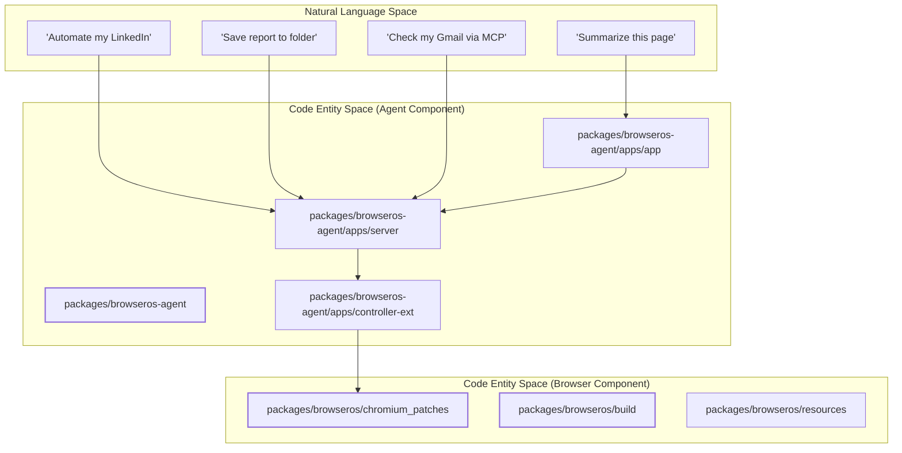
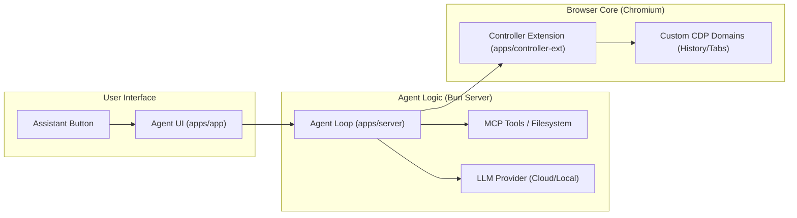

<!-- source: DeepWiki mcp.deepwiki.com · repo browseros-ai/BrowserOS · page 1.1 What is BrowserOS · fetched 2026-10-29 -->

# What is BrowserOS

Relevant source files

The following files were used as context for generating this wiki page:

- [.gitattributes](.gitattributes)
- [README.md](README.md)
- [docs/browserclaw/cockpit.mdx](docs/browserclaw/cockpit.mdx)
- [docs/browserclaw/tabs-and-isolation.mdx](docs/browserclaw/tabs-and-isolation.mdx)
- [docs/contributing.mdx](docs/contributing.mdx)
- [docs/docs.json](docs/docs.json)
- [docs/features/bring-your-own-llm.mdx](docs/features/bring-your-own-llm.mdx)
- [docs/features/connect-mcps.mdx](docs/features/connect-mcps.mdx)
- [docs/features/cowork.mdx](docs/features/cowork.mdx)
- [docs/features/local-models.mdx](docs/features/local-models.mdx)
- [docs/features/scheduled-tasks.mdx](docs/features/scheduled-tasks.mdx)
- [docs/features/smart-nudges.mdx](docs/features/smart-nudges.mdx)
- [docs/features/use-with-claude-code.mdx](docs/features/use-with-claude-code.mdx)
- [docs/images/checks-passed.png](docs/images/checks-passed.png)
- [docs/images/contributing--architecture.png](docs/images/contributing--architecture.png)
- [docs/images/hero-dark.png](docs/images/hero-dark.png)
- [docs/images/hero-light.png](docs/images/hero-light.png)
- [docs/images/switcher.png](docs/images/switcher.png)
- [docs/index.mdx](docs/index.mdx)
- [docs/videos/browserOS-agent-in-action.gif](docs/videos/browserOS-agent-in-action.gif)
- [packages/browseros-agent/.config/wt.toml](packages/browseros-agent/.config/wt.toml)
- [packages/browseros-agent/apps/app/screens/mcp-settings/QuickSetupSection.test.tsx](packages/browseros-agent/apps/app/screens/mcp-settings/QuickSetupSection.test.tsx)
- [packages/browseros-agent/apps/app/screens/mcp-settings/QuickSetupSection.tsx](packages/browseros-agent/apps/app/screens/mcp-settings/QuickSetupSection.tsx)
- [packages/browseros-agent/apps/app/screens/onboarding/features/Features.tsx](packages/browseros-agent/apps/app/screens/onboarding/features/Features.tsx)

**Purpose and Scope**: This document defines BrowserOS as a software system, explains its design philosophy, and describes its technical foundation as a privacy-first Chromium fork with native AI agent integration. It covers the core architecture, data flow between the AI agent and the browser, and the primary capabilities that distinguish it from standard browsers.

---

## Overview

BrowserOS is an open-source Chromium fork that runs AI agents natively. It serves as a privacy-first alternative to cloud-based AI browsers like ChatGPT Atlas, Perplexity Comet, or Dia by allowing users to use their own API keys or run local models via Ollama and LM Studio. The system ensures that browsing data and agent interactions remain on the user's machine. [README.md:32-39](), [README.md:110-114]().

The project is licensed under AGPL-3.0 and provides a comprehensive suite of tools for browser automation, multi-app integration via the Model Context Protocol (MCP), and persistent AI memory. [README.md:54-54](), [docs/index.mdx:80-85]().

**Sources**: [README.md:32-114](), [docs/index.mdx:80-85](), [docs/contributing.mdx:5-10]()

---

## Design Philosophy

BrowserOS implements four core design principles:

| Principle | Implementation |
|-----------|----------------|
| **Privacy-first** | Local-first architecture. User data stays on-device; supports local LLMs (Ollama/LM Studio) and BYOK (Bring Your Own Key). [README.md:102-103](), [README.md:112-114]() |
| **Native AI Integration** | 53+ browser automation tools built directly into the browser, accessible via natural language or MCP. [docs/features/use-with-claude-code.mdx:27-29]() |
| **Full Compatibility** | Built on upstream Chromium. Supports all Chrome extensions and Manifest V2 ad-blockers like uBlock Origin for "10x protection." [README.md:119-120](), [docs/index.mdx:89-91]() |
| **Extensible Ecosystem** | Integrated MCP Server and "Cowork" filesystem access for cross-app and local file workflows. [docs/features/cowork.mdx:16-18](), [docs/features/use-with-claude-code.mdx:6-10]() |

**Sources**: [README.md:102-120](), [docs/features/cowork.mdx:16-18](), [docs/features/use-with-claude-code.mdx:6-29](), [docs/index.mdx:89-91]()

---

## Technical Foundation

### Dual-Component Architecture

BrowserOS consists of two primary components: the **Agent** (TypeScript/React) and the **Browser** (Custom Chromium Build). [docs/contributing.mdx:6-9]().

#### System Entity Mapping: Natural Language to Code
The following diagram maps high-level system concepts to their specific implementation entities within the codebase.

**Sources**: [docs/contributing.mdx:6-9](), [docs/contributing.mdx:31-37](), [docs/contributing.mdx:209-212]()

---

### Component Summary
- **Agent UI (`apps/app`)**: A Chrome extension providing the chat interface, settings, and side panel. [docs/contributing.mdx:35-35]().
- **Server (`apps/server`)**: A Bun-based sidecar process that handles the agent loop, MCP tools, and API endpoints. [docs/contributing.mdx:36-36]().
- **Controller (`apps/controller-ext`)**: A privileged extension that bridges `chrome.*` APIs and custom CDP domains to the server. [docs/contributing.mdx:37-37]().
- **Browser Component (`packages/browseros`)**: Contains the build system and C++ patches applied to the Chromium source to enable custom browser-level features. [docs/contributing.mdx:88-91]().
- **MCP Server**: An HTTP-based service running on port 9239 that allows controlling the browser from external clients like `claude-code`. [docs/features/use-with-claude-code.mdx:45-46]().

**Sources**: [docs/contributing.mdx:31-37](), [docs/contributing.mdx:88-91](), [docs/features/use-with-claude-code.mdx:45-46]()

---

## Key Capabilities

### AI Operation Modes

BrowserOS supports three primary interaction modes:

1.  **Chat Mode**: Ask questions about the current page, summarize articles, or extract data. Works well with local models. [docs/index.mdx:17-19](), [docs/index.mdx:52-53]().
2.  **Agent Mode**: Describe a task and watch the AI execute it by clicking, typing, and navigating. Requires powerful reasoning models like Claude 3.5 Sonnet. [docs/index.mdx:20-22](), [docs/index.mdx:61-62]().
3.  **Scheduled Tasks**: Automate prompts to run at specific intervals (daily, hourly, etc.) in a background window. [docs/features/scheduled-tasks.mdx:6-6](), [docs/features/scheduled-tasks.mdx:115-116]().

**Sources**: [docs/index.mdx:17-22](), [docs/index.mdx:52-62](), [docs/features/scheduled-tasks.mdx:6-116]()

### Data Flow: Agent Interaction and Configuration
This diagram illustrates how the Agent component interacts with the user and the browser core.

**Sources**: [docs/contributing.mdx:31-41](), [docs/features/cowork.mdx:18-38](), [docs/features/use-with-claude-code.mdx:27-29]()

---

### Cowork (Filesystem Access)

The Cowork feature provides the agent with a sandbox-controlled access to a local folder. This allows the agent to combine browser automation with local file operations. [docs/features/cowork.mdx:6-6]().

- **Tools**: Includes `filesystem_read`, `filesystem_write`, `filesystem_edit`, and `filesystem_bash`. [docs/features/cowork.mdx:75-118]().
- **Security**: The agent is restricted to the selected folder and cannot access the broader filesystem. [docs/features/cowork.mdx:61-61]().

**Sources**: [docs/features/cowork.mdx:6-118]()

---

## Repository Structure

The codebase is organized as a monorepo:

-   `packages/browseros-agent/`: TypeScript/Bun source for the AI features.
    -   `apps/app/`: The React-based chat and settings interface. [docs/contributing.mdx:35-35]()
    -   `apps/server/`: The core agent logic and MCP tool implementations. [docs/contributing.mdx:36-36]()
    -   `apps/controller-ext/`: Bridge extension for browser automation. [docs/contributing.mdx:37-37]()
-   `packages/browseros/`: Chromium build environment.
    -   `chromium_patches/`: C++ patches applied to Chromium. [docs/contributing.mdx:8-8]()
    -   `build/`: Python-based build pipeline. [.gitattributes:7-8]()
-   `docs/`: Mintlify-based documentation. [docs/docs.json:1-4]()

**Sources**: [docs/contributing.mdx:31-37](), [docs/docs.json:1-4](), [.gitattributes:7-8]()

---

