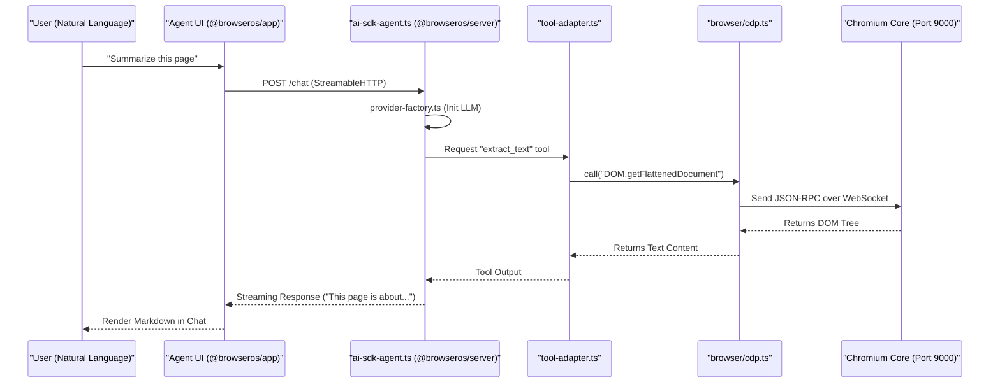

<!-- source: DeepWiki mcp.deepwiki.com · repo browseros-ai/BrowserOS · page 1.2 Architecture Overview · fetched 2026-10-29 -->

# Architecture Overview

<details>
<summary>Relevant source files</summary>

The following files were used as context for generating this wiki page:

- [.gitattributes](.gitattributes)
- [README.md](README.md)
- [docs/contributing.mdx](docs/contributing.mdx)
- [docs/images/checks-passed.png](docs/images/checks-passed.png)
- [docs/images/contributing--architecture.png](docs/images/contributing--architecture.png)
- [docs/images/hero-dark.png](docs/images/hero-dark.png)
- [docs/images/hero-light.png](docs/images/hero-light.png)
- [docs/images/switcher.png](docs/images/switcher.png)
- [docs/index.mdx](docs/index.mdx)
- [docs/videos/browserOS-agent-in-action.gif](docs/videos/browserOS-agent-in-action.gif)
- [packages/browseros-agent/README.md](packages/browseros-agent/README.md)
- [packages/browseros-agent/apps/app/README.md](packages/browseros-agent/apps/app/README.md)
- [packages/browseros-agent/apps/app/package.json](packages/browseros-agent/apps/app/package.json)
- [packages/browseros-agent/apps/claw-app/fonts.d.ts](packages/browseros-agent/apps/claw-app/fonts.d.ts)
- [packages/browseros-agent/apps/claw-app/package.json](packages/browseros-agent/apps/claw-app/package.json)
- [packages/browseros-agent/apps/claw-app/tsconfig.json](packages/browseros-agent/apps/claw-app/tsconfig.json)
- [packages/browseros-agent/apps/claw-onboard/package.json](packages/browseros-agent/apps/claw-onboard/package.json)
- [packages/browseros-agent/apps/claw-onboard/tsconfig.json](packages/browseros-agent/apps/claw-onboard/tsconfig.json)
- [packages/browseros-agent/apps/server/README.md](packages/browseros-agent/apps/server/README.md)
- [packages/browseros-agent/apps/server/package.json](packages/browseros-agent/apps/server/package.json)
- [packages/browseros-agent/bun.lock](packages/browseros-agent/bun.lock)
- [packages/browseros-agent/package.json](packages/browseros-agent/package.json)
- [packages/browseros-agent/packages/build-server-tools/package.json](packages/browseros-agent/packages/build-server-tools/package.json)
- [packages/browseros-agent/packages/onboarding-video/package.json](packages/browseros-agent/packages/onboarding-video/package.json)
- [packages/browseros-agent/scripts/codegen/cdp-protocol.ts](packages/browseros-agent/scripts/codegen/cdp-protocol.ts)
- [packages/browseros-agent/tsconfig.json](packages/browseros-agent/tsconfig.json)
- [packages/browseros/bos_build/config/BROWSEROS_BUILD_OFFSET](packages/browseros/bos_build/config/BROWSEROS_BUILD_OFFSET)
- [packages/browseros/resources/BROWSEROS_VERSION](packages/browseros/resources/BROWSEROS_VERSION)

</details>


BrowserOS uses a **two-component architecture** that separates concerns between AI/automation logic and browser functionality. This design allows for rapid iteration on AI features using modern TypeScript runtimes while maintaining a stable, high-performance browser foundation based on Chromium. [packages/browseros-agent/apps/server/README.md:3-5](), [README.md:32-34]()

---

## System Design Philosophy

The architecture is split into two primary environments:

1.  **Agent Component (TypeScript/Bun):** Powering the AI agent loop, MCP server, and Agent UI. This component is optimized for development speed and LLM integration using the [Bun](https://bun.sh) runtime. [packages/browseros-agent/apps/server/README.md:5-9](), [packages/browseros-agent/package.json:98-105]()
2.  **Browser Component (Chromium):** A custom Chromium fork with native AI integration points, privileged extensions, and vertical tabs. [README.md:39-44](), [README.md:112-114]()

This separation ensures that AI logic (which changes frequently) can be updated or restarted independently of the browser's core rendering engine.

**Sources:** [README.md:32-36](), [packages/browseros-agent/apps/server/README.md:3-9](), [packages/browseros-agent/package.json:98-105]()

---

## Component Architecture

The following diagram illustrates the relationship between the user interface, the automation server, and the underlying Chromium engine.

### High-Level Process Model

```mermaid
graph TB
    subgraph "User Space"
        User["User"]
    end

    subgraph "Browser Process (Chromium Fork)"
        direction TB
        ChromeUI["Chromium UI (Vertical Tabs, etc.)"]
        BrowserOSManager["BrowserOS Server Manager (C++)"]
        CDPServer["CDP Server (Port 9000)"]
    end

    subgraph "Agent Platform (Bun Runtime)"
        direction TB
        AgentUI["Agent UI (@browseros/app)"]
        AgentServer["BrowserOS Server (@browseros/server)"]
        AgentLoop["AI Agent Loop (ai-sdk-agent.ts)"]
        MCPTools["53+ Browser Tools"]
    end

    subgraph "External Space"
        LLM["LLM Providers (Claude, OpenAI, Ollama)"]
        MCPClients["External MCP Clients (Claude Code, Cursor)"]
    end

    User --> ChromeUI
    User --> AgentUI
    BrowserOSManager --> AgentServer
    AgentUI <-> AgentServer
    AgentServer <-> AgentLoop
    AgentLoop <-> LLM
    AgentLoop <-> MCPTools
    MCPTools <-> CDPServer
    MCPClients <-> AgentServer
```

**Diagram: System Component Interaction**

**Sources:** [packages/browseros-agent/apps/server/README.md:9-48](), [packages/browseros-agent/apps/server/package.json:1-10](), [README.md:58-63]()

---

## Agent Component (TypeScript/Bun)

The Agent component is managed as a Bun monorepo. It consists of the server-side automation logic and multiple specialized application surfaces. [packages/browseros-agent/package.json:7-10]()

### 1. BrowserOS Server (`apps/server`)
The core backend of the platform, running on [Bun](https://bun.sh) and [Hono](https://hono.dev). [packages/browseros-agent/apps/server/README.md:5]()
- **Agent Loop:** Implemented in `ai-sdk-agent.ts`, it uses the Vercel AI SDK to orchestrate multi-step browser automation. [packages/browseros-agent/apps/server/package.json:38-41](), [packages/browseros-agent/apps/server/README.md:73-80]()
- **MCP Server:** Exposes 53+ tools (navigation, input, observation, filesystem) via the Model Context Protocol. [packages/browseros-agent/apps/server/README.md:50-70]()
- **Provider Factory:** The `provider-factory.ts` handles hot-swapping between providers like Anthropic, OpenAI, and local Ollama instances. [packages/browseros-agent/apps/server/README.md:81-83]()

### 2. Application Surfaces
- **Agent App (`apps/app`):** The primary React-based extension UI for BrowserOS. [packages/browseros-agent/apps/app/package.json:2-6]()
- **Claw App (`apps/claw-app`):** A WXT-based extension surface specifically for the BrowserClaw product. [packages/browseros-agent/apps/claw-app/package.json:2-6]()
- **Onboarding (`apps/claw-onboard`):** A standalone Vite app for the first-run experience. [packages/browseros-agent/apps/claw-onboard/package.json:2-6]()

**Sources:** [packages/browseros-agent/apps/server/README.md:1-113](), [packages/browseros-agent/package.json:7-10](), [packages/browseros-agent/apps/server/package.json:63-97]()

---

## Browser Component (Chromium)

The Browser component is a custom fork of Chromium. It includes C++ modifications to support the sidecar server and enhanced automation.

### Architectural Enhancements
- **Server Management:** The browser acts as a process manager for the Bun-based server, ensuring it starts when the browser opens and restarts if it crashes.
- **CDP Extensions:** Custom Chrome DevTools Protocol (CDP) domains are added to support tab management, bookmarks, and history queries that are not available in standard Chromium. [packages/browseros-agent/apps/server/README.md:63-65]()
- **Resource Management:** Platform-specific resources (icons, default configs) are managed via a YAML-based resource system. [packages/browseros/resources/BROWSEROS_VERSION:1-4]()

### Build and Versioning
The browser version is defined by `BROWSEROS_MAJOR`, `BROWSEROS_MINOR`, and `BROWSEROS_BUILD`. [packages/browseros/resources/BROWSEROS_VERSION:1-4]() A build offset is applied to maintain unique version strings across release channels. [packages/browseros/bos_build/config/BROWSEROS_BUILD_OFFSET:1]()

**Sources:** [packages/browseros/resources/BROWSEROS_VERSION:1-4](), [packages/browseros/bos_build/config/BROWSEROS_BUILD_OFFSET:1](), [packages/browseros-agent/apps/server/README.md:32-36]()

---

## Data Flow: Natural Language to Code Entity

This diagram bridges user requests to specific code entities within the `apps/server` and browser management layers.



**Diagram: Execution Trace (Instruction to Browser Action)**

**Sources:** [packages/browseros-agent/apps/server/README.md:9-48](), [packages/browseros-agent/apps/server/package.json:38-62](), [packages/browseros-agent/apps/server/README.md:88-108]()

---

## Network and Port Configuration

BrowserOS utilizes specific ports for internal communication and external tool integration. [packages/browseros-agent/apps/server/README.md:9-48]()

| Component | Default Port | Description |
| :--- | :--- | :--- |
| **MCP Server** | 9239 | The main HTTP/SSE entry point for Agent UI and external MCP clients. [packages/browseros-agent/apps/server/README.md:12-16]() |
| **CDP Server** | 9000 | The internal port used by the server to drive the browser via DevTools Protocol. [packages/browseros-agent/apps/server/README.md:43]() |
| **Vite Dev Server** | 5173+ | Used during development for `apps/app` and `apps/claw-app`. [packages/browseros-agent/apps/app/package.json:8-10]() |

**Sources:** [packages/browseros-agent/apps/server/README.md:9-48](), [packages/browseros-agent/apps/app/package.json:8-10](), [packages/browseros-agent/apps/claw-app/package.json:8-9]()

---

