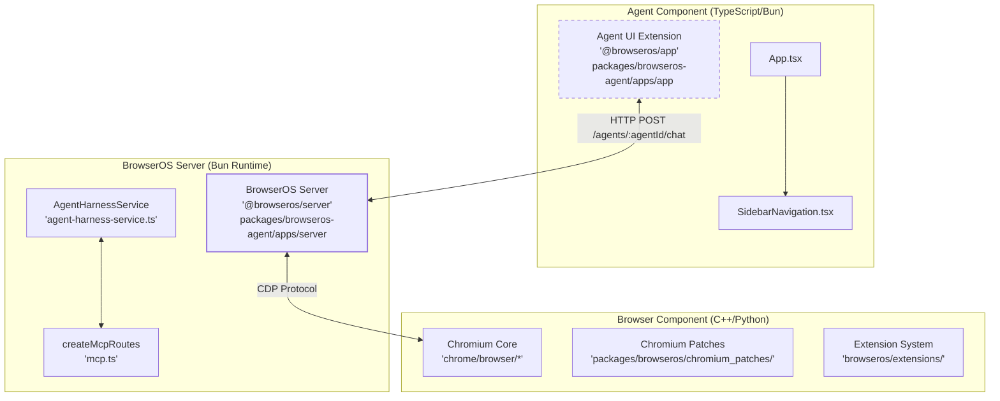
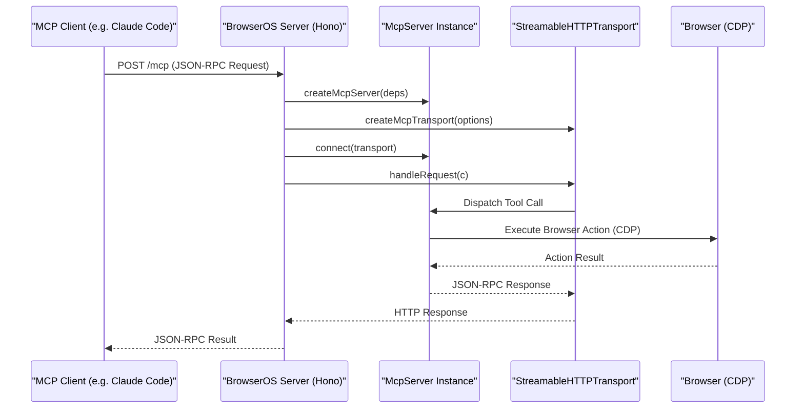

<!-- source: DeepWiki mcp.deepwiki.com · repo browseros-ai/BrowserOS · page 1.3 Key Components · fetched 2026-10-29 -->

# Key Components

Relevant source files

The following files were used as context for generating this wiki page:

- [.gitattributes](.gitattributes)
- [README.md](README.md)
- [docs/contributing.mdx](docs/contributing.mdx)
- [docs/images/checks-passed.png](docs/images/checks-passed.png)
- [docs/images/contributing--architecture.png](docs/images/contributing--architecture.png)
- [docs/images/hero-dark.png](docs/images/hero-dark.png)
- [docs/images/hero-light.png](docs/images/hero-light.png)
- [docs/images/switcher.png](docs/images/switcher.png)
- [docs/index.mdx](docs/index.mdx)
- [docs/videos/browserOS-agent-in-action.gif](docs/videos/browserOS-agent-in-action.gif)
- [packages/browseros-agent/README.md](packages/browseros-agent/README.md)
- [packages/browseros-agent/apps/app/README.md](packages/browseros-agent/apps/app/README.md)
- [packages/browseros-agent/apps/app/package.json](packages/browseros-agent/apps/app/package.json)
- [packages/browseros-agent/apps/claw-app/fonts.d.ts](packages/browseros-agent/apps/claw-app/fonts.d.ts)
- [packages/browseros-agent/apps/claw-app/package.json](packages/browseros-agent/apps/claw-app/package.json)
- [packages/browseros-agent/apps/claw-app/tsconfig.json](packages/browseros-agent/apps/claw-app/tsconfig.json)
- [packages/browseros-agent/apps/claw-onboard/package.json](packages/browseros-agent/apps/claw-onboard/package.json)
- [packages/browseros-agent/apps/claw-onboard/tsconfig.json](packages/browseros-agent/apps/claw-onboard/tsconfig.json)
- [packages/browseros-agent/apps/server/README.md](packages/browseros-agent/apps/server/README.md)
- [packages/browseros-agent/apps/server/package.json](packages/browseros-agent/apps/server/package.json)
- [packages/browseros-agent/apps/server/src/agent/mcp-builder.ts](packages/browseros-agent/apps/server/src/agent/mcp-builder.ts)
- [packages/browseros-agent/apps/server/src/api/routes/agents.ts](packages/browseros-agent/apps/server/src/api/routes/agents.ts)
- [packages/browseros-agent/apps/server/src/api/routes/chat.ts](packages/browseros-agent/apps/server/src/api/routes/chat.ts)
- [packages/browseros-agent/apps/server/src/api/routes/mcp.ts](packages/browseros-agent/apps/server/src/api/routes/mcp.ts)
- [packages/browseros-agent/apps/server/src/api/server.ts](packages/browseros-agent/apps/server/src/api/server.ts)
- [packages/browseros-agent/apps/server/src/api/services/agents/agent-harness-service.ts](packages/browseros-agent/apps/server/src/api/services/agents/agent-harness-service.ts)
- [packages/browseros-agent/apps/server/src/api/services/klavis/service.ts](packages/browseros-agent/apps/server/src/api/services/klavis/service.ts)
- [packages/browseros-agent/apps/server/src/api/services/klavis/tool-adapters.ts](packages/browseros-agent/apps/server/src/api/services/klavis/tool-adapters.ts)
- [packages/browseros-agent/apps/server/src/api/services/mcp/mcp-server.ts](packages/browseros-agent/apps/server/src/api/services/mcp/mcp-server.ts)
- [packages/browseros-agent/apps/server/src/lib/metrics.ts](packages/browseros-agent/apps/server/src/lib/metrics.ts)
- [packages/browseros-agent/apps/server/src/tools/filesystem/register-mcp.ts](packages/browseros-agent/apps/server/src/tools/filesystem/register-mcp.ts)
- [packages/browseros-agent/apps/server/tests/api/routes/agents.test.ts](packages/browseros-agent/apps/server/tests/api/routes/agents.test.ts)
- [packages/browseros-agent/apps/server/tests/api/routes/mcp.test.ts](packages/browseros-agent/apps/server/tests/api/routes/mcp.test.ts)
- [packages/browseros-agent/apps/server/tests/api/services/agents/agent-harness-service.test.ts](packages/browseros-agent/apps/server/tests/api/services/agents/agent-harness-service.test.ts)
- [packages/browseros-agent/apps/server/tests/api/services/mcp/mcp-server.test.ts](packages/browseros-agent/apps/server/tests/api/services/mcp/mcp-server.test.ts)
- [packages/browseros-agent/apps/server/tests/lib/agents/acpx-runtime.test.ts](packages/browseros-agent/apps/server/tests/lib/agents/acpx-runtime.test.ts)
- [packages/browseros-agent/apps/server/tests/lib/metrics.test.ts](packages/browseros-agent/apps/server/tests/lib/metrics.test.ts)
- [packages/browseros-agent/bun.lock](packages/browseros-agent/bun.lock)
- [packages/browseros-agent/package.json](packages/browseros-agent/package.json)
- [packages/browseros-agent/packages/build-server-tools/package.json](packages/browseros-agent/packages/build-server-tools/package.json)
- [packages/browseros-agent/packages/onboarding-video/package.json](packages/browseros-agent/packages/onboarding-video/package.json)
- [packages/browseros-agent/scripts/codegen/cdp-protocol.ts](packages/browseros-agent/scripts/codegen/cdp-protocol.ts)
- [packages/browseros-agent/tsconfig.json](packages/browseros-agent/tsconfig.json)
- [packages/browseros/bos_build/config/BROWSEROS_BUILD_OFFSET](packages/browseros/bos_build/config/BROWSEROS_BUILD_OFFSET)
- [packages/browseros/resources/BROWSEROS_VERSION](packages/browseros/resources/BROWSEROS_VERSION)

This document describes the major components that comprise BrowserOS and their relationships. BrowserOS consists of three primary subsystems: the **Agent Component** (TypeScript/Bun-based AI features), the **Browser Component** (custom Chromium with patches), and the **BrowserOS Server** (sidecar process for extended capabilities).

---

## Component Overview

BrowserOS is organized into three main components that work together to provide AI-native browsing capabilities. The architecture separates the high-level AI orchestration (Agent) from the low-level browser engine (Chromium) and the automation bridge (Server).

### High-Level Architecture Diagram
The following diagram maps the Natural Language concepts to the specific Code Entities that implement them.

Sources: [packages/browseros-agent/apps/app/package.json:2-2](), [packages/browseros-agent/apps/server/package.json:2-2](), [packages/browseros-agent/apps/server/src/api/server.ts:46-78](), [packages/browseros-agent/apps/server/src/api/routes/mcp.ts:74-161]()

---

## Agent Component

The Agent Component handles the user interface, developer tools, and high-level automation instructions. It is primarily built with TypeScript and React using the WXT framework [packages/browseros-agent/apps/app/package.json:118-118]().

### Agent UI Extension
The built-in browser extension powers the visual AI interface, including the chat panel, settings, and onboarding flows.

| Property | Value | File Reference |
|----------|-------|----------------|
| **Package Name** | `@browseros/app` | [packages/browseros-agent/apps/app/package.json:2-2]() |
| **Framework** | React 19 + Tailwind CSS | [packages/browseros-agent/apps/app/package.json:82-82](), [packages/browseros-agent/apps/app/package.json:117-117]() |
| **Runtime** | Bun | [packages/browseros-agent/package.json:105-105]() |

**Key Capabilities:**
- **UI Components**: Uses Radix UI primitives for accessible interface elements like dialogs, popovers, and tabs [packages/browseros-agent/apps/app/package.json:35-51]().
- **Workflow Engine**: Integrates `@xyflow/react` for the visual graph-based automation builder [packages/browseros-agent/apps/app/package.json:61-61]().
- **State Management**: Uses `@xstate/store` for application logic and `TanStack Query` for server-side state synchronization [packages/browseros-agent/apps/app/package.json:56-60]().

Sources: [packages/browseros-agent/apps/app/package.json:1-120](), [packages/browseros-agent/package.json:1-121]()

---

## BrowserOS Server

The BrowserOS Server is a sidecar process (running on Bun) that executes the heavy lifting for AI agents and automation.

### Server Responsibilities
The server is implemented in `packages/browseros-agent/apps/server` and uses the **Hono** web framework [packages/browseros-agent/apps/server/src/api/server.ts:65-78](). It consolidates various HTTP routes for agent interaction, MCP, and other services.

1.  **AI Orchestration**: The server manages agent lifecycle and turn execution. It leverages `AcpxRuntime` to interface with AI models via the `acpx` package [packages/browseros-agent/apps/server/src/api/server.ts:9-9](), [packages/browseros-agent/apps/server/package.json:85-85]().
2.  **MCP Host**: The `createMcpRoutes` function exposes BrowserOS as a request-scoped MCP server [packages/browseros-agent/apps/server/src/api/routes/mcp.ts:74-74](). It handles `POST /` requests by creating a per-request `mcpServer` and `transport` [packages/browseros-agent/apps/server/src/api/routes/mcp.ts:88-127]().
3.  **Tool Execution**: The server provides integration with various LLM providers including OpenAI, Anthropic, Google, Azure, and Bedrock through the `ai` SDK [packages/browseros-agent/apps/server/package.json:64-72]().
4.  **Security and Privacy**: The server binds to `127.0.0.1` by default to ensure local-only access [packages/browseros-agent/apps/server/src/api/server.ts:39-39]().

### Server Startup and Lifecycle
The server is initialized via `createHttpServer` in `packages/browseros-agent/apps/server/src/api/server.ts`.
-   **Port Availability**: Before starting, the server checks if the target port is available using `assertPortAvailable` to provide explicit startup errors [packages/browseros-agent/apps/server/src/api/server.ts:22-43]().
-   **OAuth Integration**: Initializes OAuth managers if a `browserosId` is provided [packages/browseros-agent/apps/server/src/api/server.ts:50-53]().
-   **Graceful Shutdown**: The `onShutdown` hook ensures that OAuth services and the `KlavisService` (proxy) are stopped correctly [packages/browseros-agent/apps/server/src/api/server.ts:73-77]().

### Server-Side Agent Flow
The following diagram illustrates the flow when a request interacts with the MCP server.

Sources: [packages/browseros-agent/apps/server/src/api/routes/mcp.ts:88-158](), [packages/browseros-agent/apps/server/src/api/server.ts:119-125](), [packages/browseros-agent/apps/server/package.json:77-77]()

---

## Browser Component

The Browser Component is a custom fork of Chromium, modified to support deep AI integration and privacy-first features.

### Versioning
The browser version is tracked in `packages/browseros/resources/BROWSEROS_VERSION`. As of the current build, the versioning follows:
- **Major**: 0
- **Minor**: 48
- **Build**: 9
- **Patch**: 0
[packages/browseros/resources/BROWSEROS_VERSION:1-4]()

The build system uses a specific offset for build calculations [packages/browseros/bos_build/config/BROWSEROS_BUILD_OFFSET:1-1]().

### Browser Variations
The codebase supports two primary browser products from a single source:
1.  **BrowserOS**: The "AI browser for humans" with a built-in agent in every tab [README.md:35-39]().
2.  **BrowserClaw**: The "browser for AI agents" designed to be driven by external MCP clients like Claude Code or Cursor [README.md:19-23]().

### Key Browser Features
-   **Local-only Privacy**: History, sessions, and screenshots are stored locally (e.g., `~/.browserclaw/`) and never leave the machine [README.md:103-103]().
-   **Manifest V2 Support**: Maintains support for legacy extensions like uBlock Origin for superior ad-blocking compared to standard Chrome [README.md:112-112]().
-   **Onboarding**: Includes a standalone Vite-based onboarding app (`@browseros/claw-onboard`) to guide users through initial setup [packages/browseros-agent/apps/claw-onboard/package.json:2-6]().

Sources: [README.md:1-115](), [packages/browseros/resources/BROWSEROS_VERSION:1-4](), [packages/browseros-agent/apps/claw-onboard/package.json:1-41]()

---

## Component Interop

The components communicate through a mix of HTTP, WebSockets, and the Chrome DevTools Protocol (CDP).

| Interaction | Protocol | Implementation Detail |
|-------------|----------|-----------------------|
| **UI -> Server** | HTTP / SSE | The Agent UI communicates with the server via Hono-defined routes [packages/browseros-agent/apps/server/src/api/server.ts:65-78](). |
| **External -> Server** | MCP (JSON-RPC) | External tools connect via the MCP endpoint on port 9100 (default) [packages/browseros-agent/apps/server/src/api/routes/mcp.ts:74-88](). |
| **Server -> Browser** | CDP | The server controls the browser instance using the `@browseros/cdp-protocol` [packages/browseros-agent/apps/server/package.json:77-77](). |
| **Server -> LLM** | HTTP | The server uses the Vercel AI SDK to communicate with cloud or local providers [packages/browseros-agent/apps/server/package.json:86-86](). |

Sources: [packages/browseros-agent/apps/server/src/api/server.ts:1-140](), [packages/browseros-agent/apps/server/src/api/routes/mcp.ts:1-161](), [packages/browseros-agent/apps/server/package.json:63-97]()

---

