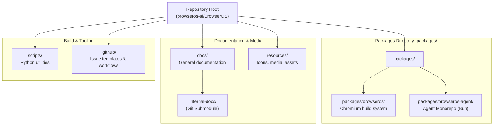
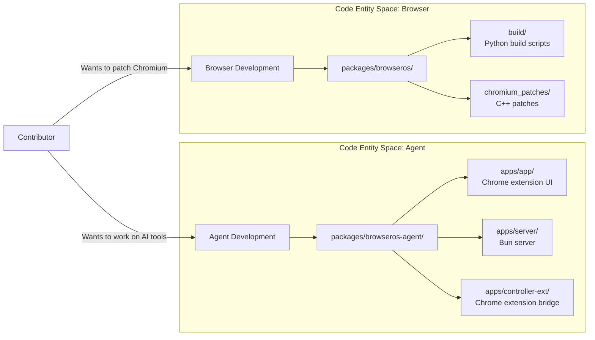
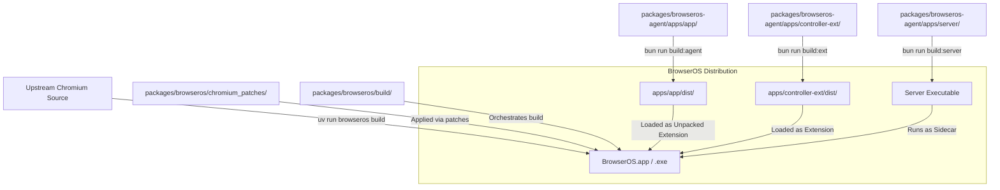

<!-- source: DeepWiki mcp.deepwiki.com · repo browseros-ai/BrowserOS · page 1.4 Repository Structure · fetched 2026-10-29 -->

# Repository Structure

Relevant source files

The following files were used as context for generating this wiki page:

- [.gitattributes](.gitattributes)
- [.gitignore](.gitignore)
- [.gitmodules](.gitmodules)
- [README.md](README.md)
- [docs/contributing.mdx](docs/contributing.mdx)
- [docs/images/checks-passed.png](docs/images/checks-passed.png)
- [docs/images/contributing--architecture.png](docs/images/contributing--architecture.png)
- [docs/images/hero-dark.png](docs/images/hero-dark.png)
- [docs/images/hero-light.png](docs/images/hero-light.png)
- [docs/images/switcher.png](docs/images/switcher.png)
- [docs/index.mdx](docs/index.mdx)
- [docs/videos/browserOS-agent-in-action.gif](docs/videos/browserOS-agent-in-action.gif)

This document describes the organization of the BrowserOS repository, including its monorepo layout, git submodules, and key directories. BrowserOS is a privacy-first Chromium fork that runs AI agents natively, and its repository is designed to manage the complexity of both browser-level C++ modifications and high-level TypeScript agent logic.

---

## Purpose and Scope

BrowserOS uses a monorepo structure that combines multiple codebases into a single repository. The repository contains:

- **Agent Component**: TypeScript/React applications for the AI features, UI, and browser automation [docs/contributing.mdx:8-8]().
- **Browser Component**: Custom Chromium build including C++ patches and build configurations [docs/contributing.mdx:9-9]().
- **Build Infrastructure**: Python modules and scripts for orchestrating Chromium builds [docs/contributing.mdx:136-141]().
- **Git Submodule**: The `.internal-docs` submodule for project documentation [.gitmodules:1-5]().

This page documents the physical layout of the repository and the purpose of each major directory.

---

## Monorepo Overview

BrowserOS is structured as a monorepo that separates the AI agent logic from the core browser engine. This allows developers to work on UI and automation tools independently of the heavy Chromium build process.

### Repository Topology

**Sources:** [docs/contributing.mdx:6-9](), [.gitmodules:1-5](), [.gitattributes:1-12]()

---

## Git Submodules

The repository uses git submodules to manage documentation that may be shared or restricted.

### Internal Docs Submodule

| Property | Value |
|----------|-------|
| **Path** | `.internal-docs` |
| **Remote URL** | `git@github.com:browseros-ai/internal-docs.git` |
| **Branch** | `main` |
| **Purpose** | Private/internal project documentation |

**Sources:** [.gitmodules:1-5]()

---

## Top-Level Directory Structure

The repository root is organized to support two distinct development paths: Agent development (fast iteration) and Browser development (deep integration).

### Directory Layout Table

| Directory | Type | Purpose |
|-----------|------|---------|
| `packages/browseros/` | Source | Chromium build scripts, UV configuration, and C++ patches [docs/contributing.mdx:136-141]() |
| `packages/browseros-agent/` | Source | TypeScript/Bun monorepo for Agent UI, Server, and Controller [docs/contributing.mdx:31-37]() |
| `docs/` | Content | General documentation, images, and videos [docs/contributing.mdx:25-25]() |
| `scripts/` | Tooling | Python scripts for build orchestration and git maintenance [.gitattributes:9-9]() |
| `resources/` | Assets | Static media, icons, and product logos [README.md:17-17]() |

### Development Path Association

**Sources:** [docs/contributing.mdx:33-37](), [docs/contributing.mdx:8-9](), [.gitattributes:7-9]()

---

## Packages Directory

The `packages/` directory is the core of the monorepo, containing the two primary software components.

### packages/browseros-agent/

This directory is a Bun monorepo containing the TypeScript/React components for the AI agent. It is the entry point for most contributors [docs/contributing.mdx:11-11]().

- **`apps/app/`**: The main Chrome extension providing the chat interface, settings, and side panel [docs/contributing.mdx:35-35]().
- **`apps/server/`**: The Bun server responsible for the agent loop, MCP tools, and API endpoints [docs/contributing.mdx:36-36]().
- **`apps/controller-ext/`**: A Chrome extension that bridges `chrome.*` APIs to the server [docs/contributing.mdx:37-37]().

### packages/browseros/

This directory manages the custom Chromium distribution and its build pipeline.

- **`build/`**: Python scripts used to orchestrate the Chromium build process via `uv` [docs/contributing.mdx:136-141]().
- **`chromium_patches/`**: C++ and Python files that modify the upstream Chromium source code [.gitattributes:8-8]().
- **`resources/`**: Icons and branding assets for BrowserOS and BrowserClaw [README.md:17-33]().

**Sources:** [docs/contributing.mdx:33-37](), [docs/contributing.mdx:146-152](), [.gitattributes:7-8]()

---

## Build and Resource Management

The repository includes specialized tooling to manage large binary assets and build artifacts.

### Resource Organization

| File/Path | Purpose |
|-----------|---------|
| `docs/videos/` | Large GIF and video files managed via Git LFS [.gitattributes:12-12]() |
| `packages/browseros/build/` | Contains the Python build system for Chromium [docs/contributing.mdx:146-152]() |
| `packages/browseros-agent/crates/` | Rust components such as `browseros-cdp` for protocol handling [.gitattributes:15-15]() |

### Build Artifact Flow

**Sources:** [docs/contributing.mdx:60-85](), [docs/contributing.mdx:146-152](), [README.md:102-103]()

---

## Build Exclusions and Metadata

The repository uses `.gitattributes` and `.gitignore` to manage how files are treated by Git and linguistic analysis.

- **Generated Files**: Python build/tooling files in `packages/browseros/build/`, `packages/browseros/chromium_patches/`, and `scripts/` are marked as `linguist-generated` so they do not skew language statistics [.gitattributes:7-9]().
- **Large File Storage (LFS)**: Large media files (GIFs, videos) in `docs/videos/` and `resources/` are tracked via Git LFS to keep the repository size manageable [.gitattributes:1-5]().
- **Binary Hashing**: The Chromium CDP protocol file `protocol.json` is marked to never rewrite line endings as it is hashed as raw bytes [.gitattributes:15-15]().
- **Ignored Patterns**: Build directories like `dist/`, `node_modules/`, and internal tool paths like `.auctor/` are excluded from version control [.gitignore:1-20]().

**Sources:** [.gitattributes:1-15](), [.gitignore:1-39]()

---

