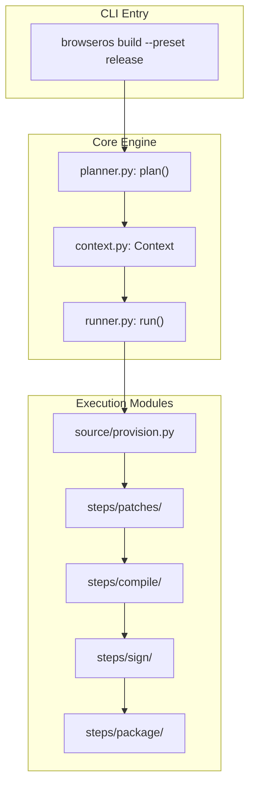
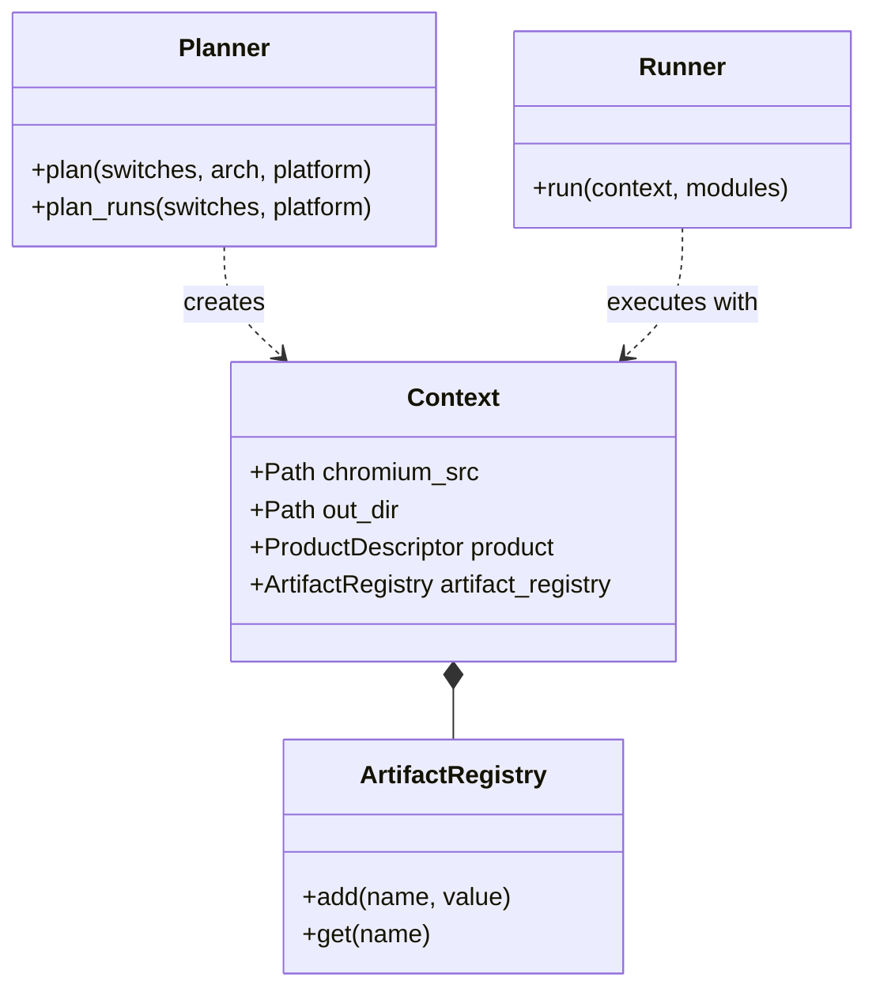

<!-- source: DeepWiki mcp.deepwiki.com · repo browseros-ai/BrowserOS · page 10 Build System · fetched 2026-10-29 -->

# Build System

Relevant source files

The following files were used as context for generating this wiki page:

- [.github/workflows/bos-build-tests.yml](.github/workflows/bos-build-tests.yml)
- [.github/workflows/build-browseros.yml](.github/workflows/build-browseros.yml)
- [.github/workflows/release-linux.yml](.github/workflows/release-linux.yml)
- [.github/workflows/release-windows.yml](.github/workflows/release-windows.yml)
- [packages/browseros-agent/scripts/build/claw-server-rust-local.sh](packages/browseros-agent/scripts/build/claw-server-rust-local.sh)
- [packages/browseros/bos_build/README.md](packages/browseros/bos_build/README.md)
- [packages/browseros/bos_build/ci_watchdog_test.py](packages/browseros/bos_build/ci_watchdog_test.py)
- [packages/browseros/bos_build/ci_workflow_test.py](packages/browseros/bos_build/ci_workflow_test.py)
- [packages/browseros/bos_build/cli/build.py](packages/browseros/bos_build/cli/build.py)
- [packages/browseros/bos_build/cli/build_test.py](packages/browseros/bos_build/cli/build_test.py)
- [packages/browseros/bos_build/cli/source.py](packages/browseros/bos_build/cli/source.py)
- [packages/browseros/bos_build/core/checkout_lock.py](packages/browseros/bos_build/core/checkout_lock.py)
- [packages/browseros/bos_build/core/checkout_lock_test.py](packages/browseros/bos_build/core/checkout_lock_test.py)
- [packages/browseros/bos_build/core/context.py](packages/browseros/bos_build/core/context.py)
- [packages/browseros/bos_build/core/context_test.py](packages/browseros/bos_build/core/context_test.py)
- [packages/browseros/bos_build/core/planner.py](packages/browseros/bos_build/core/planner.py)
- [packages/browseros/bos_build/core/planner_test.py](packages/browseros/bos_build/core/planner_test.py)
- [packages/browseros/bos_build/core/products.py](packages/browseros/bos_build/core/products.py)
- [packages/browseros/bos_build/core/resolver.py](packages/browseros/bos_build/core/resolver.py)
- [packages/browseros/bos_build/core/resolver_test.py](packages/browseros/bos_build/core/resolver_test.py)
- [packages/browseros/bos_build/core/step_test.py](packages/browseros/bos_build/core/step_test.py)
- [packages/browseros/bos_build/docs/build-cli.md](packages/browseros/bos_build/docs/build-cli.md)
- [packages/browseros/bos_build/docs/warpbuild-ci.md](packages/browseros/bos_build/docs/warpbuild-ci.md)
- [packages/browseros/bos_build/products/browseros/product.py](packages/browseros/bos_build/products/browseros/product.py)
- [packages/browseros/bos_build/products/products_test.py](packages/browseros/bos_build/products/products_test.py)
- [packages/browseros/bos_build/profiles/nightly-ci.yaml](packages/browseros/bos_build/profiles/nightly-ci.yaml)
- [packages/browseros/bos_build/profiles/release-ci.yaml](packages/browseros/bos_build/profiles/release-ci.yaml)
- [packages/browseros/bos_build/steps/__init__.py](packages/browseros/bos_build/steps/__init__.py)
- [packages/browseros/bos_build/steps/compile/universal.py](packages/browseros/bos_build/steps/compile/universal.py)
- [packages/browseros/bos_build/steps/compile/universal_test.py](packages/browseros/bos_build/steps/compile/universal_test.py)
- [packages/browseros/bos_build/steps/extensions/bundled_extensions.py](packages/browseros/bos_build/steps/extensions/bundled_extensions.py)
- [packages/browseros/bos_build/steps/extensions/bundled_extensions_test.py](packages/browseros/bos_build/steps/extensions/bundled_extensions_test.py)
- [packages/browseros/bos_build/steps/setup/configure.py](packages/browseros/bos_build/steps/setup/configure.py)
- [packages/browseros/bos_build/steps/setup/configure_test.py](packages/browseros/bos_build/steps/setup/configure_test.py)
- [packages/browseros/bos_build/steps/source/provision.py](packages/browseros/bos_build/steps/source/provision.py)
- [packages/browseros/bos_build/steps/source/provision_test.py](packages/browseros/bos_build/steps/source/provision_test.py)

The BrowserOS Build System is a modular, Python-based orchestration engine that manages the end-to-end lifecycle of the browser—from Chromium source provisioning and multi-layered patching to platform-specific packaging and R2 artifact distribution. It coordinates two primary build paths: the **Agent** (TypeScript/Bun) and the **Browser** (Chromium/C++).

The system is designed around the concept of a **Pipeline**, where a specific combination of `preset`, `product`, `platform`, and `arch` is resolved into an ordered list of execution modules [packages/browseros/bos_build/README.md:39-56]().

---

## Build Architecture

The build pipeline is executed via the `browseros` CLI tool (powered by `uv`). It replaces static configuration files with a dynamic **Planner** that composes steps based on resolved switches [packages/browseros/bos_build/core/planner.py:2-9]().

### Build Execution Flow

**Sources:** [packages/browseros/bos_build/core/planner.py:89-108](), [packages/browseros/bos_build/core/context.py:61-91](), [packages/browseros/bos_build/cli/build.py:181-211]()

---

## Pipeline Planning

The `planner.py` module encodes the pipeline logic. Instead of manual step lists, it uses **Switches** (flat toggles for `clean`, `provision`, `sign`, `upload`, etc.) to determine the sequence of modules [packages/browseros/bos_build/core/planner.py:25-39]().

### Platform Pipeline Variations
| Platform | Key Modules | Packaging Artifact |
| :--- | :--- | :--- |
| **macOS** | `sparkle_setup`, `sign_macos`, `package_macos`, `sparkle_sign` | `.dmg` |
| **Windows** | `winsparkle_setup`, `sign_windows`, `package_windows`, `sparkle_sign` | `.exe` (Mini Installer) |
| **Linux** | `package_linux` | `.AppImage`, `.deb` |

For a deep dive into how these steps are composed, see [Build System Overview](#10.1).

**Sources:** [packages/browseros/bos_build/core/planner_test.py:26-94](), [packages/browseros/bos_build/core/planner.py:83-86]()

---

## Patch and Feature Management

BrowserOS uses a feature-based patching system. The `features.yaml` registry organizes patches into logical units (e.g., `branding`, `llm-chat`, `vertical-tabs`), which are applied to the Chromium source tree [packages/browseros/bos_build/README.md:71-93]().

### Feature Commit Annotation
To maintain a clean git history in the Chromium fork, the system uses an annotation module that creates distinct git commits for each feature applied [packages/browseros/bos_build/ci_workflow_test.py:101-111]().

For details on managing patches and features, see [Feature Management](#10.4).

---

## Infrastructure and CI/CD

BrowserOS utilizes **WarpBuild** (Azure BYOC) for high-performance Linux and Windows builds, and self-hosted Mac Mini runners for signed macOS builds [packages/browseros/bos_build/docs/warpbuild-ci.md:1-15]().

### CI Runner Matrix
| Platform | Runner Label | Image |
| :--- | :--- | :--- |
| Linux x64 | `warp-custom-browseros-ubuntu-2204-x64-32x` | Ubuntu 22.04 |
| Windows x64 | `warp-custom-browseros-windows-2025-x64-32x` | Windows Server 2025 |
| macOS arm64 | `browseros-builder` | macOS 15+ |

**Sources:** [packages/browseros/bos_build/docs/warpbuild-ci.md:19-23](), [.github/workflows/build-browseros.yml:65-68]()

### Build System Components

**Sources:** [packages/browseros/bos_build/core/context.py:61-105](), [packages/browseros/bos_build/core/planner.py:89-130](), [packages/browseros/bos_build/core/runner.py:28]()

---

## Child Pages

*   **[Build System Overview](#10.1)**: Introduction to the Python-based build system (`uv`/`pyproject.toml`) and the source-to-package pipeline.
*   **[Agent Development Workflow](#10.2)**: Setup for TypeScript/Bun development, including the server, extension, and controller dev loop.
*   **[Browser Development Workflow](#10.3)**: Guide for building custom Chromium using the `browseros build` CLI.
*   **[Feature Management](#10.4)**: Organizing patches via `features.yaml` and managing the git commit stack.
*   **[Resource Management](#10.5)**: Managing `download_resources.yaml`, `copy_resources.yaml`, and the R2 artifact system.
*   **[Code Signing](#10.6)**: macOS notarization and Windows `CodeSignTool` integration.
*   **[Packaging and Distribution](#10.7)**: Creating `.dmg`, `.exe`, `.AppImage`, and `.deb` installers.
*   **[Version Management](#10.8)**: Managing `BROWSEROS_VERSION`, build offsets, and automated version bumping.

---

