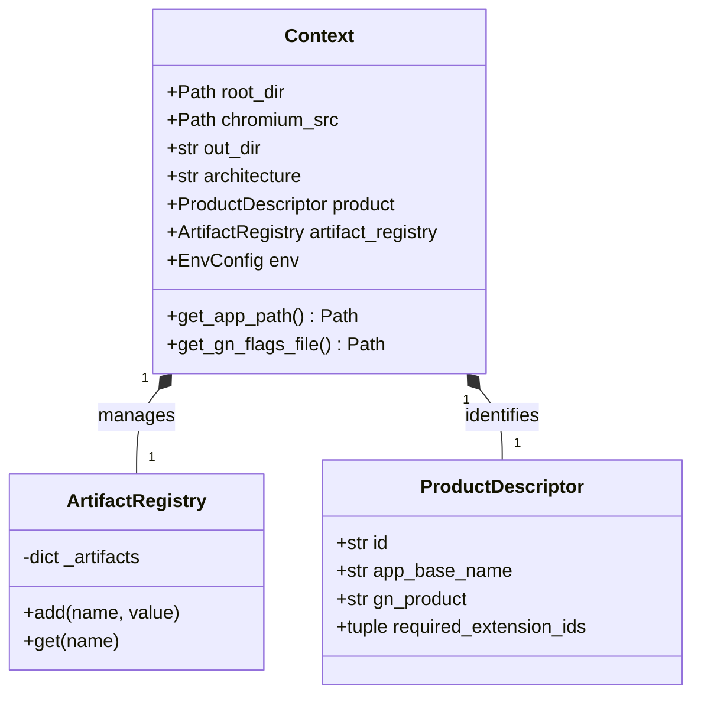
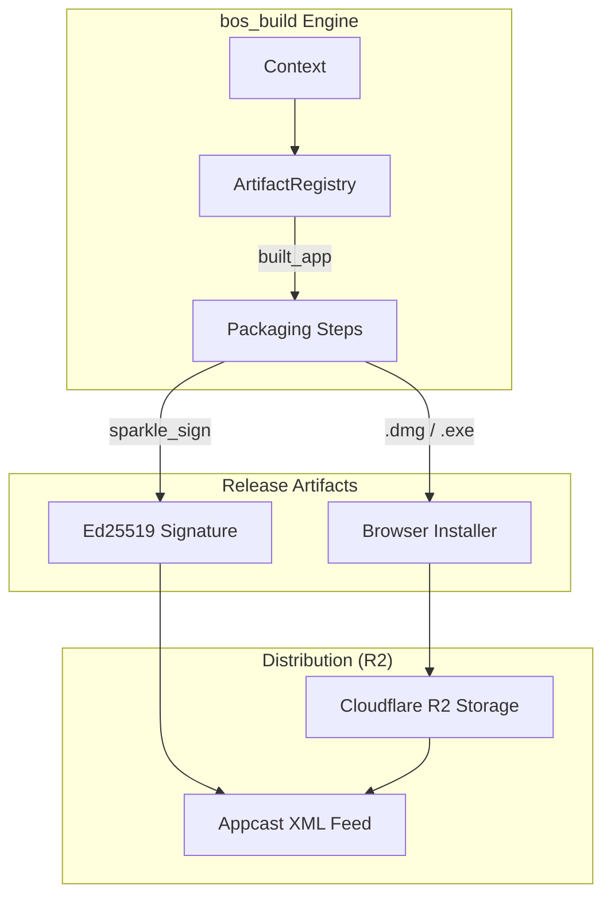

<!-- source: DeepWiki mcp.deepwiki.com · repo browseros-ai/BrowserOS · page 10.1 Build System Overview · fetched 2026-10-29 -->

# Build System Overview

<details>
<summary>Relevant source files</summary>

The following files were used as context for generating this wiki page:

- [packages/browseros-agent/scripts/build/claw-server-rust-local.sh](packages/browseros-agent/scripts/build/claw-server-rust-local.sh)
- [packages/browseros/.env.example](packages/browseros/.env.example)
- [packages/browseros/bos_build/README.md](packages/browseros/bos_build/README.md)
- [packages/browseros/bos_build/cli/build.py](packages/browseros/bos_build/cli/build.py)
- [packages/browseros/bos_build/cli/build_test.py](packages/browseros/bos_build/cli/build_test.py)
- [packages/browseros/bos_build/core/checkout_lock.py](packages/browseros/bos_build/core/checkout_lock.py)
- [packages/browseros/bos_build/core/checkout_lock_test.py](packages/browseros/bos_build/core/checkout_lock_test.py)
- [packages/browseros/bos_build/core/context.py](packages/browseros/bos_build/core/context.py)
- [packages/browseros/bos_build/core/context_test.py](packages/browseros/bos_build/core/context_test.py)
- [packages/browseros/bos_build/core/planner.py](packages/browseros/bos_build/core/planner.py)
- [packages/browseros/bos_build/core/planner_test.py](packages/browseros/bos_build/core/planner_test.py)
- [packages/browseros/bos_build/core/products.py](packages/browseros/bos_build/core/products.py)
- [packages/browseros/bos_build/core/resolver.py](packages/browseros/bos_build/core/resolver.py)
- [packages/browseros/bos_build/core/resolver_test.py](packages/browseros/bos_build/core/resolver_test.py)
- [packages/browseros/bos_build/core/step_test.py](packages/browseros/bos_build/core/step_test.py)
- [packages/browseros/bos_build/docs/build-cli.md](packages/browseros/bos_build/docs/build-cli.md)
- [packages/browseros/bos_build/products/browseros/product.py](packages/browseros/bos_build/products/browseros/product.py)
- [packages/browseros/bos_build/products/products_test.py](packages/browseros/bos_build/products/products_test.py)
- [packages/browseros/bos_build/profiles/nightly-ci.yaml](packages/browseros/bos_build/profiles/nightly-ci.yaml)
- [packages/browseros/bos_build/steps/__init__.py](packages/browseros/bos_build/steps/__init__.py)
- [packages/browseros/bos_build/steps/compile/universal.py](packages/browseros/bos_build/steps/compile/universal.py)
- [packages/browseros/bos_build/steps/compile/universal_test.py](packages/browseros/bos_build/steps/compile/universal_test.py)
- [packages/browseros/bos_build/steps/extensions/bundled_extensions.py](packages/browseros/bos_build/steps/extensions/bundled_extensions.py)
- [packages/browseros/bos_build/steps/extensions/bundled_extensions_test.py](packages/browseros/bos_build/steps/extensions/bundled_extensions_test.py)
- [packages/browseros/bos_build/steps/setup/configure.py](packages/browseros/bos_build/steps/setup/configure.py)
- [packages/browseros/bos_build/steps/setup/configure_test.py](packages/browseros/bos_build/steps/setup/configure_test.py)
- [packages/browseros/pyproject.toml](packages/browseros/pyproject.toml)
- [packages/browseros/requirements.txt](packages/browseros/requirements.txt)
- [packages/browseros/uv.lock](packages/browseros/uv.lock)

</details>


The BrowserOS build system is a modular, Python-based pipeline designed to manage the complexities of a custom Chromium fork alongside a TypeScript-based agent. It leverages `uv` for dependency management and `pyproject.toml` for configuration [packages/browseros/pyproject.toml:1-19](), providing a unified CLI (`browseros`) to handle everything from source patching to multi-platform packaging and distribution [packages/browseros/bos_build/README.md:3-14]().

## Purpose and Scope

The build system automates the lifecycle of BrowserOS by bridging two distinct technology stacks:
1.  **The Browser:** A custom-patched Chromium C++ codebase, managed via a sophisticated feature-patching system.
2.  **The Agent:** A TypeScript/Bun environment containing the UI, Controller, and Server sidecar.

The system is designed around a **Composition-based architecture**, where a build is not merely configured but composed into an ordered list of steps based on a preset, product, platform, and architecture [packages/browseros/bos_build/README.md:41-56]().

## System Architecture

The build system operates as a state machine centered around a `Context` object [packages/browseros/bos_build/core/context.py:61-91](). This object carries resolved build state (architecture, build type, product descriptors) and an `ArtifactRegistry` that tracks files produced by one step for use by another [packages/browseros/bos_build/core/context.py:34-58]().

### Build Pipeline Flow
The `planner.py` engine resolves switches into a linear sequence of modules [packages/browseros/bos_build/core/planner.py:89-108](). The following diagram illustrates the progression from source code to a distributed package.

**Figure 1: Source to Distribution Pipeline**
```mermaid
graph TD
    subgraph "Phase: Setup"
        [clean] --> [git_setup]
        [git_setup] --> [sparkle_setup/winsparkle_setup]
    end

    subgraph "Phase: Prep"
        [sparkle_setup/winsparkle_setup] --> [download_resources]
        [download_resources] --> [resources]
        [resources] --> [bundled_extensions]
        [bundled_extensions] --> [chromium_replace]
        [chromium_replace] --> [string_replaces]
        [string_replaces] --> [series_patches]
        [series_patches] --> [patches]
        [patches] --> [configure]
    end

    subgraph "Phase: Build"
        [configure] --> [compile]
    end

    subgraph "Phase: Package & Sign"
        [compile] --> [sign_macos/sign_windows]
        [sign_macos/sign_windows] --> [package_macos/package_windows/package_linux]
        [package_macos/package_windows/package_linux] --> [sparkle_sign]
    end

    subgraph "Phase: Upload"
        [sparkle_sign] --> [upload]
    end
```
**Sources:** [packages/browseros/bos_build/core/planner_test.py:26-48](), [packages/browseros/bos_build/cli/build.py:46-49]()

## Key Build Paths

### 1. Agent Build Path
The Agent build path focuses on the TypeScript components. While the Python CLI manages bundling the resulting extensions into the browser [packages/browseros/bos_build/steps/extensions/bundled_extensions.py:10-20](), the agent components are built via `bun`.
*   **Controller/UI:** Built as extensions. The system can either use CDN-pinned CRX files or build from the local repo if `bundle_local_extensions` is enabled [packages/browseros/bos_build/core/context.py:89-91]().
*   **Server:** Compiled for various targets (e.g., `darwin-arm64`, `win32-x64`) and bundled as resources [packages/browseros/bos_build/steps/compile/universal.py:38-52]().

### 2. Browser Build Path
Managed by the `bos_build` engine, this path involves the Chromium source:
*   **Chromium Checkout:** The `git_setup` step handles the checkout. The system supports different `provision` modes: `none`, `full`, or `shallow` [packages/browseros/bos_build/core/planner.py:21]().
*   **Configuration:** The `ConfigureModule` generates the `args.gn` file. It uses product-specific GN arguments and platform-specific flags (e.g., `flags.macos.release.gn`) [packages/browseros/bos_build/core/context.py:173-178]().
*   **Universal Builds (macOS):** A special path where the system executes three sequential runs: an `arm64` build, an `x64` build, and a `merge_universal` step that folds them into a single `.app` [packages/browseros/bos_build/core/planner.py:133-184]().

## Implementation Detail: Context Object

The `Context` object is the single source of truth for the build session [packages/browseros/bos_build/core/context.py:1-9]().

**Figure 2: Context Entity Mapping**

**Sources:** [packages/browseros/bos_build/core/context.py:61-105](), [packages/browseros/bos_build/core/products.py:25-50]()

The `Context` derives application names and output paths dynamically based on the `ProductDescriptor` (e.g., `browseros` vs `browserclaw`) and the target architecture [packages/browseros/bos_build/core/context.py:113-116]().

## Release and Distribution Pipeline

Once artifacts are created, they are signed and distributed.

1.  **Sparkle/WinSparkle Setup:** Fetches the update framework binaries [packages/browseros/bos_build/core/context.py:94-95]().
2.  **Platform Signing:** `sign_macos` or `sign_windows` handles binary identity.
3.  **Sparkle Signing:** The `sparkle_sign` step generates the Ed25519 signatures required for the update feed [packages/browseros/bos_build/core/planner_test.py:30-47]().
4.  **Universal Merging:** On macOS, the `merge_universal` step uses a `universalizer_patched.py` script to combine architectures while validating that server binary versions are aligned to prevent skew [packages/browseros/bos_build/steps/compile/universal.py:38-75]().

### Distribution Entity Mapping
**Figure 3: Artifact and Metadata Flow**

**Sources:** [packages/browseros/bos_build/steps/compile/universal.py:125-126](), [packages/browseros/bos_build/core/planner_test.py:138-146](), [packages/browseros/bos_build/README.md:21-26]()

---

