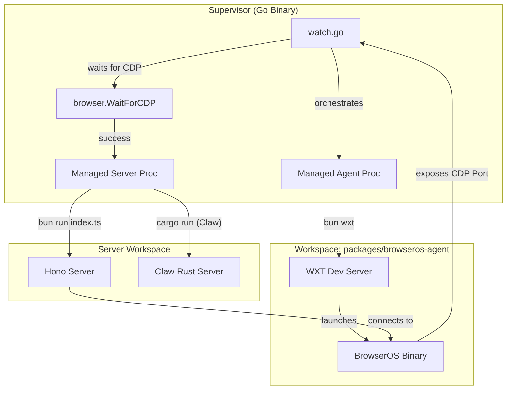
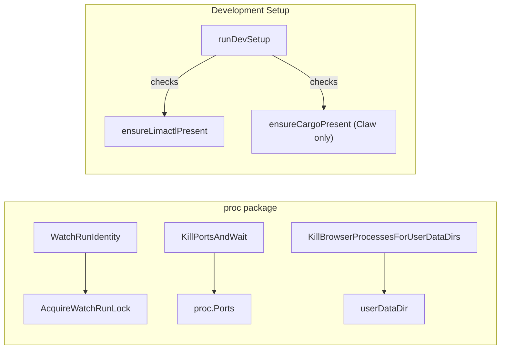
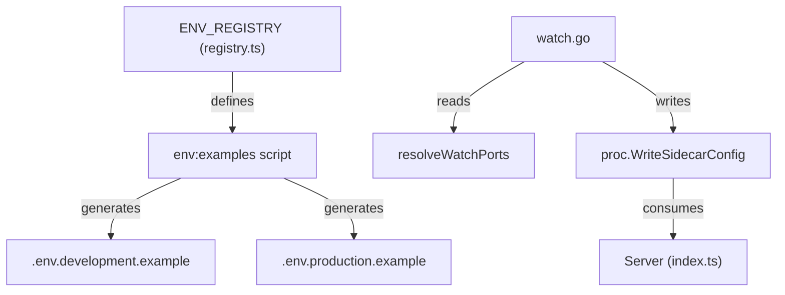

<!-- source: DeepWiki mcp.deepwiki.com · repo browseros-ai/BrowserOS · page 10.2 Agent Development Workflow · fetched 2026-10-29 -->

# Agent Development Workflow

Relevant source files

The following files were used as context for generating this wiki page:

- [packages/browseros-agent/.env.development.example](packages/browseros-agent/.env.development.example)
- [packages/browseros-agent/.env.production.example](packages/browseros-agent/.env.production.example)
- [packages/browseros-agent/crates/harness-integrations/tests/skills.rs](packages/browseros-agent/crates/harness-integrations/tests/skills.rs)
- [packages/browseros-agent/packages/shared/src/env/generate.test.ts](packages/browseros-agent/packages/shared/src/env/generate.test.ts)
- [packages/browseros-agent/packages/shared/src/env/registry.ts](packages/browseros-agent/packages/shared/src/env/registry.ts)
- [packages/browseros-agent/scripts/release/release-extensions-workflow.test.ts](packages/browseros-agent/scripts/release/release-extensions-workflow.test.ts)
- [packages/browseros-agent/tools/dev/cmd/setup.go](packages/browseros-agent/tools/dev/cmd/setup.go)
- [packages/browseros-agent/tools/dev/cmd/setup_test.go](packages/browseros-agent/tools/dev/cmd/setup_test.go)
- [packages/browseros-agent/tools/dev/cmd/sidecar.go](packages/browseros-agent/tools/dev/cmd/sidecar.go)
- [packages/browseros-agent/tools/dev/cmd/test.go](packages/browseros-agent/tools/dev/cmd/test.go)
- [packages/browseros-agent/tools/dev/cmd/watch.go](packages/browseros-agent/tools/dev/cmd/watch.go)
- [packages/browseros-agent/tools/dev/cmd/watch_test.go](packages/browseros-agent/tools/dev/cmd/watch_test.go)
- [packages/browseros-agent/tools/dev/proc/log.go](packages/browseros-agent/tools/dev/proc/log.go)
- [packages/browseros-agent/tools/dev/setup.sh](packages/browseros-agent/tools/dev/setup.sh)
- [packages/browseros-agent/tools/dogfood/cmd/sidecar.go](packages/browseros-agent/tools/dogfood/cmd/sidecar.go)
- [packages/browseros-agent/tools/dogfood/cmd/sidecar_test.go](packages/browseros-agent/tools/dogfood/cmd/sidecar_test.go)
- [tools/release_secrets/sync.py](tools/release_secrets/sync.py)
- [tools/release_secrets/sync_test.py](tools/release_secrets/sync_test.py)

The BrowserOS Agent is a TypeScript-based suite of services powered by **Bun**. The development workflow manages three primary sub-components: the **Server** (sidecar process), the **Agent UI/Extension** (built with WXT), and the **Controller** (automation bridge). This page documents the local development environment, process supervision, and configuration management.

## Local Development Loop

The development environment utilizes a custom Go-based supervisor (`tools/dev/cmd/watch.go`) to manage the lifecycle of multiple services. This tool orchestrates the startup sequence: building the agent, waiting for the Chrome DevTools Protocol (CDP) to become available, and then launching the sidecar server.

### Primary Development Commands
The root `package.json` provides scripts to initiate the development environment:

| Command | Script | Purpose |
| :--- | :--- | :--- |
| `bun run dev:watch` | `./tools/dev/run.sh watch` | Starts the full dev environment with WXT HMR and server watching [packages/browseros-agent/package.json:12-12](). |
| `bun run dev:watch:new` | `./tools/dev/run.sh watch --new` | Starts dev with random ports and a fresh temporary user-data directory [packages/browseros-agent/tools/dev/cmd/watch.go:42-42](). |
| `bun run dev:manual` | `./tools/dev/run.sh watch --manual` | Builds the agent statically instead of WXT HMR mode [packages/browseros-agent/tools/dev/cmd/watch.go:43-43](). |
| `bun run dev:claw` | `./tools/dev/run.sh watch --claw` | Runs the BrowserClaw UI and standalone Rust server [packages/browseros-agent/tools/dev/cmd/watch.go:44-44](). |
| `bun run test` | `./tools/dev/run.sh test` | Starts a clean environment, runs tests, and cleans up [packages/browseros-agent/tools/dev/cmd/test.go:20-25](). |

### Service Orchestration Data Flow
The `watch` command coordinates the `WXT` build for the extension and the `Bun` runner for the server. It ensures that the server only starts once the browser (launched by WXT or manually) has opened its CDP port.

**Agent Dev Service Mapping**

Sources: [packages/browseros-agent/tools/dev/cmd/watch.go:22-27](), [packages/browseros-agent/tools/dev/cmd/watch.go:175-182](), [packages/browseros-agent/tools/dev/cmd/test.go:122-132](), [packages/browseros-agent/tools/dev/cmd/watch.go:164-164]()

## Process Supervision & Locking

To prevent port conflicts and orphaned processes, BrowserOS uses a file-locking mechanism to track active development sessions.

### Watch Run Identity
A "Run" is identified by its mode, browser profile path, and port configuration.
*   **Locking**: The supervisor acquires an exclusive lock via `proc.AcquireWatchRunLock` to ensure only one supervisor manages a specific profile at a time [packages/browseros-agent/tools/dev/cmd/watch.go:78-87]().
*   **Takeover**: When starting a new session, the tool kills existing processes on preferred ports and browser processes associated with the `userDataDir` [packages/browseros-agent/tools/dev/cmd/watch.go:118-129]().
*   **Claw Mode**: When running with `--claw`, the supervisor manages a Rust-based server via `cargo run` and injects sidecar configuration via a JSON file [packages/browseros-agent/tools/dev/cmd/watch_test.go:179-182]().

**Process Lifecycle Logic**

Sources: [packages/browseros-agent/tools/dev/cmd/watch.go:63-65](), [packages/browseros-agent/tools/dev/cmd/watch.go:78-93](), [packages/browseros-agent/tools/dev/cmd/watch.go:118-129]()

## Environment Configuration

BrowserOS uses a centralized `ENV_REGISTRY` to manage environment variables across development and production.

### Environment Registry
The `ENV_REGISTRY` defines the schema, section, and default values for all variables [packages/browseros-agent/packages/shared/src/env/registry.ts:37-37]().
*   **App Ports**: `BROWSEROS_CDP_PORT` (9005), `BROWSEROS_SERVER_PORT` (9105), and `BROWSEROS_EXTENSION_PORT` (9305) [packages/browseros-agent/packages/shared/src/env/registry.ts:65-88]().
*   **Claw Overrides**: `BROWSEROS_CLAW_CDP_PORT` and `VITE_BROWSEROS_CLAW_API_URL` are used specifically for BrowserClaw development [packages/browseros-agent/packages/shared/src/env/registry.ts:163-190]().
*   **Production Secrets**: Variables like `R2_SECRET_ACCESS_KEY` and `SPARKLE_PRIVATE_KEY` are managed via `tools/release_secrets/sync.py` to ensure they are safely synced to GitHub Actions [tools/release_secrets/sync.py:96-107](), [tools/release_secrets/sync.py:165-174]().

### Configuration Sidecars
Sidecar processes receive their configuration through JSON files written to the temporary user data directory [packages/browseros-agent/tools/dev/cmd/sidecar.go:9-15](). These files include:
*   **Ports**: CDP, Server, and Proxy port assignments.
*   **Directories**: Resource and execution paths.

**Environment Data Flow**

Sources: [packages/browseros-agent/packages/shared/src/env/registry.ts:37-37](), [packages/browseros-agent/.env.development.example:1-3](), [packages/browseros-agent/tools/dev/cmd/sidecar.go:9-15]()

## Testing Workflow

The `test` command (`tools/dev/cmd/test.go`) automates the setup of a transient environment for running integration tests.

### Test Lifecycle
1.  **Cleanup**: Kills conflicting ports and removes orphaned temp directories [packages/browseros-agent/tools/dev/cmd/test.go:49-55]().
2.  **Environment Setup**: Creates a temporary profile and writes a server sidecar config [packages/browseros-agent/tools/dev/cmd/test.go:109-120]().
3.  **Service Startup**: Starts the Bun server and BrowserOS binary (optionally headless) [packages/browseros-agent/tools/dev/cmd/test.go:123-154]().
4.  **Execution**: Runs `bun test` with the provided arguments [packages/browseros-agent/tools/dev/cmd/test.go:168-179]().
5.  **Teardown**: Gracefully stops processes and removes the temporary profile unless `--keep` is specified [packages/browseros-agent/tools/dev/cmd/test.go:76-88]().

Sources: [packages/browseros-agent/tools/dev/cmd/test.go:20-36](), [packages/browseros-agent/tools/dev/cmd/test.go:109-187]()

---

