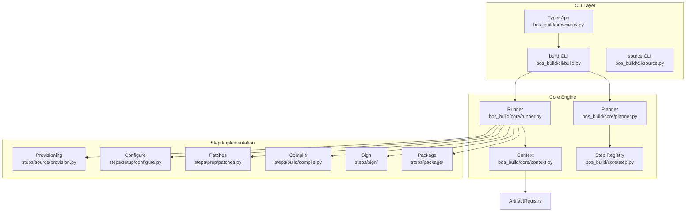

<!-- source: DeepWiki mcp.deepwiki.com · repo browseros-ai/BrowserOS · page 10.3 Browser Development Workflow · fetched 2026-10-29 -->

# Browser Development Workflow

<details>
<summary>Relevant source files</summary>

The following files were used as context for generating this wiki page:

- [.github/workflows/bos-build-tests.yml](.github/workflows/bos-build-tests.yml)
- [.github/workflows/build-browseros.yml](.github/workflows/build-browseros.yml)
- [.github/workflows/release-linux.yml](.github/workflows/release-linux.yml)
- [.github/workflows/release-windows.yml](.github/workflows/release-windows.yml)
- [packages/browseros-agent/scripts/build/claw-server-rust-local.sh](packages/browseros-agent/scripts/build/claw-server-rust-local.sh)
- [packages/browseros/bos_build/README.md](packages/browseros/bos_build/README.md)
- [packages/browseros/bos_build/ci_watchdog_test.py](packages/browseros/bos_build/ci_watchdog_test.py)
- [packages/browseros/bos_build/ci_workflow_test.py](packages/browseros/bos_build/ci_workflow_test.py)
- [packages/browseros/bos_build/cli/build.py](packages/browseros/bos_build/cli/build.py)
- [packages/browseros/bos_build/cli/build_test.py](packages/browseros/bos_build/cli/build_test.py)
- [packages/browseros/bos_build/cli/source.py](packages/browseros/bos_build/cli/source.py)
- [packages/browseros/bos_build/core/checkout_lock.py](packages/browseros/bos_build/core/checkout_lock.py)
- [packages/browseros/bos_build/core/checkout_lock_test.py](packages/browseros/bos_build/core/checkout_lock_test.py)
- [packages/browseros/bos_build/core/context.py](packages/browseros/bos_build/core/context.py)
- [packages/browseros/bos_build/core/context_test.py](packages/browseros/bos_build/core/context_test.py)
- [packages/browseros/bos_build/core/planner.py](packages/browseros/bos_build/core/planner.py)
- [packages/browseros/bos_build/core/planner_test.py](packages/browseros/bos_build/core/planner_test.py)
- [packages/browseros/bos_build/core/products.py](packages/browseros/bos_build/core/products.py)
- [packages/browseros/bos_build/core/resolver.py](packages/browseros/bos_build/core/resolver.py)
- [packages/browseros/bos_build/core/resolver_test.py](packages/browseros/bos_build/core/resolver_test.py)
- [packages/browseros/bos_build/core/step_test.py](packages/browseros/bos_build/core/step_test.py)
- [packages/browseros/bos_build/docs/build-cli.md](packages/browseros/bos_build/docs/build-cli.md)
- [packages/browseros/bos_build/docs/warpbuild-ci.md](packages/browseros/bos_build/docs/warpbuild-ci.md)
- [packages/browseros/bos_build/products/browseros/product.py](packages/browseros/bos_build/products/browseros/product.py)
- [packages/browseros/bos_build/products/products_test.py](packages/browseros/bos_build/products/products_test.py)
- [packages/browseros/bos_build/profiles/nightly-ci.yaml](packages/browseros/bos_build/profiles/nightly-ci.yaml)
- [packages/browseros/bos_build/profiles/release-ci.yaml](packages/browseros/bos_build/profiles/release-ci.yaml)
- [packages/browseros/bos_build/steps/__init__.py](packages/browseros/bos_build/steps/__init__.py)
- [packages/browseros/bos_build/steps/compile/universal.py](packages/browseros/bos_build/steps/compile/universal.py)
- [packages/browseros/bos_build/steps/compile/universal_test.py](packages/browseros/bos_build/steps/compile/universal_test.py)
- [packages/browseros/bos_build/steps/extensions/bundled_extensions.py](packages/browseros/bos_build/steps/extensions/bundled_extensions.py)
- [packages/browseros/bos_build/steps/extensions/bundled_extensions_test.py](packages/browseros/bos_build/steps/extensions/bundled_extensions_test.py)
- [packages/browseros/bos_build/steps/setup/configure.py](packages/browseros/bos_build/steps/setup/configure.py)
- [packages/browseros/bos_build/steps/setup/configure_test.py](packages/browseros/bos_build/steps/setup/configure_test.py)
- [packages/browseros/bos_build/steps/source/provision.py](packages/browseros/bos_build/steps/source/provision.py)
- [packages/browseros/bos_build/steps/source/provision_test.py](packages/browseros/bos_build/steps/source/provision_test.py)

</details>


This document covers the complete workflow for building the custom Chromium browser that powers BrowserOS. It explains the build system architecture, the `uv run browseros build` command, and the modular pipeline management.

For prerequisites and system requirements, see page 10.1. For resource management and binary downloads, see page 10.5.

## Overview

Building BrowserOS requires compiling a custom Chromium fork with BrowserOS-specific patches applied. The build system is implemented in Python using the `uv` package manager and provides a unified CLI for all platforms (macOS, Windows, Linux).

The build process is composed of modular steps that are planned dynamically based on **Presets** and **Switches** [packages/browseros/bos_build/core/planner.py:1-9]().

| Presets | Description |
|---------|-------------|
| `release` | Full optimization, symbols stripped, signing and uploading enabled by default [packages/browseros/bos_build/core/planner.py:84](). |
| `debug` | Unoptimized build, no signing, local iteration focus [packages/browseros/bos_build/core/planner.py:85](). |

**Sources:**
- [packages/browseros/bos_build/core/planner.py:1-86]()
- [packages/browseros/bos_build/README.md:1-26]()

## Build System Architecture

The BrowserOS build system orchestrates Chromium compilation through a modular pipeline. It separates concerns into a core engine (`bos_build/core`), platform plumbing (`bos_build/lib`), and domain-specific steps (`bos_build/steps`).

### Build System Components



**Key Components:**

| Component | Location | Role |
|-----------|----------|------|
| `Context` | [packages/browseros/bos_build/core/context.py:61]() | Shared state including paths, product info, and version data [packages/browseros/bos_build/core/context.py:100-141](). |
| `ArtifactRegistry` | [packages/browseros/bos_build/core/context.py:34]() | Tracking channel for artifacts (DMGs, EXEs) between steps [packages/browseros/bos_build/core/context.py:45-57](). |
| `Planner` | [packages/browseros/bos_build/core/planner.py]() | Resolves presets/switches into an ordered list of step names [packages/browseros/bos_build/core/planner.py:89-108](). |
| `Runner` | [packages/browseros/bos_build/core/runner.py]() | Executes the planned steps within the build context. |

**Sources:**
- [packages/browseros/bos_build/core/context.py:34-141]()
- [packages/browseros/bos_build/core/planner.py:89-108]()
- [packages/browseros/bos_build/README.md:71-93]()

### Build Pipeline Planning

The `plan()` function [packages/browseros/bos_build/core/planner.py:89]() composes the step list. This logic is golden-tested to ensure consistency across platforms [packages/browseros/bos_build/core/planner_test.py:25-49]().

```mermaid
graph TD
    A[Start: browseros build] --> B{Resolve Switches};
    B --> C{Apply Preset Defaults};
    C --> D{Planner.plan()};
    D --> E[Provisioning Steps];
    E --> F[Prep Steps: patches, resources];
    F --> G[Build Steps: compile];
    G --> H[Post-Build: sign, package, upload];
    H --> I[Execute via Runner.run()];
```

**Sources:**
- [packages/browseros/bos_build/core/planner.py:89-108]()
- [packages/browseros/bos_build/core/planner_test.py:2-184]()

## Browser Build Workflow

The build process is divided into functional phases. A typical `release` build for macOS arm64 includes 16 discrete steps [packages/browseros/bos_build/core/planner_test.py:28-48]().

### 1. Provisioning & Setup
*   **clean**: Resets the tree and deletes hook-managed toolchains [packages/browseros/bos_build/core/planner_test.py:31]().
*   **git_setup**: Configures depot_tools and local git environment [packages/browseros/bos_build/core/planner_test.py:32]().
*   **sparkle_setup** / **winsparkle_setup**: Downloads platform-specific update frameworks [packages/browseros/bos_build/core/planner_test.py:33, 57]().

### 2. Preparation (Prep)
*   **download_resources**: Pulls server and onboarding bundles from R2 [packages/browseros/bos_build/core/planner_test.py:34]().
*   **bundled_extensions**: Integrates core extensions (Agent, Controller) [packages/browseros/bos_build/core/planner_test.py:36]().
*   **patches**: Applies the BrowserOS patch stack to the Chromium source [packages/browseros/bos_build/core/planner_test.py:40]().
*   **configure**: Runs `gn gen` to generate build files in `out/Default_<product>_<arch>` [packages/browseros/bos_build/core/planner_test.py:41]().

### 3. Compilation
*   **compile**: Executes `ninja` to build the Chromium binary [packages/browseros/bos_build/core/planner_test.py:42]().
*   **merge_universal** (macOS only): Combines arm64 and x64 slices into a single app bundle [packages/browseros/bos_build/core/planner_test.py:140]().

### 4. Post-Processing
*   **sign_macos** / **sign_windows**: Performs platform-native code signing [packages/browseros/bos_build/core/planner_test.py:43, 67]().
*   **package_macos** / **package_windows**: Wraps the binary in a DMG or EXE installer [packages/browseros/bos_build/core/planner_test.py:44, 68]().
*   **sparkle_sign**: Generates Ed25519 signatures for the update feed [packages/browseros/bos_build/core/planner_test.py:45]().
*   **upload**: Ships artifacts and metadata to R2 [packages/browseros/bos_build/core/planner_test.py:46]().

**Sources:**
- [packages/browseros/bos_build/core/planner_test.py:25-159]()
- [packages/browseros/bos_build/core/context.py:113-115]()

## Development CLI Usage

The `browseros build` command provides several flags for granular control during development.

| Flag | Purpose |
|------|---------|
| `--show-plan` | Prints the step list and required environment variables without needing a Chromium checkout [packages/browseros/bos_build/cli/build.py:140-145](). |
| `--from <step>` | Resumes a build from a specific step (e.g., resume at `compile` after fixing a patch) [packages/browseros/bos_build/cli/build.py:135-139](). |
| `--skip <steps>` | Comma-separated list of steps to remove from the planned execution [packages/browseros/bos_build/cli/build.py:129-134](). |
| `--gn-arg <key=val>` | Appends custom GN arguments to `args.gn`. These take precedence over profile defaults [packages/browseros/bos_build/cli/build.py:171-179](). |

**Example Commands:**
```bash
# Check what a release build would do
uv run browseros build --preset release --show-plan

# Fast local iteration with an existing checkout
uv run browseros build --preset debug --chromium-src ~/src/chromium/src

# Resume a failed macOS build from signing
uv run browseros build --preset release --from sign_macos
```

**Sources:**
- [packages/browseros/bos_build/cli/build.py:129-211]()
- [packages/browseros/bos_build/README.md:95-122]()

## CI Workflow Integration

The browser build is automated via `.github/workflows/build-browseros.yml`. This reusable workflow handles runner provisioning, caching, and execution of the `bos_build` system.

### CI Environment Setup
On Windows runners, the workflow performs a specific Git bootstrap to ensure compatibility with `depot_tools`, setting `core.autocrlf=false` and `core.filemode=false` [packages/browseros/bos_build/ci_workflow_test.py:19-25](). It uses an isolated global config at `$RUNNER_TEMP/browseros-global.gitconfig` [.github/workflows/build-browseros.yml:108-115]().

### Cache Strategy
The workflow uses a two-tier cache for Chromium source:
1.  **WarpCache**: Used for Linux and macOS runners [.github/workflows/build-browseros.yml:166-172]().
2.  **R2 Cache**: Used for Windows runners to overcome platform-specific cache limitations [.github/workflows/build-browseros.yml:182-186]().

**Sources:**
- [.github/workflows/build-browseros.yml:103-186]()
- [packages/browseros/bos_build/ci_workflow_test.py:62-135]()
- [packages/browseros/bos_build/docs/warpbuild-ci.md:1-58]()

---

