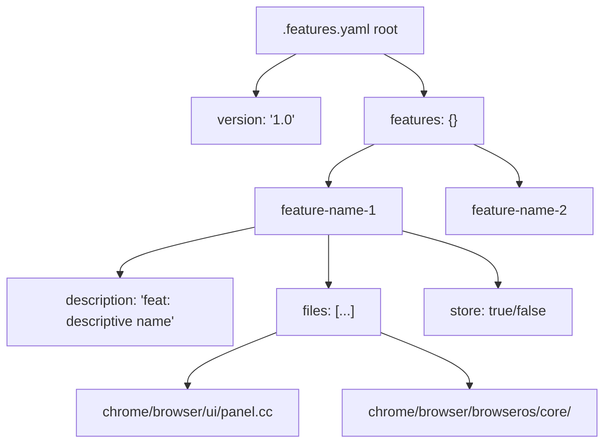
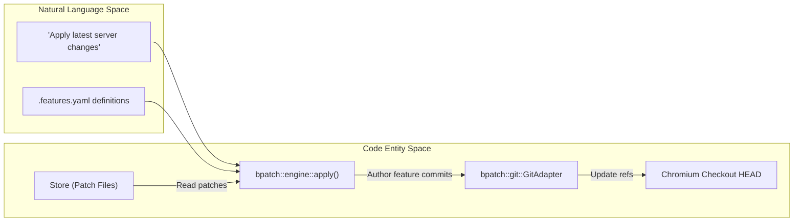

<!-- source: DeepWiki mcp.deepwiki.com · repo browseros-ai/BrowserOS · page 10.4 Feature Management · fetched 2026-10-29 -->

# Feature Management

Relevant source files

The following files were used as context for generating this wiki page:

- [packages/browseros-agent/apps/claw-app/wxt.config.ts](packages/browseros-agent/apps/claw-app/wxt.config.ts)
- [packages/browseros/bos_build/cli/ext.py](packages/browseros/bos_build/cli/ext.py)
- [packages/browseros/bos_build/cli/ext_test.py](packages/browseros/bos_build/cli/ext_test.py)
- [packages/browseros/bos_build/release/extensions/release.py](packages/browseros/bos_build/release/extensions/release.py)
- [packages/browseros/bos_build/release/extensions/release_test.py](packages/browseros/bos_build/release/extensions/release_test.py)
- [packages/browseros/chromium_patches/.features.yaml](packages/browseros/chromium_patches/.features.yaml)
- [packages/browseros/tools/bpatch/Makefile](packages/browseros/tools/bpatch/Makefile)
- [packages/browseros/tools/bpatch/README.md](packages/browseros/tools/bpatch/README.md)
- [packages/browseros/tools/bpatch/src/cli/apply.rs](packages/browseros/tools/bpatch/src/cli/apply.rs)
- [packages/browseros/tools/bpatch/src/cli/diff.rs](packages/browseros/tools/bpatch/src/cli/diff.rs)
- [packages/browseros/tools/bpatch/src/cli/feature.rs](packages/browseros/tools/bpatch/src/cli/feature.rs)
- [packages/browseros/tools/bpatch/src/cli/ls.rs](packages/browseros/tools/bpatch/src/cli/ls.rs)
- [packages/browseros/tools/bpatch/src/cli/mod.rs](packages/browseros/tools/bpatch/src/cli/mod.rs)
- [packages/browseros/tools/bpatch/src/cli/status.rs](packages/browseros/tools/bpatch/src/cli/status.rs)
- [packages/browseros/tools/bpatch/src/engine/apply.rs](packages/browseros/tools/bpatch/src/engine/apply.rs)
- [packages/browseros/tools/bpatch/src/engine/conflict.rs](packages/browseros/tools/bpatch/src/engine/conflict.rs)
- [packages/browseros/tools/bpatch/src/engine/extract.rs](packages/browseros/tools/bpatch/src/engine/extract.rs)
- [packages/browseros/tools/bpatch/src/engine/mod.rs](packages/browseros/tools/bpatch/src/engine/mod.rs)
- [packages/browseros/tools/bpatch/src/engine/state.rs](packages/browseros/tools/bpatch/src/engine/state.rs)
- [packages/browseros/tools/bpatch/src/git.rs](packages/browseros/tools/bpatch/src/git.rs)
- [packages/browseros/tools/bpatch/src/main.rs](packages/browseros/tools/bpatch/src/main.rs)
- [packages/browseros/tools/bpatch/src/store.rs](packages/browseros/tools/bpatch/src/store.rs)
- [packages/browseros/tools/bpatch/tests/apply.rs](packages/browseros/tools/bpatch/tests/apply.rs)
- [packages/browseros/tools/bpatch/tests/simulations.rs](packages/browseros/tools/bpatch/tests/simulations.rs)
- [packages/browseros/tools/bpatch/tests/status.rs](packages/browseros/tools/bpatch/tests/status.rs)
- [packages/browseros/tools/bpatch/tests/store.rs](packages/browseros/tools/bpatch/tests/store.rs)

## Purpose and Scope

This document explains BrowserOS's feature management system for organizing Chromium patches. The system uses `.features.yaml` to group hundreds of patch files into logical, named features, and the `bpatch` tool to manage the convergence between a Chromium checkout and the patch store. This ensures that custom modifications in the BrowserOS Chromium fork remain maintainable, searchable, and organized by logical capability.

## Overview

BrowserOS maintains a custom Chromium fork with modifications across thousands of files. To maintain organization, the build system uses a feature-based approach:

- **`.features.yaml`**: A structured manifest in the `chromium_patches` directory that groups related patches into named features. [packages/browseros/chromium_patches/.features.yaml:1-2]()
- **`bpatch`**: A Rust-based tool that manages the patch store. It uses a model where a checkout's state is `base + store`. [packages/browseros/tools/bpatch/README.md:5-5]()
- **Feature-Based Commits**: `bpatch` authors git commits in the Chromium checkout that correspond to features defined in the manifest, preserving logical grouping during development. [packages/browseros/tools/bpatch/src/engine/apply.rs:67-69]()

Sources: [packages/browseros/chromium_patches/.features.yaml:1-21](), [packages/browseros/tools/bpatch/README.md:1-81](), [packages/browseros/tools/bpatch/src/engine/apply.rs:128-141]()

## .features.yaml Structure

### File Format

`.features.yaml` uses a hierarchical structure to define feature ownership of file paths.

**Structure of .features.yaml**

### Feature Definition

Each feature entry supports the following fields:

| Field | Type | Purpose | Example |
|-------|------|---------|---------|
| `description` | String | Commit message subject for this feature group. | `"feat: browseros server"` [packages/browseros/chromium_patches/.features.yaml:154]() |
| `files` | List | Paths or directories owned by the feature. Directories end in `/`. | `chrome/browser/browseros/core/` [packages/browseros/chromium_patches/.features.yaml:32]() |
| `store` | Boolean | (Optional) If `false`, changes are tracked but not saved as patch files (used for build artifacts). | `store: false` [packages/browseros/chromium_patches/.features.yaml:6]() |

Sources: [packages/browseros/chromium_patches/.features.yaml:1-50](), [packages/browseros/tools/bpatch/src/store.rs:8-12]()

## Layer Strategy

Features are organized into layers to manage dependencies and build order.

| Layer | Purpose | Example Features |
|-------|---------|------------------|
| **Layer 0: Build Outputs** | Files generated by `bos_build` that should not be part of the permanent patch store. | `build-resources` [packages/browseros/chromium_patches/.features.yaml:5-20]() |
| **Layer 1: Core & Branding** | Foundation patches and product identity. | `browseros-core`, `branding` [packages/browseros/chromium_patches/.features.yaml:26-76]() |
| **Layer 2: Platform Patches** | OS-specific fixes (Windows, macOS). | `windows-patches`, `crash-reporter` [packages/browseros/chromium_patches/.features.yaml:89-106]() |
| **Layer 3: Services** | Infrastructure like updaters and the sidecar server. | `mac-sparkle-updater`, `server` [packages/browseros/chromium_patches/.features.yaml:110-158]() |
| **Layer 4: Features** | High-level capabilities (API, Vertical Tabs). | `api`, `vertical-tabs` [packages/browseros/chromium_patches/.features.yaml:173-178]() |

Sources: [packages/browseros/chromium_patches/.features.yaml:3-178]()

## The bpatch Tool

`bpatch` is the primary interface for managing the BrowserOS Chromium fork. It automates the "Daily Loop" of applying updates and extracting new changes.

### Core Verbs

| Verb | Action | Source |
|------|--------|--------|
| `status` | Shows the relationship between checkout base, store revision, and applied trailers. | [packages/browseros/tools/bpatch/src/cli/mod.rs:103-107]() |
| `apply` | Converges the checkout to the store state. It authors a chain of feature commits. | [packages/browseros/tools/bpatch/src/cli/mod.rs:121-125]() |
| `annotate` | Commits dirty working tree changes into feature/resource commits based on `.features.yaml`. | [packages/browseros/tools/bpatch/src/cli/mod.rs:127-135]() |
| `extract` | Folds checkout commits back into the store as per-file `.patch` files. | [packages/browseros/tools/bpatch/src/cli/mod.rs:137-143]() |
| `feature add` | Appends new paths to `.features.yaml` ownership. | [packages/browseros/tools/bpatch/src/cli/mod.rs:145-152]() |

### Data Flow: Store to Checkout

**Bridge: Applying Patch Store to Codebase**

Sources: [packages/browseros/tools/bpatch/README.md:55-81](), [packages/browseros/tools/bpatch/src/cli/mod.rs:98-201](), [packages/browseros/tools/bpatch/src/engine/apply.rs:172-205]()

### Git Trailers

`bpatch` uses Git commit trailers to track state without a metadata file in the checkout.
- `Bpatch-Store-Rev`: The SHA of the patch store repository at the time of apply. [packages/browseros/tools/bpatch/README.md:74]()
- `Bpatch-Base`: The Chromium base version/commit. [packages/browseros/tools/bpatch/src/engine/state.rs:10-10]()

Sources: [packages/browseros/tools/bpatch/README.md:5-5](), [packages/browseros/tools/bpatch/src/engine/state.rs:8-12]()

## Annotating Build Outputs

The `annotate` command is critical for managing files dirtied by the `bos_build` pipeline. It classifies dirty paths into two categories:
1. **Feature Commits**: Paths owned by features where `store: true`. These are treated as source code changes. [packages/browseros/tools/bpatch/README.md:138-139]()
2. **Resource Commits**: Paths owned by features where `store: false` (like `build-resources`). These are bundled into a single "resource: bos_build outputs" commit. [packages/browseros/tools/bpatch/README.md:140-141]()

This prevents generated files (like `BROWSEROS_VERSION` or branding assets) from polluting the logical feature patches while keeping the working tree clean.

Sources: [packages/browseros/tools/bpatch/README.md:136-145](), [packages/browseros/tools/bpatch/src/cli/annotate.rs:1-10](), [packages/browseros/chromium_patches/.features.yaml:5-20]()

---

