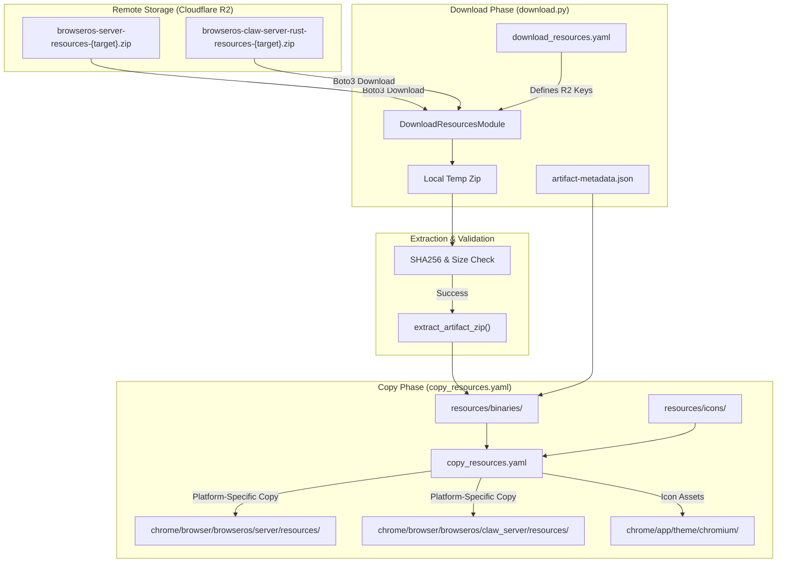
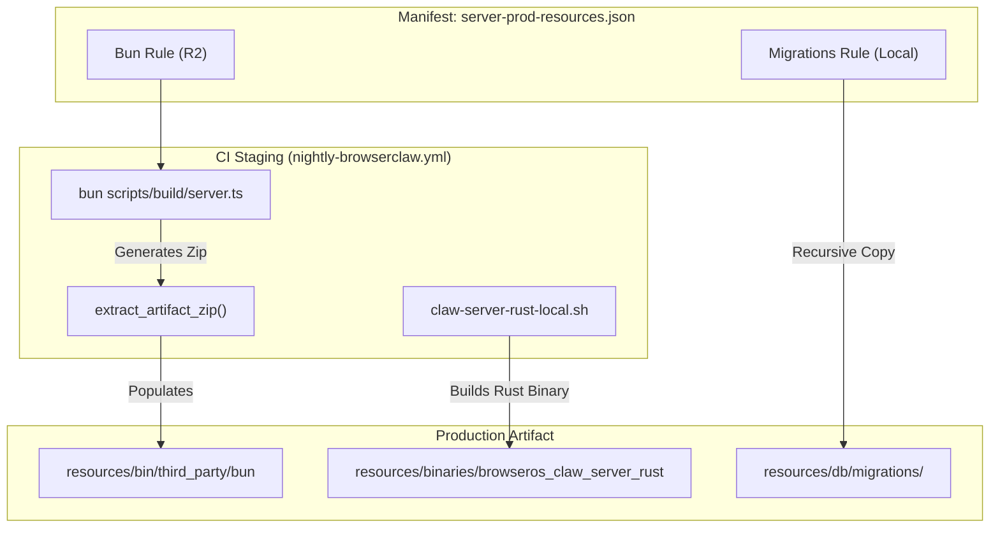

<!-- source: DeepWiki mcp.deepwiki.com · repo browseros-ai/BrowserOS · page 10.5 Resource Management · fetched 2026-10-29 -->

# Resource Management

Relevant source files

The following files were used as context for generating this wiki page:

- [.github/workflows/nightly-browserclaw.yml](.github/workflows/nightly-browserclaw.yml)
- [packages/browseros-agent/contracts/claw-mcp/tests/browser.ts](packages/browseros-agent/contracts/claw-mcp/tests/browser.ts)
- [packages/browseros-agent/scripts/build/config/server-prod-resources.json](packages/browseros-agent/scripts/build/config/server-prod-resources.json)
- [packages/browseros/bos_build/config/copy_resources.yaml](packages/browseros/bos_build/config/copy_resources.yaml)
- [packages/browseros/bos_build/config/download_resources.yaml](packages/browseros/bos_build/config/download_resources.yaml)
- [packages/browseros/bos_build/docs/nightly-macos-ci.md](packages/browseros/bos_build/docs/nightly-macos-ci.md)
- [packages/browseros/bos_build/products/browserclaw/product.py](packages/browseros/bos_build/products/browserclaw/product.py)
- [packages/browseros/bos_build/products/server_binaries.py](packages/browseros/bos_build/products/server_binaries.py)
- [packages/browseros/bos_build/products/server_binaries_test.py](packages/browseros/bos_build/products/server_binaries_test.py)
- [packages/browseros/bos_build/steps/resources/resources_test.py](packages/browseros/bos_build/steps/resources/resources_test.py)
- [packages/browseros/bos_build/steps/sign/macos_test.py](packages/browseros/bos_build/steps/sign/macos_test.py)
- [packages/browseros/bos_build/steps/storage/download_test.py](packages/browseros/bos_build/steps/storage/download_test.py)

## Purpose and Scope

This document describes the resource management system in BrowserOS, detailing how external binaries, assets, and artifacts are fetched, validated, and integrated into the build process. BrowserOS utilizes a multi-stage resource pipeline involving Cloudflare R2 for artifact storage and a YAML-driven configuration system for downloading and copying resources into the Chromium source tree.

---

## Resource Management Architecture

The resource system is divided into two primary phases: **Download** (fetching remote artifacts) and **Copy** (placing local files into the build tree). This ensures that heavy binaries like the BrowserOS Server and third-party tools (Bun, Rust-based agents) are not stored directly in the primary repository but are available during compilation.

### Resource Data Flow

The following diagram bridges the natural language concepts of "Downloading" and "Copying" to the specific Python modules and configuration files that implement them.

**Sources:** [packages/browseros/bos_build/steps/storage/download.py:19-24](), [packages/browseros/bos_build/config/download_resources.yaml:1-35](), [packages/browseros/bos_build/config/copy_resources.yaml:35-150]()

---

## Download System (R2 Artifacts)

BrowserOS uses `download_resources.yaml` to define external dependencies that must be fetched before the build starts. This is primarily used for the BrowserOS Server and BrowserClaw Rust Server resource bundles.

### Artifact Structure and Security

Resources are typically packaged as `artifact_zip` files. These archives contain a mandatory `artifact-metadata.json` file used for integrity verification [packages/browseros/bos_build/steps/storage/download.py:20-22]().

**Verification Process:**
1.  **Metadata Parsing:** The system reads `artifact-metadata.json` from the zip [packages/browseros/bos_build/steps/storage/download_test.py:59-61]().
2.  **Integrity Check:** For every file declared in the metadata, the system calculates the SHA256 hash and compares it against the expected value [packages/browseros/bos_build/steps/storage/download_test.py:132-155]().
3.  **Size Validation:** The byte size of each file is verified to prevent truncated downloads [packages/browseros/bos_build/steps/storage/download_test.py:143-146]().
4.  **Permissions:** The system restores Unix mode bits from the zip's external attributes. It specifically ensures that binaries in `resources/bin/` retain their executable bits [packages/browseros/bos_build/steps/storage/download_test.py:66-79]().

### Configuration (download_resources.yaml)

The configuration allows for platform and architecture-specific filtering.

| Field | Description | Supported Values |
|-------|-------------|------------------|
| `r2_key` | Path in the R2 bucket | `artifacts/server/latest/...`, `claw-server-rust/prod-resources/latest/...` |
| `destination` | Local path to extract to | `resources/binaries/browseros_server/...` |
| `download_type` | How to handle the file | `file`, `artifact_zip` |
| `os` | Target Operating System | `windows`, `macos`, `linux` |
| `arch` | Target Architecture | `x64`, `arm64` |

**Sources:** [packages/browseros/bos_build/config/download_resources.yaml:36-117]()

---

## Artifact Staging and Deployment

The build system includes a staging mechanism to prepare resources for production bundles, particularly during CI runs where local source tree integration is tested.

### Server Artifact Staging

The staging logic differentiates between local resources (like database migrations) and remote R2 resources (like third-party binaries).

**Key Components:**
- **Third-Party Binaries:** Binaries for Bun are fetched from R2 based on the target OS and architecture [packages/browseros-agent/scripts/build/config/server-prod-resources.json:2-57]().
- **Rust Server Staging:** The BrowserClaw Rust server is built natively using `claw-server-rust-local.sh` and staged in the `resources/binaries/browseros_claw_server_rust` directory [packages/browseros/bos_build/docs/nightly-macos-ci.md:59-64]().
- **Local Resources:** Recursive directories, such as Drizzle migrations, are copied from the source tree into the artifact [packages/browseros-agent/scripts/build/config/server-prod-resources.json:59-67]().

**Sources:** [packages/browseros/bos_build/docs/nightly-macos-ci.md:43-70](), [packages/browseros-agent/scripts/build/config/server-prod-resources.json:1-68]()

---

## Resource Integration (Copy System)

Once resources are available locally (either via download or staging), the `copy_resources.yaml` configuration dictates their placement within the Chromium source tree.

### Key Copy Operations

| Resource Category | Source | Destination | Purpose |
|-------------------|--------|-------------|---------|
| **Version** | `resources/BROWSEROS_VERSION` | `chrome/BROWSEROS_VERSION` | Version tracking [packages/browseros/bos_build/config/copy_resources.yaml:37-40]() |
| **Icons** | `resources/browseros/icons/*.png` | `chrome/app/theme/chromium/` | Branding assets [packages/browseros/bos_build/config/copy_resources.yaml:42-46]() |
| **Server Resources** | `resources/binaries/browseros_server/{target}/resources` | `chrome/browser/browseros/server/resources` | Bundled agent logic [packages/browseros/bos_build/config/copy_resources.yaml:151-156]() |
| **Claw Rust Server** | `resources/binaries/browseros_claw_server_rust/{target}/resources` | `chrome/browser/browseros/claw_server/resources` | Bundled Rust agent [packages/browseros/bos_build/config/copy_resources.yaml:189-199]() |

### Legacy Normalization
The copy system handles legacy binary naming. For example, it renames `browseros-claw-server-rs` to `browseros-claw-server` during the copy to maintain compatibility with older CDN artifacts [packages/browseros/bos_build/config/copy_resources.yaml:193-196]().

**Sources:** [packages/browseros/bos_build/config/copy_resources.yaml:1-210](), [packages/browseros/bos_build/steps/resources/resources_test.py:93-122]()

---

## Server Bundle Metadata

Resource roots and signing metadata are defined in `ServerBundle` objects. These descriptors link local resource paths to their final locations in the packaged application.

| Bundle Property | BrowserOS Server | BrowserClaw Server |
|-----------------|------------------|--------------------|
| **Local Root** | `resources/binaries/browseros_server` | `resources/binaries/browseros_claw_server_rust` |
| **Chromium Root** | `chrome/browser/browseros/server/resources` | `chrome/browser/browseros/claw_server/resources` |
| **macOS App Root** | `Contents/Resources/BrowserOSServer/default/resources` | `Contents/Resources/BrowserClawServer/default/resources` |
| **Artifact Prefix** | `artifacts/server` | `claw-server-rust/prod-resources` |

**Sources:** [packages/browseros/bos_build/products/server_binaries.py:25-47](), [packages/browseros/bos_build/products/browserclaw/product.py:26-48](), [packages/browseros/bos_build/products/server_binaries_test.py:36-71]()

---

## Signing Verification

During the macOS build, the system verifies that all resources in the final `.app` bundle match the source tree and maintain correct permissions.

- **Discovery:** The `find_components_to_sign` function scans the app bundle for registered binaries defined in the `ServerBundle` [packages/browseros/bos_build/steps/sign/macos_test.py:37-78]().
- **Integrity Check:** `verify_server_resources_bundle` compares the files in the packaged `Contents/Resources/` directory against the Chromium source tree to ensure no files were lost during the build process [packages/browseros/bos_build/steps/sign/macos_test.py:95-106]().
- **Permission Check:** The system specifically flags if a file that was executable in the source tree has lost its executable bit in the final bundle [packages/browseros/bos_build/steps/sign/macos_test.py:107-118]().

**Sources:** [packages/browseros/bos_build/steps/sign/macos_test.py:15-22](), [packages/browseros/bos_build/products/server_binaries.py:67-73]()

---

