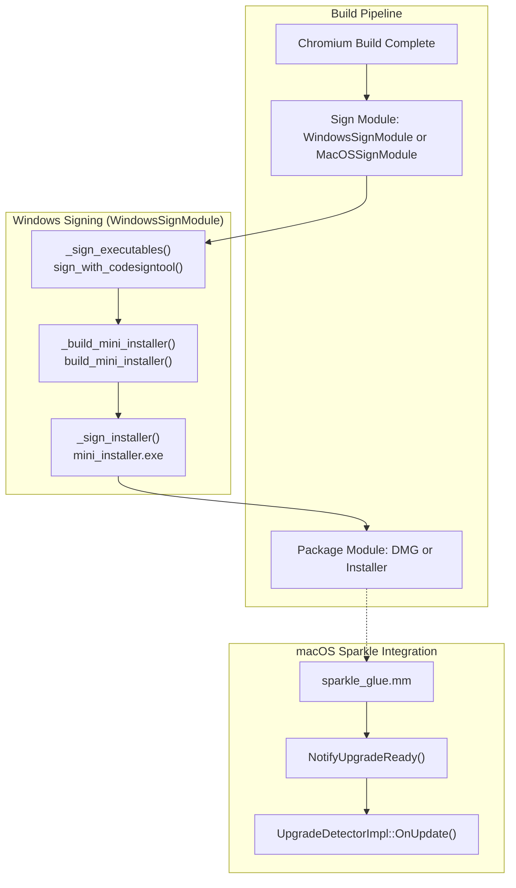
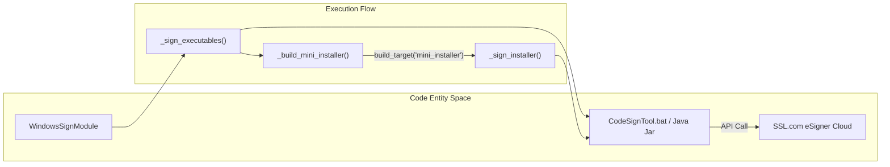

<!-- source: DeepWiki mcp.deepwiki.com · repo browseros-ai/BrowserOS · page 10.6 Code Signing · fetched 2026-10-29 -->

# Code Signing

Relevant source files

The following files were used as context for generating this wiki page:

- [packages/browseros/bos_build/lib/env.py](packages/browseros/bos_build/lib/env.py)
- [packages/browseros/bos_build/lib/logger.py](packages/browseros/bos_build/lib/logger.py)
- [packages/browseros/bos_build/lib/utils.py](packages/browseros/bos_build/lib/utils.py)
- [packages/browseros/bos_build/lib/utils_test.py](packages/browseros/bos_build/lib/utils_test.py)
- [packages/browseros/bos_build/release/ota/__init__.py](packages/browseros/bos_build/release/ota/__init__.py)
- [packages/browseros/bos_build/release/ota/common.py](packages/browseros/bos_build/release/ota/common.py)
- [packages/browseros/bos_build/release/ota/feeds_alignment_test.py](packages/browseros/bos_build/release/ota/feeds_alignment_test.py)
- [packages/browseros/bos_build/release/ota/server.py](packages/browseros/bos_build/release/ota/server.py)
- [packages/browseros/bos_build/release/ota/sign_binary.py](packages/browseros/bos_build/release/ota/sign_binary.py)
- [packages/browseros/bos_build/release/ota/sign_binary_test.py](packages/browseros/bos_build/release/ota/sign_binary_test.py)
- [packages/browseros/bos_build/steps/sign/windows.py](packages/browseros/bos_build/steps/sign/windows.py)
- [packages/browseros/bos_build/steps/sign/windows_test.py](packages/browseros/bos_build/steps/sign/windows_test.py)
- [packages/browseros/chromium_patches/chrome/BUILD.gn](packages/browseros/chromium_patches/chrome/BUILD.gn)
- [packages/browseros/chromium_patches/chrome/browser/BUILD.gn](packages/browseros/chromium_patches/chrome/browser/BUILD.gn)
- [packages/browseros/chromium_patches/chrome/browser/buildflags.gni](packages/browseros/chromium_patches/chrome/browser/buildflags.gni)
- [packages/browseros/chromium_patches/chrome/browser/mac/chrome_browser_main_extra_parts_mac.mm](packages/browseros/chromium_patches/chrome/browser/mac/chrome_browser_main_extra_parts_mac.mm)
- [packages/browseros/chromium_patches/chrome/browser/mac/sparkle_glue.h](packages/browseros/chromium_patches/chrome/browser/mac/sparkle_glue.h)
- [packages/browseros/chromium_patches/chrome/browser/mac/sparkle_glue.mm](packages/browseros/chromium_patches/chrome/browser/mac/sparkle_glue.mm)
- [packages/browseros/chromium_patches/chrome/browser/ui/toolbar/app_menu_icon_controller.cc](packages/browseros/chromium_patches/chrome/browser/ui/toolbar/app_menu_icon_controller.cc)
- [packages/browseros/chromium_patches/chrome/browser/ui/views/relaunch_notification/relaunch_notification_controller.cc](packages/browseros/chromium_patches/chrome/browser/ui/views/relaunch_notification/relaunch_notification_controller.cc)
- [packages/browseros/chromium_patches/chrome/browser/ui/webui/help/sparkle_version_updater_mac.h](packages/browseros/chromium_patches/chrome/browser/ui/webui/help/sparkle_version_updater_mac.h)
- [packages/browseros/chromium_patches/chrome/browser/ui/webui/help/sparkle_version_updater_mac.mm](packages/browseros/chromium_patches/chrome/browser/ui/webui/help/sparkle_version_updater_mac.mm)
- [packages/browseros/chromium_patches/chrome/browser/upgrade_detector/upgrade_detector_impl.cc](packages/browseros/chromium_patches/chrome/browser/upgrade_detector/upgrade_detector_impl.cc)

This document describes the code signing infrastructure for BrowserOS across macOS and Windows platforms. Code signing ensures that BrowserOS binaries are verifiable and trusted by operating systems, preventing tampering and enabling features like auto-updates and macOS notarization.

The page covers platform-specific signing for the browser application and Over-The-Air (OTA) update binaries. For information about update mechanisms that use these signatures, see [Update Systems](9). For packaging that occurs after signing, see [Packaging and Distribution](10.7).

---

## Overview

BrowserOS implements a multi-tier signing architecture:

| Platform | Method | Purpose |
|----------|--------|---------|
| **macOS** | `codesign` + Apple Notarization | System-level trust, Gatekeeper approval |
| **Windows** | SSL.com CodeSignTool | SmartScreen reputation, driver signing |
| **All Platforms** | Ed25519 (Sparkle) | Secure update verification for server binaries |

The build system signs two categories of artifacts:

1.  **Browser Application**: The main BrowserOS.app (macOS) or `mini_installer.exe` (Windows).
2.  **Server Binaries**: The BrowserOS Server sidecar process (including `browseros_server.exe` and `browseros-claw-server.exe`) distributed via OTA updates.

Sources: [packages/browseros/bos_build/steps/sign/windows.py:41-44](), [packages/browseros/bos_build/release/ota/server.py:41-50](), [packages/browseros/bos_build/products/server_binaries.py:12-16]()

---

## Signing Architecture

### Build Pipeline Flow

**Signing and Update Flow**

This diagram shows how code signing integrates into the build pipeline and bridges into the runtime update detection system. `WindowsSignModule` signs executables before and after packaging the `mini_installer`. At runtime, signed updates are processed by `SparkleGlue`.

Sources: [packages/browseros/bos_build/steps/sign/windows.py:75-86](), [packages/browseros/chromium_patches/chrome/browser/mac/sparkle_glue.mm:58-73](), [packages/browseros/chromium_patches/chrome/browser/upgrade_detector/upgrade_detector_impl.cc:561-570]()

---

## Windows Code Signing

### CodeSignTool Integration

Windows signing uses SSL.com's **CodeSignTool** for cloud-based signing. This requires `ESIGNER_USERNAME`, `ESIGNER_PASSWORD`, and `ESIGNER_TOTP_SECRET` for automated 2FA [packages/browseros/bos_build/steps/sign/windows.py:34-40]().

**Windows Signing Sequence**

The `WindowsSignModule` [packages/browseros/bos_build/steps/sign/windows.py:41]() executes three primary steps:
1.  **Sign Executables**: `_sign_executables()` [packages/browseros/bos_build/steps/sign/windows.py:87-112]() signs `chrome.exe` and BrowserOS Server binaries found in the build output directory. It verifies that required binaries like `browseros_server.exe` exist before proceeding [packages/browseros/bos_build/steps/sign/windows.py:94-101]().
2.  **Build Installer**: `_build_mini_installer()` [packages/browseros/bos_build/steps/sign/windows.py:113-116]() invokes the Chromium `mini_installer` build target to create the installer containing the already-signed binaries.
3.  **Sign Installer**: `_sign_installer()` [packages/browseros/bos_build/steps/sign/windows.py:118-129]() signs the final `mini_installer.exe` wrapper.

Sources: [packages/browseros/bos_build/steps/sign/windows.py:75-129](), [packages/browseros/bos_build/steps/sign/windows_test.py:102-111]()

---

## macOS Code Signing and Sparkle

### Sparkle Framework Integration

BrowserOS integrates the Sparkle framework for macOS updates. The `SparkleGlue` class [packages/browseros/chromium_patches/chrome/browser/mac/sparkle_glue.h:61]() manages the updater lifecycle.

*   **Initialization**: Sparkle is initialized during `PreCreateMainMessageLoop` in `ChromeBrowserMainExtraPartsMac` [packages/browseros/chromium_patches/chrome/browser/mac/chrome_browser_main_extra_parts_mac.mm:23-30]().
*   **Version Comparison**: Sparkle compares the appcast's `sparkle:version` against the bundle's `CFBundleVersion` [packages/browseros/chromium_patches/chrome/browser/mac/sparkle_glue.h:56-60]().
*   **Architecture Specific Feeds**: The updater fetches feeds based on system architecture (e.g., `appcast-x86_64.xml` or `appcast.xml` for ARM) [packages/browseros/chromium_patches/chrome/browser/mac/sparkle_glue.mm:35-46]().

Sources: [packages/browseros/chromium_patches/chrome/browser/mac/sparkle_glue.mm:35-46](), [packages/browseros/chromium_patches/chrome/browser/mac/sparkle_glue.h:56-60]()

---

## OTA Binary Signing

The `ServerOTAModule` [packages/browseros/bos_build/release/ota/server.py:41]() handles the creation and signing of update packages for sidecar binaries.

1.  **OS Signing**: `_sign_bundle()` [packages/browseros/bos_build/release/ota/server.py:181-182]() signs the raw binary using `sign_server_bundle_macos` or `sign_server_bundle_windows` [packages/browseros/bos_build/release/ota/sign_binary.py:26-33]().
2.  **Compression**: `create_server_bundle_zip()` [packages/browseros/bos_build/release/ota/server.py:187-188]() creates a ZIP archive of the signed resources.
3.  **Sparkle Signature**: The ZIP is signed with an Ed25519 key to generate a signature for the appcast [packages/browseros/bos_build/release/ota/common.py:22]().
4.  **Notarization**: macOS ZIP artifacts are submitted for notarization via `notarize_macos_zip()` [packages/browseros/bos_build/release/ota/server.py:191-192]().

Sources: [packages/browseros/bos_build/release/ota/server.py:169-195](), [packages/browseros/bos_build/release/ota/sign_binary.py:26-33]()

---

## Environment Configuration

### Required Variables

Signing requires specific environment variables managed via `EnvConfig` [packages/browseros/bos_build/lib/env.py:10]().

| Variable | Platform | Description |
|----------|----------|-------------|
| `MACOS_CERTIFICATE_NAME` | macOS | Developer ID Application certificate name [packages/browseros/bos_build/release/ota/server.py:96-97]() |
| `CODE_SIGN_TOOL_PATH` | Windows | Path to CodeSignTool directory [packages/browseros/bos_build/steps/sign/windows.py:57-58]() |
| `ESIGNER_USERNAME` | Windows | SSL.com eSigner username [packages/browseros/bos_build/steps/sign/windows.py:61-62]() |
| `ESIGNER_TOTP_SECRET` | Windows | TOTP secret for automated 2FA [packages/browseros/bos_build/steps/sign/windows.py:65-66]() |

### Security and Redaction

The build system includes logic to prevent sensitive credentials from leaking into logs. The `redact_sensitive_text` utility is used when logging command outputs that might contain passwords or TOTP secrets [packages/browseros/bos_build/steps/sign/windows.py:26](). Tests verify that `CodeSignTool` error messages containing passwords are correctly masked [packages/browseros/bos_build/release/ota/sign_binary_test.py:97-132]().

Sources: [packages/browseros/bos_build/steps/sign/windows.py:26](), [packages/browseros/bos_build/release/ota/sign_binary_test.py:97-132]()

---

