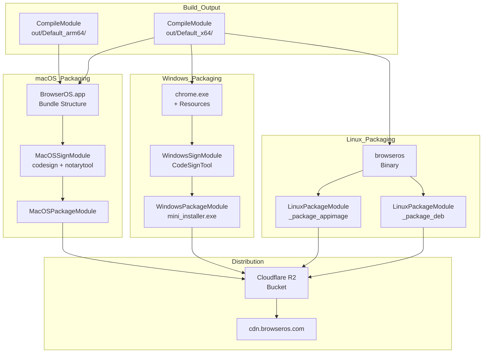
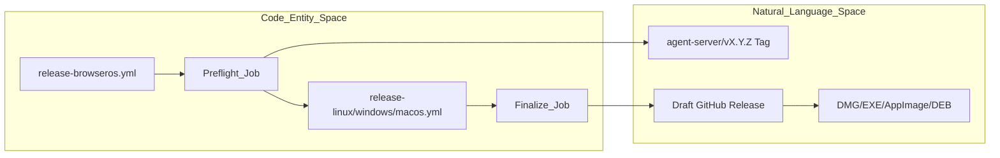
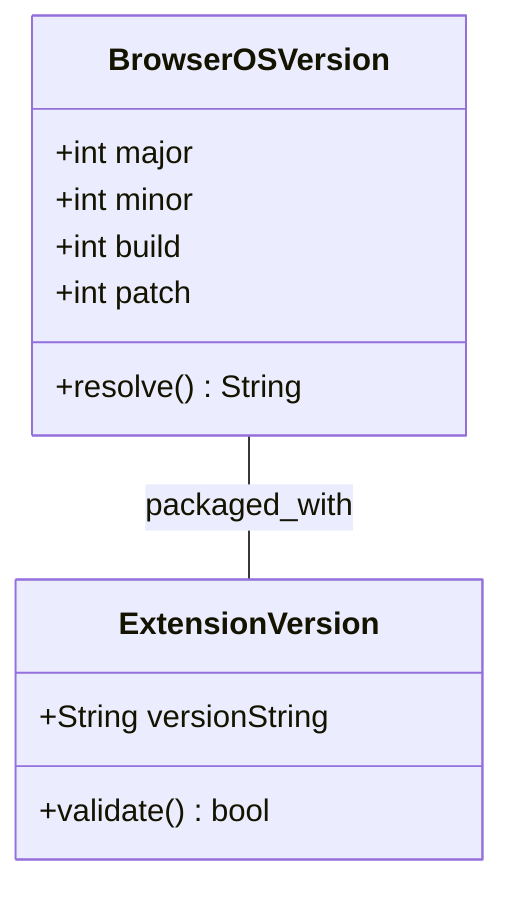

<!-- source: DeepWiki mcp.deepwiki.com · repo browseros-ai/BrowserOS · page 10.7 Packaging and Distribution · fetched 2026-10-29 -->

# Packaging and Distribution

Relevant source files

The following files were used as context for generating this wiki page:

- [.github/actionlint.yaml](.github/actionlint.yaml)
- [.github/workflows/nightly-browseros.yml](.github/workflows/nightly-browseros.yml)
- [.github/workflows/release-browserclaw.yml](.github/workflows/release-browserclaw.yml)
- [.github/workflows/release-browseros.yml](.github/workflows/release-browseros.yml)
- [.github/workflows/release-extension-feeds.yml](.github/workflows/release-extension-feeds.yml)
- [.github/workflows/release-extensions.yml](.github/workflows/release-extensions.yml)
- [.github/workflows/release-macos.yml](.github/workflows/release-macos.yml)
- [packages/browseros/bos_build/cli/dev.py](packages/browseros/bos_build/cli/dev.py)
- [packages/browseros/bos_build/cli/dev_test.py](packages/browseros/bos_build/cli/dev_test.py)
- [packages/browseros/bos_build/docs/release-ci.md](packages/browseros/bos_build/docs/release-ci.md)
- [packages/browseros/bos_build/patchkit/batch_apply.py](packages/browseros/bos_build/patchkit/batch_apply.py)
- [packages/browseros/bos_build/patchkit/batch_apply_test.py](packages/browseros/bos_build/patchkit/batch_apply_test.py)
- [packages/browseros/bos_build/patchkit/doctor.py](packages/browseros/bos_build/patchkit/doctor.py)
- [packages/browseros/bos_build/patchkit/doctor_test.py](packages/browseros/bos_build/patchkit/doctor_test.py)
- [packages/browseros/bos_build/profiles/nightly-macos.yaml](packages/browseros/bos_build/profiles/nightly-macos.yaml)
- [packages/browseros/bos_build/release/extensions/specs.py](packages/browseros/bos_build/release/extensions/specs.py)
- [packages/browseros/bos_build/release/extensions/specs_test.py](packages/browseros/bos_build/release/extensions/specs_test.py)
- [packages/browseros/bos_build/steps/package/linux.py](packages/browseros/bos_build/steps/package/linux.py)
- [packages/browseros/bos_build/steps/package/linux_test.py](packages/browseros/bos_build/steps/package/linux_test.py)
- [packages/browseros/bos_build/steps/patches/product_user_data_dir_test.py](packages/browseros/bos_build/steps/patches/product_user_data_dir_test.py)
- [packages/browseros/chromium_patches/chrome/install_static/chromium_install_modes.h](packages/browseros/chromium_patches/chrome/install_static/chromium_install_modes.h)

## Purpose and Scope

This document covers how BrowserOS compiled binaries are packaged into platform-specific installers and distributed to end users. BrowserOS supports four distribution formats across three operating systems: `.dmg` for macOS, `.exe` for Windows, `.AppImage` and `.deb` for Linux. Each format follows platform conventions for installation, code signing, and user experience.

The packaging process transforms build outputs from [Browser Development Workflow](10.3) into signed, distributable packages. Code signing is integrated into the packaging workflow using platform-specific modules: `MacOSSignModule` for macOS, `WindowsSignModule` for Windows, and `LinuxPackageModule` for Linux. Distribution occurs via Cloudflare R2 storage and is served via CDN at `cdn.browseros.com`.

For details on code signing certificates and notarization, see [Code Signing](10.6). For the update mechanism that consumes these packages, see [Update Systems](9).

## Package Formats Overview

BrowserOS produces platform-specific package formats from a single codebase. The build system compiles architecture-specific binaries, signs them, and packages them using platform-native modules defined in `packages/browseros/bos_build/steps/package/`.

**Packaging Pipeline Architecture**

**Sources:** [.github/workflows/release-macos.yml:181-200](), [packages/browseros/bos_build/steps/package/linux.py:94-113](), [packages/browseros/bos_build/docs/release-ci.md:59-71]()

**Platform Package Summary**

| Platform | Format | Module Class | Mapping Key |
|----------|--------|--------------|-------------|
| macOS ARM64 | `.dmg` | `MacOSPackageModule` | `macos:arm64` |
| macOS Universal | `.dmg` | `MacOSPackageModule` | `macos:universal` |
| Windows x64 | `.exe` | `WindowsPackageModule` | `win:x64_installer` |
| Linux x64 | `.AppImage` | `LinuxPackageModule` | `linux:x64_appimage` |
| Linux x64 | `.deb` | `LinuxPackageModule` | `linux:x64_deb` |
| Linux ARM64 | `.AppImage` | `LinuxPackageModule` | `linux:arm64_appimage` |

**Sources:** [packages/browseros/bos_build/steps/package/linux.py:29-38](), [.github/workflows/release-macos.yml:14-20]()

## macOS Universal Packaging

macOS distribution utilizes a dedicated self-hosted builder to orchestrate multi-architecture builds [.github/workflows/release-macos.yml:183-183](). This workflow handles the complete lifecycle: building `arm64` and `universal` architectures, signing, and packaging [.github/workflows/release-macos.yml:14-20]().

### Universal Build Flow
1. **Per-Architecture Build**: Compiles Chromium for the target architecture (arm64 or universal) [.github/workflows/release-macos.yml:187-190]().
2. **Resource Integration**: Downloads published server/onboard resource bundles from R2 during the build process [packages/browseros/bos_build/docs/release-ci.md:93-98]().
3. **Signing and Notarization**: Signed macOS artifacts are produced on the dedicated builder [packages/browseros/docs/release-ci.md:69-69]().
4. **Final Packaging**: The signed app is wrapped in a `.dmg` for distribution.

**Sources:** [.github/workflows/release-macos.yml:1-20](), [packages/browseros/bos_build/docs/release-ci.md:93-98]()

## Windows Installer Packaging

Windows distribution uses a signed installer built on WarpBuild runners [packages/browseros/bos_build/docs/release-ci.md:68-68](). The `release-windows.yml` workflow orchestrates this process, with optional signing using `CodeSignTool` [.github/workflows/release-browseros.yml:201-205]().

### Windows Signing Workflow
Windows signing ensures that all executables and DLLs are signed before the final installer package is generated. This requires `ESIGNER_USERNAME`, `ESIGNER_PASSWORD`, and `ESIGNER_TOTP_SECRET` credentials [.github/workflows/release-browseros.yml:162-164]().
- **Product Identity**: Chromium's `chromium_install_modes.h` is patched to provide disjoint user-data roots for `BrowserOS` and `BrowserClaw` [packages/browseros/chromium_patches/chrome/install_static/chromium_install_modes.h:36-40]().
- **ProgIDs**: Unique ProgIDs (e.g., `BOSHTML` for BrowserOS, `BClawHTML` for BrowserClaw) are defined to manage file associations correctly [packages/browseros/chromium_patches/chrome/install_static/chromium_install_modes.h:43-47]().

**Sources:** [.github/workflows/release-browseros.yml:201-205](), [packages/browseros/chromium_patches/chrome/install_static/chromium_install_modes.h:17-96](), [packages/browseros/bos_build/docs/release-ci.md:68-68]()

## Linux Packaging

Linux packaging is handled by the `LinuxPackageModule` [packages/browseros/bos_build/steps/package/linux.py:95-95](). It produces both `.AppImage` and `.deb` formats [packages/browseros/bos_build/steps/package/linux.py:96-96]().

### Shared Resource Preparation
The `copy_browser_files` function prepares the distribution directory by copying browser binaries and required shared libraries:
- **Binaries**: `ctx.BROWSEROS_APP_NAME`, `chrome_sandbox`, `chromedriver`, and `chrome_crashpad_handler` [packages/browseros/bos_build/steps/package/linux.py:177-181]().
- **Libraries**: `libEGL.so`, `libGLESv2.so`, `libvk_swiftshader.so`, `libvulkan.so.1`, and Qt shims [packages/browseros/bos_build/steps/package/linux.py:182-187]().
- **Sidecar**: Bundled extension resources are copied from `browseros_extensions` in the Chromium output directory [packages/browseros/bos_build/steps/package/linux.py:167-173]().

### Cross-Compilation Support
The Linux packaging module handles architecture mapping for cross-compilation:
- **Metadata Mapping**: `LINUX_ARCHITECTURE_CONFIG` maps internal architecture names (`x64`, `arm64`) to package-specific strings (`x86_64`, `amd64` for AppImage and `.deb` respectively) [packages/browseros/bos_build/steps/package/linux.py:29-38]().
- **Tool Selection**: The `get_host_appimagetool` function ensures the `appimagetool` binary matches the *build machine* architecture, not the *target* architecture. This allows an x64 host to package ARM64 artifacts [packages/browseros/bos_build/steps/package/linux.py:66-76]().

**Sources:** [packages/browseros/bos_build/steps/package/linux.py:29-76](), [packages/browseros/bos_build/steps/package/linux.py:153-204](), [packages/browseros/bos_build/steps/package/linux_test.py:45-74]()

## Release and Distribution

Once packages are created, they are uploaded and tracked through the CI release workflows.

### Extension Packaging (CRX)
Extensions are built, signed, and released independently or as part of a full product release [.github/workflows/release-extensions.yml:1-30]().
- **Signing**: Uses specific keys for each extension (e.g., `BROWSEROS_AGENT_V2_KEY`, `BROWSEROS_CONTROLLER_KEY`) [.github/workflows/release-extensions.yml:141-144]().
- **Storage**: Uploads versioned CRX files to Cloudflare R2 [.github/workflows/release-extensions.yml:134-138]().

### Release Metadata and Feeds
The release orchestrators (`release-browseros.yml`, `release-browserclaw.yml`) manage update feeds:
- **Stage Updates**: Renders appcast and extension feed dry runs from R2 metadata [packages/browseros/bos_build/docs/release-ci.md:27-28]().
- **Extension Feeds**: The `release-extension-feeds.yml` workflow regenerates extension update feeds for `alpha` or `prod` channels [.github/workflows/release-extension-feeds.yml:6-14]().

**Sources:** [.github/workflows/release-extensions.yml:124-175](), [.github/workflows/release-extension-feeds.yml:1-30](), [packages/browseros/bos_build/docs/release-ci.md:7-51]()

## GitHub Integration

The primary release entry points are dispatch-only workflows that orchestrate the full build and release process [packages/browseros/bos_build/docs/release-ci.md:9-10]().

### Release Orchestration Flow
1. **Preflight**: Resolves the release version from `BROWSEROS_VERSION` and validates secrets [.github/workflows/release-browseros.yml:63-147]().
2. **Server Resources**: Builds and uploads server resource zips (e.g., `release-server.yml`) [packages/browseros/bos_build/docs/release-ci.md:18-19]().
3. **Browser Builds**: Triggers parallel builds for Linux, Windows, and macOS [packages/browseros/bos_build/docs/release-ci.md:20-23]().
4. **Finalize**: Creates or refreshes draft GitHub release assets once all platform lanes pass [packages/browseros/bos_build/docs/release-ci.md:30-32]().

**GitHub Release Entity Model**

**Sources:** [packages/browseros/bos_build/docs/release-ci.md:7-51](), [.github/workflows/release-browseros.yml:1-60](), [.github/workflows/release-server.yml:73-81]()

## Version Management

BrowserOS uses a multi-part versioning strategy defined in `packages/browseros/resources/BROWSEROS_VERSION` [.github/workflows/release-browseros.yml:80-80]().

### Version Components
- **Browser Version**: Resolved from `BROWSEROS_MAJOR`, `MINOR`, `BUILD`, and `PATCH` variables [.github/workflows/release-browseros.yml:98-101]().
- **Extension Version**: Provided as a manual input during release dispatch [.github/workflows/release-extensions.yml:6-9]().
- **Server Version**: Resolved from `package.json` (Agent/Claw) or `Cargo.toml` (Rust Server) and tagged independently [packages/browseros/bos_build/docs/release-ci.md:75-81]().

**Version Logic Model**

**Sources:** [.github/workflows/release-browseros.yml:76-121](), [packages/browseros/bos_build/docs/release-ci.md:73-81]()

---

