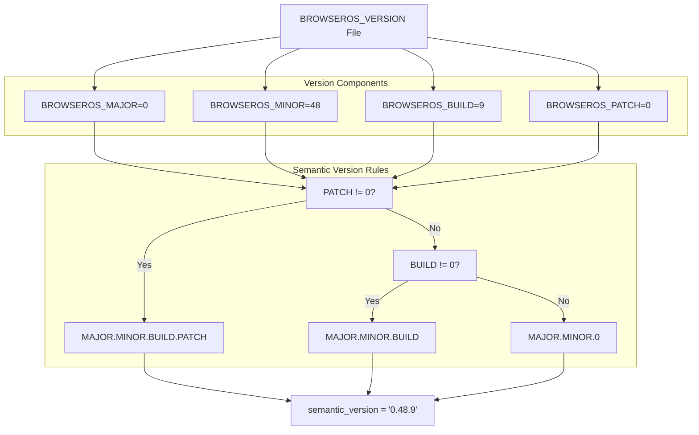
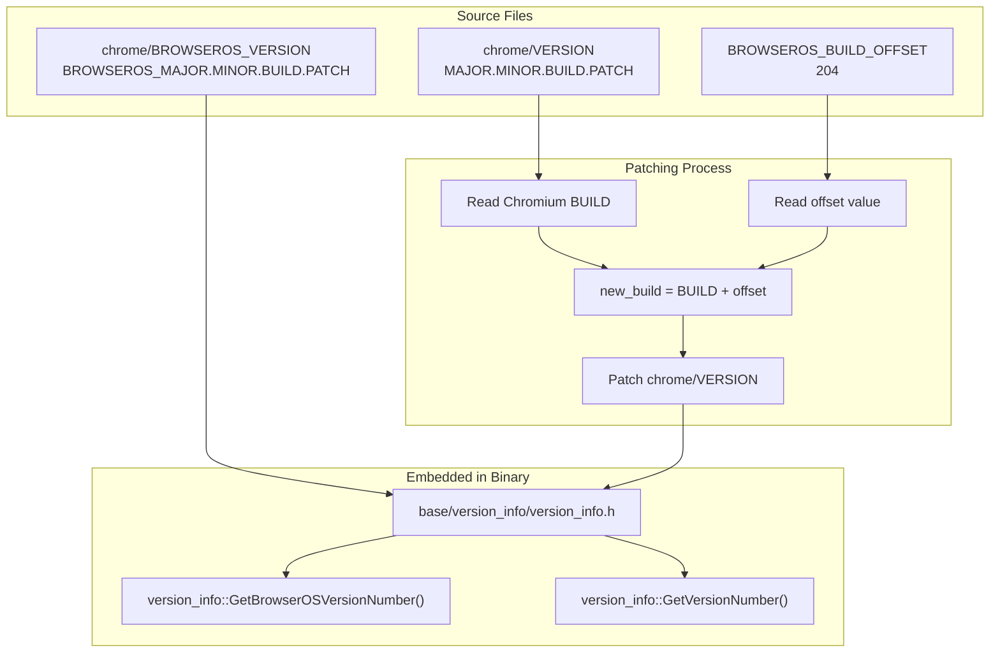
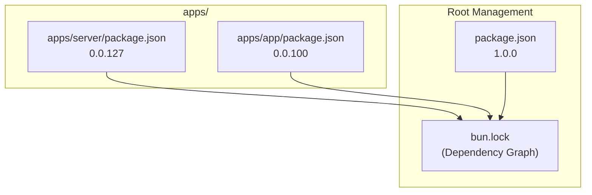

<!-- source: DeepWiki mcp.deepwiki.com · repo browseros-ai/BrowserOS · page 10.8 Version Management · fetched 2026-10-29 -->

# Version Management

<details>
<summary>Relevant source files</summary>

The following files were used as context for generating this wiki page:

- [packages/browseros-agent/README.md](packages/browseros-agent/README.md)
- [packages/browseros-agent/apps/app/README.md](packages/browseros-agent/apps/app/README.md)
- [packages/browseros-agent/apps/app/package.json](packages/browseros-agent/apps/app/package.json)
- [packages/browseros-agent/apps/claw-app/fonts.d.ts](packages/browseros-agent/apps/claw-app/fonts.d.ts)
- [packages/browseros-agent/apps/claw-app/package.json](packages/browseros-agent/apps/claw-app/package.json)
- [packages/browseros-agent/apps/claw-app/tsconfig.json](packages/browseros-agent/apps/claw-app/tsconfig.json)
- [packages/browseros-agent/apps/claw-onboard/package.json](packages/browseros-agent/apps/claw-onboard/package.json)
- [packages/browseros-agent/apps/claw-onboard/tsconfig.json](packages/browseros-agent/apps/claw-onboard/tsconfig.json)
- [packages/browseros-agent/apps/server/README.md](packages/browseros-agent/apps/server/README.md)
- [packages/browseros-agent/apps/server/package.json](packages/browseros-agent/apps/server/package.json)
- [packages/browseros-agent/bun.lock](packages/browseros-agent/bun.lock)
- [packages/browseros-agent/package.json](packages/browseros-agent/package.json)
- [packages/browseros-agent/packages/build-server-tools/package.json](packages/browseros-agent/packages/build-server-tools/package.json)
- [packages/browseros-agent/packages/onboarding-video/package.json](packages/browseros-agent/packages/onboarding-video/package.json)
- [packages/browseros-agent/scripts/codegen/cdp-protocol.ts](packages/browseros-agent/scripts/codegen/cdp-protocol.ts)
- [packages/browseros-agent/tsconfig.json](packages/browseros-agent/tsconfig.json)
- [packages/browseros/bos_build/config/BROWSEROS_BUILD_OFFSET](packages/browseros/bos_build/config/BROWSEROS_BUILD_OFFSET)
- [packages/browseros/resources/BROWSEROS_VERSION](packages/browseros/resources/BROWSEROS_VERSION)

</details>


BrowserOS uses a dual versioning system: a semantic version for release identification (`BROWSEROS_VERSION`) and a modified Chromium version for update sequencing (`chrome/VERSION` + `BROWSEROS_BUILD_OFFSET`). This page documents how versions are defined, embedded in Chromium binaries, and propagated throughout the build and update systems.

## Version File Structure

BrowserOS maintains version information in structured files that are processed during build and embedded into Chromium binaries.

### BROWSEROS_VERSION File Format

The `BROWSEROS_VERSION` file defines the release version using four numeric components. This file serves as the single source of truth for the BrowserOS semantic version.

**File Location:** [packages/browseros/resources/BROWSEROS_VERSION:1-4]()

```text
BROWSEROS_MAJOR=0
BROWSEROS_MINOR=48
BROWSEROS_BUILD=9
BROWSEROS_PATCH=0
```

**Diagram: Version Components and Construction**

Title: Version String Generation Logic


**Version Components**

| Component | Variable | Current Value | Purpose |
|-----------|----------|---------------|---------|
| Major | `BROWSEROS_MAJOR` | 0 | Breaking changes, major releases |
| Minor | `BROWSEROS_MINOR` | 48 | Feature releases, minor updates |
| Build | `BROWSEROS_BUILD` | 9 | Build iteration within minor version |
| Patch | `BROWSEROS_PATCH` | 0 | Hotfixes, patch releases |

**Semantic Version Construction**

The build system constructs a semantic version string following these rules:
- If `PATCH` is non-zero: `{MAJOR}.{MINOR}.{BUILD}.{PATCH}` (e.g., "0.48.9.1")
- Else if `BUILD` is non-zero: `{MAJOR}.{MINOR}.{BUILD}` (e.g., "0.48.9")
- Otherwise: `{MAJOR}.{MINOR}.0` (e.g., "0.48.0")

Sources: [packages/browseros/resources/BROWSEROS_VERSION:1-4]()

## Chromium Version Patching

BrowserOS patches Chromium's version files to create a unique version number for update sequencing. The system uses both Chromium's native `chrome/VERSION` file and a BrowserOS-specific offset value.

### BROWSEROS_BUILD_OFFSET

The `BROWSEROS_BUILD_OFFSET` file contains a single numeric value added to Chromium's BUILD component.

**File Location:** [packages/browseros/bos_build/config/BROWSEROS_BUILD_OFFSET:1]()

```text
204
```

**Diagram: Version Patching Flow**

Title: Upstream Chromium Version Modification


**Version Patching Implementation**

The build system utilizes `BROWSEROS_BUILD_OFFSET` to ensure BrowserOS builds have a strictly higher version number than the upstream Chromium they are based on. This is critical for auto-update frameworks like Sparkle (macOS) to recognize the custom fork as an "upgrade".

Sources: [packages/browseros/bos_build/config/BROWSEROS_BUILD_OFFSET:1]()

## Component Versioning

Beyond the core browser, BrowserOS components (Server, Agent Extension, etc.) maintain their own versioning within the monorepo to support independent update cycles.

### Server and Extension Versions

The BrowserOS sidecar server and the Agent extension follow standard Node.js/Bun versioning conventions within their respective `package.json` files.

| Component | Package Name | Version | Location |
|-----------|--------------|---------|----------|
| Server | `@browseros/server` | 0.0.127 | [packages/browseros-agent/apps/server/package.json:3]() |
| Agent Extension | `@browseros/app` | 0.0.100 | [packages/browseros-agent/apps/app/package.json:5]() |
| Claw Extension | `@browseros/claw-app` | 0.1.0 | [packages/browseros-agent/apps/claw-app/package.json:5]() |
| Onboarding App | `@browseros/claw-onboard` | 0.0.12 | [packages/browseros-agent/apps/claw-onboard/package.json:5]() |

**Diagram: Monorepo Version Consumption**

Title: Monorepo Package Versioning


**Integration Points**

1.  **Bun Lockfile**: The `bun.lock` file acts as the ultimate authority for package resolution across the monorepo, pinning versions for internal workspace dependencies and external libraries. [packages/browseros-agent/bun.lock:1-23]()
2.  **Build Scripts**: Server binaries are built using `bun scripts/build/server.ts`, which packages the server with its version metadata. [packages/browseros-agent/apps/server/package.json:13]()
3.  **Extension Release**: Extension versions are pinned during the release feed generation (e.g., `agent=0.0.119`). [packages/browseros-agent/apps/app/README.md:163-171]()

Sources: [packages/browseros-agent/apps/server/package.json:1-10](), [packages/browseros-agent/apps/app/package.json:1-10](), [packages/browseros-agent/bun.lock:1-60](), [packages/browseros-agent/apps/app/README.md:143-171]()

## Release Flow and Version Bumping

The release process for different components is decoupled to allow for rapid iteration of the Agent and Server without full Chromium rebuilds.

### Server Release Flow
Server releases are triggered by annotated component tags. The version is bumped in `apps/server/package.json` and synchronized in `bun.lock` before a PR is merged. [packages/browseros-agent/apps/server/README.md:154-158]()

### Extension Release Flow
Extensions are built as signed CRX artifacts. The release path involves:
1.  Dispatching the `release-extensions.yml` workflow with a specific version. [packages/browseros-agent/apps/app/README.md:154-157]()
2.  Updating extension feeds (appcasts) for the `alpha` or `prod` channels. [packages/browseros-agent/apps/app/README.md:163-171]()

Sources: [packages/browseros-agent/apps/server/README.md:154-158](), [packages/browseros-agent/apps/app/README.md:143-171]()

---

