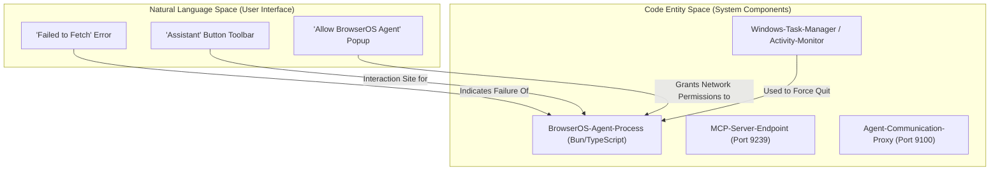
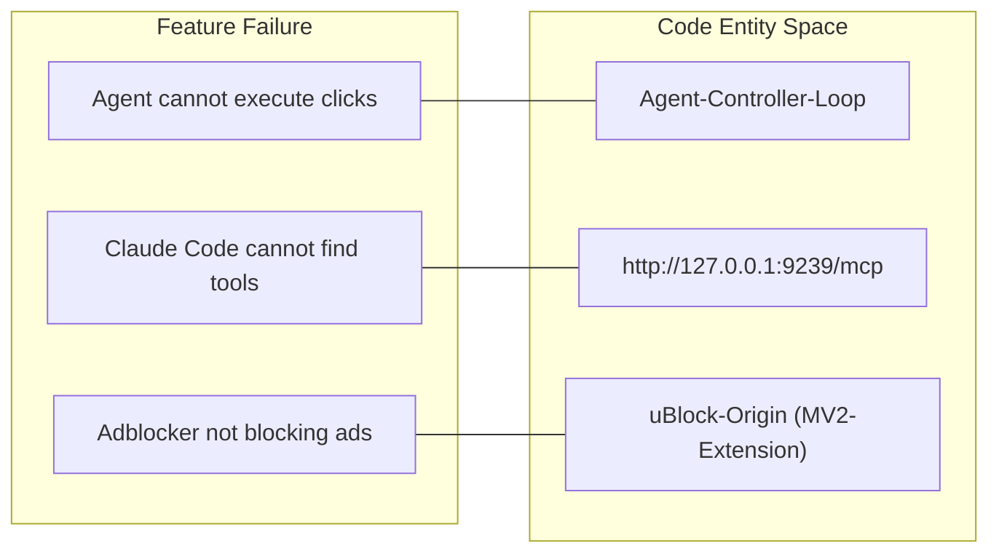

<!-- source: DeepWiki mcp.deepwiki.com · repo browseros-ai/BrowserOS · page 11 Troubleshooting · fetched 2026-10-29 -->

# Troubleshooting

Relevant source files

The following files were used as context for generating this wiki page:

- [docs/features/ad-blocking.mdx](docs/features/ad-blocking.mdx)
- [docs/images/about-browseros.png](docs/images/about-browseros.png)
- [docs/images/adblock-browseros.png](docs/images/adblock-browseros.png)
- [docs/images/adblock-chrome.png](docs/images/adblock-chrome.png)
- [docs/images/browseros-mcp-turned-on.png](docs/images/browseros-mcp-turned-on.png)
- [docs/images/check-for-updates.png](docs/images/check-for-updates.png)
- [docs/onboarding.mdx](docs/onboarding.mdx)

This page provides a high-level overview of common technical issues encountered while using BrowserOS and directs you to specific guides for resolution. Most issues stem from process communication failures between the Chromium-based browser and the sidecar Agent process, or from platform-specific update behaviors.

### Common Issues Overview

The BrowserOS architecture relies on a persistent connection between the frontend browser and a backend agent (running on `Bun`). When this link is severed, AI features like Agent Mode and MCP tools will cease to function.

| Issue Category | Common Symptoms | Primary Resolution |
| :--- | :--- | :--- |
| **Connectivity** | "Failed to Fetch", "Unable to connect to BrowserOS agent" | Restart Agent process or check port `9100` |
| **Updates** | "Update failed", version mismatch between Browser and Server | Use platform-specific manual update steps |
| **Permissions** | Tools failing to click or navigate, Windows Firewall popups | Grant network access to `BrowserOS Agent` |
| **MCP Failures** | External clients (Claude Code) cannot connect | Verify MCP URL in `Settings → MCP Server` |
| **AI Performance** | Agent failing tasks or hallucinating | Check model selection (Sonnet 4.5 recommended) |

### Connection Issues

The most frequent error is a disconnect from the **BrowserOS Agent**. This process is responsible for executing the LLM-driven browser automation and managing the built-in MCP Server. On Windows, this is often caused by firewall restrictions or the process being killed by the operating system.

**Key Symptoms:**
*   Error message: **"Failed to Fetch"**
*   Error message: **"Unable to connect to BrowserOS agent"**

**Common Causes:**
*   **Windows Firewall:** On first run, Windows asks to allow **BrowserOS Agent** network access. If denied, the agent cannot communicate with the browser.
*   **Port Conflicts:** The agent defaults to port `9100`. If another application uses this port, the agent fails to start.

For detailed recovery steps, including manual process restarts via Task Manager and port conflict resolution, see **[Connection Issues](#11.1)**.

### Updating BrowserOS

BrowserOS uses a dual-update system. The browser itself is updated via standard platform mechanisms, while the Agent/Server component can receive over-the-air (OTA) updates.

**Update Channels:**
*   **macOS:** Managed via the Sparkle framework.
*   **Windows:** Managed via a standard installer or the "Check for Updates" menu.
*   **Linux:** Distributed via AppImage and Debian packages.

For instructions on how to force an update or clean-install a new version, see **[Updating BrowserOS](#11.2)**.

### AI and Extension Troubleshooting

BrowserOS re-enables features that are deprecated or restricted in standard Chrome, such as Manifest V2 support for ad blockers.

*   **Ad Blocking:** If ads are appearing, ensure the full **uBlock Origin** (not Lite) is installed from the Chrome Web Store [docs/features/ad-blocking.mdx:6-16](). BrowserOS provides ~10x more protection than standard Chrome by maintaining MV2 support [docs/features/ad-blocking.mdx:31-35]().
*   **Agent Performance:** If Agent Mode is failing tasks, ensure you are using a high-tier model like **Claude 3.5 Sonnet** or **Claude 4.5**. Local models (Ollama) are currently recommended for Chat Mode only [docs/onboarding.mdx:37-39]().

### System Communication Map

The following diagram illustrates the relationship between the natural language requests and the underlying code entities that may require troubleshooting.

**Bridge: UI to Agent Process**

Sources: [docs/onboarding.mdx:31-36](), [docs/features/ad-blocking.mdx:6-16]()

### Component Relationship Diagram

This diagram maps common troubleshooting targets to their specific roles in the codebase.

**Bridge: Feature Failures to Code Entities**

Sources: [docs/features/ad-blocking.mdx:6-16](), [docs/onboarding.mdx:45-47]()

### Troubleshooting MCP Connections

BrowserOS acts as an MCP server, exposing tools to external clients like Claude Code. If these clients cannot connect, verify the server status in the browser settings.

Common causes for MCP failure include:
1.  **Port Conflict:** Ensure port `9239` is not blocked by a local firewall.
2.  **Process Orphans:** If the browser crashes, the MCP server might stay bound to the port. Restarting the **BrowserOS Agent** manually via Task Manager or Activity Monitor is the recommended fix.

For more on MCP integration, see [MCP Server Architecture](#5.1).

Sources: [docs/onboarding.mdx:1-58](), [docs/features/ad-blocking.mdx:1-40]()

---

