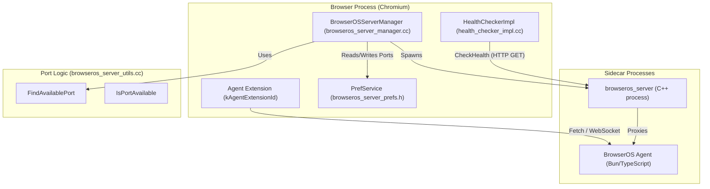
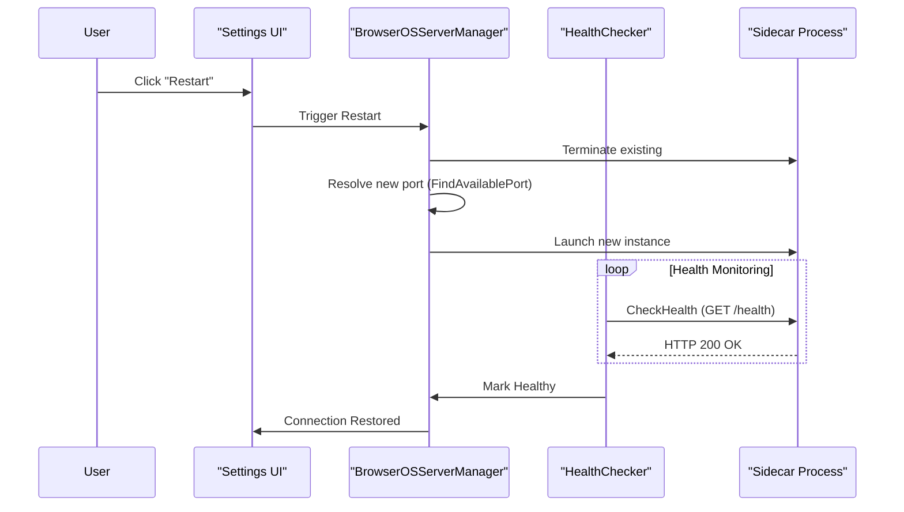

<!-- source: DeepWiki mcp.deepwiki.com · repo browseros-ai/BrowserOS · page 11.1 Connection Issues · fetched 2026-10-29 -->

# Connection Issues

Relevant source files

The following files were used as context for generating this wiki page:

- [docs/features/ad-blocking.mdx](docs/features/ad-blocking.mdx)
- [docs/images/about-browseros.png](docs/images/about-browseros.png)
- [docs/images/adblock-browseros.png](docs/images/adblock-browseros.png)
- [docs/images/adblock-chrome.png](docs/images/adblock-chrome.png)
- [docs/images/browseros-mcp-turned-on.png](docs/images/browseros-mcp-turned-on.png)
- [docs/images/check-for-updates.png](docs/images/check-for-updates.png)
- [docs/onboarding.mdx](docs/onboarding.mdx)
- [packages/browseros/chromium_patches/chrome/browser/browseros/server/browseros_server_utils.cc](packages/browseros/chromium_patches/chrome/browser/browseros/server/browseros_server_utils.cc)
- [packages/browseros/chromium_patches/chrome/browser/browseros/server/browseros_server_utils.h](packages/browseros/chromium_patches/chrome/browser/browseros/server/browseros_server_utils.h)
- [packages/browseros/chromium_patches/chrome/browser/browseros/server/health_checker.h](packages/browseros/chromium_patches/chrome/browser/browseros/server/health_checker.h)
- [packages/browseros/chromium_patches/chrome/browser/browseros/server/health_checker_impl.cc](packages/browseros/chromium_patches/chrome/browser/browseros/server/health_checker_impl.cc)
- [packages/browseros/chromium_patches/chrome/browser/browseros/server/health_checker_impl.h](packages/browseros/chromium_patches/chrome/browser/browseros/server/health_checker_impl.h)
- [packages/browseros/chromium_patches/chrome/browser/browseros/server/test/mock_health_checker.h](packages/browseros/chromium_patches/chrome/browser/browseros/server/test/mock_health_checker.h)

This page provides technical guidance for diagnosing and resolving communication failures between the BrowserOS Chromium interface and its underlying sidecar processes. The most common manifestations of these issues are **"Failed to Fetch"** or **"Unable to connect to BrowserOS agent"** errors, which typically indicate that the Agent or Server process has terminated unexpectedly, is being blocked by system security, or is suffering from port exhaustion.

## Error Manifestations and Root Causes

When the browser interface cannot communicate with the backend, it is usually due to one of three states:
1.  **Process Termination**: The `BrowserOS Agent` or `browseros_server` process has crashed or been killed by the OS.
2.  **Network Blockage**: A firewall (specifically Windows Defender Firewall) is preventing the `127.0.0.1` loopback connection.
3.  **Port Conflict**: Another application is bound to the default ports required by BrowserOS.

### Connection Architecture

The following diagram illustrates the relationship between the Browser process and the managed server components, mapping high-level UI components to their underlying code entities.

**Managed Component Connectivity & Code Entities**

Sources:
- [packages/browseros/chromium_patches/chrome/browser/browseros/server/browseros_server_utils.cc:78-110]()
- [packages/browseros/chromium_patches/chrome/browser/browseros/server/health_checker_impl.cc:36-77]()
- [packages/browseros/chromium_patches/chrome/browser/browseros/server/health_checker.h:20-27]()

## Diagnostic Steps

### 1. Health Check Validation
BrowserOS uses a `HealthCheckerImpl` to monitor the sidecar server's status. It performs an HTTP GET request to a configured health path (e.g., `http://127.0.0.1:[port]/health`) every 30 seconds [packages/browseros/chromium_patches/chrome/browser/browseros/server/health_checker_impl.cc:40-52](). 

If the health check fails, the browser logs a warning with the specific `net::Error` code [packages/browseros/chromium_patches/chrome/browser/browseros/server/health_checker_impl.cc:89-93](). Common errors include:
*   `ERR_CONNECTION_REFUSED`: The server process is not running.
*   `ERR_TIMED_OUT`: The server is hanging or blocked by a firewall (timeout set to 15 seconds) [packages/browseros/chromium_patches/chrome/browser/browseros/server/health_checker_impl.cc:28-28]().

### 2. Port Availability and Conflicts
The system attempts to find an available port using `FindAvailablePort` [packages/browseros/chromium_patches/chrome/browser/browseros/server/browseros_server_utils.cc:78-80](). It checks up to 100 ports starting from the base port [packages/browseros/chromium_patches/chrome/browser/browseros/server/browseros_server_utils.cc:83-85]().

The `IsPortAvailable` function performs a dual-stack check (IPv4 and IPv6) to ensure the port is truly free [packages/browseros/chromium_patches/chrome/browser/browseros/server/browseros_server_utils.cc:142-167](). If you suspect a conflict:

| OS | Command to Find Process | Command to Kill Process |
| :--- | :--- | :--- |
| **macOS/Linux** | `lsof -i :9239` (MCP Default) | `kill -9 PID` |
| **Windows** | `netstat -ano \| findstr :9239` | `taskkill /PID PID /F` |

Sources:
- [packages/browseros/chromium_patches/chrome/browser/browseros/server/browseros_server_utils.cc:112-168]()
- [packages/browseros/chromium_patches/chrome/browser/browseros/server/health_checker_impl.cc:89-93]()

## Resolution Strategies

### Windows Firewall Configuration
On Windows, the `BrowserOS Agent` requires explicit permission to access the network for local loopback communication. If the initial prompt was declined, the agent will be blocked. BrowserOS provides a visual guide for this in the onboarding flow [docs/onboarding.mdx:8-41]().

### Manual Agent Restart
If the Agent has crashed, BrowserOS manages the lifecycle via the `BrowserOSServerManager`. You can trigger a restart through the UI, which uses the internal process management logic to cycle the sidecar.

**Restart Lifecycle Flow**

Sources:
- [packages/browseros/chromium_patches/chrome/browser/browseros/server/health_checker_impl.cc:81-97]()
- [packages/browseros/chromium_patches/chrome/browser/browseros/server/browseros_server_utils.cc:78-110]()

### Resource and Path Issues
The server requires a valid execution directory, typically located at `[USER_DATA]/.browseros` [packages/browseros/chromium_patches/chrome/browser/browseros/server/browseros_server_utils.cc:174-183](). If the browser fails to create this directory or the bundled resources path is unreachable, the server will fail to start [packages/browseros/chromium_patches/chrome/browser/browseros/server/browseros_server_utils.cc:185-190]().

Sources:
- [packages/browseros/chromium_patches/chrome/browser/browseros/server/browseros_server_utils.cc:174-203]()
- [docs/onboarding.mdx]()
- [docs/features/ad-blocking.mdx]()

---

