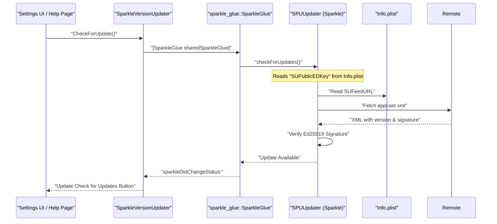
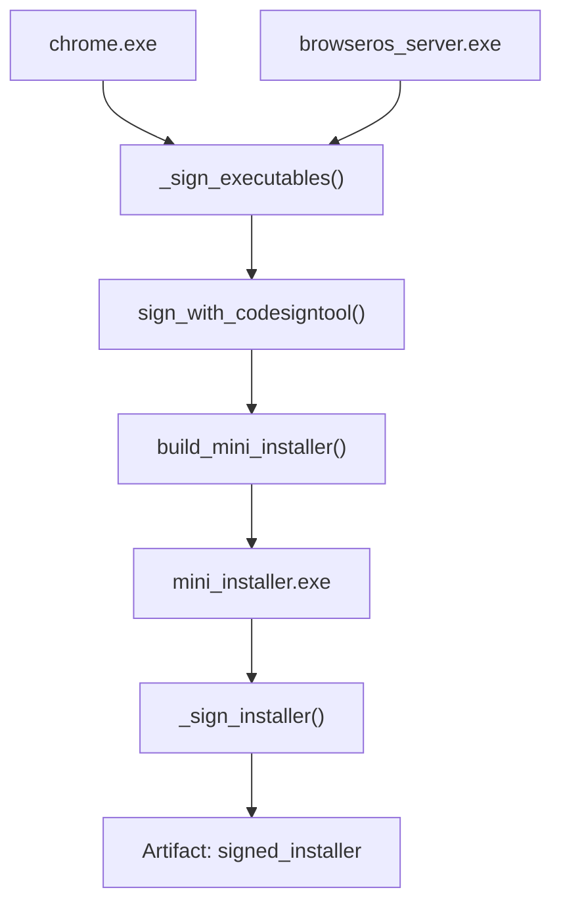

<!-- source: DeepWiki mcp.deepwiki.com · repo browseros-ai/BrowserOS · page 11.2 Updating BrowserOS · fetched 2026-10-29 -->

# Updating BrowserOS

Relevant source files

The following files were used as context for generating this wiki page:

- [packages/browseros/bos_build/lib/env.py](packages/browseros/bos_build/lib/env.py)
- [packages/browseros/bos_build/lib/logger.py](packages/browseros/bos_build/lib/logger.py)
- [packages/browseros/bos_build/lib/utils.py](packages/browseros/bos_build/lib/utils.py)
- [packages/browseros/bos_build/lib/utils_test.py](packages/browseros/bos_build/lib/utils_test.py)
- [packages/browseros/bos_build/release/ota/__init__.py](packages/browseros/bos_build/release/ota/__init__.py)
- [packages/browseros/bos_build/release/ota/common.py](packages/browseros/bos_build/release/ota/common.py)
- [packages/browseros/bos_build/release/ota/feeds_alignment_test.py](packages/browseros/bos_build/release/ota/feeds_alignment_test.py)
- [packages/browseros/bos_build/release/ota/server.py](packages/browseros/bos_build/release/ota/server.py)
- [packages/browseros/bos_build/release/ota/sign_binary.py](packages/browseros/bos_build/release/ota/sign_binary.py)
- [packages/browseros/bos_build/release/ota/sign_binary_test.py](packages/browseros/bos_build/release/ota/sign_binary_test.py)
- [packages/browseros/bos_build/steps/sign/windows.py](packages/browseros/bos_build/steps/sign/windows.py)
- [packages/browseros/bos_build/steps/sign/windows_test.py](packages/browseros/bos_build/steps/sign/windows_test.py)
- [packages/browseros/chromium_patches/chrome/BUILD.gn](packages/browseros/chromium_patches/chrome/BUILD.gn)
- [packages/browseros/chromium_patches/chrome/browser/BUILD.gn](packages/browseros/chromium_patches/chrome/browser/BUILD.gn)
- [packages/browseros/chromium_patches/chrome/browser/buildflags.gni](packages/browseros/chromium_patches/chrome/browser/buildflags.gni)
- [packages/browseros/chromium_patches/chrome/browser/mac/chrome_browser_main_extra_parts_mac.mm](packages/browseros/chromium_patches/chrome/browser/mac/chrome_browser_main_extra_parts_mac.mm)
- [packages/browseros/chromium_patches/chrome/browser/mac/sparkle_glue.h](packages/browseros/chromium_patches/chrome/browser/mac/sparkle_glue.h)
- [packages/browseros/chromium_patches/chrome/browser/mac/sparkle_glue.mm](packages/browseros/chromium_patches/chrome/browser/mac/sparkle_glue.mm)
- [packages/browseros/chromium_patches/chrome/browser/ui/toolbar/app_menu_icon_controller.cc](packages/browseros/chromium_patches/chrome/browser/ui/toolbar/app_menu_icon_controller.cc)
- [packages/browseros/chromium_patches/chrome/browser/ui/views/relaunch_notification/relaunch_notification_controller.cc](packages/browseros/chromium_patches/chrome/browser/ui/views/relaunch_notification/relaunch_notification_controller.cc)
- [packages/browseros/chromium_patches/chrome/browser/ui/webui/help/sparkle_version_updater_mac.h](packages/browseros/chromium_patches/chrome/browser/ui/webui/help/sparkle_version_updater_mac.h)
- [packages/browseros/chromium_patches/chrome/browser/ui/webui/help/sparkle_version_updater_mac.mm](packages/browseros/chromium_patches/chrome/browser/ui/webui/help/sparkle_version_updater_mac.mm)
- [packages/browseros/chromium_patches/chrome/browser/upgrade_detector/upgrade_detector_impl.cc](packages/browseros/chromium_patches/chrome/browser/upgrade_detector/upgrade_detector_impl.cc)

BrowserOS utilizes a multi-layered update architecture designed to handle its two primary components: the **Browser** (a custom Chromium engine) and the **Agent** (the sidecar TypeScript/Bun server). Because BrowserOS operates across macOS, Windows, and Linux, it employs platform-specific delivery mechanisms to ensure security, code signing integrity, and seamless background updates.

## Update Architecture Overview

The system distinguishes between "Hard Updates" (binary replacements of the Chromium engine) and "Soft Updates" (OTA updates for the Agent or extensions).

| Component | Platform | Mechanism | Verification |
| :--- | :--- | :--- | :--- |
| **Browser (macOS)** | macOS | Sparkle Framework | Ed25519 + Apple Notarization |
| **Browser (Windows)** | Windows | Installer / WinSparkle | Ed25519 / Authenticode |
| **Browser (Linux)** | Linux | AppImage/deb replacement | GPG/Checksum |
| **Agent / Server** | All | OTA Sidecar Update | Ed25519 Signature |

### Update Data Flow and Entity Mapping

The following diagram maps the update check process from the user interface down to the configuration entities in the codebase, specifically focusing on the macOS Sparkle implementation.

**Update Check Sequence**

Sources: [packages/browseros/chromium_patches/chrome/browser/mac/sparkle_glue.mm:158-196](), [packages/browseros/chromium_patches/chrome/browser/ui/webui/help/sparkle_version_updater_mac.mm:78-99]() (ref)

---

## macOS: Sparkle Auto-Update

On macOS, BrowserOS integrates the **Sparkle framework** to provide a native background update experience. This allows the browser to check for updates periodically and prompt the user to restart to apply them.

### Configuration and Branding
The Sparkle framework is configured via the `Info.plist` file within the application bundle and initialized during the browser startup phase.

*   **Initialization**: Sparkle is initialized in `ChromeBrowserMainExtraPartsMac::PreCreateMainMessageLoop` by calling `sparkle_glue::SparkleEnabled()` [packages/browseros/chromium_patches/chrome/browser/mac/chrome_browser_main_extra_parts_mac.mm:23-30]().
*   **`SUPublicEDKey`**: The public Ed25519 key used to verify the signature of downloaded update packages.
*   **`SUFeedURL`**: Architecture-specific URLs are determined at runtime. For x86_64, it uses `appcast-x86_64.xml`; otherwise, it defaults to `appcast.xml` [packages/browseros/chromium_patches/chrome/browser/mac/sparkle_glue.mm:35-46]().
*   **`SUEnableAutomaticChecks`**: Set to `YES` to allow background polling [packages/browseros/chromium_patches/chrome/browser/mac/sparkle_glue.mm:151-156]().

### Integration with Chromium UI
BrowserOS hooks into the standard Chromium `UpgradeDetector` to show the update badge in the app menu immediately when Sparkle finds an update.
*   **Immediate Notification**: Unlike standard Chrome which waits days to show an "annoyance" level, BrowserOS sets the thresholds in `UpgradeDetectorImpl::DoCalculateThresholds` to zero so the badge appears as soon as `NotifyUpgradeReady()` is called [packages/browseros/chromium_patches/chrome/browser/upgrade_detector/upgrade_detector_impl.cc:41-51]().
*   **Sparkle Observer**: The `SparkleVersionUpdater` class implements a bridge to listen for status changes (Checking, Downloading, ReadyToInstall) and progress percentages to update the Chrome "About" page [packages/browseros/chromium_patches/chrome/browser/mac/sparkle_glue.h:43-51]().
Sources:
- [packages/browseros/chromium_patches/chrome/browser/mac/chrome_browser_main_extra_parts_mac.mm:23-30]()
- [packages/browseros/chromium_patches/chrome/browser/mac/sparkle_glue.mm:35-46]()
- [packages/browseros/chromium_patches/chrome/browser/upgrade_detector/upgrade_detector_impl.cc:41-51]()
- [packages/browseros/chromium_patches/chrome/browser/mac/sparkle_glue.h:43-51]()

---

## Windows: Installer and Signing

Windows updates are typically delivered via a signed `mini_installer.exe`. The build system handles the complex process of signing both the individual binaries and the final installer to ensure trust.

### Windows Signing Pipeline
The `WindowsSignModule` class manages the multi-step signing process required for Windows distribution.

**Windows Signing Flow**

Sources: [packages/browseros/bos_build/steps/sign/windows.py:87-129](), [packages/browseros/bos_build/steps/sign/windows.py:177-182]()

*   **Binary Discovery**: The system automatically finds the primary browser executable (`chrome.exe`) and required server binaries like `browseros_server.exe` [packages/browseros/bos_build/steps/sign/windows.py:87-106]().
*   **CodeSignTool**: Signing uses the SSL.com CodeSignTool, requiring environment variables for `ESIGNER_USERNAME`, `ESIGNER_PASSWORD`, and `ESIGNER_TOTP_SECRET` [packages/browseros/bos_build/steps/sign/windows.py:34-40]().
*   **Security**: The build system includes logic to redact sensitive credentials from logs if the signing tool fails [packages/browseros/bos_build/release/ota/sign_binary_test.py:97-132]().

---

## Server OTA Updates

The `BrowserOSServer` sidecar can be updated independently of the browser engine via an Over-The-Air (OTA) mechanism.

### OTA Module Logic
The `ServerOTAModule` handles fetching latest artifacts from R2, signing them, and generating Sparkle-compatible appcast feeds [packages/browseros/bos_build/release/ota/server.py:41-50]().

*   **Artifact Retrieval**: Unsigned resources are downloaded from R2 based on the product ID (e.g., `browseros` vs `browserclaw`) [packages/browseros/bos_build/release/ota/server.py:115-139]().
*   **Platform Staging**: The module iterates through supported platforms (`darwin-arm64`, `win-x64`, etc.), signs the binaries, and creates a Sparkle payload ZIP [packages/browseros/bos_build/release/ota/server.py:169-195]().
*   **Feed Rendering**: `render_server_appcast` generates the XML feed containing the new version, download URL, and Ed25519 signature [packages/browseros/bos_build/release/ota/feeds_alignment_test.py:32-42]().

Sources:
- [packages/browseros/bos_build/steps/sign/windows.py:87-129]()
- [packages/browseros/bos_build/release/ota/server.py:41-50]()
- [packages/browseros/bos_build/release/ota/server.py:169-195]()
- [packages/browseros/bos_build/release/ota/feeds_alignment_test.py:32-42]()

---

## Component Update Summary

| Component | Update Type | Primary Files / Classes |
| :--- | :--- | :--- |
| **Chromium Engine** | Hard | `chrome/VERSION`, `BROWSEROS_VERSION` |
| **macOS Updater** | Sparkle | `sparkle_glue.mm`, `sparkle_glue.h` |
| **Windows Signing** | CodeSignTool | `bos_build/steps/sign/windows.py` |
| **Server OTA** | Sidecar | `bos_build/release/ota/server.py` |

The build system ensures that all platform-specific dependencies, such as the Sparkle framework on macOS, are correctly bundled into the final distributable [packages/browseros/chromium_patches/chrome/BUILD.gn:54-58]().

Sources:
- [packages/browseros/chromium_patches/chrome/browser/mac/sparkle_glue.mm:1-111]()
- [packages/browseros/bos_build/steps/sign/windows.py:41-85]()
- [packages/browseros/bos_build/release/ota/server.py:141-156]()
- [packages/browseros/chromium_patches/chrome/BUILD.gn:54-58]()

---

