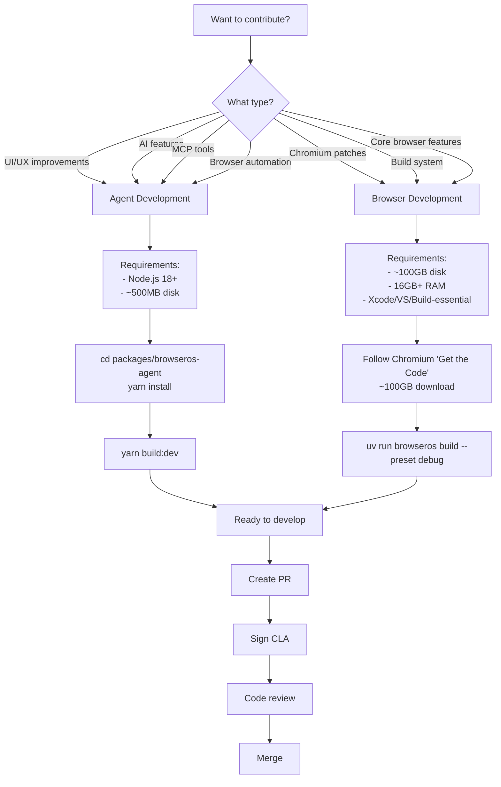
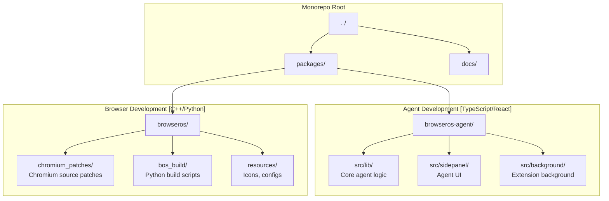
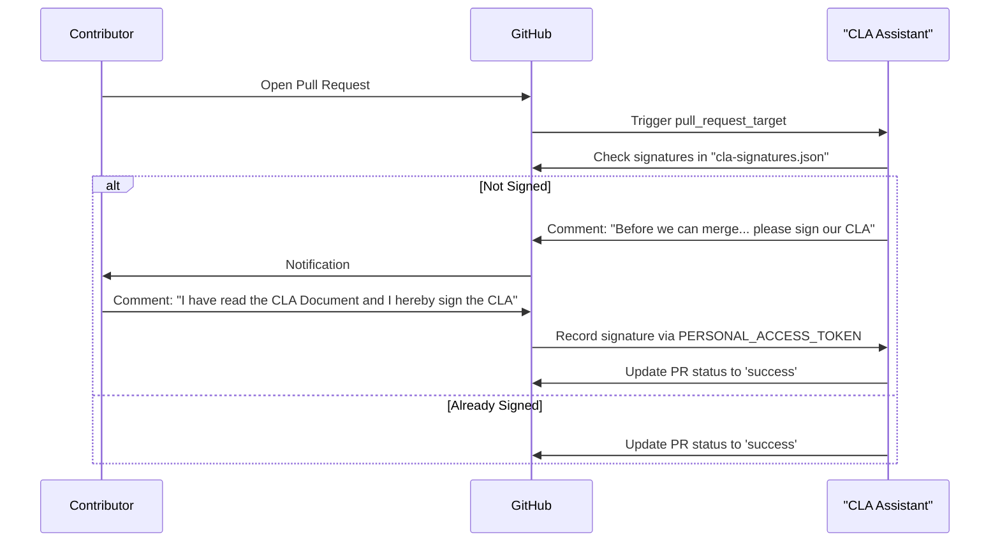

<!-- source: DeepWiki mcp.deepwiki.com · repo browseros-ai/BrowserOS · page 12 Contributing · fetched 2026-10-29 -->

# Contributing

Relevant source files

The following files were used as context for generating this wiki page:

- [.github/ISSUE_TEMPLATE/01-bug.yml](.github/ISSUE_TEMPLATE/01-bug.yml)
- [.github/ISSUE_TEMPLATE/config.yml](.github/ISSUE_TEMPLATE/config.yml)
- [.github/ISSUE_TEMPLATE/feature_request.md](.github/ISSUE_TEMPLATE/feature_request.md)
- [.github/workflows/branch-cleaner.yml](.github/workflows/branch-cleaner.yml)
- [.github/workflows/cla.yml](.github/workflows/cla.yml)
- [.github/workflows/claude.yml](.github/workflows/claude.yml)
- [.github/workflows/pr-title.yml](.github/workflows/pr-title.yml)
- [CLA.md](CLA.md)
- [CONTRIBUTING.md](CONTRIBUTING.md)
- [LICENSE](LICENSE)
- [packages/browseros-agent/CLAUDE.md](packages/browseros-agent/CLAUDE.md)

**Purpose and Scope**: This document provides an overview of the contribution process for BrowserOS, including development paths, CLA requirements, and workflow. For step-by-step environment setup, see [Development Setup](#12.1). For CLA signing details, see [CLA Requirements](#12.2). For coding conventions, see [Code Standards](#12.3). For the complete PR workflow, see [Pull Request Process](#12.4).

## Contribution Paths

BrowserOS has two distinct development paths corresponding to its two-component architecture:

| Path | Component | Languages | Setup Complexity | Build Time |
|------|-----------|-----------|------------------|------------|
| **Agent Development** | Agent UI, Server, Controller | TypeScript, React, Bun/Yarn | Low (10 minutes) | Fast (seconds) |
| **Browser Development** | Chromium Core, Patches | C++, Python | High (4+ hours) | Slow (3+ hours first build) |

Most contributors work on the Agent path since it has significantly lower barriers to entry [CONTRIBUTING.md:9-10]().

**Development Path Decision Tree**

Sources: [CONTRIBUTING.md:11-56](), [CONTRIBUTING.md:102-129]()

## Repository Structure

Contributors work within specific directories depending on their development path. The monorepo uses `Bun` and `Yarn` for the Agent space and a `uv`-based Python system for the Browser build system [CONTRIBUTING.md:66-77](), [CONTRIBUTING.md:113-126](), [packages/browseros-agent/CLAUDE.md:3-19]().

Sources: [CONTRIBUTING.md:195-213](), [packages/browseros-agent/CLAUDE.md:3-4]()

## Contributor License Agreement (CLA)

All contributors must sign the CLA before their first pull request can be merged. The signing process is automated through GitHub PR comments. Signatures are tracked in `cla-signatures.json` in the `cla-signatures` repository [CLA.md:46-49](), [.github/workflows/cla.yml:30-34]().

**CLA Signing Flow**

Sources: [CLA.md:46-49](), [.github/workflows/cla.yml:1-59]()

## Code Standards

BrowserOS maintains strict standards to ensure codebase health. For detailed rules, see [Code Standards](#12.3).

| Category | Standard | Source |
|----------|----------|--------|
| **TypeScript** | Strict typing (no `any`), Zod schemas for interfaces, path aliases (`@/lib`) | [CONTRIBUTING.md:151-174]() |
| **React** | Tailwind CSS only, Hooks at top level, Zod for props | [CONTRIBUTING.md:176-181]() |
| **Testing** | Vitest for Agent (`bun run test`) | [CONTRIBUTING.md:181](), [packages/browseros-agent/CLAUDE.md:10-14]() |
| **Imports** | Extensionless TypeScript imports (e.g., `./utils`) | [packages/browseros-agent/CLAUDE.md:18]() |
| **Shared Data** | Use `@browseros/shared` for ports, timeouts, and URLs | [packages/browseros-agent/CLAUDE.md:21-27]() |

Sources: [CONTRIBUTING.md:149-192](), [packages/browseros-agent/CLAUDE.md:1-31]()

## Pull Request Process

To contribute code, follow these high-level steps. For a detailed guide, see [Pull Request Process](#12.4).

1.  **Conventional Commits**: PR titles must follow the conventional format (e.g., `feat:`, `fix:`) [.github/workflows/pr-title.yml:1-21]().
2.  **Testing**: Run the root check suite (`bun run check`) and tests (`bun run test`) before pushing [packages/browseros-agent/CLAUDE.md:5-14]().
3.  **Visuals**: Include screenshots or videos for UI changes [CONTRIBUTING.md:138]().
4.  **CLA Signing**: Comment on the PR to sign the agreement: `I have read the CLA Document and I hereby sign the CLA` [.github/workflows/cla.yml:40-44]().
5.  **Review**: Open a PR with a clear description explaining what changed and why [CONTRIBUTING.md:135-139](). The repository also uses `Claude Code` for automated assistance [.github/workflows/claude.yml:1-43]().

Sources: [CONTRIBUTING.md:133-148](), [.github/workflows/pr-title.yml:1-21](), [.github/workflows/cla.yml:1-59](), [packages/browseros-agent/CLAUDE.md:5-15]()

## Community and Support

- **Bug Reports**: Use the [Bug Report template](.github/ISSUE_TEMPLATE/01-bug.yml) with clear reproduction steps and environment details [CONTRIBUTING.md:220-228]().
- **Feature Requests**: Use the [Feature Request template](.github/ISSUE_TEMPLATE/feature_request.md) to propose enhancements [.github/ISSUE_TEMPLATE/feature_request.md:1-23]().
- **Discord**: Join the community for real-time help at [https://discord.gg/YKwjt5vuKr](https://discord.gg/YKwjt5vuKr) [.github/ISSUE_TEMPLATE/config.yml:3-5]().

Sources: [CONTRIBUTING.md:216-250](), [.github/ISSUE_TEMPLATE/01-bug.yml:1-76](), [.github/ISSUE_TEMPLATE/config.yml:1-15]()

---

