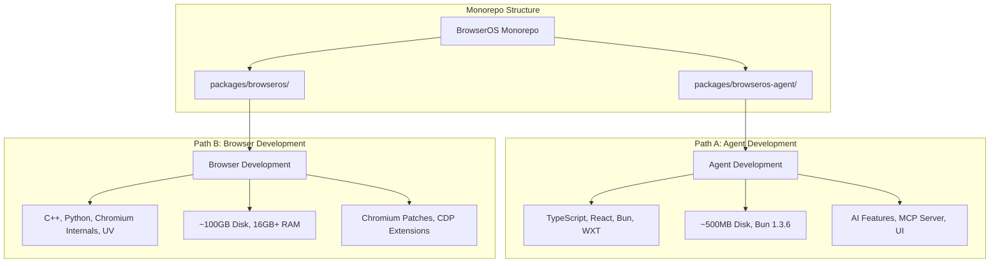
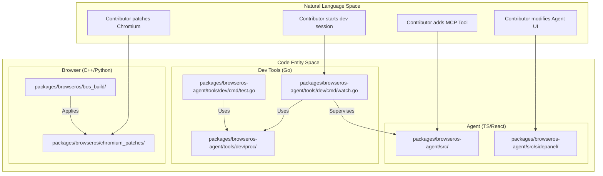

<!-- source: DeepWiki mcp.deepwiki.com · repo browseros-ai/BrowserOS · page 12.1 Development Setup · fetched 2026-10-29 -->

# Development Setup

<details>
<summary>Relevant source files</summary>

The following files were used as context for generating this wiki page:

- [.github/ISSUE_TEMPLATE/01-bug.yml](.github/ISSUE_TEMPLATE/01-bug.yml)
- [.github/ISSUE_TEMPLATE/config.yml](.github/ISSUE_TEMPLATE/config.yml)
- [.github/ISSUE_TEMPLATE/feature_request.md](.github/ISSUE_TEMPLATE/feature_request.md)
- [CONTRIBUTING.md](CONTRIBUTING.md)
- [LICENSE](LICENSE)
- [packages/browseros-agent/CLAUDE.md](packages/browseros-agent/CLAUDE.md)
- [packages/browseros-agent/crates/harness-integrations/tests/skills.rs](packages/browseros-agent/crates/harness-integrations/tests/skills.rs)
- [packages/browseros-agent/tools/dev/cmd/setup.go](packages/browseros-agent/tools/dev/cmd/setup.go)
- [packages/browseros-agent/tools/dev/cmd/setup_test.go](packages/browseros-agent/tools/dev/cmd/setup_test.go)
- [packages/browseros-agent/tools/dev/cmd/sidecar.go](packages/browseros-agent/tools/dev/cmd/sidecar.go)
- [packages/browseros-agent/tools/dev/cmd/test.go](packages/browseros-agent/tools/dev/cmd/test.go)
- [packages/browseros-agent/tools/dev/cmd/watch.go](packages/browseros-agent/tools/dev/cmd/watch.go)
- [packages/browseros-agent/tools/dev/cmd/watch_test.go](packages/browseros-agent/tools/dev/cmd/watch_test.go)
- [packages/browseros-agent/tools/dev/proc/log.go](packages/browseros-agent/tools/dev/proc/log.go)
- [packages/browseros-agent/tools/dev/setup.sh](packages/browseros-agent/tools/dev/setup.sh)
- [packages/browseros-agent/tools/dogfood/cmd/sidecar.go](packages/browseros-agent/tools/dogfood/cmd/sidecar.go)
- [packages/browseros-agent/tools/dogfood/cmd/sidecar_test.go](packages/browseros-agent/tools/dogfood/cmd/sidecar_test.go)

</details>


This page provides step-by-step instructions for setting up a local development environment for BrowserOS. The setup process varies significantly depending on whether you are working on the **Agent** (TypeScript/React/Bun) or **Browser** (Chromium C++/Python).

---

## Development Paths

BrowserOS is organized as a monorepo with two primary development tracks. Most contributors start with the Agent as it has significantly lower hardware requirements and faster iteration cycles.



Sources: [CONTRIBUTING.md:5-8](), [packages/browseros-agent/CLAUDE.md:1-5]()

---

## Prerequisites Comparison

| Requirement | Agent Development | Browser Development |
|------------|------------------|-------------------|
| **Disk Space** | ~500MB | ~100GB |
| **RAM** | 8GB+ | 16GB+ (Recommended) |
| **Setup Time** | ~10 minutes | 3+ hours (Initial fetch) |
| **Build Time** | <1 minute | 1-3 hours (Full build) |
| **Primary Tools** | Bun, Node.js 18+ | `uv`, Xcode/VS, Python, `depot_tools` |
| **Skillset** | TypeScript, React, Chrome APIs | C++, Python, Chromium internals |

Sources: [CONTRIBUTING.md:25-31](), [CONTRIBUTING.md:46-52](), [CONTRIBUTING.md:93-101]()

---

## Agent Development Setup

The Agent consists of the **Agent UI** (WXT extension), the **Server** (MCP server), and shared packages.

### Step 1: Install Bun
BrowserOS Agent development requires **Bun**. Node.js 18+ is also required [CONTRIBUTING.md:26]().

```bash
# Install Bun (if not already installed)
curl -fsSL https://bun.sh/install | bash
```

Sources: [CONTRIBUTING.md:26](), [packages/browseros-agent/CLAUDE.md:19-19]()

### Step 2: Install Dependencies
Navigate to the agent package and install the monorepo dependencies using Bun.

```bash
cd packages/browseros-agent
bun install
```

Sources: [CONTRIBUTING.md:68-69](), [packages/browseros-agent/CLAUDE.md:19-19]()

### Step 3: Environment Configuration
Copy the example environment file and add your `LITELLM_API_KEY`.

```bash
cd packages/browseros-agent
cp .env.example .env
# Edit .env and add your LITELLM_API_KEY
```

Sources: [CONTRIBUTING.md:71-73]()

### Step 4: Build the Extension
Perform a one-time build of the extension for development.

```bash
cd packages/browseros-agent
yarn build:dev
```

Sources: [CONTRIBUTING.md:75-76]()

### Step 5: Load in BrowserOS
Load the built extension into BrowserOS or Chrome.

1. Open `chrome://extensions/`
2. Enable **Developer mode** (top right toggle)
3. Click **Load unpacked**
4. Select `packages/browseros-agent/dist/`
5. Press Agent icon from extensions toolbar to open the agent panel

Sources: [CONTRIBUTING.md:79-86]()

### Step 6: Development Workflow
For active development, use the `watch` command. This starts the agent (WXT HMR), waits for CDP, and then starts the server sidecar [packages/browseros-agent/tools/dev/cmd/watch.go:22-26]().

```bash
# From the monorepo root:
bun run dev:watch
```

**Watch Modes:**
- `--new`: Creates a fresh user-data directory and uses random available ports [packages/browseros-agent/tools/dev/cmd/watch.go:42]().
- `--manual`: Builds the agent statically instead of using HMR mode [packages/browseros-agent/tools/dev/cmd/watch.go:43]().
- `--claw`: Runs the BrowserClaw UI and standalone Rust server [packages/browseros-agent/tools/dev/cmd/watch.go:44]().

Sources: [packages/browseros-agent/tools/dev/cmd/watch.go:22-46](), [packages/browseros-agent/tools/dev/cmd/watch.go:95-107]()

---

## Browser Development Setup

Building the custom Chromium browser requires significant disk space and time. This path is for working on browser-level features or patches to Chromium itself [CONTRIBUTING.md:89-91]().

### Prerequisites
- **~100GB disk space** for Chromium source [CONTRIBUTING.md:95]()
- **16GB+ RAM** (recommended) [CONTRIBUTING.md:96]()
- **Platform tools:**
  - macOS: Xcode + Command Line Tools [CONTRIBUTING.md:98]()
  - Linux: `build-essential` and dependencies [CONTRIBUTING.md:99]()
  - Windows: Visual Studio Build Tools [CONTRIBUTING.md:100]()

### Step 1: Checkout Chromium Source
Follow the official Chromium guide for your platform to set up `depot_tools` and fetch the Chromium source tree [CONTRIBUTING.md:104-109]().

### Step 2: Build BrowserOS
Once Chromium is checked out, use the `uv` based build system. The build typically takes 1-3 hours [CONTRIBUTING.md:129]().

```bash
cd packages/browseros

# Debug build (for development)
uv run browseros build --preset debug --chromium-src /path/to/chromium/src

# Release build (for production)
uv run browseros build --preset release --chromium-src /path/to/chromium/src
```

Sources: [CONTRIBUTING.md:115-127]()

---

## Testing and Verification

Before pushing changes, you must verify your work using the built-in check suite and tests [packages/browseros-agent/CLAUDE.md:5-12]().

```bash
# Run lint, typecheck, and Fallow
bun run check

# Run the full test suite
bun run test
```

### Automated Test Environment
The `test` command manages the full lifecycle: killing conflicting ports, starting the server and browser, waiting for readiness, running tests, and cleaning up [packages/browseros-agent/tools/dev/cmd/test.go:20-25]().

```bash
# Run tests with a headless browser
bun run dev:test -- --headless
```

Sources: [packages/browseros-agent/CLAUDE.md:7-12](), [packages/browseros-agent/tools/dev/cmd/test.go:20-30](), [packages/browseros-agent/tools/dev/cmd/test.go:167-180]()

---

## System Integration Diagram

This diagram bridges contributor actions to specific code entities and processes.



Sources: [CONTRIBUTING.md:196-210](), [packages/browseros-agent/tools/dev/cmd/watch.go:173-182](), [packages/browseros-agent/tools/dev/cmd/test.go:123-154]()

---

## Development Environment Lifecycle

The `watch` command implements sophisticated process supervision to ensure a clean development state.

| Phase | Code Entity | Description |
|-------|-------------|-------------|
| **Port Clearing** | `proc.KillPortsAndWait` | Kills existing processes on CDP, Server, and Extension ports [packages/browseros-agent/tools/dev/cmd/watch.go:119](). |
| **Locking** | `proc.AcquireWatchRunLock` | Prevents multiple watch instances from running on the same profile [packages/browseros-agent/tools/dev/cmd/watch.go:79](). |
| **Agent HMR** | `startBrowserOSWatch` | Starts WXT in dev mode for hot-module replacement [packages/browseros-agent/tools/dev/cmd/watch.go:178](). |
| **Sidecar Server** | `proc.StartManaged` | Starts the MCP server sidecar process with auto-restart [packages/browseros-agent/tools/dev/cmd/test.go:123](). |
| **Cleanup** | `p.Stop` / `p.ForceKill` | Gracefully shuts down all managed processes on Ctrl+C [packages/browseros-agent/tools/dev/cmd/watch.go:193-200](). |

Sources: [packages/browseros-agent/tools/dev/cmd/watch.go:78-93](), [packages/browseros-agent/tools/dev/cmd/watch.go:118-129](), [packages/browseros-agent/tools/dev/cmd/watch.go:184-204](), [packages/browseros-agent/tools/dev/cmd/test.go:123-132]()

---

