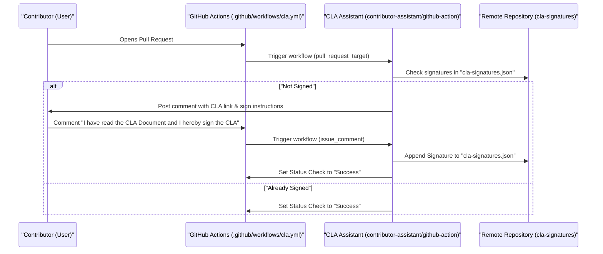

<!-- source: DeepWiki mcp.deepwiki.com · repo browseros-ai/BrowserOS · page 12.2 CLA Requirements · fetched 2026-10-29 -->

# CLA Requirements

<details>
<summary>Relevant source files</summary>

The following files were used as context for generating this wiki page:

- [.github/workflows/branch-cleaner.yml](.github/workflows/branch-cleaner.yml)
- [.github/workflows/cla.yml](.github/workflows/cla.yml)
- [.github/workflows/claude.yml](.github/workflows/claude.yml)
- [.github/workflows/pr-title.yml](.github/workflows/pr-title.yml)
- [CLA.md](CLA.md)
- [signatures/version1/cla.json](signatures/version1/cla.json)

</details>


## Purpose and Scope

This document outlines the Contributor License Agreement (CLA) requirements for BrowserOS. To maintain the legal integrity of the project and ensure that all contributions can be safely distributed under the project's licensing terms (AGPL-3.0), all contributors must sign the CLA before their pull requests can be merged [CLA.md:23-31]().

The process is fully automated via a GitHub Action bot and does not require physical signatures or external documents [.github/workflows/cla.yml:1-59]().

---

## The CLA Process

BrowserOS uses a "comment-to-sign" workflow managed by the `contributor-assistant/github-action` [.github/workflows/cla.yml:25](). This ensures a low-friction experience for developers while maintaining a verifiable record of consent.

### Signature Workflow

The workflow is triggered by PR events (`opened`, `synchronize`) or specific issue comments [.github/workflows/cla.yml:3-7]().



**Sources:** [.github/workflows/cla.yml:3-59](), [CLA.md:46-49]()

### How to Sign

1.  **Open a Pull Request**: Submit your code changes. The PR title must follow conventional commit standards (e.g., `feat:`, `fix:`) as validated by `ytanikin/pr-conventional-commits` [.github/workflows/pr-title.yml:17-20]().
2.  **Read the Document**: Review the full [CLA.md](). It defines "Contribution" as any original work intentionally submitted for inclusion [CLA.md:11-12]().
3.  **Post the Signature Comment**: The bot will post a message if you haven't signed [.github/workflows/cla.yml:37-46](). Reply with the exact phrase defined in the workflow configuration [.github/workflows/cla.yml:56]():
    > `I have read the CLA Document and I hereby sign the CLA`
4.  **Verification**: The bot detects the comment via `github.event.comment.body` [.github/workflows/cla.yml:21-22](). Once verified, the CLA status check passes automatically.

**Sources:** [.github/workflows/cla.yml:20-22](), [CLA.md:46-49](), [.github/workflows/pr-title.yml:1-21]()

---

## Signature Tracking and Data Flow

Signatures are tracked in a versioned JSON format. While the active workflow stores current signatures in a remote `cla-signatures` repository owned by the `browseros-ai` organization [.github/workflows/cla.yml:33-34](), the codebase maintains a historical record of signed contributors.

### Data Entity Mapping

The signature record maps GitHub metadata to the legal agreement.

```mermaid
classDiagram
    class "signatures/version1/cla.json" {
        +Array signedContributors
    }
    class "ContributorEntry (Object)" {
        +String name
        +Number id
        +Number comment_id
        +String created_at
        +Number repoId
        +Number pullRequestNo
    }
    
    "signatures/version1/cla.json" "1" -- "*" "ContributorEntry (Object)" : contains
```

**Sources:** [signatures/version1/cla.json:1-140]()

### Implementation Detail: `cla.json`

The file `signatures/version1/cla.json` contains a registry of contributors who have successfully completed the workflow. Each entry captures the specific context of the signature to ensure auditability.

| Field | Description | Code Entity |
| :--- | :--- | :--- |
| `name` | GitHub username of the contributor | `name` [signatures/version1/cla.json:4]() |
| `id` | Unique numeric GitHub User ID | `id` [signatures/version1/cla.json:5]() |
| `comment_id` | ID of the specific comment containing the signature | `comment_id` [signatures/version1/cla.json:6]() |
| `created_at` | ISO 8601 timestamp of signature | `created_at` [signatures/version1/cla.json:7]() |
| `repoId` | ID of the repository where the PR was made | `repoId` [signatures/version1/cla.json:8]() |
| `pullRequestNo` | The specific PR number where signature occurred | `pullRequestNo` [signatures/version1/cla.json:9]() |

**Sources:** [signatures/version1/cla.json:2-10]()

---

## Automated Validation and Maintenance

Beyond the CLA, every PR undergoes automated validation. The repository also maintains automated cleanup tasks.

### PR Validation Pipeline

1.  **Conventional Commits**: Validates PR titles against types like `feat`, `fix`, `docs`, `refactor`, etc. [.github/workflows/pr-title.yml:19-20]().
2.  **Claude Code Integration**: Pull requests and issue comments can trigger `anthropics/claude-code-action` for automated analysis and assistance, provided the user has `OWNER`, `MEMBER`, or `COLLABORATOR` associations [.github/workflows/claude.yml:16-43]().

### Maintenance Workflows

*   **Branch Cleaner**: To keep the repository tidy, the `GitHub Branch Cleaner` runs every Sunday at midnight (cron `0 0 * * 0`) [.github/workflows/branch-cleaner.yml:4-5](). It deletes merged branches that are older than 30 days [.github/workflows/branch-cleaner.yml:13-17]().

**Sources:** [.github/workflows/pr-title.yml:1-21](), [.github/workflows/claude.yml:1-43](), [.github/workflows/branch-cleaner.yml:1-18]()

### Troubleshooting Signatures

If the CLA check fails despite signing:
*   **Recheck**: Comment `recheck` on the PR to trigger a re-verification by the `CLA Assistant` [.github/workflows/cla.yml:21-52]().
*   **Email Mismatch**: Ensure your commit email matches your GitHub account email [.github/workflows/cla.yml:53-54]().
*   **Allowlist**: Certain bots and internal contributors (e.g., `shadowfax92`, `felarof99`, `dependabot`, `github-actions`) are automatically allowlisted and do not need to sign [.github/workflows/cla.yml:35]().

**Sources:** [.github/workflows/cla.yml:21-55]()

---

