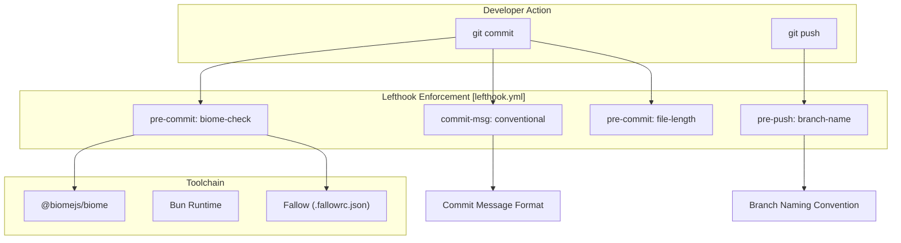
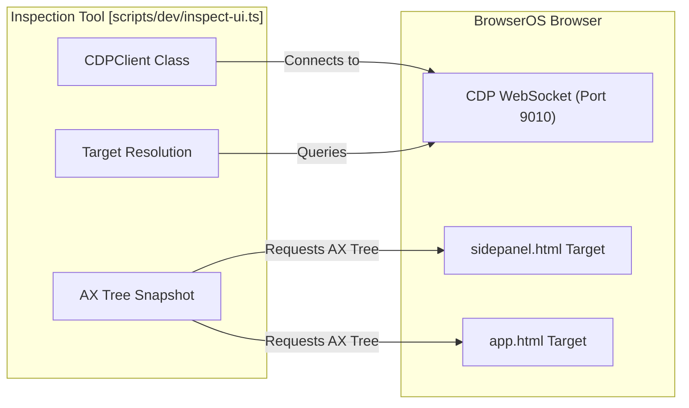

<!-- source: DeepWiki mcp.deepwiki.com · repo browseros-ai/BrowserOS · page 12.3 Code Standards · fetched 2026-10-29 -->

# Code Standards

Relevant source files

The following files were used as context for generating this wiki page:

- [lefthook.yml](lefthook.yml)
- [packages/browseros-agent/.claude/skills/test-ui/SKILL.md](packages/browseros-agent/.claude/skills/test-ui/SKILL.md)
- [packages/browseros-agent/.fallowrc.json](packages/browseros-agent/.fallowrc.json)
- [packages/browseros-agent/apps/app/codegen.ts](packages/browseros-agent/apps/app/codegen.ts)
- [packages/browseros-agent/apps/claw-app/screens/task-detail/task-detail.helpers.test.ts](packages/browseros-agent/apps/claw-app/screens/task-detail/task-detail.helpers.test.ts)
- [packages/browseros-agent/apps/claw-app/screens/task-detail/task-detail.helpers.ts](packages/browseros-agent/apps/claw-app/screens/task-detail/task-detail.helpers.ts)
- [packages/browseros-agent/apps/server/src/compiled-bootstrap.ts](packages/browseros-agent/apps/server/src/compiled-bootstrap.ts)
- [packages/browseros-agent/apps/server/src/index.ts](packages/browseros-agent/apps/server/src/index.ts)
- [packages/browseros-agent/apps/server/src/lib/native-addon-guard.ts](packages/browseros-agent/apps/server/src/lib/native-addon-guard.ts)
- [packages/browseros-agent/biome.json](packages/browseros-agent/biome.json)
- [packages/browseros-agent/lefthook.yml](packages/browseros-agent/lefthook.yml)
- [packages/browseros-agent/scripts/build/server/native-addon-policy.test.ts](packages/browseros-agent/scripts/build/server/native-addon-policy.test.ts)
- [packages/browseros-agent/scripts/dev/inspect-ui.ts](packages/browseros-agent/scripts/dev/inspect-ui.ts)

This document defines coding conventions, linting rules, type checking requirements, and testing standards for the BrowserOS codebase. Standards are enforced to ensure consistency across the monorepo's diverse components, ranging from TypeScript-based AI agents to Chromium patches and server-side logic.

---

## Overview

BrowserOS is a monorepo containing multiple distinct environments. While general principles apply across the project, specific standards are tailored to each domain:

| Component | Environment | Primary Tools | Location |
|-----------|-------------|---------------|----------|
| **Agent UI** | WXT (React) | Biome, Bun, TanStack Query | `packages/browseros-agent/apps/app/` |
| **Server** | Bun (Hono) | Biome, Bun, MCP SDK | `packages/browseros-agent/apps/server/` |
| **Shared** | TypeScript | Biome, Bun | `packages/browseros-agent/packages/shared/` |

**Sources:** [packages/browseros-agent/apps/server/src/index.ts:1-24](), [packages/browseros-agent/biome.json:1-18]()

---

## Universal Ground Rules

Regardless of the specific package, all contributors must adhere to these baseline standards within the `browseros-agent` monorepo:

- **Runtime:** Use Bun for all TypeScript execution (`bun run`, `bun test`) [packages/browseros-agent/apps/server/src/index.ts:9-15]().
- **Formatting & Linting:** Biome is the primary tool for code quality. It enforces a maximum cognitive complexity of **30** [packages/browseros-agent/biome.json:24-42]().
- **Import Organization:** Biome automatically organizes imports on save or during check [packages/browseros-agent/biome.json:51-58]().
- **Dead Code:** Unused imports and variables are treated as errors [packages/browseros-agent/biome.json:28-31]().
- **Security:** Native addon loading is strictly disabled in production server builds via a guard mechanism to prevent unauthorized binary execution [packages/browseros-agent/apps/server/src/compiled-bootstrap.ts:1-5](), [packages/browseros-agent/scripts/build/server/native-addon-policy.test.ts:53-55]().

**Sources:** [packages/browseros-agent/biome.json:24-58](), [packages/browseros-agent/apps/server/src/compiled-bootstrap.ts:1-5](), [packages/browseros-agent/scripts/build/server/native-addon-policy.test.ts:112-114]()

---

## Automated Quality Enforcement

BrowserOS utilizes `lefthook` to enforce standards locally before code reaches the repository.

### Local Git Hooks
- **Commit Messages:** Enforces **Conventional Commits** (e.g., `feat(auth): add OAuth2 support`). Supported types include `feat`, `fix`, `docs`, `style`, `refactor`, `perf`, `test`, `chore`, `ci`, `build`, and `revert` [lefthook.yml:1-15]().
- **Linting:** Runs `biome check --write` on staged files to ensure formatting and lint rules are met before commit [lefthook.yml:19-22]().
- **File Length:** Issues a warning if `.ts` or `.tsx` files exceed **400 lines**, encouraging modularity [lefthook.yml:25-38]().
- **Branch Naming:** Enforces format `<type>/<short-description>` (e.g., `feat/add-mcp-tool`) for all branches except `main` and `master` [lefthook.yml:40-57]().

### Dead Code Detection (Fallow)
The project uses `fallow` to detect unused files, exports, and dependencies.
- **Entry Points:** Critical entry points like `apps/server/src/index.ts` and `apps/app/entrypoints/app/main.tsx` are protected from deletion [packages/browseros-agent/.fallowrc.json:3-17]().
- **Rules:** Generates warnings for unused types, exports, and circular dependencies [packages/browseros-agent/.fallowrc.json:53-64]().

**Sources:** [lefthook.yml:1-58](), [packages/browseros-agent/.fallowrc.json:1-67]()

---

## Testing Requirements

BrowserOS uses `bun:test` as the primary test runner.

- **Unit Testing:** Logic should be isolated into pure helper functions to allow testing without complex environment setups (e.g., testing UI logic without a React tree) [packages/browseros-agent/apps/app/screens/task-detail/task-detail.helpers.ts:1-9]().
- **Integration Testing:** Server components are tested for critical policies, such as the native addon guard [packages/browseros-agent/scripts/build/server/native-addon-policy.test.ts:29-51]().
- **UI Verification:** Use the `inspect-ui.ts` utility to interact with the browser extension via CDP.
    - **Snapshots:** Use `snapshot` for fast, text-based structural verification of the Accessibility (AX) tree [packages/browseros-agent/scripts/dev/inspect-ui.ts:216-252](), [packages/browseros-agent/.claude/skills/test-ui/SKILL.md:85-89]().
    - **Screenshots:** Use `screenshot` only for visual layout and CSS verification [packages/browseros-agent/.claude/skills/test-ui/SKILL.md:91-98]().

**Sources:** [packages/browseros-agent/apps/app/screens/task-detail/task-detail.helpers.test.ts:7-10](), [packages/browseros-agent/scripts/dev/inspect-ui.ts:24-111](), [packages/browseros-agent/.claude/skills/test-ui/SKILL.md:85-98]()

---

## Code Entities to Documentation Mapping

### Code Quality Pipeline
This diagram illustrates how local actions trigger automated enforcement tools.

**Sources:** [lefthook.yml:1-58](), [packages/browseros-agent/biome.json:1-53](), [packages/browseros-agent/.fallowrc.json:53-64]()

### UI Testing and Inspection Architecture
This diagram shows the relationship between the inspection script and the browser targets.

**Sources:** [packages/browseros-agent/scripts/dev/inspect-ui.ts:24-53](), [packages/browseros-agent/scripts/dev/inspect-ui.ts:122-138](), [packages/browseros-agent/scripts/dev/inspect-ui.ts:216-252]()

---

## GraphQL Standards

For components using GraphQL (primarily the Agent UI), code generation is mandatory to ensure type safety.

- **Schema:** The schema is defined in `schema/schema.graphql` [packages/browseros-agent/apps/app/codegen.ts:9-16]().
- **Codegen:** Run GraphQL codegen to produce typed documents. Custom scalars like `Cursor`, `Datetime`, and `JSON` are mapped to `string` or `any` to maintain compatibility with application logic [packages/browseros-agent/apps/app/codegen.ts:32-48]().
- **Location:** Generated types are stored in `./generated/graphql/` and should not be manually edited [packages/browseros-agent/apps/app/codegen.ts:32-32]().

**Sources:** [packages/browseros-agent/apps/app/codegen.ts:1-56]()

---

