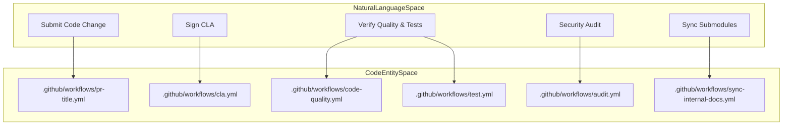
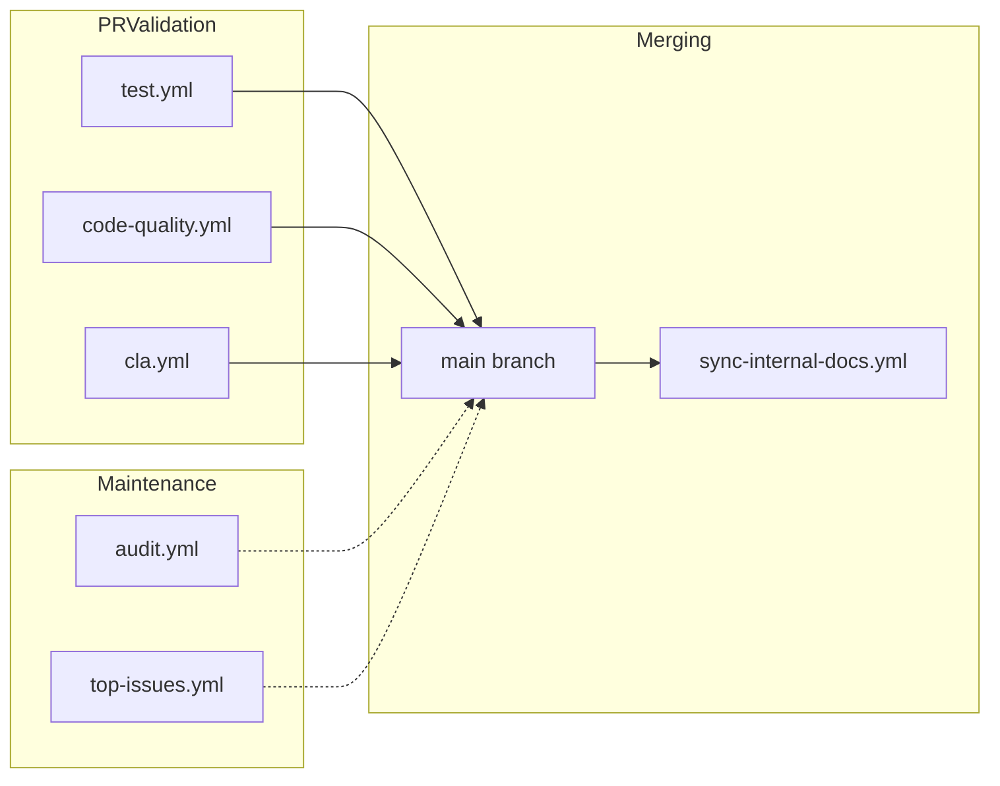

<!-- source: DeepWiki mcp.deepwiki.com · repo browseros-ai/BrowserOS · page 12.4 Pull Request Process · fetched 2026-10-29 -->

# Pull Request Process

Relevant source files

The following files were used as context for generating this wiki page:

- [.github/dependabot.yml](.github/dependabot.yml)
- [.github/workflows/audit.yml](.github/workflows/audit.yml)
- [.github/workflows/branch-cleaner.yml](.github/workflows/branch-cleaner.yml)
- [.github/workflows/cla.yml](.github/workflows/cla.yml)
- [.github/workflows/claude.yml](.github/workflows/claude.yml)
- [.github/workflows/code-quality.yml](.github/workflows/code-quality.yml)
- [.github/workflows/pr-title.yml](.github/workflows/pr-title.yml)
- [.github/workflows/sync-internal-docs.yml](.github/workflows/sync-internal-docs.yml)
- [.github/workflows/test.yml](.github/workflows/test.yml)
- [.github/workflows/top-issues.yml](.github/workflows/top-issues.yml)
- [CLA.md](CLA.md)
- [packages/browseros-agent/contracts/claw-mcp/tests/run.ts](packages/browseros-agent/contracts/claw-mcp/tests/run.ts)
- [packages/browseros-agent/scripts/run-cargo-test.helpers.ts](packages/browseros-agent/scripts/run-cargo-test.helpers.ts)
- [packages/browseros-agent/scripts/run-cargo-test.test.ts](packages/browseros-agent/scripts/run-cargo-test.test.ts)
- [packages/browseros-agent/scripts/run-cargo-test.ts](packages/browseros-agent/scripts/run-cargo-test.ts)
- [packages/browseros-agent/scripts/run-test-suite.ts](packages/browseros-agent/scripts/run-test-suite.ts)

This document describes the complete process for submitting pull requests (PRs) to BrowserOS, from initial creation through automated validation, review, and merging. BrowserOS is a monorepo containing both the AI Agent (TypeScript/Bun) and the custom Browser (Chromium).

## Purpose and Scope

This page serves as a technical guide for contributors to understand the mechanics of the PR lifecycle. It covers:
- The PR workflow and branch management.
- Conventional commit requirements.
- The automated Contributor License Agreement (CLA) signing process.
- Continuous Integration (CI) checks including security audits, code quality, and integration tests.
- Internal documentation synchronization and automated dependency updates.

---

## Pull Request Workflow

The contribution process is governed by several GitHub Action workflows that map natural language contribution steps to code entities.

### From Contribution to Code Entity

**Sources:** [.github/workflows/pr-title.yml:1-21](), [.github/workflows/cla.yml:1-59](), [.github/workflows/code-quality.yml:1-161](), [.github/workflows/test.yml:1-92](), [.github/workflows/audit.yml:1-187](), [.github/workflows/sync-internal-docs.yml:1-106]()

---

## Creating a Pull Request

### 1. Branching and Commits
Contributors should create feature branches from `main`. BrowserOS enforces **Conventional Commits** for PR titles to ensure clean changelog generation and consistent history.

| Type | Description |
| :--- | :--- |
| `feat` | A new feature |
| `fix` | A bug fix |
| `docs` | Documentation only changes |
| `test` | Adding missing tests or correcting existing tests |
| `ci` | CI/CD configuration changes |
| `refactor` | Code change that neither fixes a bug nor adds a feature |
| `perf` | Performance improvements |
| `chore` | Changes to the build process or auxiliary tools |
| `build` | Changes that affect the build system or external dependencies |

The `PR Conventional Commit Validation` workflow ensures these types are used correctly [.github/workflows/pr-title.yml:13-20]().

### 2. Contributor License Agreement (CLA)
BrowserOS requires a signed CLA for all contributions. This is managed by the `CLA Assistant` workflow [.github/workflows/cla.yml:1-59]().

**The Signing Mechanism:**
- On the first PR from a new contributor, the bot posts a prompt explaining the requirement [.github/workflows/cla.yml:37-47]().
- The contributor must reply with a comment: `I have read the CLA Document and I hereby sign the CLA` [.github/workflows/cla.yml:56-56]().
- The signature is recorded in the `cla-signatures` repository in a file named `cla-signatures.json` [.github/workflows/cla.yml:30-34]().
- Once signed, the status check will pass automatically [.github/workflows/cla.yml:46-46]().

**Sources:** [.github/workflows/cla.yml:1-59](), [CLA.md:1-49]()

---

## Automated Verification (CI)

Once a PR is opened or updated, several automated suites are triggered to ensure stability and security.

### Code Quality and Linting
The `Code Quality` workflow runs on every PR affecting the `packages/browseros-agent/**` path [.github/workflows/code-quality.yml:3-10]().
- **Biome:** Used for linting and formatting via `biome ci .` [.github/workflows/code-quality.yml:13-33]().
- **Typecheck:** Ensures TypeScript integrity after running `wxt prepare` and `codegen` [.github/workflows/code-quality.yml:35-65]().
- **Claw API:** Validates generated code and API conformance via `codegen:claw-api:check` and `test:claw-api-contract` [.github/workflows/code-quality.yml:67-138]().
- **Fallow:** Runs dead code detection via `bun fallow` [.github/workflows/code-quality.yml:139-160]().

### Test Suites
The `Tests` workflow executes a comprehensive matrix of tests across the agent and server components [.github/workflows/test.yml:21-91]().

| Suite | Command | Purpose |
| :--- | :--- | :--- |
| `server-api` | `bun run test:api` | Validates Server REST/CDP endpoints [.github/workflows/test.yml:37-40]() |
| `server-agent` | `bun run test:agent` | Tests agent-to-server communication [.github/workflows/test.yml:33-36]() |
| `claw-mcp` | `bun run test:claw-mcp-contract` | Validates MCP server/client contract [.github/workflows/test.yml:87-91]() |
| `claw-server-rust` | `cargo test --workspace` | Rust-based backend component tests [.github/workflows/test.yml:77-81]() |

Integration tests that require a browser instance download a cached `BrowserOS.AppImage` to simulate the production environment [.github/workflows/test.yml:132-162](). Local developers can run these using `packages/browseros-agent/scripts/run-test-suite.ts` [packages/browseros-agent/scripts/run-test-suite.ts:13-71]().

### Security Auditing
BrowserOS runs a `Daily Security Audit` that monitors the dependency tree for vulnerabilities [.github/workflows/audit.yml:1-6]().
- **Audit Process:** Executes `bun audit --json` within the `packages/browseros-agent` directory [.github/workflows/audit.yml:14-31]().
- **Reporting:** A TypeScript script `parse-audit.ts` parses results, categorizes vulnerabilities by severity, and generates a Slack payload [.github/workflows/audit.yml:41-174]().

**Sources:** [.github/workflows/code-quality.yml:1-161](), [.github/workflows/test.yml:1-184](), [.github/workflows/audit.yml:1-187](), [packages/browseros-agent/scripts/run-test-suite.ts:1-135]()

---

## Review and Merging

### AI-Assisted Review
BrowserOS utilizes `Claude Code` for automated PR assistance [.github/workflows/claude.yml:1-2]().
- **Triggers:** Runs on PR creation, ready-for-review status, or when tagged with `@claude` in comments by authorized contributors [.github/workflows/claude.yml:3-22]().
- **Capabilities:** Utilizes the `anthropics/claude-code-action` to analyze code changes and provide feedback [.github/workflows/claude.yml:36-40]().

### Community Feedback
Top issues and feature requests are tracked in a community roadmap issue (#169), which is updated hourly based on 👍 reactions [.github/workflows/top-issues.yml:1-22](). This helps maintainers prioritize PR reviews based on community demand [.github/workflows/top-issues.yml:71-108]().

### Automated Maintenance
- **Dependabot:** Automatically opens PRs for `bun` and `github-actions` dependency updates, limited to minor and patch versions to maintain stability [.github/dependabot.yml:1-65]().
- **Internal Docs Sync:** A specialized workflow bumps the `.internal-docs` submodule pointer on `main` every 4 hours, creating an auto-merging PR if new commits are detected [.github/workflows/sync-internal-docs.yml:1-106]().
- **Branch Cleaner:** The `branch-cleaner.yml` workflow removes stale branches to keep the repository organized [.github/workflows/branch-cleaner.yml:1-18]().

### Release Data Flow

**Sources:** [.github/workflows/claude.yml:1-43](), [.github/workflows/top-issues.yml:1-117](), [.github/dependabot.yml:1-65](), [.github/workflows/sync-internal-docs.yml:1-106]()

---

