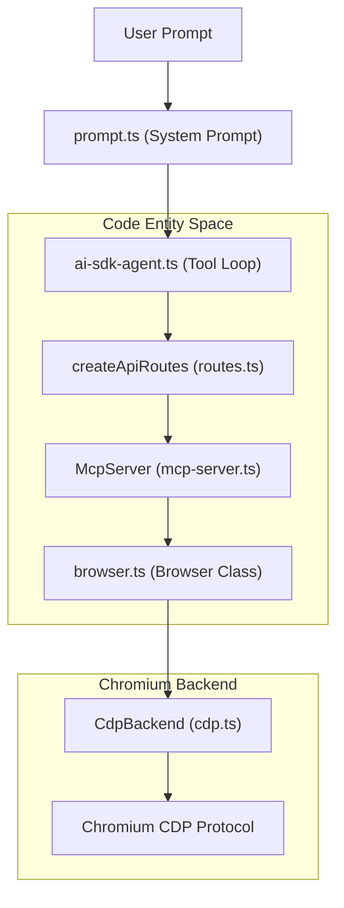
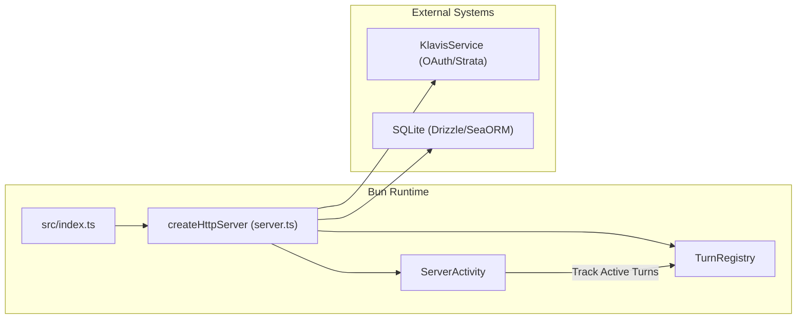

<!-- source: DeepWiki mcp.deepwiki.com · repo browseros-ai/BrowserOS · page 13 Glossary · fetched 2026-10-29 -->

# Glossary

Relevant source files

The following files were used as context for generating this wiki page:

- [.gitattributes](.gitattributes)
- [README.md](README.md)
- [docs/browserclaw/cockpit.mdx](docs/browserclaw/cockpit.mdx)
- [docs/browserclaw/tabs-and-isolation.mdx](docs/browserclaw/tabs-and-isolation.mdx)
- [docs/contributing.mdx](docs/contributing.mdx)
- [docs/docs.json](docs/docs.json)
- [docs/features/bring-your-own-llm.mdx](docs/features/bring-your-own-llm.mdx)
- [docs/features/connect-mcps.mdx](docs/features/connect-mcps.mdx)
- [docs/features/cowork.mdx](docs/features/cowork.mdx)
- [docs/features/local-models.mdx](docs/features/local-models.mdx)
- [docs/features/scheduled-tasks.mdx](docs/features/scheduled-tasks.mdx)
- [docs/features/smart-nudges.mdx](docs/features/smart-nudges.mdx)
- [docs/features/use-with-claude-code.mdx](docs/features/use-with-claude-code.mdx)
- [docs/images/checks-passed.png](docs/images/checks-passed.png)
- [docs/images/contributing--architecture.png](docs/images/contributing--architecture.png)
- [docs/images/hero-dark.png](docs/images/hero-dark.png)
- [docs/images/hero-light.png](docs/images/hero-light.png)
- [docs/images/switcher.png](docs/images/switcher.png)
- [docs/index.mdx](docs/index.mdx)
- [docs/videos/browserOS-agent-in-action.gif](docs/videos/browserOS-agent-in-action.gif)
- [packages/browseros-agent/.config/wt.toml](packages/browseros-agent/.config/wt.toml)
- [packages/browseros-agent/Cargo.lock](packages/browseros-agent/Cargo.lock)
- [packages/browseros-agent/Cargo.toml](packages/browseros-agent/Cargo.toml)
- [packages/browseros-agent/README.md](packages/browseros-agent/README.md)
- [packages/browseros-agent/apps/app/README.md](packages/browseros-agent/apps/app/README.md)
- [packages/browseros-agent/apps/app/package.json](packages/browseros-agent/apps/app/package.json)
- [packages/browseros-agent/apps/app/screens/mcp-settings/QuickSetupSection.test.tsx](packages/browseros-agent/apps/app/screens/mcp-settings/QuickSetupSection.test.tsx)
- [packages/browseros-agent/apps/app/screens/mcp-settings/QuickSetupSection.tsx](packages/browseros-agent/apps/app/screens/mcp-settings/QuickSetupSection.tsx)
- [packages/browseros-agent/apps/app/screens/onboarding/features/Features.tsx](packages/browseros-agent/apps/app/screens/onboarding/features/Features.tsx)
- [packages/browseros-agent/apps/claw-app/fonts.d.ts](packages/browseros-agent/apps/claw-app/fonts.d.ts)
- [packages/browseros-agent/apps/claw-app/package.json](packages/browseros-agent/apps/claw-app/package.json)
- [packages/browseros-agent/apps/claw-app/tsconfig.json](packages/browseros-agent/apps/claw-app/tsconfig.json)
- [packages/browseros-agent/apps/claw-onboard/package.json](packages/browseros-agent/apps/claw-onboard/package.json)
- [packages/browseros-agent/apps/claw-onboard/tsconfig.json](packages/browseros-agent/apps/claw-onboard/tsconfig.json)
- [packages/browseros-agent/apps/claw-server-rust/Cargo.toml](packages/browseros-agent/apps/claw-server-rust/Cargo.toml)
- [packages/browseros-agent/apps/claw-server-rust/src/api/mcp/dispatch.rs](packages/browseros-agent/apps/claw-server-rust/src/api/mcp/dispatch.rs)
- [packages/browseros-agent/apps/claw-server-rust/src/api/mcp/mod.rs](packages/browseros-agent/apps/claw-server-rust/src/api/mcp/mod.rs)
- [packages/browseros-agent/apps/claw-server-rust/src/api/mcp/observers/audit.rs](packages/browseros-agent/apps/claw-server-rust/src/api/mcp/observers/audit.rs)
- [packages/browseros-agent/apps/claw-server-rust/src/api/mcp/service.rs](packages/browseros-agent/apps/claw-server-rust/src/api/mcp/service.rs)
- [packages/browseros-agent/apps/claw-server-rust/src/app.rs](packages/browseros-agent/apps/claw-server-rust/src/app.rs)
- [packages/browseros-agent/apps/claw-server-rust/src/config.rs](packages/browseros-agent/apps/claw-server-rust/src/config.rs)
- [packages/browseros-agent/apps/claw-server-rust/src/db/audit_log.rs](packages/browseros-agent/apps/claw-server-rust/src/db/audit_log.rs)
- [packages/browseros-agent/apps/claw-server-rust/src/db/entities/recording_streams.rs](packages/browseros-agent/apps/claw-server-rust/src/db/entities/recording_streams.rs)
- [packages/browseros-agent/apps/claw-server-rust/src/db/entities/tool_dispatches.rs](packages/browseros-agent/apps/claw-server-rust/src/db/entities/tool_dispatches.rs)
- [packages/browseros-agent/apps/claw-server-rust/src/db/migration.rs](packages/browseros-agent/apps/claw-server-rust/src/db/migration.rs)
- [packages/browseros-agent/apps/claw-server-rust/src/db/mod.rs](packages/browseros-agent/apps/claw-server-rust/src/db/mod.rs)
- [packages/browseros-agent/apps/claw-server-rust/src/db/recording_index.rs](packages/browseros-agent/apps/claw-server-rust/src/db/recording_index.rs)
- [packages/browseros-agent/apps/claw-server-rust/src/db/session_tabs.rs](packages/browseros-agent/apps/claw-server-rust/src/db/session_tabs.rs)
- [packages/browseros-agent/apps/claw-server-rust/src/lib.rs](packages/browseros-agent/apps/claw-server-rust/src/lib.rs)
- [packages/browseros-agent/apps/claw-server-rust/src/main.rs](packages/browseros-agent/apps/claw-server-rust/src/main.rs)
- [packages/browseros-agent/apps/claw-server-rust/src/runtime.rs](packages/browseros-agent/apps/claw-server-rust/src/runtime.rs)
- [packages/browseros-agent/apps/claw-server-rust/src/services/audit.rs](packages/browseros-agent/apps/claw-server-rust/src/services/audit.rs)
- [packages/browseros-agent/apps/claw-server-rust/src/services/first_run.rs](packages/browseros-agent/apps/claw-server-rust/src/services/first_run.rs)
- [packages/browseros-agent/apps/claw-server-rust/src/services/harness.rs](packages/browseros-agent/apps/claw-server-rust/src/services/harness.rs)
- [packages/browseros-agent/apps/claw-server-rust/src/services/mod.rs](packages/browseros-agent/apps/claw-server-rust/src/services/mod.rs)
- [packages/browseros-agent/apps/claw-server-rust/src/services/recordings/store.rs](packages/browseros-agent/apps/claw-server-rust/src/services/recordings/store.rs)
- [packages/browseros-agent/apps/claw-server-rust/src/services/replay/builder.rs](packages/browseros-agent/apps/claw-server-rust/src/services/replay/builder.rs)
- [packages/browseros-agent/apps/claw-server-rust/src/services/session_efficiency.rs](packages/browseros-agent/apps/claw-server-rust/src/services/session_efficiency.rs)
- [packages/browseros-agent/apps/claw-server-rust/src/services/sessions/manager.rs](packages/browseros-agent/apps/claw-server-rust/src/services/sessions/manager.rs)
- [packages/browseros-agent/apps/claw-server-rust/tests/canonical_routes.rs](packages/browseros-agent/apps/claw-server-rust/tests/canonical_routes.rs)
- [packages/browseros-agent/apps/claw-server-rust/tests/connections.rs](packages/browseros-agent/apps/claw-server-rust/tests/connections.rs)
- [packages/browseros-agent/apps/claw-server-rust/tests/dependency_boundaries.rs](packages/browseros-agent/apps/claw-server-rust/tests/dependency_boundaries.rs)
- [packages/browseros-agent/apps/claw-server-rust/tests/routes.rs](packages/browseros-agent/apps/claw-server-rust/tests/routes.rs)
- [packages/browseros-agent/apps/claw-server-rust/tests/telemetry.rs](packages/browseros-agent/apps/claw-server-rust/tests/telemetry.rs)
- [packages/browseros-agent/apps/server/README.md](packages/browseros-agent/apps/server/README.md)
- [packages/browseros-agent/apps/server/package.json](packages/browseros-agent/apps/server/package.json)
- [packages/browseros-agent/apps/server/src/agent/mcp-builder.ts](packages/browseros-agent/apps/server/src/agent/mcp-builder.ts)
- [packages/browseros-agent/apps/server/src/api/routes/agents.ts](packages/browseros-agent/apps/server/src/api/routes/agents.ts)
- [packages/browseros-agent/apps/server/src/api/routes/chat.ts](packages/browseros-agent/apps/server/src/api/routes/chat.ts)
- [packages/browseros-agent/apps/server/src/api/routes/mcp.ts](packages/browseros-agent/apps/server/src/api/routes/mcp.ts)
- [packages/browseros-agent/apps/server/src/api/server.ts](packages/browseros-agent/apps/server/src/api/server.ts)
- [packages/browseros-agent/apps/server/src/api/services/agents/agent-harness-service.ts](packages/browseros-agent/apps/server/src/api/services/agents/agent-harness-service.ts)
- [packages/browseros-agent/apps/server/src/api/services/klavis/service.ts](packages/browseros-agent/apps/server/src/api/services/klavis/service.ts)
- [packages/browseros-agent/apps/server/src/api/services/klavis/tool-adapters.ts](packages/browseros-agent/apps/server/src/api/services/klavis/tool-adapters.ts)
- [packages/browseros-agent/apps/server/src/api/services/mcp/mcp-server.ts](packages/browseros-agent/apps/server/src/api/services/mcp/mcp-server.ts)
- [packages/browseros-agent/apps/server/src/lib/metrics.ts](packages/browseros-agent/apps/server/src/lib/metrics.ts)
- [packages/browseros-agent/apps/server/src/tools/filesystem/register-mcp.ts](packages/browseros-agent/apps/server/src/tools/filesystem/register-mcp.ts)
- [packages/browseros-agent/apps/server/tests/api/routes/agents.test.ts](packages/browseros-agent/apps/server/tests/api/routes/agents.test.ts)
- [packages/browseros-agent/apps/server/tests/api/routes/mcp.test.ts](packages/browseros-agent/apps/server/tests/api/routes/mcp.test.ts)
- [packages/browseros-agent/apps/server/tests/api/services/agents/agent-harness-service.test.ts](packages/browseros-agent/apps/server/tests/api/services/agents/agent-harness-service.test.ts)
- [packages/browseros-agent/apps/server/tests/api/services/mcp/mcp-server.test.ts](packages/browseros-agent/apps/server/tests/api/services/mcp/mcp-server.test.ts)
- [packages/browseros-agent/apps/server/tests/lib/agents/acpx-runtime.test.ts](packages/browseros-agent/apps/server/tests/lib/agents/acpx-runtime.test.ts)
- [packages/browseros-agent/apps/server/tests/lib/metrics.test.ts](packages/browseros-agent/apps/server/tests/lib/metrics.test.ts)
- [packages/browseros-agent/bun.lock](packages/browseros-agent/bun.lock)
- [packages/browseros-agent/crates/browseros-core/src/snapshot/mod.rs](packages/browseros-agent/crates/browseros-core/src/snapshot/mod.rs)
- [packages/browseros-agent/crates/browseros-core/src/snapshot/render.rs](packages/browseros-agent/crates/browseros-core/src/snapshot/render.rs)
- [packages/browseros-agent/crates/browseros-mcp/src/lib.rs](packages/browseros-agent/crates/browseros-mcp/src/lib.rs)
- [packages/browseros-agent/package.json](packages/browseros-agent/package.json)
- [packages/browseros-agent/packages/build-server-tools/package.json](packages/browseros-agent/packages/build-server-tools/package.json)
- [packages/browseros-agent/packages/onboarding-video/package.json](packages/browseros-agent/packages/onboarding-video/package.json)
- [packages/browseros-agent/scripts/codegen/cdp-protocol.ts](packages/browseros-agent/scripts/codegen/cdp-protocol.ts)
- [packages/browseros-agent/tsconfig.json](packages/browseros-agent/tsconfig.json)
- [packages/browseros/bos_build/config/BROWSEROS_BUILD_OFFSET](packages/browseros/bos_build/config/BROWSEROS_BUILD_OFFSET)
- [packages/browseros/resources/BROWSEROS_VERSION](packages/browseros/resources/BROWSEROS_VERSION)

This page provides definitions for codebase-specific terms, jargon, and architectural concepts used within the BrowserOS project. It serves as a technical reference for engineers to understand the mapping between high-level features and their underlying implementation in the code.

## Core Concepts

### Agent Mode vs. Chat Mode
The system operates in two primary interaction modes that determine how the LLM interacts with the browser.

| Term | Definition | Implementation Detail |
| :--- | :--- | :--- |
| **Agent Mode** | A high-reasoning mode where the AI uses tools to navigate, click, and automate browser tasks. | Defined in `getRoleAndMode` with full control of Chromium [packages/browseros-agent/apps/server/src/agent/prompt.ts:37-40](). |
| **Chat Mode** | A lightweight mode for Q&A about the current page, summarization, or translation. | Injected as "read-only chat mode" in the system prompt [packages/browseros-agent/apps/server/src/agent/prompt.ts:52-55](). |

**Sources:** [packages/browseros-agent/apps/server/src/agent/prompt.ts:29-58](), [README.md:112-115]()

### MCP (Model Context Protocol)
BrowserOS implements the Model Context Protocol to bridge the gap between AI models and external tools.

*   **BrowserOS MCP Server**: A built-in server exposing browser automation tools. It uses `StreamableHTTPTransport` to handle requests [packages/browseros-agent/apps/server/src/api/routes/mcp.ts:72-75]().
*   **App Connectors**: Integrations for services like Gmail, Slack, and Linear. These are handled via `KlavisService` and the `execute_action` tool [packages/browseros-agent/apps/server/src/api/services/klavis.ts:17-25](), [packages/browseros-agent/apps/server/src/agent/prompt.ts:75-78]().

**Sources:** [packages/browseros-agent/apps/server/src/api/routes/mcp.ts:45-102](), [README.md:67-68]()

---

## Technical Components

### BrowserOS Server
The central sidecar process (implemented in TypeScript/Bun or Rust) responsible for the lifecycle of the AI agent and system-level automation.

*   **Hono App**: The TypeScript server uses `hono` to define API routes for chat, MCP, and agent management [packages/browseros-agent/apps/server/src/api/server.ts:65-78]().
*   **Rust Backend (BrowserClaw)**: A performance-oriented implementation of the server used in the BrowserClaw variant [packages/browseros-agent/apps/claw-server-rust/src/main.rs:1-15]().
*   **Port Management**: The server asserts port availability before binding to ensure explicit startup errors [packages/browseros-agent/apps/server/src/api/server.ts:22-43]().

**Sources:** [packages/browseros-agent/apps/server/src/api/server.ts:21-141](), [packages/browseros-agent/apps/claw-server-rust/src/lib.rs:1-20]()

### Versioning & Build Constants
BrowserOS uses a specific versioning scheme to track forks against upstream Chromium.

*   **BROWSEROS_VERSION**: Defined in `packages/browseros/resources/BROWSEROS_VERSION` using `MAJOR.MINOR.BUILD.PATCH` format [packages/browseros/resources/BROWSEROS_VERSION:1-4]().
*   **Build Offset**: An integer used to differentiate BrowserOS builds from standard Chromium [packages/browseros/bos_build/config/BROWSEROS_BUILD_OFFSET:1-1]().

**Sources:** [packages/browseros/resources/BROWSEROS_VERSION:1-4](), [packages/browseros/bos_build/config/BROWSEROS_BUILD_OFFSET:1-1]()

---

## Architecture Diagrams

### From Natural Language to Tool Execution
This diagram illustrates how a user's request flows through the agent's tool-loop to the browser backend.

**System Logic Flow: User Request to CDP Command**

**Sources:** [packages/browseros-agent/apps/server/src/agent/prompt.ts:10-23](), [packages/browseros-agent/apps/server/src/api/routes/index.ts:10-40](), [packages/browseros-agent/apps/server/src/api/server.ts:65-78]()

### Server Lifecycle and Activity Monitoring
The relationship between the HTTP server and the active agent turns.

**Process Management Architecture**

**Sources:** [packages/browseros-agent/apps/server/src/api/server.ts:46-78](), [packages/browseros-agent/apps/claw-server-rust/src/db/mod.rs:31-45]()

---

## Domain Jargon

| Term | Definition | Code Pointer |
| :--- | :--- | :--- |
| **Cowork** | Feature combining browser automation with local filesystem access in a sandboxed folder. | [README.md:128-132]() |
| **SOUL.md** | Markdown file defining AI personality, behavior rules, and constraints. | [README.md:144-144]() |
| **LLM Hub** | Multi-pane UI for side-by-side LLM response comparison and provider testing. | [README.md:133-137]() |
| **Smart Nudges** | Contextual suggestions to connect external apps via MCP during a conversation. | [README.md:149-153]() |
| **Klavis** | Internal service for managing OAuth tokens and proxying requests to external app connectors. | [packages/browseros-agent/apps/server/src/api/services/klavis.ts:17-18]() |
| **TurnRegistry** | A central registry used to track active agent "turns" (conversations) for activity monitoring. | [packages/browseros-agent/apps/server/src/api/server.ts:62-63]() |
| **Audit Log** | A durable record of agent actions, tool dispatches, and results stored in SQLite. | [packages/browseros-agent/apps/claw-server-rust/src/db/audit_log.rs:10-25]() |
| **BrowserClaw** | A specialized version of BrowserOS designed specifically for driving AI agents with existing logins. | [README.md:58-63]() |
| **Bun.lock** | The lockfile defining the exact dependency graph for the TypeScript components. | [packages/browseros-agent/bun.lock:1-10]() |

**Sources:** [README.md:19-153](), [packages/browseros-agent/apps/server/src/api/server.ts:50-78](), [packages/browseros-agent/apps/claw-server-rust/src/db/mod.rs:8-15]()