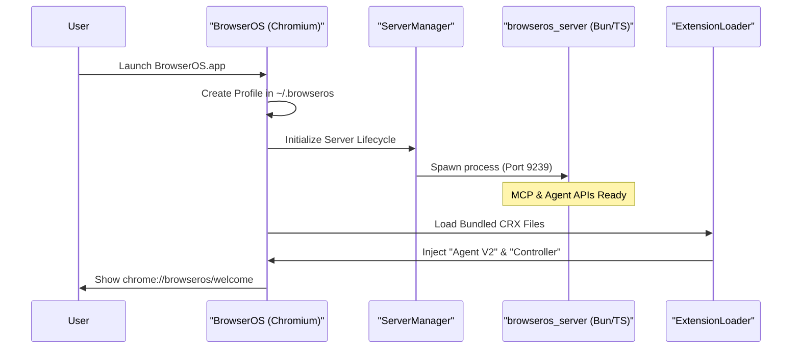
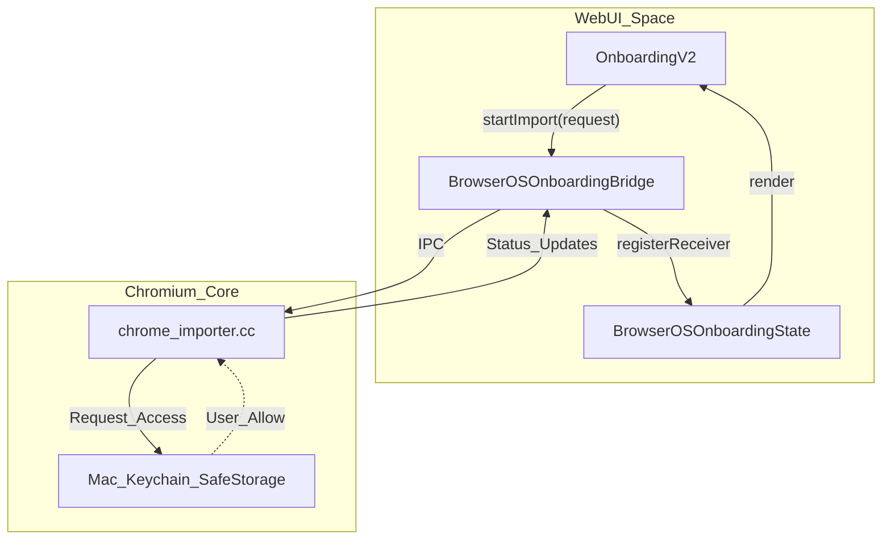

<!-- source: DeepWiki mcp.deepwiki.com · repo browseros-ai/BrowserOS · page 2 Getting Started · fetched 2026-10-29 -->

# Getting Started

Relevant source files

The following files were used as context for generating this wiki page:

- [docs/features/ad-blocking.mdx](docs/features/ad-blocking.mdx)
- [docs/images/about-browseros.png](docs/images/about-browseros.png)
- [docs/images/adblock-browseros.png](docs/images/adblock-browseros.png)
- [docs/images/adblock-chrome.png](docs/images/adblock-chrome.png)
- [docs/images/browseros-mcp-turned-on.png](docs/images/browseros-mcp-turned-on.png)
- [docs/images/check-for-updates.png](docs/images/check-for-updates.png)
- [docs/onboarding.mdx](docs/onboarding.mdx)
- [packages/browseros-agent/apps/claw-onboard/src/onboarding/OnboardingV2.test.tsx](packages/browseros-agent/apps/claw-onboard/src/onboarding/OnboardingV2.test.tsx)
- [packages/browseros-agent/apps/claw-onboard/src/onboarding/OnboardingV2.tsx](packages/browseros-agent/apps/claw-onboard/src/onboarding/OnboardingV2.tsx)
- [packages/browseros-agent/apps/claw-onboard/src/onboarding/components/ImportItemChecklist.tsx](packages/browseros-agent/apps/claw-onboard/src/onboarding/components/ImportItemChecklist.tsx)
- [packages/browseros-agent/apps/claw-onboard/src/onboarding/components/ImportSourceTile.tsx](packages/browseros-agent/apps/claw-onboard/src/onboarding/components/ImportSourceTile.tsx)
- [packages/browseros-agent/apps/claw-onboard/src/onboarding/components/ImportedSummaryCard.tsx](packages/browseros-agent/apps/claw-onboard/src/onboarding/components/ImportedSummaryCard.tsx)
- [packages/browseros-agent/apps/claw-onboard/src/onboarding/components/MacKeychainNotice.tsx](packages/browseros-agent/apps/claw-onboard/src/onboarding/components/MacKeychainNotice.tsx)
- [packages/browseros-agent/apps/claw-onboard/src/onboarding/components/VisualRail.tsx](packages/browseros-agent/apps/claw-onboard/src/onboarding/components/VisualRail.tsx)
- [packages/browseros-agent/apps/claw-onboard/src/onboarding/onboarding-v2.helpers.test.ts](packages/browseros-agent/apps/claw-onboard/src/onboarding/onboarding-v2.helpers.test.ts)
- [packages/browseros-agent/apps/claw-onboard/src/onboarding/onboarding-v2.helpers.ts](packages/browseros-agent/apps/claw-onboard/src/onboarding/onboarding-v2.helpers.ts)
- [packages/browseros-agent/apps/claw-onboard/src/onboarding/onboarding-v2.schemas.test.ts](packages/browseros-agent/apps/claw-onboard/src/onboarding/onboarding-v2.schemas.test.ts)
- [packages/browseros-agent/apps/claw-onboard/src/onboarding/onboarding-v2.schemas.ts](packages/browseros-agent/apps/claw-onboard/src/onboarding/onboarding-v2.schemas.ts)
- [packages/browseros-agent/apps/claw-onboard/src/onboarding/steps/ImportStep.test.tsx](packages/browseros-agent/apps/claw-onboard/src/onboarding/steps/ImportStep.test.tsx)
- [packages/browseros-agent/apps/claw-onboard/src/onboarding/steps/ImportStep.tsx](packages/browseros-agent/apps/claw-onboard/src/onboarding/steps/ImportStep.tsx)
- [packages/browseros-agent/apps/claw-onboard/src/onboarding/steps/ReadyStep.test.tsx](packages/browseros-agent/apps/claw-onboard/src/onboarding/steps/ReadyStep.test.tsx)
- [packages/browseros-agent/apps/claw-onboard/src/onboarding/steps/ReadyStep.tsx](packages/browseros-agent/apps/claw-onboard/src/onboarding/steps/ReadyStep.tsx)
- [packages/browseros-agent/apps/claw-onboard/src/onboarding/steps/WelcomeStep.tsx](packages/browseros-agent/apps/claw-onboard/src/onboarding/steps/WelcomeStep.tsx)

This page guides you through the installation and initial setup of BrowserOS. It covers platform-specific installation, the first-run onboarding experience, and migrating your data from Google Chrome.

For detailed instructions on specific setup steps, see the following child pages:
- [Installation](#2.1) — Platform-specific download links and installation steps.
- [Importing Chrome Data](#2.3) — How to migrate bookmarks, passwords, history, and extensions.

---

## Installation Overview

BrowserOS is distributed as a multi-component system consisting of a custom Chromium browser and a sidecar Agent server process. Binaries are provided for macOS (Universal/Intel), Windows, and Linux (AppImage/Debian).

### Supported Platforms

| Platform | Format | Update Mechanism |
|----------|--------|------------------|
| **macOS** | DMG | Sparkle Framework [docs/docs.json:18]() |
| **Windows** | EXE Installer | Manual / In-app check |
| **Linux** | AppImage / DEB | Manual replacement |

### System Requirements
- **macOS**: 10.15 (Catalina) or later.
- **Windows**: Windows 10 or later.
- **Linux**: Modern distribution with GTK3+ support.

For step-by-step platform guides, see [Installation](#2.1).

---

## First Run & Onboarding

When you first launch BrowserOS, the system initializes your local environment. This involves setting up the profile directory and launching the background processes required for AI features [docs/onboarding.mdx:1-6]().

### Initialization Sequence

The system manages the lifecycle of the sidecar server and handles the injection of privileged extensions like the Agent and uBlock Origin.

**Title: BrowserOS Launch Sequence**

**Sources:** [docs/onboarding.mdx:1-40](), [docs/features/ad-blocking.mdx:12]()

### Onboarding Steps
The `OnboardingV2` flow [packages/browseros-agent/apps/claw-onboard/src/onboarding/OnboardingV2.tsx:64-71]() guides users through three primary stages:
1.  **Welcome**: Introduction to the "secondary browser" concept—a browser for your agents, not just for you [packages/browseros-agent/apps/claw-onboard/src/onboarding/OnboardingV2.test.tsx:89-96]().
2.  **Import**: Securely migrating credentials and browsing data [packages/browseros-agent/apps/claw-onboard/src/onboarding/steps/ImportStep.tsx:127-136]().
3.  **Ready/Connect**: Finalizing the connection to external agent tools like Claude Code [packages/browseros-agent/apps/claw-onboard/src/onboarding/steps/ReadyStep.tsx:28-36]().

---

## Data Migration

BrowserOS allows you to transition from Google Chrome without losing your workflow. The migration tool specifically targets `AGENT_LOGIN_ITEMS` (Cookies and Passwords) as the default to ensure agents can operate within your existing accounts [packages/browseros-agent/apps/claw-onboard/src/onboarding/onboarding-v2.helpers.ts:116-123]().

### Onboarding Import Architecture

The import process uses a bridge to communicate between the WebUI and the underlying Chromium importer logic.

**Title: Onboarding Import Logic Flow**

**Sources:** [packages/browseros-agent/apps/claw-onboard/src/onboarding/OnboardingV2.tsx:72-85](), [packages/browseros-agent/apps/claw-onboard/src/onboarding/components/MacKeychainNotice.tsx:4-12](), [packages/browseros-agent/apps/claw-onboard/src/onboarding/onboarding-v2.helpers.ts:198-211]()

### Key Migration Facts
-   **Logins-First Approach**: The UI defaults to importing `cookies` and `passwords` only, as these are required for agent autonomy [packages/browseros-agent/apps/claw-onboard/src/onboarding/onboarding-v2.helpers.ts:136-141]().
-   **macOS Keychain**: During import, macOS will prompt for the system password to allow the importer to read the Chrome Safe Storage key [packages/browseros-agent/apps/claw-onboard/src/onboarding/components/MacKeychainNotice.tsx:13-26]().
-   **Optional Data**: History, Bookmarks, and Autofill are available under "Also copy my browsing setup" but are unchecked by default [packages/browseros-agent/apps/claw-onboard/src/onboarding/steps/ImportStep.test.tsx:162-181]().
-   **Extension Compatibility**: BrowserOS re-enabled full Manifest V2 support, allowing the original **uBlock Origin** extension to function at full power [docs/features/ad-blocking.mdx:10-12]().

---

## Verifying Setup

Once installed, you can verify the core AI components are functional:

1.  **Check the Sidebar**: You should see icons for **Assistant**, **Skills**, **Connect Apps**, and **Scheduled Tasks**.
2.  **Verify MCP**: Navigate to `chrome://newtab/#/mcp` to manage external agent connections [packages/browseros-agent/apps/claw-onboard/src/onboarding/OnboardingV2.tsx:36]().
3.  **Test the Agent**: Open a page and click the **Assistant** button (or `Option+K`) to ensure the agent can access page context [docs/onboarding.mdx:31-32]().

### Connection Troubleshooting
If the UI displays a "Failed to fetch" or "Unable to connect" error, it typically indicates the local sidecar server is not responding. Ensure no firewall is blocking port 9239.

**Sources:** [docs/onboarding.mdx:31-40](), [packages/browseros-agent/apps/claw-onboard/src/onboarding/steps/ReadyStep.tsx:12-20]()

---

