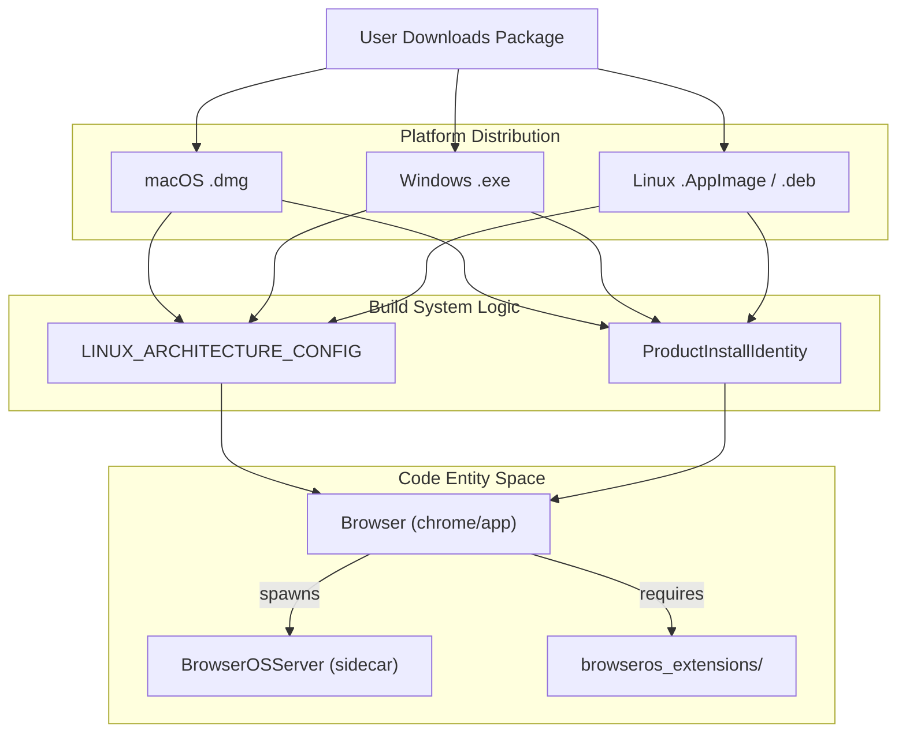
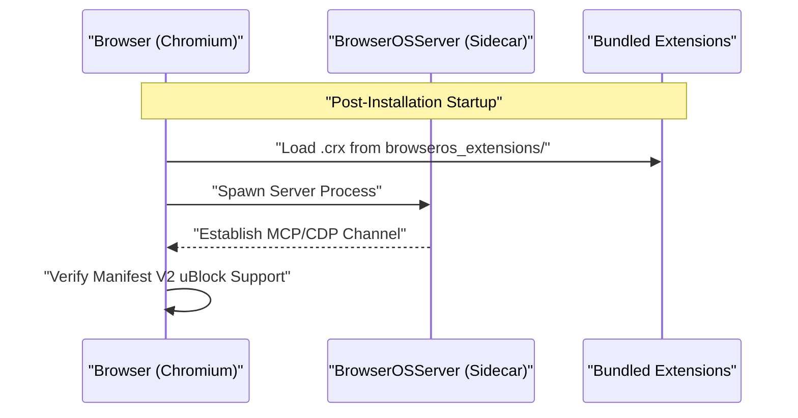

<!-- source: DeepWiki mcp.deepwiki.com · repo browseros-ai/BrowserOS · page 2.1 Installation · fetched 2026-10-29 -->

# Installation

Relevant source files

The following files were used as context for generating this wiki page:

- [docs/features/ad-blocking.mdx](docs/features/ad-blocking.mdx)
- [docs/images/about-browseros.png](docs/images/about-browseros.png)
- [docs/images/adblock-browseros.png](docs/images/adblock-browseros.png)
- [docs/images/adblock-chrome.png](docs/images/adblock-chrome.png)
- [docs/images/browseros-mcp-turned-on.png](docs/images/browseros-mcp-turned-on.png)
- [docs/images/check-for-updates.png](docs/images/check-for-updates.png)
- [docs/onboarding.mdx](docs/onboarding.mdx)
- [packages/browseros/bos_build/cli/dev.py](packages/browseros/bos_build/cli/dev.py)
- [packages/browseros/bos_build/cli/dev_test.py](packages/browseros/bos_build/cli/dev_test.py)
- [packages/browseros/bos_build/patchkit/batch_apply.py](packages/browseros/bos_build/patchkit/batch_apply.py)
- [packages/browseros/bos_build/patchkit/batch_apply_test.py](packages/browseros/bos_build/patchkit/batch_apply_test.py)
- [packages/browseros/bos_build/patchkit/doctor.py](packages/browseros/bos_build/patchkit/doctor.py)
- [packages/browseros/bos_build/patchkit/doctor_test.py](packages/browseros/bos_build/patchkit/doctor_test.py)
- [packages/browseros/bos_build/steps/package/linux.py](packages/browseros/bos_build/steps/package/linux.py)
- [packages/browseros/bos_build/steps/package/linux_test.py](packages/browseros/bos_build/steps/package/linux_test.py)
- [packages/browseros/bos_build/steps/patches/product_user_data_dir_test.py](packages/browseros/bos_build/steps/patches/product_user_data_dir_test.py)
- [packages/browseros/chromium_patches/chrome/install_static/chromium_install_modes.h](packages/browseros/chromium_patches/chrome/install_static/chromium_install_modes.h)

This page provides download links and platform-specific installation instructions for BrowserOS. BrowserOS is a two-component architecture consisting of the **Browser** (a custom Chromium fork) and the **BrowserOS Server** (a sidecar process handling AI agents and MCP tools) [docs/onboarding.mdx:1-4]().

---

## Download Links

BrowserOS provides platform-specific installers. Artifacts are generated by the build system and uploaded to distribution servers. The build system manages these artifacts through product-specific configurations for both BrowserOS and its variants like BrowserClaw [packages/browseros/chromium_patches/chrome/install_static/chromium_install_modes.h:38-96]().

| Platform | Package Type | Architecture | Download URL |
|----------|-------------|--------------|--------------|
| macOS | DMG | Universal / arm64 / x64 | `https://browseros.com` |
| Windows | Installer (EXE) | x64 | `https://browseros.com` |
| Linux | AppImage / .deb | x64 (amd64) / arm64 | `https://browseros.com` |

**Sources:** [packages/browseros/bos_build/steps/package/linux.py:29-38](), [packages/browseros/chromium_patches/chrome/install_static/chromium_install_modes.h:38-96]()

---

## System Requirements

### Minimum Requirements

| Component | Requirement |
|-----------|-------------|
| Operating System | macOS 10.15+, Windows 10+, Linux (Ubuntu 22.04+ recommended) |
| RAM | 4GB minimum, 8GB recommended |
| Disk Space | ~500MB for application binaries |
| Architecture | x64 (Intel/AMD), ARM64 (Apple Silicon / AArch64) [packages/browseros/bos_build/steps/package/linux.py:29-38]() |

### AI Model Compatibility
BrowserOS includes a default AI model with limited usage. For the best experience, users should configure their own keys [docs/onboarding.mdx:21-24]().
- **Chat Mode**: Works well with local models via **Ollama** or **LM Studio** [docs/onboarding.mdx:26-28]().
- **Agent Mode**: Requires high-reasoning models. **Claude 3.5 Sonnet** is recommended; local models are currently insufficient for complex agent tasks [docs/onboarding.mdx:37-40]().

---

## Installation Architecture

The installation process sets up the disjoint user-data roots and singletons for the browser and its sidecar. On Windows, this is handled via `ProductInstallIdentity` to ensure BrowserOS and variants like BrowserClaw do not conflict [packages/browseros/chromium_patches/chrome/install_static/chromium_install_modes.h:17-31]().

**Diagram: Installation to Code Entity Mapping**

**Sources:** [packages/browseros/chromium_patches/chrome/install_static/chromium_install_modes.h:17-31](), [packages/browseros/bos_build/steps/package/linux.py:29-38](), [packages/browseros/bos_build/steps/package/linux.py:167-174]()

---

## macOS Installation

### Download and Install
1. Download the DMG.
2. Drag `BrowserOS.app` to the `/Applications` folder.
3. On first launch, if prompted by Gatekeeper, allow the application in **System Settings > Privacy & Security**.

### Profile Management
macOS profile roots are derived from the `BROWSEROS_PRODUCT_DIR_NAME` build argument, ensuring disjoint storage for different product IDs [packages/browseros/bos_build/steps/patches/product_user_data_dir_test.py:81-105]().

**Sources:** [packages/browseros/bos_build/steps/patches/product_user_data_dir_test.py:81-105]()

---

## Windows Installation

### Download and Install
1. Run the `BrowserOS` installer. The installation uses a specific `base_app_id` and `active_setup_guid` to manage the system registry [packages/browseros/chromium_patches/chrome/install_static/chromium_install_modes.h:69-77]().
2. The default installation path is disjoint from standard Chromium to allow side-by-side usage [packages/browseros/chromium_patches/chrome/install_static/chromium_install_modes.h:36-37]().

### Identity Configuration
Windows installations are configured with specific COM class IDs (CLSIDs) for features like the toast activator and the elevation service [packages/browseros/chromium_patches/chrome/install_static/chromium_install_modes.h:79-90]().

**Sources:** [packages/browseros/chromium_patches/chrome/install_static/chromium_install_modes.h:69-90]()

---

## Linux Installation

BrowserOS supports both portable AppImages and Debian-based packages, with specific logic to handle architecture-specific tools like `appimagetool` during the build process [packages/browseros/bos_build/steps/package/linux.py:44-53]().

### AppImage
1. Download the `.AppImage` file.
2. Make it executable: `chmod +x BrowserOS-x86_64.AppImage`.
3. Run the file directly. The AppImage bundles the browser and the `BrowserOSServer` sidecar [packages/browseros/bos_build/steps/package/linux.py:122-124]().

### Debian (.deb)
1. Install via terminal: `sudo dpkg -i browseros_amd64.deb`.
2. The package includes an AppArmor profile to manage browser sandboxing [packages/browseros/bos_build/steps/package/linux_test.py:18-21]().

### Binary Composition
The Linux package bundles critical Chromium resources and custom extensions:
- `chrome_sandbox`: Set with SUID bits for security [packages/browseros/bos_build/steps/package/linux.py:180]().
- `browseros_extensions/`: Contains the `bundled_extensions.json` and product-specific `.crx` files [packages/browseros/bos_build/steps/package/linux.py:167-174]().

**Sources:** [packages/browseros/bos_build/steps/package/linux.py:44-53](), [packages/browseros/bos_build/steps/package/linux.py:167-180](), [packages/browseros/bos_build/steps/package/linux_test.py:18-21]()

---

## Post-Installation Setup

### 1. Import Chrome Data
BrowserOS allows one-click migration from Google Chrome:
- Navigate to `chrome://settings/importData` [docs/onboarding.mdx:12]().
- Select **Google Chrome** to import bookmarks, passwords, and history [docs/onboarding.mdx:13-17]().

### 2. Ad-Blocking Configuration
BrowserOS re-enables full **Manifest V2** support, allowing the original **uBlock Origin** extension to block ~10x more ads than the Manifest V3 "Lite" versions [docs/features/ad-blocking.mdx:8-15]().

### 3. AI Provider Setup
Configure your preferred LLM provider in the AI Settings:
- **Cloud**: Gemini (Quick start with free API key), Claude, or OpenAI [docs/onboarding.mdx:24-27]().
- **Local**: Ollama or LM Studio for privacy-focused chat [docs/onboarding.mdx:27-28]().

**Sources:** [docs/onboarding.mdx:12-28](), [docs/features/ad-blocking.mdx:8-15]()

---

## Troubleshooting

### Connection Issues
If the browser cannot communicate with the agent:
1. **Sidecar Status**: Ensure the `BrowserOSServer` process is running.
2. **Firewall**: Check that local communication on port `9239` is not blocked.
3. **AppArmor (Linux)**: Ensure the AppArmor profile was correctly created during installation [packages/browseros/bos_build/steps/package/linux_test.py:18-21]().

**Diagram: Component Interaction Flow**

**Sources:** [packages/browseros/bos_build/steps/package/linux.py:167-174](), [docs/features/ad-blocking.mdx:8-12]()

---

