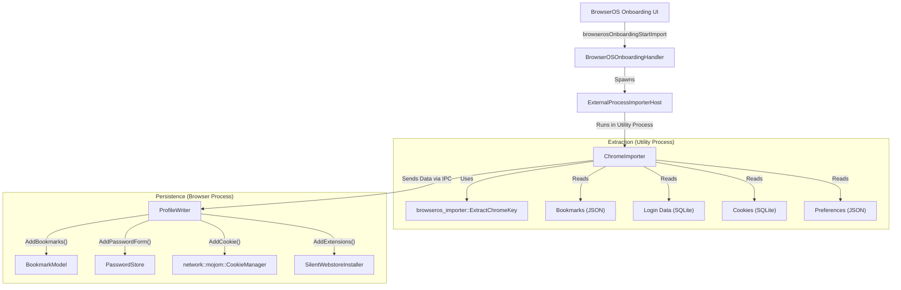

<!-- source: DeepWiki mcp.deepwiki.com · repo browseros-ai/BrowserOS · page 2.3 Importing Chrome Data · fetched 2026-10-29 -->

# Importing Chrome Data

<details>
<summary>Relevant source files</summary>

The following files were used as context for generating this wiki page:

- [packages/browseros/chromium_patches/chrome/browser/browseros/onboarding/browseros_onboarding.cc](packages/browseros/chromium_patches/chrome/browser/browseros/onboarding/browseros_onboarding.cc)
- [packages/browseros/chromium_patches/chrome/browser/browseros/onboarding/browseros_onboarding_api.ts](packages/browseros/chromium_patches/chrome/browser/browseros/onboarding/browseros_onboarding_api.ts)
- [packages/browseros/chromium_patches/chrome/browser/importer/importer_list.cc](packages/browseros/chromium_patches/chrome/browser/importer/importer_list.cc)
- [packages/browseros/chromium_patches/chrome/browser/importer/profile_writer.cc](packages/browseros/chromium_patches/chrome/browser/importer/profile_writer.cc)
- [packages/browseros/chromium_patches/chrome/browser/ui/webui/settings/import_data_handler.cc](packages/browseros/chromium_patches/chrome/browser/ui/webui/settings/import_data_handler.cc)
- [packages/browseros/chromium_patches/chrome/common/importer/profile_import_process_param_traits_macros.h](packages/browseros/chromium_patches/chrome/common/importer/profile_import_process_param_traits_macros.h)
- [packages/browseros/chromium_patches/chrome/utility/importer/browseros/chrome_bookmarks_importer.cc](packages/browseros/chromium_patches/chrome/utility/importer/browseros/chrome_bookmarks_importer.cc)
- [packages/browseros/chromium_patches/chrome/utility/importer/browseros/chrome_cookie_importer.cc](packages/browseros/chromium_patches/chrome/utility/importer/browseros/chrome_cookie_importer.cc)
- [packages/browseros/chromium_patches/chrome/utility/importer/browseros/chrome_cookie_importer.h](packages/browseros/chromium_patches/chrome/utility/importer/browseros/chrome_cookie_importer.h)
- [packages/browseros/chromium_patches/chrome/utility/importer/browseros/chrome_decryptor.cc](packages/browseros/chromium_patches/chrome/utility/importer/browseros/chrome_decryptor.cc)
- [packages/browseros/chromium_patches/chrome/utility/importer/browseros/chrome_decryptor.h](packages/browseros/chromium_patches/chrome/utility/importer/browseros/chrome_decryptor.h)
- [packages/browseros/chromium_patches/chrome/utility/importer/browseros/chrome_decryptor_mac.mm](packages/browseros/chromium_patches/chrome/utility/importer/browseros/chrome_decryptor_mac.mm)
- [packages/browseros/chromium_patches/chrome/utility/importer/browseros/chrome_decryptor_win.cc](packages/browseros/chromium_patches/chrome/utility/importer/browseros/chrome_decryptor_win.cc)
- [packages/browseros/chromium_patches/chrome/utility/importer/browseros/chrome_extensions_importer.cc](packages/browseros/chromium_patches/chrome/utility/importer/browseros/chrome_extensions_importer.cc)
- [packages/browseros/chromium_patches/chrome/utility/importer/browseros/chrome_importer.cc](packages/browseros/chromium_patches/chrome/utility/importer/browseros/chrome_importer.cc)
- [packages/browseros/chromium_patches/chrome/utility/importer/browseros/chrome_importer.h](packages/browseros/chromium_patches/chrome/utility/importer/browseros/chrome_importer.h)
- [packages/browseros/chromium_patches/chrome/utility/importer/browseros/chrome_importer_utils.cc](packages/browseros/chromium_patches/chrome/utility/importer/browseros/chrome_importer_utils.cc)
- [packages/browseros/chromium_patches/chrome/utility/importer/browseros/chrome_importer_utils.h](packages/browseros/chromium_patches/chrome/utility/importer/browseros/chrome_importer_utils.h)
- [packages/browseros/chromium_patches/chrome/utility/importer/browseros/chrome_password_importer.cc](packages/browseros/chromium_patches/chrome/utility/importer/browseros/chrome_password_importer.cc)
- [packages/browseros/chromium_patches/chrome/utility/importer/browseros/chrome_password_importer.h](packages/browseros/chromium_patches/chrome/utility/importer/browseros/chrome_password_importer.h)
- [packages/browseros/chromium_patches/components/user_data_importer/common/importer_data_types.h](packages/browseros/chromium_patches/components/user_data_importer/common/importer_data_types.h)

</details>


This page explains the technical implementation of how BrowserOS imports bookmarks, passwords, history, cookies, and extensions from Google Chrome. As an AI-native Chromium fork, BrowserOS extends standard Chromium importer logic to ensure the AI agent can operate with the user's existing web identity and tools.

## Overview

The import process allows users to bring their existing browsing context into BrowserOS with a single click. Users trigger this via the onboarding flow or by navigating to `chrome://settings/importData` [packages/browseros/chromium_patches/chrome/browser/ui/webui/settings/import_data_handler.cc:1-20]().

### Data Flow Architecture

The following diagram bridges the user-facing import request to the internal C++ classes and processes responsible for data extraction and profile writing.


Sources: [packages/browseros/chromium_patches/chrome/browser/browseros/onboarding/browseros_onboarding.cc:182-184](), [packages/browseros/chromium_patches/chrome/utility/importer/browseros/chrome_importer.cc:30-90](), [packages/browseros/chromium_patches/chrome/browser/importer/profile_writer.cc:64-139]()

## Detailed Implementation

### 1. Onboarding API and Handler
BrowserOS introduces a dedicated onboarding handler to manage the data import flow during the initial setup.

*   **Message Handling**: The `BrowserOSOnboardingHandler` registers callbacks for `browserosOnboardingStartImport` and `browserosOnboardingRefreshSources` [packages/browseros/chromium_patches/chrome/browser/browseros/onboarding/browseros_onboarding.cc:172-189]().
*   **Source Detection**: The `ImporterList` is used to detect installed browsers and their profiles. BrowserOS specifically adds logic to detect Chrome profiles by reading the `Local State` file and `info_cache` [packages/browseros/chromium_patches/chrome/browser/importer/importer_list.cc:158-190]().
*   **Frontend API**: The `BrowserOSOnboardingChrome` interface in TypeScript allows the onboarding UI to communicate with the C++ handler via `chrome.send` [packages/browseros/chromium_patches/chrome/browser/browseros/onboarding/browseros_onboarding_api.ts:90-100]().

Sources: [packages/browseros/chromium_patches/chrome/browser/browseros/onboarding/browseros_onboarding.cc](), [packages/browseros/chromium_patches/chrome/browser/importer/importer_list.cc]()

### 2. Password Decryption
Chrome protects passwords and keys using platform-specific encryption. BrowserOS implements specialized decryptors for both Windows and macOS.

#### Windows (DPAPI + AES-GCM)
*   **Local State**: Reads `os_crypt.encrypted_key` from Chrome's `Local State` [packages/browseros/chromium_patches/chrome/utility/importer/browseros/chrome_decryptor_win.cc:56-92]().
*   **Master Key**: Calls `CryptUnprotectData` to strip the `DPAPI` prefix and obtain the master key [packages/browseros/chromium_patches/chrome/utility/importer/browseros/chrome_decryptor_win.cc:122-146]().
*   **AES-256-GCM**: Decrypts `v10` prefixed passwords using the master key and a 12-byte nonce [packages/browseros/chromium_patches/chrome/utility/importer/browseros/chrome_decryptor_win.cc:149-187]().

#### macOS (Keychain + PBKDF2)
*   **Keychain**: Retrieves the "Chrome Safe Storage" password from the macOS Keychain [packages/browseros/chromium_patches/chrome/utility/importer/browseros/chrome_decryptor_mac.mm:50-73]().
*   **Key Derivation**: Uses PBKDF2-HMAC-SHA1 with the salt `saltysalt` and 1003 iterations to derive the AES key [packages/browseros/chromium_patches/chrome/utility/importer/browseros/chrome_decryptor_mac.mm:76-90]().
*   **AES-128-CBC**: Decrypts `v10` values using the derived key and a space-character IV [packages/browseros/chromium_patches/chrome/utility/importer/browseros/chrome_decryptor_mac.mm:93-132]().

Sources: [packages/browseros/chromium_patches/chrome/utility/importer/browseros/chrome_decryptor_win.cc](), [packages/browseros/chromium_patches/chrome/utility/importer/browseros/chrome_decryptor_mac.mm]()

### 3. Cookie Import
BrowserOS imports cookies from Chrome's `Cookies` SQLite database, preserving authentication states where possible.

*   **Database Versioning**: Handles Chrome 130+ (version 24) which prepends a 32-byte SHA256 hash to cookie values before encryption [packages/browseros/chromium_patches/chrome/utility/importer/browseros/chrome_cookie_importer.cc:185-198]().
*   **Blacklisting**: Skips Device-Bound Session Credential (DBSC) cookies like `__Secure-1PSIDTS` and `__Secure-3PSIDTS` because they are tied to hardware state that cannot be migrated [packages/browseros/chromium_patches/chrome/utility/importer/browseros/chrome_cookie_importer.cc:113-150]().
*   **Persistence**: Uses `net::CanonicalCookie::FromStorage` in the `ProfileWriter` to restore all attributes, including `HttpOnly` and `SameSite` flags, bypassing standard sanitization to ensure session continuity [packages/browseros/chromium_patches/chrome/browser/importer/profile_writer.cc:90-113]().

Sources: [packages/browseros/chromium_patches/chrome/utility/importer/browseros/chrome_cookie_importer.cc](), [packages/browseros/chromium_patches/chrome/browser/importer/profile_writer.cc:64-139]()

### 4. Extension Migration
BrowserOS scans the source Chrome profile for installed extensions and attempts to reinstall them.

*   **Detection Logic**: The `HasExtensionsToImport` function parses `Preferences` to find extensions. It filters for those installed from the Web Store and excludes default/built-in extensions [packages/browseros/chromium_patches/chrome/browser/importer/importer_list.cc:60-115]().
*   **Silent Installation**: BrowserOS uses a custom `SilentWebstoreInstaller` class which inherits from `extensions::WebstoreInstallWithPrompt` but overrides `CreateInstallPrompt` to return `nullptr`, enabling background installation without user interruption [packages/browseros/chromium_patches/chrome/browser/importer/profile_writer.cc:42-55]().
*   **Registry Check**: Before installation, the system checks `extensions::ExtensionRegistry` to avoid duplicate installs of already present extensions [packages/browseros/chromium_patches/chrome/browser/importer/profile_writer.cc:173-193]().

Sources: [packages/browseros/chromium_patches/chrome/browser/importer/importer_list.cc](), [packages/browseros/chromium_patches/chrome/browser/importer/profile_writer.cc:149-199]()

## System Integration

The import logic is integrated into the broader BrowserOS architecture, mapping system-level components to the code entities that manage them.

```mermaid
graph LR
    subgraph "Natural Language Space"
        "Onboarding Flow"
        "Keychain Access"
        "SQLite Data Extraction"
        "Cookie Persistence"
        "Extension Reinstallation"
    end

    subgraph "Code Entity Space"
        BOH["BrowserOSOnboardingHandler"]
        CD["browseros_importer::ExtractChromeKey"]
        CI["ChromeImporter"]
        PW["ProfileWriter::AddCookie"]
        SWI["SilentWebstoreInstaller"]
    end

    "Onboarding Flow" -.-> BOH
    "Keychain Access" -.-> CD
    "SQLite Data Extraction" -.-> CI
    "Cookie Persistence" -.-> PW
    "Extension Reinstallation" -.-> SWI
```
Sources: [packages/browseros/chromium_patches/chrome/browser/browseros/onboarding/browseros_onboarding.cc:135](), [packages/browseros/chromium_patches/chrome/utility/importer/browseros/chrome_decryptor.h:35](), [packages/browseros/chromium_patches/chrome/utility/importer/browseros/chrome_importer.cc:26](), [packages/browseros/chromium_patches/chrome/browser/importer/profile_writer.cc:64](), [packages/browseros/chromium_patches/chrome/browser/importer/profile_writer.cc:42]()

### Summary of Imported Entities

| Entity | Source File (Chrome) | Logic Component |
| :--- | :--- | :--- |
| **Bookmarks** | `Bookmarks` (JSON) | `ImportChromeBookmarks` [packages/browseros/chromium_patches/chrome/utility/importer/browseros/chrome_bookmarks_importer.cc:117]() |
| **Passwords** | `Login Data` (SQLite) | `ImportChromePasswords` [packages/browseros/chromium_patches/chrome/utility/importer/browseros/chrome_password_importer.cc:32]() |
| **Cookies** | `Cookies` (SQLite) | `ImportChromeCookies` [packages/browseros/chromium_patches/chrome/utility/importer/browseros/chrome_cookie_importer.cc:154]() |
| **History** | `History` (SQLite) | `ImportChromeHistory` [packages/browseros/chromium_patches/chrome/utility/importer/browseros/chrome_history_importer.cc:1]() |
| **Extensions** | `Preferences` (JSON) | `ImportChromeExtensions` [packages/browseros/chromium_patches/chrome/utility/importer/browseros/chrome_extensions_importer.cc:73]() |
| **Autofill** | `Web Data` (SQLite) | `ImportChromeAutofill` [packages/browseros/chromium_patches/chrome/utility/importer/browseros/chrome_autofill_importer.cc:1]() |

Sources:
- `packages/browseros/chromium_patches/chrome/utility/importer/browseros/chrome_importer.cc`
- `packages/browseros/chromium_patches/chrome/utility/importer/browseros/chrome_decryptor_win.cc`
- `packages/browseros/chromium_patches/chrome/utility/importer/browseros/chrome_decryptor_mac.mm`
- `packages/browseros/chromium_patches/chrome/browser/browseros/onboarding/browseros_onboarding.cc`
- `packages/browseros/chromium_patches/chrome/browser/importer/profile_writer.cc`
- `packages/browseros/chromium_patches/chrome/browser/importer/importer_list.cc`

---

