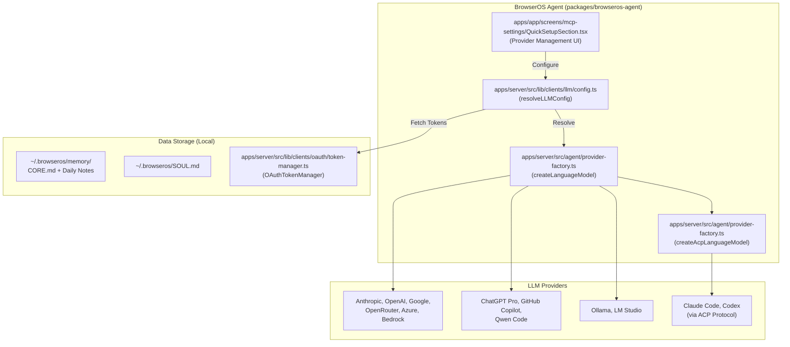
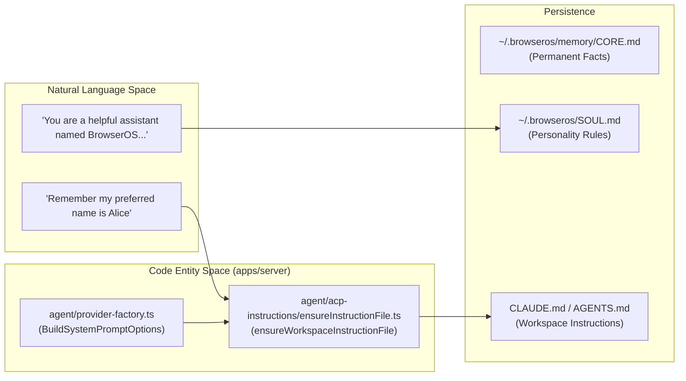

<!-- source: DeepWiki mcp.deepwiki.com · repo browseros-ai/BrowserOS · page 3 AI Integration · fetched 2026-10-29 -->

# AI Integration

Relevant source files

The following files were used as context for generating this wiki page:

- [docs/browserclaw/cockpit.mdx](docs/browserclaw/cockpit.mdx)
- [docs/browserclaw/tabs-and-isolation.mdx](docs/browserclaw/tabs-and-isolation.mdx)
- [docs/docs.json](docs/docs.json)
- [docs/features/bring-your-own-llm.mdx](docs/features/bring-your-own-llm.mdx)
- [docs/features/connect-mcps.mdx](docs/features/connect-mcps.mdx)
- [docs/features/cowork.mdx](docs/features/cowork.mdx)
- [docs/features/local-models.mdx](docs/features/local-models.mdx)
- [docs/features/scheduled-tasks.mdx](docs/features/scheduled-tasks.mdx)
- [docs/features/smart-nudges.mdx](docs/features/smart-nudges.mdx)
- [docs/features/use-with-claude-code.mdx](docs/features/use-with-claude-code.mdx)
- [packages/browseros-agent/.config/wt.toml](packages/browseros-agent/.config/wt.toml)
- [packages/browseros-agent/apps/app/screens/mcp-settings/QuickSetupSection.test.tsx](packages/browseros-agent/apps/app/screens/mcp-settings/QuickSetupSection.test.tsx)
- [packages/browseros-agent/apps/app/screens/mcp-settings/QuickSetupSection.tsx](packages/browseros-agent/apps/app/screens/mcp-settings/QuickSetupSection.tsx)
- [packages/browseros-agent/apps/app/screens/onboarding/features/Features.tsx](packages/browseros-agent/apps/app/screens/onboarding/features/Features.tsx)
- [packages/browseros-agent/apps/server/src/agent/provider-factory.ts](packages/browseros-agent/apps/server/src/agent/provider-factory.ts)
- [packages/browseros-agent/apps/server/src/api/routes/acpx-probe.ts](packages/browseros-agent/apps/server/src/api/routes/acpx-probe.ts)
- [packages/browseros-agent/apps/server/src/api/routes/oauth.ts](packages/browseros-agent/apps/server/src/api/routes/oauth.ts)
- [packages/browseros-agent/apps/server/src/api/routes/provider.ts](packages/browseros-agent/apps/server/src/api/routes/provider.ts)
- [packages/browseros-agent/apps/server/src/api/services/acpx-probe/probeAgent.ts](packages/browseros-agent/apps/server/src/api/services/acpx-probe/probeAgent.ts)
- [packages/browseros-agent/apps/server/src/lib/agents/host-acp/bundled-bun.ts](packages/browseros-agent/apps/server/src/lib/agents/host-acp/bundled-bun.ts)
- [packages/browseros-agent/apps/server/src/lib/agents/host-acp/codex-home.ts](packages/browseros-agent/apps/server/src/lib/agents/host-acp/codex-home.ts)
- [packages/browseros-agent/apps/server/src/lib/agents/host-acp/launcher.ts](packages/browseros-agent/apps/server/src/lib/agents/host-acp/launcher.ts)
- [packages/browseros-agent/apps/server/src/lib/clients/llm/config.ts](packages/browseros-agent/apps/server/src/lib/clients/llm/config.ts)
- [packages/browseros-agent/apps/server/src/lib/clients/llm/provider.ts](packages/browseros-agent/apps/server/src/lib/clients/llm/provider.ts)
- [packages/browseros-agent/apps/server/src/lib/clients/llm/test-acp-provider.ts](packages/browseros-agent/apps/server/src/lib/clients/llm/test-acp-provider.ts)
- [packages/browseros-agent/apps/server/src/lib/clients/oauth/providers.ts](packages/browseros-agent/apps/server/src/lib/clients/oauth/providers.ts)
- [packages/browseros-agent/apps/server/src/lib/clients/oauth/token-manager.ts](packages/browseros-agent/apps/server/src/lib/clients/oauth/token-manager.ts)
- [packages/browseros-agent/apps/server/tests/agent/provider-factory-acp.test.ts](packages/browseros-agent/apps/server/tests/agent/provider-factory-acp.test.ts)
- [packages/browseros-agent/apps/server/tests/api/services/acpx-probe/probeAgent.test.ts](packages/browseros-agent/apps/server/tests/api/services/acpx-probe/probeAgent.test.ts)
- [packages/browseros-agent/apps/server/tests/lib/agents/bundled-bun.test.ts](packages/browseros-agent/apps/server/tests/lib/agents/bundled-bun.test.ts)
- [packages/browseros-agent/apps/server/tests/lib/agents/host-acp/codex-home.test.ts](packages/browseros-agent/apps/server/tests/lib/agents/host-acp/codex-home.test.ts)
- [packages/browseros-agent/apps/server/tests/lib/agents/host-acp/launcher.test.ts](packages/browseros-agent/apps/server/tests/lib/agents/host-acp/launcher.test.ts)
- [packages/browseros-agent/apps/server/tests/lib/clients/llm/config.test.ts](packages/browseros-agent/apps/server/tests/lib/clients/llm/config.test.ts)

BrowserOS integrates AI capabilities through a privacy-first architecture that connects directly to LLM providers without routing requests through BrowserOS servers. This page provides an overview of the AI subsystem, including provider configuration, interaction modes (Chat and Agent), and the memory/personality system that makes the assistant context-aware.

**Child pages provide detailed documentation:**
- **[LLM Provider Setup](#3.1)** — Guide users through configuring API keys for various LLM providers via the AI Settings page.
- **[Cloud AI Providers](#3.2)** — Document supported cloud providers: Kimi, Claude, GPT, Gemini, OpenRouter, Azure, Bedrock.
- **[OAuth Providers](#3.3)** — Document OAuth-based providers that use existing subscriptions: ChatGPT Plus/Pro, GitHub Copilot, and Qwen Code.
- **[Local AI Integration](#3.4)** — Explain setup for local LLMs using Ollama and LM Studio, including context requirements.
- **[Agent Mode](#3.5)** — Explain Agent Mode for task automation, recommended models, and capabilities.
- **[Memory System](#3.7)** — Explain the two-tier memory system: `CORE.md` for permanent facts and daily notes for session context.
- **[SOUL.md Personality](#3.8)** — Document the `SOUL.md` file for defining assistant personality and behavior rules.
- **[Skills](#3.9)** — Explain the Skills system for teaching the agent reusable task instructions using `SKILL.md` format.

**Sources:** [docs/features/bring-your-own-llm.mdx:6-8](), [packages/browseros-agent/apps/server/src/lib/clients/llm/provider.ts:186-200]()

## Architecture Overview

The AI subsystem consists of the **Agent UI**, the **Agent Server** (Bun-based sidecar), and the **Controller Extension**. The server resolves LLM configurations and instantiates language models using the Vercel AI SDK.

### Component Architecture

**Key Code Entities:**
- `resolveLLMConfig`: Logic for resolving API keys and OAuth tokens for all providers [packages/browseros-agent/apps/server/src/lib/clients/llm/config.ts:22-69]().
- `createLanguageModel`: Entry point for creating Vercel AI SDK models [packages/browseros-agent/apps/server/src/agent/provider-factory.ts:221-255]().
- `createAcpLanguageModel`: Specifically handles Agent Client Protocol (ACP) agents like Claude Code and Codex [packages/browseros-agent/apps/server/src/agent/provider-factory.ts:121-219]().
- `OAuthTokenManager`: Manages OAuth flows, token storage, and refreshes for zero-key providers [packages/browseros-agent/apps/server/src/lib/clients/oauth/token-manager.ts:76-112]().

**Sources:** [packages/browseros-agent/apps/server/src/lib/clients/llm/config.ts:22-69](), [packages/browseros-agent/apps/server/src/agent/provider-factory.ts:121-255](), [packages/browseros-agent/apps/server/src/lib/clients/oauth/token-manager.ts:76-112]()

## Supported LLM Providers

BrowserOS supports three types of LLM integration: Cloud API (Bring Your Own Key), OAuth (Existing Subscriptions), and Local (Ollama/LM Studio).

### Provider Categories

| Category | Authentication | Supported Providers |
|----------|----------------|---------------------|
| **Cloud** | API Key | Kimi (Moonshot), Anthropic, OpenAI, Google, OpenRouter, Azure, Bedrock |
| **OAuth** | Single Sign-In | ChatGPT Plus/Pro, GitHub Copilot, Qwen Code |
| **Local** | None (Localhost) | Ollama, LM Studio (OpenAI-compatible) |

### OAuth Integration (Zero-Key Setup)
BrowserOS allows users to leverage existing paid subscriptions without API keys. This is handled via the `OAuthTokenManager` which manages PKCE and Device Code flows.

- **ChatGPT Plus/Pro**: Uses the `createChatGPTProModel` to communicate with OpenAI models [packages/browseros-agent/apps/server/src/lib/clients/llm/provider.ts:196-203]().
- **GitHub Copilot**: Uses `createCopilotFetch` to access models through Copilot's API [packages/browseros-agent/apps/server/src/lib/clients/llm/provider.ts:185-194]().
- **Qwen Code**: Accesses the Qwen Code API via OAuth tokens [packages/browseros-agent/apps/server/src/lib/clients/llm/provider.ts:176-183]().

**Sources:** [docs/features/bring-your-own-llm.mdx:16-33](), [packages/browseros-agent/apps/server/src/lib/clients/llm/provider.ts:176-203]()

## AI Interaction Modes

BrowserOS provides distinct modes optimized for different workflows.

### Agent Mode (Autonomous)
The default mode for multi-step task automation. It is recommended to use high-reasoning cloud models like **Claude 3.5 Sonnet**, **GPT-4o**, or **Kimi K2.5** for these tasks [docs/features/bring-your-own-llm.mdx:44-46]().
- **Capabilities**: Browser automation, multi-step reasoning, and filesystem access via Cowork [docs/features/cowork.mdx:6-14]().
- **ACP Integration**: Built-in support for Claude Code and Codex agents via `AcpxProvider` [packages/browseros-agent/apps/server/src/agent/provider-factory.ts:38-41]().

### Chat Mode
Optimized for Q&A and summarization. This mode is compatible with local models like **Ollama** or **Gemini Flash** [docs/features/bring-your-own-llm.mdx:39-42]().
- **Capabilities**: Asking questions about the current page and summarizing content.

**Sources:** [docs/features/bring-your-own-llm.mdx:39-46](), [packages/browseros-agent/apps/server/src/agent/provider-factory.ts:38-41]()

## Memory and Personality System

BrowserOS features a persistent memory and personality system that lives entirely on the user's local machine.

### Context Assembly

- **SOUL.md**: Defines the assistant's personality and behavior rules.
- **ACP Instructions**: The system automatically plants `CLAUDE.md` or `AGENTS.md` in provider workspaces to guide agent behavior [packages/browseros-agent/apps/server/src/agent/provider-factory.ts:136-166]().

**Sources:** [packages/browseros-agent/apps/server/src/agent/provider-factory.ts:136-166]()

## Browser Automation & MCP

BrowserOS exposes its internal capabilities to external AI agents through the Model Context Protocol (MCP).

- **Browser Control**: Exposes 53+ tools for navigation, tab management, and page interaction [docs/features/use-with-claude-code.mdx:27-29]().
- **Connect Apps**: Integrates 40+ external services (Gmail, Slack, GitHub, etc.) via MCP, allowing the agent to perform cross-app workflows [docs/features/connect-mcps.mdx:65-67]().
- **Scheduled Tasks**: Allows the agent to run browser automation on a defined schedule (Daily, Hourly, or Minutes) in a hidden background window [docs/features/scheduled-tasks.mdx:52-64]().

**Sources:** [docs/features/use-with-claude-code.mdx:27-29](), [docs/features/connect-mcps.mdx:65-67](), [docs/features/scheduled-tasks.mdx:52-64]()

---

