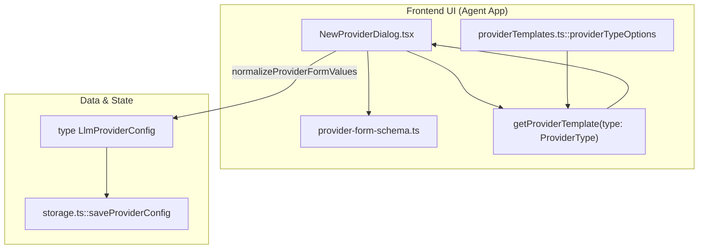
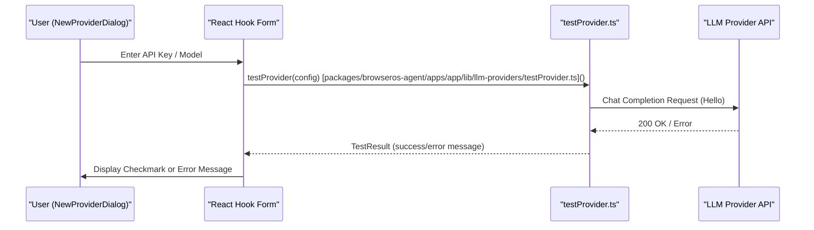

<!-- source: DeepWiki mcp.deepwiki.com · repo browseros-ai/BrowserOS · page 3.1 LLM Provider Setup · fetched 2026-10-29 -->

# LLM Provider Setup

Relevant source files

The following files were used as context for generating this wiki page:

- [docs/browserclaw/cockpit.mdx](docs/browserclaw/cockpit.mdx)
- [docs/browserclaw/tabs-and-isolation.mdx](docs/browserclaw/tabs-and-isolation.mdx)
- [docs/docs.json](docs/docs.json)
- [docs/features/bring-your-own-llm.mdx](docs/features/bring-your-own-llm.mdx)
- [docs/features/connect-mcps.mdx](docs/features/connect-mcps.mdx)
- [docs/features/cowork.mdx](docs/features/cowork.mdx)
- [docs/features/local-models.mdx](docs/features/local-models.mdx)
- [docs/features/scheduled-tasks.mdx](docs/features/scheduled-tasks.mdx)
- [docs/features/smart-nudges.mdx](docs/features/smart-nudges.mdx)
- [docs/features/use-with-claude-code.mdx](docs/features/use-with-claude-code.mdx)
- [packages/browseros-agent/.config/wt.toml](packages/browseros-agent/.config/wt.toml)
- [packages/browseros-agent/apps/app/lib/browseros-api-url.ts](packages/browseros-agent/apps/app/lib/browseros-api-url.ts)
- [packages/browseros-agent/apps/app/lib/browseros/capabilities.test.ts](packages/browseros-agent/apps/app/lib/browseros/capabilities.test.ts)
- [packages/browseros-agent/apps/app/lib/browseros/capabilities.ts](packages/browseros-agent/apps/app/lib/browseros/capabilities.ts)
- [packages/browseros-agent/apps/app/lib/env.test.ts](packages/browseros-agent/apps/app/lib/env.test.ts)
- [packages/browseros-agent/apps/app/lib/env.ts](packages/browseros-agent/apps/app/lib/env.ts)
- [packages/browseros-agent/apps/app/lib/llm-providers/providerIcons.tsx](packages/browseros-agent/apps/app/lib/llm-providers/providerIcons.tsx)
- [packages/browseros-agent/apps/app/lib/llm-providers/providerTemplates.ts](packages/browseros-agent/apps/app/lib/llm-providers/providerTemplates.ts)
- [packages/browseros-agent/apps/app/lib/llm-providers/storage.test.ts](packages/browseros-agent/apps/app/lib/llm-providers/storage.test.ts)
- [packages/browseros-agent/apps/app/lib/llm-providers/storage.ts](packages/browseros-agent/apps/app/lib/llm-providers/storage.ts)
- [packages/browseros-agent/apps/app/screens/ai-settings/NewProviderDialog.tsx](packages/browseros-agent/apps/app/screens/ai-settings/NewProviderDialog.tsx)
- [packages/browseros-agent/apps/app/screens/ai-settings/model-picker.helpers.test.ts](packages/browseros-agent/apps/app/screens/ai-settings/model-picker.helpers.test.ts)
- [packages/browseros-agent/apps/app/screens/ai-settings/model-picker.helpers.ts](packages/browseros-agent/apps/app/screens/ai-settings/model-picker.helpers.ts)
- [packages/browseros-agent/apps/app/screens/mcp-settings/QuickSetupSection.test.tsx](packages/browseros-agent/apps/app/screens/mcp-settings/QuickSetupSection.test.tsx)
- [packages/browseros-agent/apps/app/screens/mcp-settings/QuickSetupSection.tsx](packages/browseros-agent/apps/app/screens/mcp-settings/QuickSetupSection.tsx)
- [packages/browseros-agent/apps/app/screens/onboarding/features/Features.tsx](packages/browseros-agent/apps/app/screens/onboarding/features/Features.tsx)
- [packages/browseros-agent/apps/app/screens/sidepanel/index/ChatFooter.tsx](packages/browseros-agent/apps/app/screens/sidepanel/index/ChatFooter.tsx)
- [packages/browseros-agent/apps/app/wxt.config.ts](packages/browseros-agent/apps/app/wxt.config.ts)
- [packages/browseros-agent/apps/server/tests/agent/provider-factory-baseurl.test.ts](packages/browseros-agent/apps/server/tests/agent/provider-factory-baseurl.test.ts)

This page describes how to configure Large Language Model (LLM) providers in BrowserOS. Users can connect to cloud-based services (Gemini, Claude, OpenAI, OpenRouter), utilize subscription-based OAuth providers (ChatGPT Plus, GitHub Copilot, Qwen Code), or run models locally (Ollama, LM Studio). BrowserOS uses a "Bring Your Own Keys" (BYOK) and "Bring Your Own Subscription" approach, where API keys and OAuth tokens are stored locally.

---

## Overview

BrowserOS supports a wide array of LLM provider configurations that power the Agent's AI capabilities. The system distinguishes between standard API-key providers and OAuth-based providers that leverage existing web subscriptions.

**Key Configuration Points:**
- **Templates**: The UI provides `providerTemplates` for quick setup of popular services [packages/browseros-agent/apps/app/lib/llm-providers/providerTemplates.ts:65]().
- **Default Models**: BrowserOS recommends specific models for different modes. For **Agent Mode**, cloud models like `Claude Opus 4.5`, `GPT-5`, or `Kimi K2.5` are recommended over local models due to reasoning requirements [docs/features/bring-your-own-llm.mdx:42-46]().
- **Context Management**: Local models (Ollama/LM Studio) require manual context window adjustment (minimum 15,000–20,000 tokens) to prevent agent loops [docs/features/local-models.mdx:10-12]().

**Sources:**
- [packages/browseros-agent/apps/app/lib/llm-providers/providerTemplates.ts:65]()
- [docs/features/bring-your-own-llm.mdx:42-46]()
- [docs/features/local-models.mdx:10-12]()

---

## Configuration Architecture

The configuration system maps user-friendly templates to a technical `LlmProviderConfig` object. This configuration includes essential metadata like `contextWindow`, `supportsImages`, and encrypted `apiKey` storage.

**Diagram: UI Configuration and Entity Mapping**

The `NewProviderDialog` component [packages/browseros-agent/apps/app/screens/ai-settings/NewProviderDialog.tsx:191]() handles the user interface for adding or editing LLM configurations. It utilizes `providerFormSchema` to validate inputs [packages/browseros-agent/apps/app/screens/ai-settings/NewProviderDialog.tsx:208](). When a user selects a provider type, `getProviderTemplate` [packages/browseros-agent/apps/app/lib/llm-providers/providerTemplates.ts:63]() populates the form with defaults such as `baseUrl` and `contextWindow`. The final form values are converted into a `LlmProviderConfig` object via `normalizeProviderFormValues` [packages/browseros-agent/apps/app/screens/ai-settings/NewProviderDialog.tsx:80]() before being persisted.

**Sources:**
- [packages/browseros-agent/apps/app/screens/ai-settings/NewProviderDialog.tsx:191-230]()
- [packages/browseros-agent/apps/app/lib/llm-providers/providerTemplates.ts:63-65]()
- [packages/browseros-agent/apps/app/screens/ai-settings/provider-form-schema.ts:80-83]()

---

## Provider Categories

### 1. Cloud Providers (API Key)
Standard providers require a manual API key entry. BrowserOS provides direct links to the developer consoles for these services within the UI templates.

| Provider | Default Model | Context Window | Setup Guide |
|----------|---------------|----------------|-------------|
| **Moonshot AI** | `kimi-k2.5` | 128,000 | [platform.moonshot.ai](https://platform.moonshot.ai) |
| **Anthropic** | `claude-3-5-sonnet-latest` | 200,000 | [console.anthropic.com](https://console.anthropic.com) |
| **OpenAI** | `gpt-4o` | 128,000 | [platform.openai.com](https://platform.openai.com) |
| **Google Gemini**| `gemini-1.5-flash` | 1,000,000 | [aistudio.google.com](https://aistudio.google.com) |
| **OpenRouter** | `anthropic/claude-3.5-sonnet` | 200,000 | [openrouter.ai](https://openrouter.ai) |

**Sources:**
- [packages/browseros-agent/apps/app/lib/llm-providers/providerTemplates.ts:65-150]()
- [docs/features/bring-your-own-llm.mdx:83-93]()

### 2. OAuth Providers (Subscription-Based)
These providers leverage existing subscriptions for ChatGPT Plus, GitHub Copilot, or Qwen Code. They offer high context windows without per-token costs.

| Provider | Access Method | Context Window | Recommendation |
|----------|---------------|----------------|----------------|
| **ChatGPT Pro** | OpenAI OAuth | Up to 400K | High-end reasoning [docs/features/bring-your-own-llm.mdx:25]() |
| **GitHub Copilot**| GitHub OAuth | 128,000 | Multi-model access (Claude, GPT, Gemini) [docs/features/bring-your-own-llm.mdx:31]() |

**Sources:**
- [docs/features/bring-your-own-llm.mdx:16-33]()
- [packages/browseros-agent/apps/app/screens/ai-settings/NewProviderDialog.tsx:131-135]()

### 3. Local Providers
For privacy-focused workflows, users can connect to local inference engines.

- **Ollama**: Default endpoint `http://localhost:11434/v1`. Requires `OLLAMA_CONTEXT_LENGTH=20000` for agentic stability [docs/features/local-models.mdx:17-19]().
- **LM Studio**: Default endpoint `http://localhost:1234/v1`. Operates as an `openai-compatible` provider [packages/browseros-agent/apps/app/lib/llm-providers/providerTemplates.ts:135-140]().

**Sources:**
- [docs/features/local-models.mdx:17-19]()
- [packages/browseros-agent/apps/app/lib/llm-providers/providerTemplates.ts:120-140]()

---

## Technical Implementation: Testing and Validation

Before saving a provider configuration, BrowserOS performs a connectivity test to ensure the API key and model ID are valid.

**Diagram: Provider Validation Sequence**

The validation logic is encapsulated in `testProvider` [packages/browseros-agent/apps/app/lib/llm-providers/testProvider.ts](), which is triggered by the "Test" button in the `NewProviderDialog` [packages/browseros-agent/apps/app/screens/ai-settings/NewProviderDialog.tsx:197](). The function checks if the provider is "testable" based on its type and required fields (e.g., `apiKey` for OpenAI, `accessKeyId` for Bedrock) [packages/browseros-agent/apps/app/screens/ai-settings/NewProviderDialog.tsx:146-182]().

**Sources:**
- [packages/browseros-agent/apps/app/screens/ai-settings/NewProviderDialog.tsx:146-182]()
- [packages/browseros-agent/apps/app/screens/ai-settings/NewProviderDialog.tsx:197-200]()

---

## Integration with Agent Modes

The choice of provider significantly impacts the reliability of BrowserOS features.

### Agent Mode vs. Chat Mode
- **Chat Mode**: Supports almost any model, including lightweight local models like `qwen/qwen3-4b` [docs/features/local-models.mdx:95]().
- **Agent Mode**: Requires models with high reasoning capabilities to handle browser automation tools and filesystem tools provided by **Cowork** [docs/features/cowork.mdx:18-39](). Recommended models include `Claude Opus 4.5`, `GPT-5`, or `Kimi K2.5` [docs/features/bring-your-own-llm.mdx:42-46]().

### Scheduled Tasks
Scheduled tasks trigger hidden browser windows and require reliable cloud models to ensure the 10-minute timeout is not exceeded [docs/features/scheduled-tasks.mdx:126-128](). These tasks utilize the browser's built-in alarm system to trigger at specific intervals [docs/features/scheduled-tasks.mdx:112-114]().

**Sources:**
- [docs/features/bring-your-own-llm.mdx:42-46]()
- [docs/features/cowork.mdx:18-39]()
- [docs/features/scheduled-tasks.mdx:112-114]()
- [docs/features/scheduled-tasks.mdx:126-128]()

---

