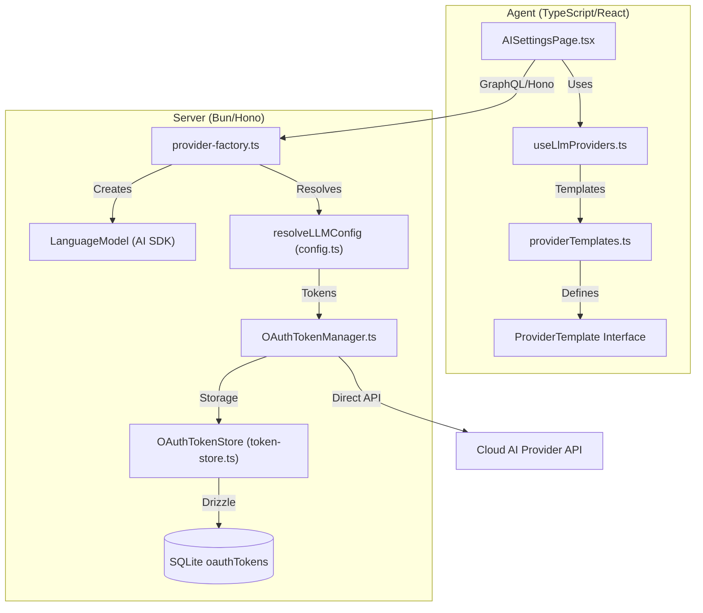
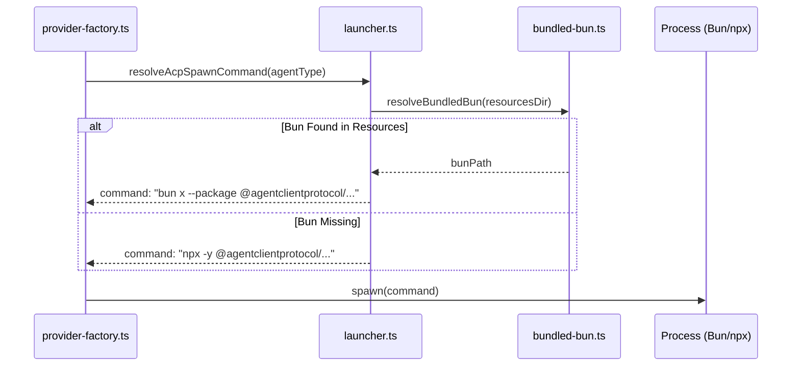
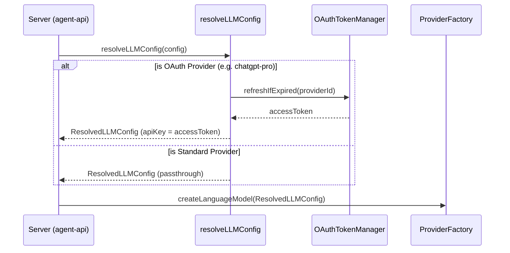

<!-- source: DeepWiki mcp.deepwiki.com · repo browseros-ai/BrowserOS · page 3.2 Cloud AI Providers · fetched 2026-10-29 -->

# Cloud AI Providers

Relevant source files

The following files were used as context for generating this wiki page:

- [docs/browserclaw/cockpit.mdx](docs/browserclaw/cockpit.mdx)
- [docs/browserclaw/tabs-and-isolation.mdx](docs/browserclaw/tabs-and-isolation.mdx)
- [docs/docs.json](docs/docs.json)
- [docs/features/bring-your-own-llm.mdx](docs/features/bring-your-own-llm.mdx)
- [docs/features/connect-mcps.mdx](docs/features/connect-mcps.mdx)
- [docs/features/cowork.mdx](docs/features/cowork.mdx)
- [docs/features/local-models.mdx](docs/features/local-models.mdx)
- [docs/features/scheduled-tasks.mdx](docs/features/scheduled-tasks.mdx)
- [docs/features/smart-nudges.mdx](docs/features/smart-nudges.mdx)
- [docs/features/use-with-claude-code.mdx](docs/features/use-with-claude-code.mdx)
- [packages/browseros-agent/.config/wt.toml](packages/browseros-agent/.config/wt.toml)
- [packages/browseros-agent/apps/app/screens/mcp-settings/QuickSetupSection.test.tsx](packages/browseros-agent/apps/app/screens/mcp-settings/QuickSetupSection.test.tsx)
- [packages/browseros-agent/apps/app/screens/mcp-settings/QuickSetupSection.tsx](packages/browseros-agent/apps/app/screens/mcp-settings/QuickSetupSection.tsx)
- [packages/browseros-agent/apps/app/screens/onboarding/features/Features.tsx](packages/browseros-agent/apps/app/screens/onboarding/features/Features.tsx)
- [packages/browseros-agent/apps/server/src/agent/provider-factory.ts](packages/browseros-agent/apps/server/src/agent/provider-factory.ts)
- [packages/browseros-agent/apps/server/src/api/routes/acpx-probe.ts](packages/browseros-agent/apps/server/src/api/routes/acpx-probe.ts)
- [packages/browseros-agent/apps/server/src/api/routes/oauth.ts](packages/browseros-agent/apps/server/src/api/routes/oauth.ts)
- [packages/browseros-agent/apps/server/src/api/routes/provider.ts](packages/browseros-agent/apps/server/src/api/routes/provider.ts)
- [packages/browseros-agent/apps/server/src/api/services/acpx-probe/probeAgent.ts](packages/browseros-agent/apps/server/src/api/services/acpx-probe/probeAgent.ts)
- [packages/browseros-agent/apps/server/src/lib/agents/host-acp/bundled-bun.ts](packages/browseros-agent/apps/server/src/lib/agents/host-acp/bundled-bun.ts)
- [packages/browseros-agent/apps/server/src/lib/agents/host-acp/codex-home.ts](packages/browseros-agent/apps/server/src/lib/agents/host-acp/codex-home.ts)
- [packages/browseros-agent/apps/server/src/lib/agents/host-acp/launcher.ts](packages/browseros-agent/apps/server/src/lib/agents/host-acp/launcher.ts)
- [packages/browseros-agent/apps/server/src/lib/clients/llm/config.ts](packages/browseros-agent/apps/server/src/lib/clients/llm/config.ts)
- [packages/browseros-agent/apps/server/src/lib/clients/llm/provider.ts](packages/browseros-agent/apps/server/src/lib/clients/llm/provider.ts)
- [packages/browseros-agent/apps/server/src/lib/clients/llm/test-acp-provider.ts](packages/browseros-agent/apps/server/src/lib/clients/llm/test-acp-provider.ts)
- [packages/browseros-agent/apps/server/src/lib/clients/oauth/providers.ts](packages/browseros-agent/apps/server/src/lib/clients/oauth/providers.ts)
- [packages/browseros-agent/apps/server/src/lib/clients/oauth/token-manager.ts](packages/browseros-agent/apps/server/src/lib/clients/oauth/token-manager.ts)
- [packages/browseros-agent/apps/server/tests/agent/provider-factory-acp.test.ts](packages/browseros-agent/apps/server/tests/agent/provider-factory-acp.test.ts)
- [packages/browseros-agent/apps/server/tests/api/services/acpx-probe/probeAgent.test.ts](packages/browseros-agent/apps/server/tests/api/services/acpx-probe/probeAgent.test.ts)
- [packages/browseros-agent/apps/server/tests/lib/agents/bundled-bun.test.ts](packages/browseros-agent/apps/server/tests/lib/agents/bundled-bun.test.ts)
- [packages/browseros-agent/apps/server/tests/lib/agents/host-acp/codex-home.test.ts](packages/browseros-agent/apps/server/tests/lib/agents/host-acp/codex-home.test.ts)
- [packages/browseros-agent/apps/server/tests/lib/agents/host-acp/launcher.test.ts](packages/browseros-agent/apps/server/tests/lib/agents/host-acp/launcher.test.ts)
- [packages/browseros-agent/apps/server/tests/lib/clients/llm/config.test.ts](packages/browseros-agent/apps/server/tests/lib/clients/llm/config.test.ts)

## Purpose and Scope

This document details the technical implementation and configuration for cloud-based AI providers in BrowserOS. It covers both standard **API Key (BYOK)** providers (Kimi/Moonshot, Claude, GPT, Gemini, OpenRouter, Azure, Bedrock) and **OAuth-based** subscription providers (ChatGPT Pro, GitHub Copilot, Qwen Code).

For local AI model setup (Ollama, LM Studio), see page 3.4 Local AI Integration. For the visual setup guide, see page 3.1 LLM Provider Setup.

---

## Architecture Overview

BrowserOS employs a dual-layer architecture for managing cloud AI providers. Configuration and templates are managed in the **Agent (Frontend)**, while the actual model instantiation and request handling occur in the **Server (Backend)** using the Vercel AI SDK.

### Provider Integration Map

Sources: [packages/browseros-agent/apps/server/src/agent/provider-factory.ts:121-166](), [packages/browseros-agent/apps/server/src/lib/clients/llm/config.ts:22-69](), [packages/browseros-agent/apps/server/src/lib/clients/oauth/token-manager.ts:1-20]()

---

## Supported Cloud Providers

### API Key Providers (BYOK)
These providers require a user-provided API key stored in the local profile. BrowserOS uses `provider.ts` to instantiate models via the Vercel AI SDK.

| Provider | Type ID | Default Base URL | Implementation Function |
| :--- | :--- | :--- | :--- |
| **Kimi (Moonshot)** | `moonshot` | `https://api.moonshot.ai/v1` | `createMoonshotModel` |
| **Claude (Anthropic)** | `anthropic` | `https://api.anthropic.com/v1` | `createAnthropicModel` |
| **GPT (OpenAI)** | `openai` | `https://api.openai.com/v1` | `createOpenAIModel` |
| **Gemini (Google)** | `google` | `https://generativelanguage.googleapis.com/v1beta` | `createGoogleModel` |
| **OpenRouter** | `openrouter` | `https://openrouter.ai/api/v1` | `createOpenRouterModel` |
| **Azure OpenAI** | `azure` | (User Defined) | `createAzureModel` |
| **AWS Bedrock** | `bedrock` | (Region Based) | `createBedrockModel` |

Sources: [packages/browseros-agent/apps/server/src/lib/clients/llm/provider.ts:37-117](), [packages/browseros-agent/apps/server/src/lib/clients/llm/provider.ts:166-174](), [docs/features/bring-your-own-llm.mdx:83-93]()

### OAuth Subscription Providers
These providers leverage existing web subscriptions. BrowserOS performs an OAuth handshake to retrieve short-lived session tokens, eliminating the need for manual API keys.

| Provider | Type ID | Default Model | Upstream API |
| :--- | :--- | :--- | :--- |
| **ChatGPT Plus/Pro** | `chatgpt-pro` | `gpt-5.5` | `EXTERNAL_URLS.CHATGPT_API` |
| **GitHub Copilot** | `github-copilot` | `gpt-5-mini` | `EXTERNAL_URLS.GITHUB_COPILOT_API` |
| **Qwen Code** | `qwen-code` | `coder-model` | `EXTERNAL_URLS.QWEN_CODE_API` |

Sources: [packages/browseros-agent/apps/server/src/lib/clients/llm/config.ts:27-54](), [packages/browseros-agent/apps/server/src/lib/clients/llm/provider.ts:176-200]()

---

## Technical Implementation: Agent Protocol (ACP)

For "Agent Mode" (e.g., Claude Code, Codex), BrowserOS uses the **Agent Client Protocol (ACP)** to launch specialized adapter processes.

### ACP Launcher Flow

- **Bundled Runtime**: BrowserOS attempts to use a bundled `bun` binary located at `<resourcesDir>/bin/third_party/bun` to ensure zero-dependency execution [packages/browseros-agent/apps/server/src/lib/agents/host-acp/launcher.ts:6-12]().
- **Workspace Isolation**: Each ACP agent gets a dedicated directory under `workspaces/<providerType>/<providerId>` to prevent file collisions [packages/browseros-agent/apps/server/src/agent/provider-factory.ts:69-75]().
- **Instruction Injection**: On startup, the server ensures a `CLAUDE.md` or `AGENTS.md` file exists in the workspace to provide system context to the agent [packages/browseros-agent/apps/server/src/agent/provider-factory.ts:136-156]().

Sources: [packages/browseros-agent/apps/server/src/lib/agents/host-acp/launcher.ts:52-88](), [packages/browseros-agent/apps/server/src/agent/provider-factory.ts:121-166]()

---

## Configuration Resolution

When an AI request is initiated, the server must "resolve" the configuration. This is critical for OAuth providers where the `apiKey` field in the database is actually a reference to a managed token.

**Key Function**: `resolveLLMConfig` in `config.ts` handles the mapping of OAuth tokens or BrowserOS gateway configs into standard Vercel AI SDK `LanguageModel` parameters [packages/browseros-agent/apps/server/src/lib/clients/llm/config.ts:22-69]().

---

## Data Flow and Security

### Proxied Communication (OAuth)
OAuth providers often require custom headers or specific fetch implementations to mimic official clients.

- **GitHub Copilot**: Uses `createCopilotFetch` to inject required headers for the Copilot API [packages/browseros-agent/apps/server/src/lib/clients/llm/provider.ts:192]().
- **ChatGPT Pro**: Uses `createCodexFetch` to handle account-specific routing for OpenAI Codex [packages/browseros-agent/apps/server/src/lib/clients/llm/provider.ts:199]().

### Security of Credentials
- **Local Storage**: API keys and OAuth tokens are stored locally. BrowserOS provides an `OAuthTokenManager` to handle token lifecycles [packages/browseros-agent/apps/server/src/lib/clients/llm/config.ts:84-100]().
- **Token Refresh**: For OAuth providers supporting it, `refreshIfExpired` handles automatic background refreshing before a model is instantiated [packages/browseros-agent/apps/server/src/lib/clients/llm/config.ts:91-93]().
- **BrowserOS Gateway**: The `BROWSEROS` provider type fetches configuration from a remote service defined by `BROWSEROS_CONFIG_URL` [packages/browseros-agent/apps/server/src/lib/clients/llm/config.ts:109-133]().

Sources: [packages/browseros-agent/apps/server/src/lib/clients/llm/provider.ts:185-201](), [packages/browseros-agent/apps/server/src/lib/clients/llm/config.ts:22-69]()

---

