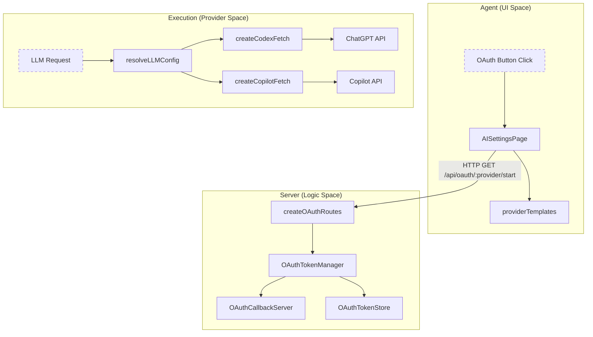
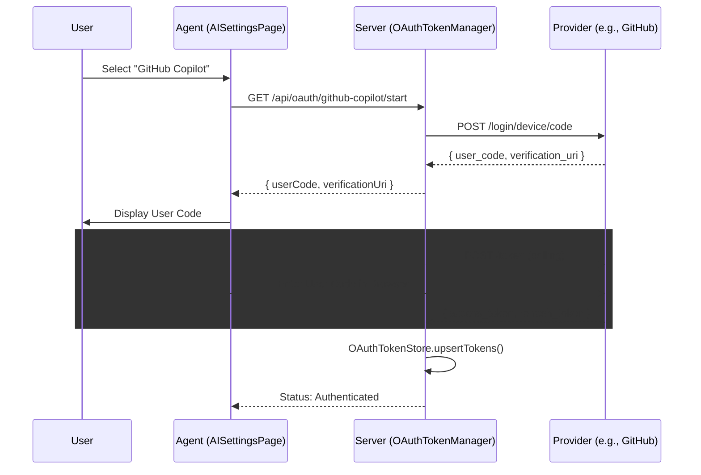

<!-- source: DeepWiki mcp.deepwiki.com · repo browseros-ai/BrowserOS · page 3.3 OAuth Providers · fetched 2026-10-29 -->

# OAuth Providers

Relevant source files

The following files were used as context for generating this wiki page:

- [docs/features/chatgpt-pro-oauth.mdx](docs/features/chatgpt-pro-oauth.mdx)
- [packages/browseros-agent/.gitignore](packages/browseros-agent/.gitignore)
- [packages/browseros-agent/apps/server/src/agent/provider-factory.ts](packages/browseros-agent/apps/server/src/agent/provider-factory.ts)
- [packages/browseros-agent/apps/server/src/api/routes/acpx-probe.ts](packages/browseros-agent/apps/server/src/api/routes/acpx-probe.ts)
- [packages/browseros-agent/apps/server/src/api/routes/oauth.ts](packages/browseros-agent/apps/server/src/api/routes/oauth.ts)
- [packages/browseros-agent/apps/server/src/api/routes/provider.ts](packages/browseros-agent/apps/server/src/api/routes/provider.ts)
- [packages/browseros-agent/apps/server/src/api/services/acpx-probe/probeAgent.ts](packages/browseros-agent/apps/server/src/api/services/acpx-probe/probeAgent.ts)
- [packages/browseros-agent/apps/server/src/lib/agents/host-acp/bundled-bun.ts](packages/browseros-agent/apps/server/src/lib/agents/host-acp/bundled-bun.ts)
- [packages/browseros-agent/apps/server/src/lib/agents/host-acp/codex-home.ts](packages/browseros-agent/apps/server/src/lib/agents/host-acp/codex-home.ts)
- [packages/browseros-agent/apps/server/src/lib/agents/host-acp/launcher.ts](packages/browseros-agent/apps/server/src/lib/agents/host-acp/launcher.ts)
- [packages/browseros-agent/apps/server/src/lib/clients/llm/config.ts](packages/browseros-agent/apps/server/src/lib/clients/llm/config.ts)
- [packages/browseros-agent/apps/server/src/lib/clients/llm/provider.ts](packages/browseros-agent/apps/server/src/lib/clients/llm/provider.ts)
- [packages/browseros-agent/apps/server/src/lib/clients/llm/test-acp-provider.ts](packages/browseros-agent/apps/server/src/lib/clients/llm/test-acp-provider.ts)
- [packages/browseros-agent/apps/server/src/lib/clients/oauth/providers.ts](packages/browseros-agent/apps/server/src/lib/clients/oauth/providers.ts)
- [packages/browseros-agent/apps/server/src/lib/clients/oauth/token-manager.ts](packages/browseros-agent/apps/server/src/lib/clients/oauth/token-manager.ts)
- [packages/browseros-agent/apps/server/tests/__helpers__/browser.ts](packages/browseros-agent/apps/server/tests/__helpers__/browser.ts)
- [packages/browseros-agent/apps/server/tests/__helpers__/cleanup.sh](packages/browseros-agent/apps/server/tests/__helpers__/cleanup.sh)
- [packages/browseros-agent/apps/server/tests/__helpers__/with-browser.ts](packages/browseros-agent/apps/server/tests/__helpers__/with-browser.ts)
- [packages/browseros-agent/apps/server/tests/agent/provider-factory-acp.test.ts](packages/browseros-agent/apps/server/tests/agent/provider-factory-acp.test.ts)
- [packages/browseros-agent/apps/server/tests/api/services/acpx-probe/probeAgent.test.ts](packages/browseros-agent/apps/server/tests/api/services/acpx-probe/probeAgent.test.ts)
- [packages/browseros-agent/apps/server/tests/lib/agents/bundled-bun.test.ts](packages/browseros-agent/apps/server/tests/lib/agents/bundled-bun.test.ts)
- [packages/browseros-agent/apps/server/tests/lib/agents/host-acp/codex-home.test.ts](packages/browseros-agent/apps/server/tests/lib/agents/host-acp/codex-home.test.ts)
- [packages/browseros-agent/apps/server/tests/lib/agents/host-acp/launcher.test.ts](packages/browseros-agent/apps/server/tests/lib/agents/host-acp/launcher.test.ts)
- [packages/browseros-agent/apps/server/tests/lib/clients/llm/config.test.ts](packages/browseros-agent/apps/server/tests/lib/clients/llm/config.test.ts)

OAuth Providers in BrowserOS allow users to leverage their existing premium subscriptions—specifically **ChatGPT Plus/Pro**, **GitHub Copilot**, and **Qwen Code**—as LLM backends without requiring manual API key management. BrowserOS handles the authentication handshake, token storage, and specialized request signing required to interface with these services' internal APIs.

## Architecture Overview

The OAuth system is split between the **Agent (UI)** and the **Server (Backend)**. The Agent initiates the flow and displays authentication status, while the Server manages the actual OAuth handshake, secure token storage, and the lifecycle of the session (refreshing tokens).

### Authentication Flow Types
BrowserOS implements two distinct OAuth flows based on the provider's requirements:
1.  **PKCE (Proof Key for Code Exchange):** Used for ChatGPT Plus/Pro. It involves a local `OAuthCallbackServer` on the user's machine to capture the authorization code [packages/browseros-agent/apps/server/src/lib/clients/oauth/token-manager.ts:89-127]().
2.  **Device Code Flow:** Used for GitHub Copilot and Qwen Code. The user is presented with a `userCode` and enters it on the provider's website while the server polls for the token [packages/browseros-agent/apps/server/src/lib/clients/oauth/token-manager.ts:196-231]().

### Data Flow: Request Resolution
When a user sends a message using an OAuth provider, the request follows this path:
1.  The `agent` app sends a request to the `server`.
2.  `resolveLLMConfig` identifies the provider as an OAuth type (e.g., `LLM_PROVIDERS.CHATGPT_PRO`) [packages/browseros-agent/apps/server/src/lib/clients/llm/config.ts:27-54]().
3.  `resolveOAuthConfig` retrieves the stored `accessToken` from the `OAuthTokenManager`, refreshing it if expired [packages/browseros-agent/apps/server/src/lib/clients/llm/config.ts:79-107]().
4.  The provider factory creates a specialized model instance using a custom fetcher (e.g., `createCodexFetch` or `createCopilotFetch`) to handle proprietary headers or body formats [packages/browseros-agent/apps/server/src/lib/clients/llm/provider.ts:185-202]().

### Component Association (NL to Code)
The following diagram maps high-level authentication concepts to the specific TypeScript entities that implement them.

**Diagram: OAuth Entity Mapping**

Sources: [packages/browseros-agent/apps/server/src/lib/clients/oauth/token-manager.ts:76-87](), [packages/browseros-agent/apps/server/src/lib/clients/llm/config.ts:22-69](), [packages/browseros-agent/apps/server/src/lib/clients/llm/provider.ts:185-202]()

## Supported Providers

| Provider | Type | Internal Model ID | Auth Flow | Base URL |
| :--- | :--- | :--- | :--- | :--- |
| **ChatGPT Plus/Pro** | `chatgpt-pro` | `gpt-5.5` | PKCE | `EXTERNAL_URLS.OPENAI_AUTH` |
| **GitHub Copilot** | `github-copilot` | `gpt-5-mini` | Device Code | `EXTERNAL_URLS.GITHUB_COPILOT_API` |
| **Qwen Code** | `qwen-code` | `coder-model` | Device Code | `EXTERNAL_URLS.QWEN_CODE_API` |

Sources: [packages/browseros-agent/apps/server/src/lib/clients/llm/config.ts:27-54](), [packages/browseros-agent/apps/server/src/lib/clients/oauth/providers.ts:27-64](), [packages/browseros-agent/apps/server/src/lib/clients/llm/provider.ts:176-202]()

## Implementation Details

### OAuth Token Management
The `OAuthTokenManager` class in the server is the central authority for managing credentials. It generates authorization URLs, handles callbacks, and manages `refreshLocks` to prevent race conditions when multiple concurrent requests trigger a token refresh [packages/browseros-agent/apps/server/src/lib/clients/oauth/token-manager.ts:76-87]().

**Key Functions:**
- `generateAuthorizationUrl`: Sets up PKCE state and generates the provider's login URL [packages/browseros-agent/apps/server/src/lib/clients/oauth/token-manager.ts:91-127]().
- `handleCallback`: Exchanges the authorization code for tokens and parses JWT claims (like email/accountId) [packages/browseros-agent/apps/server/src/lib/clients/oauth/token-manager.ts:129-194]().
- `startDeviceCodeFlow`: Initiates the polling-based device flow [packages/browseros-agent/apps/server/src/lib/clients/oauth/token-manager.ts:200-232]().

### Request Signing (Fetchers)
Because these providers do not use standard API keys, BrowserOS implements custom fetch logic to mimic the official clients:
- **Codex (ChatGPT):** Uses `createCodexFetch` to handle session-based headers and specific account routing via `accountId` [packages/browseros-agent/apps/server/src/lib/clients/llm/provider.ts:196-202]().
- **Copilot:** Uses `createCopilotFetch` to inject GitHub-specific telemetry and authorization headers [packages/browseros-agent/apps/server/src/lib/clients/llm/provider.ts:185-194]().

### Sequence: Device Code Flow
The interaction between the Agent UI, the BrowserOS Server, and the external Provider (e.g., GitHub) for device-based authentication.

**Diagram: Device Code Sequence**

Sources: [packages/browseros-agent/apps/server/src/lib/clients/oauth/token-manager.ts:200-232](), [packages/browseros-agent/apps/server/src/lib/clients/oauth/providers.ts:42-51]()

## Disconnection and Logout

Disconnection is handled via the server's OAuth logic:
- **Delete Tokens:** The `OAuthTokenStore` provides `deleteTokens(browserosId, provider)`, which removes the stored credentials for a specific provider [packages/browseros-agent/apps/server/src/lib/clients/oauth/token-manager.ts:34]().
- **Refresh Locks:** During active sessions, the manager maintains `refreshLocks` to ensure token consistency during concurrent model initialization [packages/browseros-agent/apps/server/src/lib/clients/oauth/token-manager.ts:78-81]().

Sources: [packages/browseros-agent/apps/server/src/lib/clients/oauth/token-manager.ts:34-81]()

---

