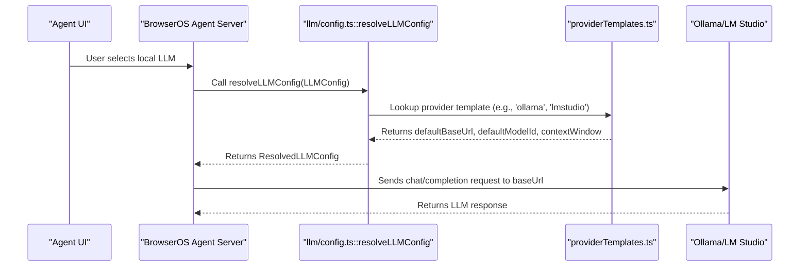

<!-- source: DeepWiki mcp.deepwiki.com · repo browseros-ai/BrowserOS · page 3.4 Local AI Integration · fetched 2026-10-29 -->

# Local AI Integration

<details>
<summary>Relevant source files</summary>

The following files were used as context for generating this wiki page:

- [docs/browserclaw/cockpit.mdx](docs/browserclaw/cockpit.mdx)
- [docs/browserclaw/tabs-and-isolation.mdx](docs/browserclaw/tabs-and-isolation.mdx)
- [docs/docs.json](docs/docs.json)
- [docs/features/bring-your-own-llm.mdx](docs/features/bring-your-own-llm.mdx)
- [docs/features/connect-mcps.mdx](docs/features/connect-mcps.mdx)
- [docs/features/cowork.mdx](docs/features/cowork.mdx)
- [docs/features/local-models.mdx](docs/features/local-models.mdx)
- [docs/features/scheduled-tasks.mdx](docs/features/scheduled-tasks.mdx)
- [docs/features/smart-nudges.mdx](docs/features/smart-nudges.mdx)
- [docs/features/use-with-claude-code.mdx](docs/features/use-with-claude-code.mdx)
- [packages/browseros-agent/.config/wt.toml](packages/browseros-agent/.config/wt.toml)
- [packages/browseros-agent/apps/app/screens/mcp-settings/QuickSetupSection.test.tsx](packages/browseros-agent/apps/app/screens/mcp-settings/QuickSetupSection.test.tsx)
- [packages/browseros-agent/apps/app/screens/mcp-settings/QuickSetupSection.tsx](packages/browseros-agent/apps/app/screens/mcp-settings/QuickSetupSection.tsx)
- [packages/browseros-agent/apps/app/screens/onboarding/features/Features.tsx](packages/browseros-agent/apps/app/screens/onboarding/features/Features.tsx)

</details>


This document covers running AI models locally on your machine using Ollama or LM Studio. Local models provide complete privacy and offline operation but have specific hardware and context length requirements to function effectively within BrowserOS.

---

## Overview

BrowserOS supports running Large Language Models (LLMs) entirely on your local machine through two primary runtime environments: **Ollama** and **LM Studio**. Both expose OpenAI-compatible HTTP APIs that the BrowserOS Agent Server connects to.

### Key Characteristics

| Aspect | Local Models | Cloud Models |
|--------|-------------|--------------|
| **Privacy** | Complete - data never leaves your device | Requests sent to provider's servers |
| **Internet Requirement** | None (after model download) | Required for every request |
| **Cost** | Free (uses local compute) | Metered by tokens or subscription |
| **Performance** | Limited by local hardware | Access to frontier models (Claude, GPT-4o) |
| **Use Cases** | Chat Mode, Q&A, summarization | Chat Mode + Agent Mode (complex reasoning) |

**Sources:** [docs/features/local-models.mdx:6-7](), [docs/features/bring-your-own-llm.mdx:39-46]()

---

## Supported Local Model Providers

### Ollama
Ollama is the easiest way to run models locally via the terminal. BrowserOS connects to it using the `ollama` provider type.

- **Implementation:** The `ollama` provider template defines the default base URL and model ID [packages/browseros-agent/apps/agent/lib/llm-providers/providerTemplates.ts:120-128]().
- **Default Endpoint:** `http://localhost:11434/v1` [packages/browseros-agent/apps/agent/lib/llm-providers/providerTemplates.ts:122]().
- **Authentication:** No API key is typically required for local Ollama instances.

### LM Studio
LM Studio provides a GUI for loading GGUF models and running a local inference server.

- **Implementation:** The `lmstudio` provider template defines the default base URL and model ID [packages/browseros-agent/apps/agent/lib/llm-providers/providerTemplates.ts:135-140]().
- **Default Endpoint:** `http://localhost:1234/v1` [packages/browseros-agent/apps/agent/lib/llm-providers/providerTemplates.ts:138]().
- **Authentication:** No API key is typically required for local LM Studio instances.

**Sources:** [packages/browseros-agent/apps/agent/lib/llm-providers/providerTemplates.ts:120-128](), [packages/browseros-agent/apps/agent/lib/llm-providers/providerTemplates.ts:135-140]()

---

## Local AI Implementation Architecture

The following diagram illustrates how the BrowserOS Agent Server communicates with local runtimes.

### Data Flow: Code Entity Space

```mermaid
graph TD
    subgraph "BrowserOS Agent Server"
        [AgentUI] --> [LLMConfigResolution];
        [LLMConfigResolution] --> [ProviderTemplates];
        [ProviderTemplates] --> [LLMClientFactory];
    end

    subgraph "Local LLM Runtimes"
        [OllamaServer] -- "http://localhost:11434/v1" --> [OllamaProcess]
        [LMStudioServer] -- "http://localhost:1234/v1" --> [LMStudioProcess]
    end

    [LLMClientFactory] -- "HTTP Request" --> [OllamaServer];
    [LLMClientFactory] -- "HTTP Request" --> [LMStudioServer];

    subgraph "Key Code Entities"
        [LLMConfigResolution] -- "resolveLLMConfig" --> packages_browseros_agent_apps_server_src_lib_clients_llm_config_ts_20_67;
        [ProviderTemplates] -- "providerTemplates" --> packages_browseros_agent_apps_agent_lib_llm_providers_providerTemplates_ts_47_151;
        [LLMClientFactory] -- "getProviderTemplate" --> packages_browseros_agent_apps_agent_lib_llm_providers_providerTemplates_ts_181_185;
        [LLMClientFactory] -- "getDefaultBaseUrlForProviders" --> packages_browseros_agent_apps_agent_lib_llm_providers_providerTemplates_ts_216_218;
    end
```

**Sources:** [packages/browseros-agent/apps/server/src/lib/clients/llm/config.ts:20-67](), [packages/browseros-agent/apps/agent/lib/llm-providers/providerTemplates.ts:47-151](), [packages/browseros-agent/apps/agent/lib/llm-providers/providerTemplates.ts:181-185](), [packages/browseros-agent/apps/agent/lib/llm-providers/providerTemplates.ts:216-218]()

---

## Context Length Requirements

A critical requirement for using local models in BrowserOS is the context window. Standard local defaults (often 4,096 tokens) are insufficient for browser automation.

- **Minimum Requirement:** 15,000–20,000 tokens [docs/features/local-models.mdx:11]().
- **Failure Mode:** Below 15k tokens, the context overflows and the agent gets stuck in a recovery loop [docs/features/local-models.mdx:11]().
- **Configuration:** When using Ollama, you must explicitly set the context length during startup:
  ```bash
  OLLAMA_CONTEXT_LENGTH=20000 ollama serve
  ```
  [docs/features/local-models.mdx:17-18]()

**Sources:** [docs/features/local-models.mdx:8-22]()

---

## Recommended Models by Hardware Tier

BrowserOS recommends specific models based on available system RAM/VRAM to ensure responsive performance.

| Hardware Tier | RAM/VRAM | Recommended Model | Size |
|---------------|----------|-------------------|------|
| **Lightweight** | 8 GB | `qwen/qwen3-4b` | ~2.28 GB |
| **Lightweight** | 8 GB | `mistralai/ministral-3-3b` | ~2.99 GB |
| **Mid-range** | 16+ GB | `openai/gpt-oss-20b` | ~12.11 GB |
| **Mid-range** | 16+ GB | `mistralai/magistral-small` | ~13.28 GB |
| **Heavy** | 64+ GB | `openai/gpt-oss-120b` | ~63.39 GB |

**Sources:** [docs/features/local-models.mdx:89-117]()

---

## Technical Implementation Details

### Provider Resolution Sequence
When a request is made, the `resolveLLMConfig` function in the Agent Server resolves the LLM configuration. For local models, it primarily ensures the `model` and `baseUrl` are correctly set. The `providerTemplates` array [packages/browseros-agent/apps/agent/lib/llm-providers/providerTemplates.ts:47-151]() defines the default settings for each provider, including `ollama` and `lmstudio`.



**Sources:** [packages/browseros-agent/apps/server/src/lib/clients/llm/config.ts:20-67](), [packages/browseros-agent/apps/agent/lib/llm-providers/providerTemplates.ts:47-151](), [packages/browseros-agent/apps/agent/lib/llm-providers/providerTemplates.ts:181-185]()

### Limitations in Agent Mode
While local models are excellent for **Chat Mode** (summarization, Q&A), they are currently not recommended for **Agent Mode**.

- **Reasoning Density:** Agentic tasks require high reasoning capabilities to accurately identify DOM elements and manage multi-step workflows [docs/features/bring-your-own-llm.mdx:44-46]().
- **Recommendation:** Use cloud models like `Claude Opus 4.5`, `GPT-5`, or `Kimi K2.5` for Agent Mode, and reserve local models for private chat interactions [docs/features/bring-your-own-llm.mdx:41-42]().

**Sources:** [docs/features/bring-your-own-llm.mdx:39-46](), [docs/features/local-models.mdx:10-12]()

---

