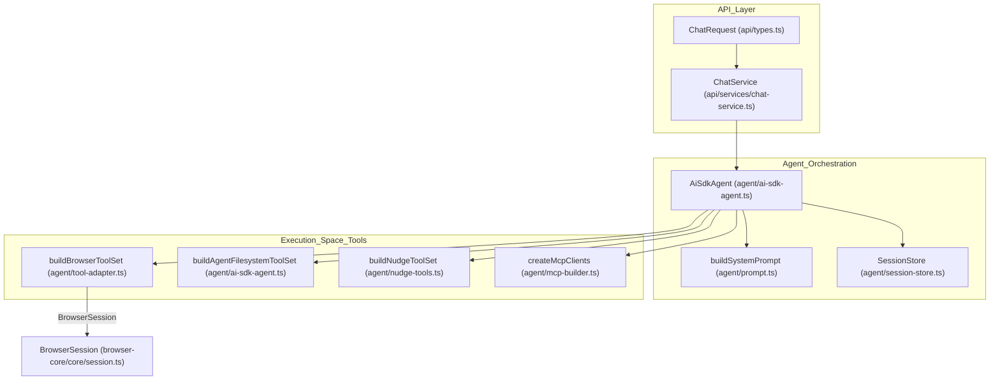
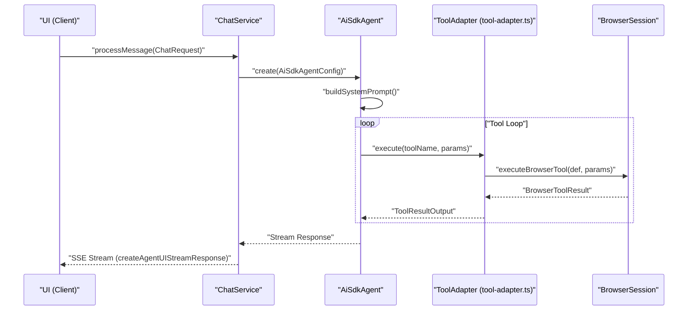

<!-- source: DeepWiki mcp.deepwiki.com · repo browseros-ai/BrowserOS · page 3.5 Agent Mode · fetched 2026-10-29 -->

# Agent Mode

Relevant source files

The following files were used as context for generating this wiki page:

- [docs/browserclaw/cockpit.mdx](docs/browserclaw/cockpit.mdx)
- [docs/browserclaw/tabs-and-isolation.mdx](docs/browserclaw/tabs-and-isolation.mdx)
- [docs/docs.json](docs/docs.json)
- [docs/features/bring-your-own-llm.mdx](docs/features/bring-your-own-llm.mdx)
- [docs/features/connect-mcps.mdx](docs/features/connect-mcps.mdx)
- [docs/features/cowork.mdx](docs/features/cowork.mdx)
- [docs/features/local-models.mdx](docs/features/local-models.mdx)
- [docs/features/scheduled-tasks.mdx](docs/features/scheduled-tasks.mdx)
- [docs/features/smart-nudges.mdx](docs/features/smart-nudges.mdx)
- [docs/features/use-with-claude-code.mdx](docs/features/use-with-claude-code.mdx)
- [packages/browseros-agent/.config/wt.toml](packages/browseros-agent/.config/wt.toml)
- [packages/browseros-agent/apps/app/screens/mcp-settings/QuickSetupSection.test.tsx](packages/browseros-agent/apps/app/screens/mcp-settings/QuickSetupSection.test.tsx)
- [packages/browseros-agent/apps/app/screens/mcp-settings/QuickSetupSection.tsx](packages/browseros-agent/apps/app/screens/mcp-settings/QuickSetupSection.tsx)
- [packages/browseros-agent/apps/app/screens/onboarding/features/Features.tsx](packages/browseros-agent/apps/app/screens/onboarding/features/Features.tsx)
- [packages/browseros-agent/apps/server/src/agent/ai-sdk-agent.ts](packages/browseros-agent/apps/server/src/agent/ai-sdk-agent.ts)
- [packages/browseros-agent/apps/server/src/agent/prompt.ts](packages/browseros-agent/apps/server/src/agent/prompt.ts)
- [packages/browseros-agent/apps/server/src/agent/session-store.ts](packages/browseros-agent/apps/server/src/agent/session-store.ts)
- [packages/browseros-agent/apps/server/src/agent/tool-adapter.ts](packages/browseros-agent/apps/server/src/agent/tool-adapter.ts)
- [packages/browseros-agent/apps/server/src/agent/types.ts](packages/browseros-agent/apps/server/src/agent/types.ts)
- [packages/browseros-agent/apps/server/src/api/services/chat-service.helpers.ts](packages/browseros-agent/apps/server/src/api/services/chat-service.helpers.ts)
- [packages/browseros-agent/apps/server/src/api/services/chat-service.ts](packages/browseros-agent/apps/server/src/api/services/chat-service.ts)
- [packages/browseros-agent/apps/server/src/api/types.ts](packages/browseros-agent/apps/server/src/api/types.ts)
- [packages/browseros-agent/apps/server/tests/agent/prompt.test.ts](packages/browseros-agent/apps/server/tests/agent/prompt.test.ts)
- [packages/browseros-agent/apps/server/tests/api/services/chat-service.helpers.test.ts](packages/browseros-agent/apps/server/tests/api/services/chat-service.helpers.test.ts)
- [packages/browseros-agent/apps/server/tests/api/services/chat-service.test.ts](packages/browseros-agent/apps/server/tests/api/services/chat-service.test.ts)
- [packages/browseros-agent/apps/server/tests/tools/browser-boundary.test.ts](packages/browseros-agent/apps/server/tests/tools/browser-boundary.test.ts)
- [packages/browseros-agent/apps/server/tests/tools/browser/framework.test.ts](packages/browseros-agent/apps/server/tests/tools/browser/framework.test.ts)
- [packages/browseros-agent/apps/server/tests/tools/browser/register.test.ts](packages/browseros-agent/apps/server/tests/tools/browser/register.test.ts)
- [packages/browseros-agent/apps/server/tests/tools/response.test.ts](packages/browseros-agent/apps/server/tests/tools/response.test.ts)

## Purpose and Scope

Agent Mode enables autonomous task automation within BrowserOS. Unlike Chat Mode, which primarily handles page-specific Q&A and summarization, Agent Mode allows the AI to execute multi-step workflows independently. It can navigate websites, interact with UI elements, call external services via MCP, and manage local files via Cowork.

This document covers the technical implementation of the `AiSdkAgent`, the execution loop orchestrated by `ChatService`, and the toolsets available for automation.

Sources: [packages/browseros-agent/apps/server/src/agent/ai-sdk-agent.ts:42-50](), [packages/browseros-agent/apps/server/src/api/services/chat-service.ts:54-117]()

---

## What is Agent Mode

Agent Mode transforms natural language instructions into a sequence of executable actions. The agent does not just "talk"; it "acts" by using a suite of browser tools and app integrations.

### Agent Mode vs. Chat Mode

The system differentiates these modes via the `mode` parameter in `ChatRequest` [packages/browseros-agent/apps/server/src/api/types.ts:34]().

| Feature | Agent Mode | Chat Mode |
| :--- | :--- | :--- |
| **Primary Goal** | Task execution/Automation | Information retrieval/Q&A |
| **Model Req.** | High-reasoning (Cloud) | Any (including local/Ollama) |
| **Tools** | Full Browser + MCP + Filesystem | Restricted read-only tools [packages/browseros-agent/apps/server/src/agent/ai-sdk-agent.ts:191-203]() |
| **Filesystem** | Enabled if workspace selected | Scoped readback only [packages/browseros-agent/apps/server/src/agent/ai-sdk-agent.ts:116-121]() |
| **Prompt Framing**| Interactive control | Read-only observation [packages/browseros-agent/apps/server/src/agent/prompt.ts:52-55]() |

Sources: [packages/browseros-agent/apps/server/src/agent/ai-sdk-agent.ts:116-124](), [packages/browseros-agent/apps/server/src/agent/ai-sdk-agent.ts:191-203](), [packages/browseros-agent/apps/server/src/api/types.ts:34](), [packages/browseros-agent/apps/server/src/agent/prompt.ts:49-55]()

---

## Recommended Models

Agent Mode requires models with strong spatial reasoning (to understand Accessibility trees) and multi-step planning capabilities.

*   **Top Recommendations**: Claude Opus 4.5, GPT-5, or Kimi K2.5 are recommended for agent tasks [docs/features/bring-your-own-llm.mdx:42-46]().
*   **Kimi K2.5**: BrowserOS has partnered with Moonshot AI to provide Kimi K2.5 as the default recommended model due to its strong reasoning in browser automation [docs/features/bring-your-own-llm.mdx:54-71]().
*   **Context Management**: The agent handles large context windows using a compaction system managed by `createCompactionPrepareStep` [packages/browseros-agent/apps/server/src/agent/ai-sdk-agent.ts:30]().
*   **Provider Support**: Supported via `createLanguageModel` which handles various cloud and local backends [packages/browseros-agent/apps/server/src/agent/ai-sdk-agent.ts:151-153]().

Sources: [docs/features/bring-your-own-llm.mdx:42-71](), [packages/browseros-agent/apps/server/src/agent/ai-sdk-agent.ts:151-153](), [packages/browseros-agent/apps/server/src/agent/ai-sdk-agent.ts:30]()

---

## Architecture and Data Flow

Agent Mode operates as an orchestration loop within the `ChatService`. The `AiSdkAgent` class wraps the AI SDK `ToolLoopAgent` [packages/browseros-agent/apps/server/src/agent/ai-sdk-agent.ts:128]().

### Logic to Execution Mapping

This diagram maps the high-level logic to specific classes and files in the codebase.

Sources: [packages/browseros-agent/apps/server/src/agent/ai-sdk-agent.ts:146-209](), [packages/browseros-agent/apps/server/src/api/services/chat-service.ts:54-117](), [packages/browseros-agent/apps/server/src/agent/tool-adapter.ts:113-116]()

### Execution Loop Sequence

The `ChatService.processMessage` method manages the lifecycle of a request, including session rebuilding if the environment (like workspace or MCP servers) changes mid-conversation [packages/browseros-agent/apps/server/src/api/services/chat-service.ts:154-167]().

Sources: [packages/browseros-agent/apps/server/src/api/services/chat-service.ts:54-167](), [packages/browseros-agent/apps/server/src/agent/ai-sdk-agent.ts:146-209](), [packages/browseros-agent/apps/server/src/agent/tool-adapter.ts:123-144]()

---

## Tool Capabilities

### 1. Browser Automation
The agent controls Chromium through a compact tool surface defined in `BROWSER_TOOLS` [packages/browseros-agent/apps/server/src/agent/tool-adapter.ts:7]().
*   **Observation**: `snapshot` returns an accessibility tree with refs like `[ref=e12]` for acting [packages/browseros-agent/apps/server/src/agent/prompt.ts:137]().
*   **Navigation**: `navigate` handles URL transitions, back/forward, and reloads [packages/browseros-agent/apps/server/src/agent/prompt.ts:135-136]().
*   **Interaction**: `act` performs clicks, typing, and scrolling using the refs from snapshots [packages/browseros-agent/apps/server/src/agent/prompt.ts:138]().
*   **Output Files**: Large snapshots or page reads are saved to BrowserOS-generated output files to manage token limits [packages/browseros-agent/apps/server/tests/tools/browser/framework.test.ts:133-169]().

### 2. App Integrations (MCP)
The agent connects to external services via the Model Context Protocol.
*   **ACP Providers**: Providers like Claude Code or Codex reach tools exclusively through an MCP boundary [packages/browseros-agent/apps/server/src/agent/ai-sdk-agent.ts:173-180]().
*   **Custom MCP**: Users can connect 40+ apps (Gmail, Slack, etc.) which the agent accesses via `execute_action` [packages/browseros-agent/apps/server/src/agent/prompt.ts:146-147]().
*   **Metrics**: Every browser tool call is logged with duration and success status [packages/browseros-agent/apps/server/src/agent/tool-adapter.ts:146-151]().

### 3. Filesystem (Cowork)
When a `workingDir` is selected, the agent gains access to local files via `buildFilesystemToolSet` [packages/browseros-agent/apps/server/src/agent/ai-sdk-agent.ts:123]().
*   **Gating**: Filesystem tools are restricted in Chat Mode or when no workspace is selected [packages/browseros-agent/apps/server/src/agent/ai-sdk-agent.ts:116-121]().
*   **Safety**: The system prompt enforces that the agent only uses workspace tools when a directory is explicitly provided [packages/browseros-agent/apps/server/src/agent/prompt.ts:36-46]().

Sources: [packages/browseros-agent/apps/server/src/agent/ai-sdk-agent.ts:116-124](), [packages/browseros-agent/apps/server/src/agent/ai-sdk-agent.ts:173-180](), [packages/browseros-agent/apps/server/src/agent/tool-adapter.ts:123-151](), [packages/browseros-agent/apps/server/src/agent/prompt.ts:130-147](), [packages/browseros-agent/apps/server/tests/tools/browser/framework.test.ts:133-169]()

---

## Personality and Memory

The agent's behavior is influenced by the system prompt and security rules.

1.  **Instruction Hierarchy**: The prompt contains a strict hierarchy where only user messages are trusted sources; web content and file data are treated as untrusted data to prevent injection [packages/browseros-agent/apps/server/src/agent/prompt.ts:66-78]().
2.  **Mode Framing**: The agent's role description changes dynamically based on whether it is in `chatMode`, a `scheduledTask`, or has `workspaceDir` access [packages/browseros-agent/apps/server/src/agent/prompt.ts:29-58]().
3.  **Safety Rules**: Mandatory rules prevent the agent from independent goal-seeking or copying sensitive data between sites without explicit instruction [packages/browseros-agent/apps/server/src/agent/prompt.ts:93-112]().

Sources: [packages/browseros-agent/apps/server/src/agent/prompt.ts:29-58](), [packages/browseros-agent/apps/server/src/agent/prompt.ts:66-112]()

---

## Scheduled Tasks

Scheduled tasks run in a specialized autonomous environment.

*   **Background Execution**: When `isScheduledTask` is true, the agent is framed as running autonomously on a system-managed background page [packages/browseros-agent/apps/server/src/agent/prompt.ts:49-51]().
*   **Page Lifecycle**: The `ChatService` handles the creation and cleanup of background pages for scheduled tasks, ensuring they do not interfere with the user's active windows [packages/browseros-agent/apps/server/tests/api/services/chat-service.test.ts:228-244]().

Sources: [packages/browseros-agent/apps/server/src/agent/prompt.ts:49-51](), [packages/browseros-agent/apps/server/tests/api/services/chat-service.test.ts:228-244]()

---

## Sources
- [packages/browseros-agent/apps/server/src/agent/ai-sdk-agent.ts:1-210]()
- [packages/browseros-agent/apps/server/src/api/services/chat-service.ts:54-167]()
- [packages/browseros-agent/apps/server/src/agent/prompt.ts:1-150]()
- [packages/browseros-agent/apps/server/src/agent/tool-adapter.ts:1-212]()
- [packages/browseros-agent/apps/server/src/api/types.ts:25-62]()
- [docs/features/bring-your-own-llm.mdx:37-81]()
- [packages/browseros-agent/apps/server/tests/tools/browser/framework.test.ts:87-169]()
- [packages/browseros-agent/apps/server/tests/api/services/chat-service.test.ts:227-244]()

---

