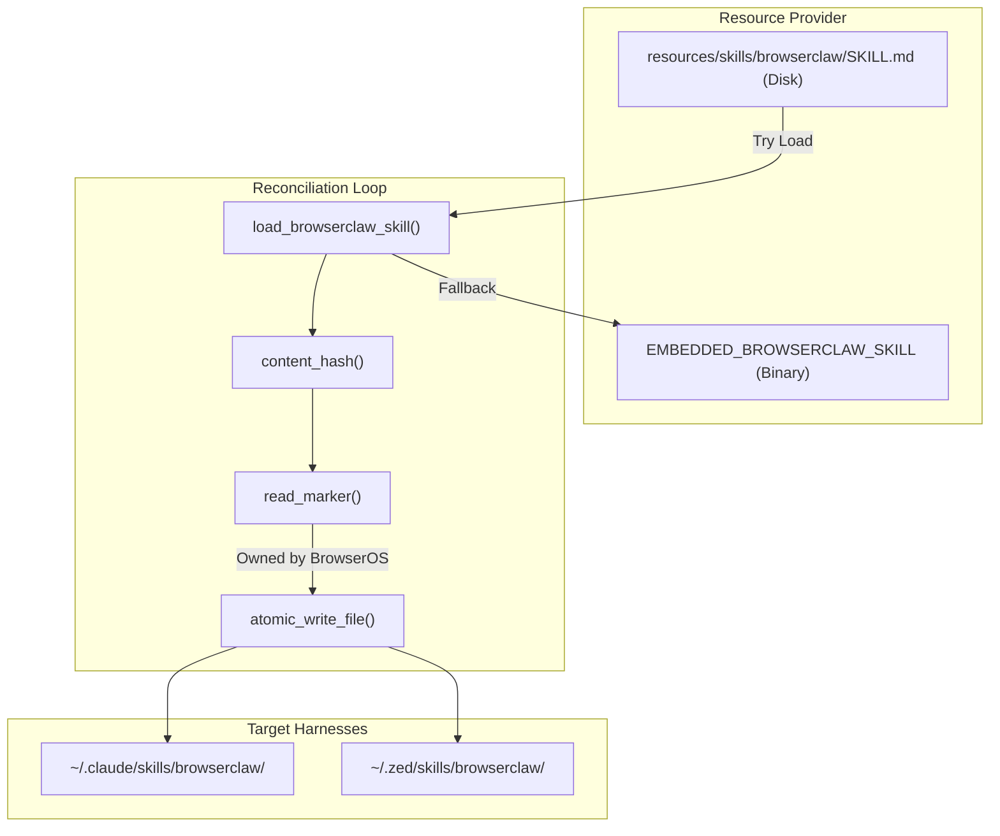

<!-- source: DeepWiki mcp.deepwiki.com · repo browseros-ai/BrowserOS · page 3.9 Skills · fetched 2026-10-29 -->

# Skills

<details>
<summary>Relevant source files</summary>

The following files were used as context for generating this wiki page:

- [.claude/skills/ask-internal/SKILL.md](.claude/skills/ask-internal/SKILL.md)
- [.claude/skills/write-docs/SKILL.md](.claude/skills/write-docs/SKILL.md)
- [.claude/skills/writing-plans/SKILL.md](.claude/skills/writing-plans/SKILL.md)
- [packages/browseros-agent/apps/claw-server-rust/resources/skills/browserclaw/SKILL.md](packages/browseros-agent/apps/claw-server-rust/resources/skills/browserclaw/SKILL.md)
- [packages/browseros-agent/apps/claw-server-rust/src/api/mcp/script_hook.rs](packages/browseros-agent/apps/claw-server-rust/src/api/mcp/script_hook.rs)
- [packages/browseros-agent/apps/claw-server-rust/src/services/harness_skills.rs](packages/browseros-agent/apps/claw-server-rust/src/services/harness_skills.rs)
- [packages/browseros-agent/crates/harness-integrations/README.md](packages/browseros-agent/crates/harness-integrations/README.md)
- [packages/browseros-agent/crates/harness-integrations/src/catalog.rs](packages/browseros-agent/crates/harness-integrations/src/catalog.rs)
- [packages/browseros-agent/crates/harness-integrations/src/error.rs](packages/browseros-agent/crates/harness-integrations/src/error.rs)
- [packages/browseros-agent/crates/harness-integrations/src/lib.rs](packages/browseros-agent/crates/harness-integrations/src/lib.rs)
- [packages/browseros-agent/crates/harness-integrations/src/mcp/emitter.rs](packages/browseros-agent/crates/harness-integrations/src/mcp/emitter.rs)
- [packages/browseros-agent/crates/harness-integrations/src/mcp/io.rs](packages/browseros-agent/crates/harness-integrations/src/mcp/io.rs)
- [packages/browseros-agent/crates/harness-integrations/src/mcp/manager.rs](packages/browseros-agent/crates/harness-integrations/src/mcp/manager.rs)
- [packages/browseros-agent/crates/harness-integrations/src/mcp/mod.rs](packages/browseros-agent/crates/harness-integrations/src/mcp/mod.rs)
- [packages/browseros-agent/crates/harness-integrations/src/mcp/paths.rs](packages/browseros-agent/crates/harness-integrations/src/mcp/paths.rs)
- [packages/browseros-agent/crates/harness-integrations/src/mcp/planner.rs](packages/browseros-agent/crates/harness-integrations/src/mcp/planner.rs)
- [packages/browseros-agent/crates/harness-integrations/src/mcp/types.rs](packages/browseros-agent/crates/harness-integrations/src/mcp/types.rs)
- [packages/browseros-agent/crates/harness-integrations/src/skills/manifest.rs](packages/browseros-agent/crates/harness-integrations/src/skills/manifest.rs)
- [packages/browseros-agent/crates/harness-integrations/src/skills/reconciler.rs](packages/browseros-agent/crates/harness-integrations/src/skills/reconciler.rs)
- [packages/browseros-agent/crates/harness-integrations/src/skills/types.rs](packages/browseros-agent/crates/harness-integrations/src/skills/types.rs)

</details>


The Skills system in BrowserOS allows users to teach the agent reusable, complex task instructions. Unlike static system prompts, skills are modular, versioned, and can be synchronized across different AI coding harnesses. They provide a structured way to define multi-phase workflows, data extraction patterns, and specialized behavioral rules that the agent activates based on user intent.

## SKILL.md Format

Skills are defined as directory-based packages containing a `SKILL.md` file. This file uses a specific structure combining YAML frontmatter for metadata and Markdown for behavioral instructions.

### Specification
The system parses the following fields from the frontmatter:
*   **`name`**: The unique identifier (slug) for the skill. Must contain only lowercase ASCII letters, digits, and hyphens [packages/browseros-agent/crates/harness-integrations/src/skills/types.rs:13-29]().
*   **`description`**: A high-level summary used by the LLM to determine when to trigger the skill [packages/browseros-agent/apps/claw-server-rust/src/services/harness_skills.rs:11-15]().
*   **`allowed-tools`**: (Optional) A list of specific tools the agent is permitted to use while this skill is active [.claude/skills/write-docs/SKILL.md:4-4]().
*   **`disable-model-invocation`**: (Optional) If true, prevents the model from using standard reasoning and forces adherence to the skill workflow [.claude/skills/write-docs/SKILL.md:5-5]().

### Supporting File Structure
A typical skill directory (e.g., `write-docs/`) may contain:
*   `SKILL.md`: The primary instruction set [.claude/skills/write-docs/SKILL.md:1-6]().
*   `scripts/`: Optional utility scripts (e.g., Python or JS) for specialized tasks [.claude/skills/write-docs/SKILL.md:33-33]().
*   `references/`: Documentation or examples the agent can refer to.
*   `assets/`: Images or templates used during task execution [.claude/skills/write-docs/SKILL.md:104-110]().

**Sources:** [packages/browseros-agent/crates/harness-integrations/src/skills/types.rs:13-29](), [packages/browseros-agent/apps/claw-server-rust/src/services/harness_skills.rs:11-15](), [.claude/skills/write-docs/SKILL.md:1-40]()

---

## Architecture & Data Flow

The Skill system is implemented primarily in Rust within the `harness-integrations` crate, which manages the reconciliation of skills into external coding agents like Claude Code, Cursor, and Zed [packages/browseros-agent/crates/harness-integrations/README.md:3-9]().

### Skill Reconciliation Logic
The `SkillReconciler` converges product-owned skill content into catalog-defined global harness roots [packages/browseros-agent/crates/harness-integrations/src/skills/reconciler.rs:24-26](). It uses a `skills.json` manifest and a `.browserclaw-managed.json` marker file to establish ownership and prevent overwriting foreign user-created skills [packages/browseros-agent/crates/harness-integrations/src/skills/manifest.rs:13-14]().

### System Component Diagram
This diagram maps the internal Rust service logic to the physical filesystem and external AI harnesses.

```mermaid
graph TD
    subgraph "Natural Language Space"
        NL_User["User Prompt (e.g., 'Write documentation for feature X')"]
    end

    subgraph "Code Entity Space"
        Harness_Claude["Claude Code (~/.claude/skills/)"]
        Harness_Cursor["Cursor (~/.cursor/skills/)"]
        Rust_Reconciler["harness_integrations::SkillReconciler"]
        Rust_Manifest["harness_integrations::SkillManifest (skills.json)"]
        Rust_Marker["harness_integrations::OwnershipMarker (.browserclaw-managed.json)"]
        FS_Source["apps/claw-server-rust/resources/skills/"]
        Skill_Spec["harness_integrations::SkillSpec"]
    end

    NL_User --> Harness_Claude: "Triggers Skill via Description"
    Rust_Reconciler -->|reconcile()| Harness_Claude
    Rust_Reconciler -->|reconcile()| Harness_Cursor
    FS_Source -->|load_browserclaw_skill()| Skill_Spec
    Skill_Spec --> Rust_Reconciler
    Rust_Reconciler --> Rust_Manifest: "Tracks managed targets"
    Rust_Reconciler --> Rust_Marker: "Writes to target directories"
```

| Component | Responsibility |
| :--- | :--- |
| `SkillSpec` | Product-owned skill content and metadata [packages/browseros-agent/crates/harness-integrations/src/skills/types.rs:7-10](). |
| `SkillReconciler` | Manages installation and removal of skills across multiple AI harnesses [packages/browseros-agent/crates/harness-integrations/src/skills/reconciler.rs:26-36](). |
| `SkillManifest` | A JSON file (`skills.json`) recording which skills were written to which harness [packages/browseros-agent/crates/harness-integrations/src/skills/manifest.rs:16-20](). |
| `OwnershipMarker` | A hidden JSON file (`.browserclaw-managed.json`) placed in target directories to signal BrowserOS ownership [packages/browseros-agent/crates/harness-integrations/src/skills/manifest.rs:42-47](). |

**Sources:** [packages/browseros-agent/crates/harness-integrations/src/skills/reconciler.rs:24-46](), [packages/browseros-agent/crates/harness-integrations/src/skills/manifest.rs:13-62](), [packages/browseros-agent/crates/harness-integrations/README.md:26-29]()

---

## Runtime Sync & Fallbacks

BrowserOS ensures that critical skills, such as the `browserclaw` skill (which teaches agents how to use the browser SDK), are always available even if filesystem resources are missing.

### Fallback Mechanism
The `load_browserclaw_skill` function attempts to load the skill from the active signed resources directory. If the file is missing or invalid (e.g., wrong name in frontmatter), it falls back to a version compiled directly into the Rust binary [packages/browseros-agent/apps/claw-server-rust/src/services/harness_skills.rs:18-36]().

### Reconciliation Lifecycle
1.  **Plan**: `plan_reconciliation` determines which targets need updates based on content hashes [packages/browseros-agent/crates/harness-integrations/src/skills/reconciler.rs:73-75]().
2.  **Verify**: The reconciler checks for the `OwnershipMarker`. If a directory exists but lacks the marker, it is treated as a "foreign" user directory and left unchanged [packages/browseros-agent/crates/harness-integrations/src/skills/reconciler.rs:114-123]().
3.  **Apply**: Content is written atomically using temporary files to prevent corruption [packages/browseros-agent/crates/harness-integrations/src/skills/manifest.rs:131-153]().

### Sync Lifecycle Diagram



**Sources:** [packages/browseros-agent/apps/claw-server-rust/src/services/harness_skills.rs:18-36](), [packages/browseros-agent/crates/harness-integrations/src/skills/reconciler.rs:72-123](), [packages/browseros-agent/crates/harness-integrations/src/skills/manifest.rs:131-153]()

---

## Core Skill Catalog

BrowserOS includes several pre-defined skills to facilitate agent operations:

| Skill Name | Purpose |
| :--- | :--- |
| `browserclaw` | Directs agents to use the BrowserOS SDK for web tasks, emphasizing code-first execution via `run` [packages/browseros-agent/apps/claw-server-rust/resources/skills/browserclaw/SKILL.md:1-15](). |
| `write-docs` | Workflow for exploring the codebase and writing Mintlify MDX documentation [.claude/skills/write-docs/SKILL.md:1-6](). |
| `ask-internal` | Answers questions about architecture and design by searching `.internal-docs/` and the codebase [.claude/skills/ask-internal/SKILL.md:1-6](). |
| `writing-plans` | Generates bite-sized implementation plans for complex engineering tasks [.claude/skills/writing-plans/SKILL.md:1-11](). |

**Sources:** [packages/browseros-agent/apps/claw-server-rust/resources/skills/browserclaw/SKILL.md:1-15](), [.claude/skills/write-docs/SKILL.md:1-6](), [.claude/skills/ask-internal/SKILL.md:1-6](), [.claude/skills/writing-plans/SKILL.md:1-11]()

---

