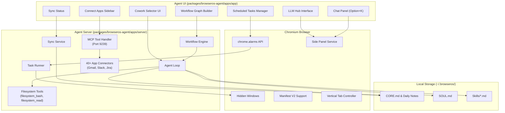

<!-- source: DeepWiki mcp.deepwiki.com · repo browseros-ai/BrowserOS · page 4 Features · fetched 2026-10-29 -->

# Features

Relevant source files

The following files were used as context for generating this wiki page:

- [.gitattributes](.gitattributes)
- [README.md](README.md)
- [docs/browserclaw/cockpit.mdx](docs/browserclaw/cockpit.mdx)
- [docs/browserclaw/tabs-and-isolation.mdx](docs/browserclaw/tabs-and-isolation.mdx)
- [docs/contributing.mdx](docs/contributing.mdx)
- [docs/docs.json](docs/docs.json)
- [docs/features/bring-your-own-llm.mdx](docs/features/bring-your-own-llm.mdx)
- [docs/features/connect-mcps.mdx](docs/features/connect-mcps.mdx)
- [docs/features/cowork.mdx](docs/features/cowork.mdx)
- [docs/features/local-models.mdx](docs/features/local-models.mdx)
- [docs/features/scheduled-tasks.mdx](docs/features/scheduled-tasks.mdx)
- [docs/features/smart-nudges.mdx](docs/features/smart-nudges.mdx)
- [docs/features/use-with-claude-code.mdx](docs/features/use-with-claude-code.mdx)
- [docs/images/checks-passed.png](docs/images/checks-passed.png)
- [docs/images/contributing--architecture.png](docs/images/contributing--architecture.png)
- [docs/images/hero-dark.png](docs/images/hero-dark.png)
- [docs/images/hero-light.png](docs/images/hero-light.png)
- [docs/images/switcher.png](docs/images/switcher.png)
- [docs/index.mdx](docs/index.mdx)
- [docs/videos/browserOS-agent-in-action.gif](docs/videos/browserOS-agent-in-action.gif)
- [packages/browseros-agent/.config/wt.toml](packages/browseros-agent/.config/wt.toml)
- [packages/browseros-agent/apps/app/screens/mcp-settings/QuickSetupSection.test.tsx](packages/browseros-agent/apps/app/screens/mcp-settings/QuickSetupSection.test.tsx)
- [packages/browseros-agent/apps/app/screens/mcp-settings/QuickSetupSection.tsx](packages/browseros-agent/apps/app/screens/mcp-settings/QuickSetupSection.tsx)
- [packages/browseros-agent/apps/app/screens/onboarding/features/Features.tsx](packages/browseros-agent/apps/app/screens/onboarding/features/Features.tsx)

This page provides a technical overview of BrowserOS-specific features that extend the browser with AI-powered automation, local file access, scheduling, and workflow capabilities. These features bridge the gap between a standard web browser and an autonomous AI agent environment.

For AI integration and LLM configuration, see [AI Integration](#3). For the Memory system and SOUL.md personality, see [Memory System](#3.7) and [SOUL.md Personality](#3.8). For the built-in MCP server that exposes these capabilities to external tools, see [MCP Server](#5).

## Feature Categories

BrowserOS features are distributed across the Agent UI extension, the background Bun server, and the Chromium-based browser core.

| Feature | Purpose | Component Location |
|---------|---------|-------------------|
| **Cowork** | Sandboxed filesystem access for agent file operations | `apps/server` + `BrowserOS Server` |
| **Scheduled Tasks** | Automated agent execution on time-based schedules | `packages/browseros-agent` + `chrome.alarms` |
| **Workflows** | Visual graph-based browser automation builder | `apps/app` |
| **LLM Hub** | Multi-model comparison interface | `apps/app` Side Panel |
| **Connect Apps** | 40+ app integrations via MCP (Gmail, Slack, etc.) | `apps/server` + OAuth |
| **Sync to Cloud** | Cross-device synchronization of configurations | `apps/server` + Cloud API |
| **Vertical Tabs** | Side-panel tab management | Chromium UI |
| **Ad Blocking** | Manifest V2 support for uBlock Origin | Chromium Core |

Sources: [docs/docs.json:43-58](), [README.md:110-123](), [docs/contributing.mdx:31-38]()

## Feature Architecture

The following diagram maps high-level features to the specific code entities and browser APIs that power them.

Sources: [docs/features/scheduled-tasks.mdx:109-124](), [docs/features/connect-mcps.mdx:14-22](), [docs/contributing.mdx:39-41](), [docs/features/use-with-claude-code.mdx:142-169]()

## Cowork (Filesystem Access)

Cowork provides sandboxed filesystem access to the AI agent. When enabled, the agent gains access to 7 specific filesystem tools exposed by the server. This allows the agent to combine web research with local file operations, such as saving reports or editing code within a specific folder.

- **Tools**: Includes `filesystem_read`, `filesystem_write`, `filesystem_edit`, `filesystem_bash`, `filesystem_find`, `filesystem_grep`, and `filesystem_ls` [docs/features/cowork.mdx:75-156]().
- **Sandbox**: The agent is restricted to the selected folder and cannot access files outside of it [docs/features/cowork.mdx:61-61]().

For details, see [Cowork (Filesystem Access)](#4.1).

Sources: [docs/features/cowork.mdx:16-41](), [docs/features/cowork.mdx:71-156]()

## Scheduled Tasks

Scheduled Tasks enable automated agent execution on time-based intervals using the `chrome.alarms` API.

- **Execution**: Tasks run in a hidden browser window to avoid interrupting active work [docs/features/scheduled-tasks.mdx:115-117]().
- **Trigger Logic**: If the browser is closed during a scheduled time, the task triggers immediately upon the next launch [docs/features/scheduled-tasks.mdx:112-114]().
- **History**: Each task maintains a history of its last 15 runs [docs/features/scheduled-tasks.mdx:100-100]().

For details on schedule types (Daily, Hourly, Minutes), see [Scheduled Tasks](#4.2).

Sources: [docs/features/scheduled-tasks.mdx:52-64](), [docs/features/scheduled-tasks.mdx:109-124]()

## Workflows

Workflows provide a visual graph builder for creating reliable, repeatable browser automations.

- **Graph Builder**: Allows users to build automations using a visual interface, distinguishing it from natural language Agent Mode [docs/index.mdx:23-25]().
- **Reliability**: Designed for multi-step workflows where consistent execution is required.

For more information, see [Workflows](#4.3).

Sources: [docs/index.mdx:23-25](), [docs/docs.json:86-86]()

## LLM Hub

BrowserOS includes a multi-pane interface for comparing LLM responses.

- **LLM Hub**: A dedicated interface supporting side-by-side comparison of models [docs/docs.json:85-85]().
- **Provider Support**: Supports cloud providers (Claude, GPT, Gemini), OAuth-based subscriptions (ChatGPT Pro, GitHub Copilot), and local models (Ollama, LM Studio) [docs/features/bring-your-own-llm.mdx:16-33](), [docs/features/local-models.mdx:26-81]().

For details, see [LLM Hub](#4.4).

Sources: [docs/features/bring-your-own-llm.mdx:1-33](), [docs/features/local-models.mdx:1-81]()

## Connect Apps (MCP)

The Connect Apps feature integrates 40+ external services via the Model Context Protocol (MCP).

- **Smart Nudges**: The agent detects when a user request requires an unconnected app and presents an interactive connection card in the chat [docs/features/connect-mcps.mdx:19-37]().
- **Zero Config Auth**: Services are connected via OAuth; credentials are managed securely and never stored in BrowserOS [docs/features/use-with-claude-code.mdx:30-32]().
- **Categories**: Includes Email (Gmail, Outlook), Calendar (Google, Cal.com), Messaging (Slack, Discord), and Development (GitHub, Vercel) [docs/features/connect-mcps.mdx:65-177]().

For the full list of supported apps, see [Connect Apps](#4.8).

Sources: [docs/features/connect-mcps.mdx:14-37](), [docs/features/connect-mcps.mdx:65-177]()

## Sync to Cloud

Sync to Cloud ensures your configuration and history follow you across devices.

| Synced Data | Local-Only Data |
|-------------|-----------------|
| Conversation History | API Keys |
| Scheduled Task Definitions | Memory (CORE.md, etc.) |
| LLM Provider Configs | OAuth Tokens (Local Storage) |

For details on the architecture and what stays local, see [Sync to Cloud](#4.5).

Sources: [docs/features/scheduled-tasks.mdx:130-134](), [docs/docs.json:54-54]()

## Vertical Tabs & Ad Blocking

BrowserOS introduces UI and privacy enhancements directly into the Chromium fork.

- **Vertical Tabs**: A side-panel tab manager that optimizes screen real estate for high-tab-count workflows [docs/docs.json:56-56]().
- **Ad Blocking**: BrowserOS maintains full Manifest V2 support, providing a "10x protection advantage" by allowing extensions like uBlock Origin to use their most powerful filtering capabilities [docs/docs.json:55-55]().

For details, see [Vertical Tabs](#4.6) and [Ad Blocking](#4.7).

Sources: [docs/docs.json:55-56]()

## Feature Tool Mapping

This table bridges "Natural Language Space" (the features) to "Code Entity Space" (the tools and files).

| Feature | Primary Code Tool / Entity | Location |
|---------|---------------------------|----------|
| **Cowork** | `filesystem_bash`, `filesystem_read` | `apps/server` |
| **Scheduled Tasks** | `chrome.alarms`, `TaskRunner` | `packages/browseros-agent` |
| **App Connect** | `MCPHandler`, `AppConnectors` | `apps/server` |
| **MCP Server** | `http://127.0.0.1:9239/mcp` | `apps/server` |
| **Automation** | `53+ browser automation tools` | `apps/server` |

Sources: [docs/features/scheduled-tasks.mdx:112-114](), [docs/features/use-with-claude-code.mdx:45-49](), [docs/features/use-with-claude-code.mdx:27-29]()

---

