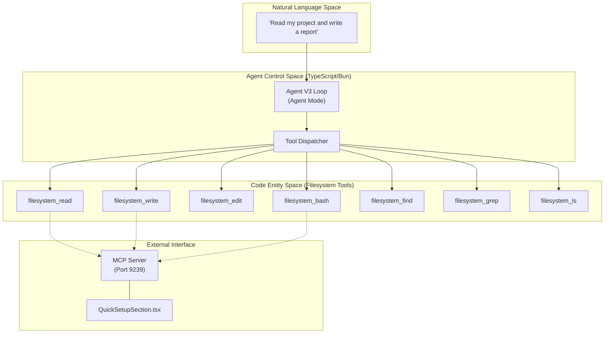
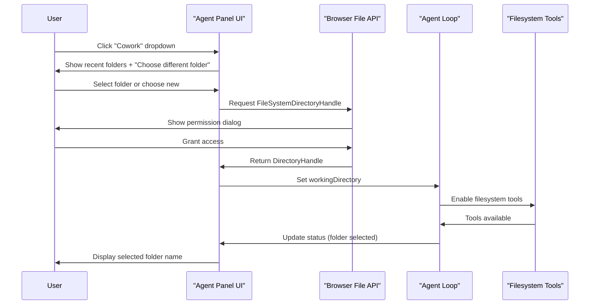
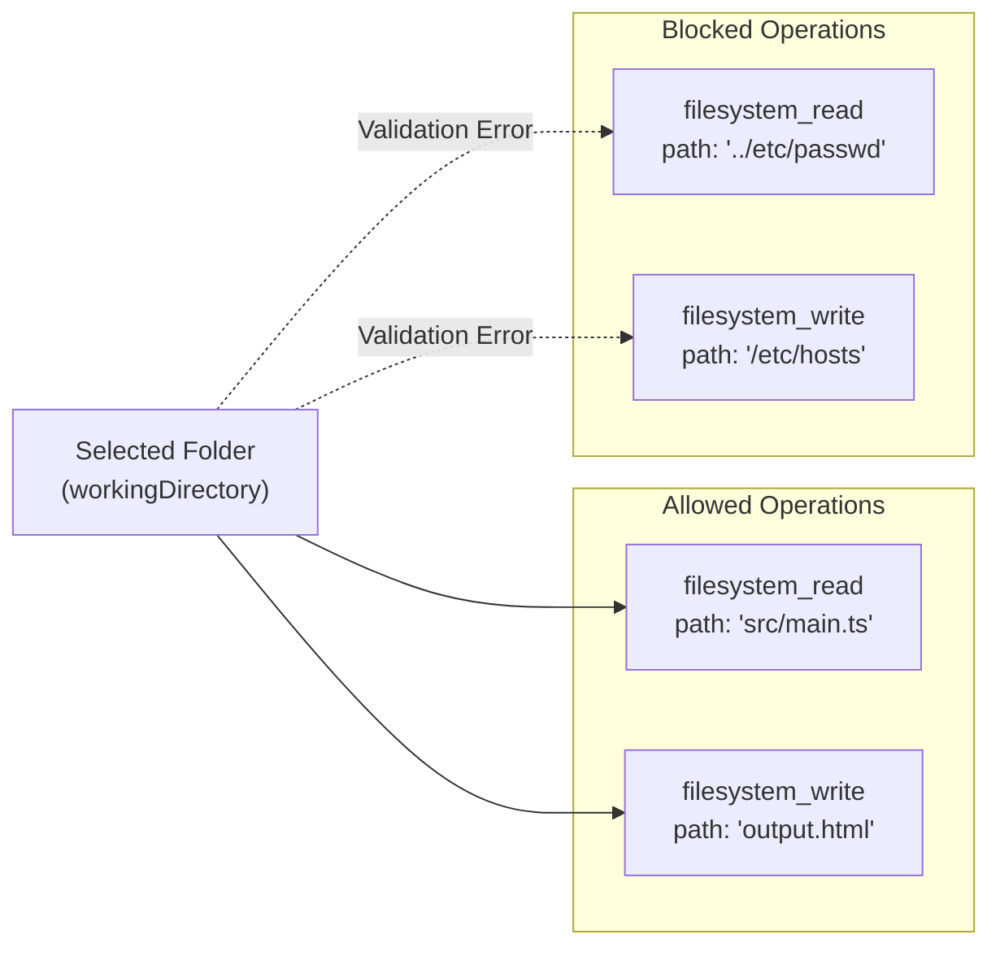

<!-- source: DeepWiki mcp.deepwiki.com · repo browseros-ai/BrowserOS · page 4.1 Cowork (Filesystem Access) · fetched 2026-10-29 -->

# Cowork (Filesystem Access)

Relevant source files

The following files were used as context for generating this wiki page:

- [docs/browserclaw/cockpit.mdx](docs/browserclaw/cockpit.mdx)
- [docs/browserclaw/tabs-and-isolation.mdx](docs/browserclaw/tabs-and-isolation.mdx)
- [docs/docs.json](docs/docs.json)
- [docs/features/bring-your-own-llm.mdx](docs/features/bring-your-own-llm.mdx)
- [docs/features/connect-mcps.mdx](docs/features/connect-mcps.mdx)
- [docs/features/cowork.mdx](docs/features/cowork.mdx)
- [docs/features/local-models.mdx](docs/features/local-models.mdx)
- [docs/features/scheduled-tasks.mdx](docs/features/scheduled-tasks.mdx)
- [docs/features/smart-nudges.mdx](docs/features/smart-nudges.mdx)
- [docs/features/use-with-claude-code.mdx](docs/features/use-with-claude-code.mdx)
- [packages/browseros-agent/.config/wt.toml](packages/browseros-agent/.config/wt.toml)
- [packages/browseros-agent/apps/app/screens/mcp-settings/QuickSetupSection.test.tsx](packages/browseros-agent/apps/app/screens/mcp-settings/QuickSetupSection.test.tsx)
- [packages/browseros-agent/apps/app/screens/mcp-settings/QuickSetupSection.tsx](packages/browseros-agent/apps/app/screens/mcp-settings/QuickSetupSection.tsx)
- [packages/browseros-agent/apps/app/screens/onboarding/features/Features.tsx](packages/browseros-agent/apps/app/screens/onboarding/features/Features.tsx)

Cowork is a sandboxed filesystem access feature that extends the BrowserOS agent's capabilities beyond browser automation to include local file operations. When enabled, the agent gains access to a selected folder through seven filesystem tools (`filesystem_read`, `filesystem_write`, `filesystem_edit`, `filesystem_bash`, `filesystem_find`, `filesystem_grep`, `filesystem_ls`), allowing it to combine web research with file manipulation, code editing, and command execution in a single task [docs/features/cowork.mdx:1-41]().

**Scope**: This document covers the architecture, security model, tool reference, and implementation details of the Cowork filesystem access system. For information about connecting external apps (Gmail, Slack, etc.), see [4.8 Connect Apps](). For information about using Cowork with external MCP clients like Claude Code, see [5.3 Claude Code Integration]().

---

## Architecture Overview

Cowork integrates into the BrowserOS agent execution pipeline as an optional capability layer. When a user selects a folder, the agent loop gains access to filesystem tools alongside its browser automation tools [docs/features/cowork.mdx:43-61]().

### System Component Mapping

The following diagram bridges the user-facing features to the underlying code entities and tools.

**Title: BrowserOS Cowork Entity Map**

**Sources**: [docs/features/cowork.mdx:71-156](), [docs/features/use-with-claude-code.mdx:41-53](), [packages/browseros-agent/apps/app/screens/mcp-settings/QuickSetupSection.tsx:123-142]()

---

## Activation and Folder Selection

Cowork is disabled by default and must be explicitly enabled by the user for each session. The folder selector appears in the Agent Mode interface, adjacent to the prompt input [docs/features/cowork.mdx:43-55]().

### Selection Flow

**Sources**: [docs/features/cowork.mdx:43-61]()

---

## Security Model

Cowork implements multiple layers of sandboxing to prevent unauthorized filesystem access. The agent is strictly sandboxed to the selected folder and cannot access files outside of it [docs/features/cowork.mdx:61-61]().

### Path Validation and Boundary Enforcement

Every filesystem operation validates that the resolved path remains within the `workingDirectory` boundary.

**Title: Cowork Sandbox Enforcement**

**Sources**: [docs/features/cowork.mdx:61-61](), [docs/features/cowork.mdx:71-156]()

---

## Filesystem Tools Reference

Cowork provides seven primary tools that the agent can use alongside browser automation [docs/features/cowork.mdx:71-74]().

### Tool Capabilities Table

| Tool Name | Core Functionality | Key Constraints |
|:---|:---|:---|
| `filesystem_read` | Reads file content with line numbers; supports images (PNG, JPG, SVG, etc.). | Capped at 2000 lines or 50KB [docs/features/cowork.mdx:76-86](). |
| `filesystem_write` | Creates/overwrites files; creates parent dirs automatically. | Overwrites complete content [docs/features/cowork.mdx:88-95](). |
| `filesystem_edit` | Targeted string replacement with fuzzy fallback. | Returns side-by-side diff [docs/features/cowork.mdx:97-107](). |
| `filesystem_bash` | Executes shell commands (`sh`/`bash`/`cmd`). | 120s timeout; 2000 line output limit [docs/features/cowork.mdx:109-118](). |
| `filesystem_find` | Glob pattern file search (recursive). | Skips build dirs (node_modules, .git, dist, etc.) [docs/features/cowork.mdx:120-130](). |
| `filesystem_grep` | Regex/literal content search across project. | Skips binary and files > 2MB [docs/features/cowork.mdx:132-144](). |
| `filesystem_ls` | Lists directory contents with file sizes. | Sorted alphabetically; 500 entry limit [docs/features/cowork.mdx:146-156](). |

---

## Internal Directory Structure

While Cowork allows access to user-selected folders, BrowserOS maintains its own internal state in a hidden directory.

| Component | Path | Purpose |
|:---|:---|:---|
| **Root Dir** | `~/.browseros` | Base configuration directory. |
| **Dev Root** | `~/.browseros-dev` | Isolated directory for development environments. |
| **Sessions** | `~/.browseros/sessions` | Ephemeral browser session data. |
| **Database** | `~/.browseros/db/browseros.sqlite` | Durable state storage. |

**Sources**: [docs/features/cowork.mdx:61-61](), [docs/features/cowork.mdx:71-156]()

---

## Integration with MCP

When Cowork is enabled and a folder is selected, the filesystem tools are automatically exposed via the built-in MCP server [docs/features/use-with-claude-code.mdx:5-10](). This allows external agents like Claude Code or OpenClaw to perform local file operations through BrowserOS [docs/features/use-with-claude-code.mdx:55-105]().

The MCP server typically listens on port `9239` [docs/features/use-with-claude-code.mdx:45-49](). The `QuickSetupSection` component provides snippets for connecting various clients like Claude Code, Claude Desktop, and Codex [packages/browseros-agent/apps/app/screens/mcp-settings/QuickSetupSection.tsx:19-91]().

### MCP Tool Categories
BrowserOS organizes its 53+ tools into categories, where Cowork tools fall under **Filesystem & Commands** [docs/features/use-with-claude-code.mdx:164-192]().

**Sources**: [docs/features/use-with-claude-code.mdx:164-192](), [docs/features/use-with-claude-code.mdx:5-10](), [packages/browseros-agent/apps/app/screens/mcp-settings/QuickSetupSection.tsx:19-91]()

---

## Common Usage Patterns

### Pattern: Research and Report
The agent uses browser tools to gather data and filesystem tools to persist it [docs/features/cowork.mdx:158-164]().

1. `navigate_page`: Go to source (e.g., Hacker News).
2. `get_page_content`: Extract text/comments.
3. `filesystem_write`: Save findings as an HTML/Markdown report [docs/features/cowork.mdx:168-186]().

### Pattern: Codebase Analysis
The agent searches the local project to provide context for browser-based tasks [docs/features/cowork.mdx:189-208]().

1. `filesystem_find`: Locate relevant files.
2. `filesystem_grep`: Find specific logic or TODOs.
3. `filesystem_read`: Ingest code context.
4. `filesystem_edit`: Apply fixes or updates based on web documentation.

**Sources**: [docs/features/cowork.mdx:158-208]()

---

