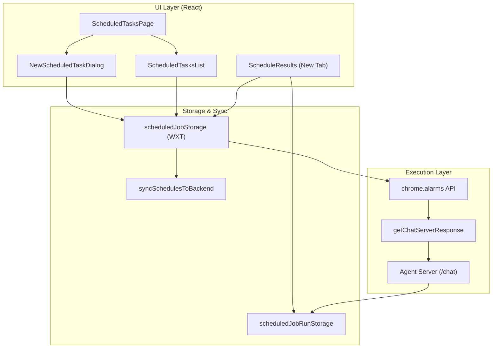
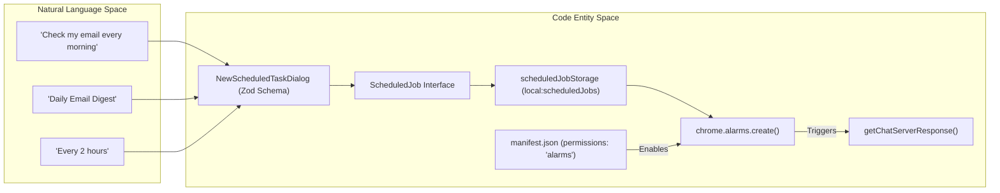

<!-- source: DeepWiki mcp.deepwiki.com · repo browseros-ai/BrowserOS · page 4.2 Scheduled Tasks · fetched 2026-10-29 -->

# Scheduled Tasks

Relevant source files

The following files were used as context for generating this wiki page:

- [docs/browserclaw/cockpit.mdx](docs/browserclaw/cockpit.mdx)
- [docs/browserclaw/tabs-and-isolation.mdx](docs/browserclaw/tabs-and-isolation.mdx)
- [docs/docs.json](docs/docs.json)
- [docs/features/bring-your-own-llm.mdx](docs/features/bring-your-own-llm.mdx)
- [docs/features/connect-mcps.mdx](docs/features/connect-mcps.mdx)
- [docs/features/cowork.mdx](docs/features/cowork.mdx)
- [docs/features/local-models.mdx](docs/features/local-models.mdx)
- [docs/features/scheduled-tasks.mdx](docs/features/scheduled-tasks.mdx)
- [docs/features/smart-nudges.mdx](docs/features/smart-nudges.mdx)
- [docs/features/use-with-claude-code.mdx](docs/features/use-with-claude-code.mdx)
- [packages/browseros-agent/.config/wt.toml](packages/browseros-agent/.config/wt.toml)
- [packages/browseros-agent/apps/app/screens/mcp-settings/QuickSetupSection.test.tsx](packages/browseros-agent/apps/app/screens/mcp-settings/QuickSetupSection.test.tsx)
- [packages/browseros-agent/apps/app/screens/mcp-settings/QuickSetupSection.tsx](packages/browseros-agent/apps/app/screens/mcp-settings/QuickSetupSection.tsx)
- [packages/browseros-agent/apps/app/screens/onboarding/features/Features.tsx](packages/browseros-agent/apps/app/screens/onboarding/features/Features.tsx)

Scheduled Tasks enable automated execution of agent prompts at defined intervals. This feature leverages the browser's alarm API to trigger background agent sessions, combining browser automation with optional filesystem access (Cowork) and external app integrations (MCP).

---

## Overview

Scheduled Tasks allow users to define natural language prompts that execute automatically on a schedule (daily, hourly, or by minutes). When a task triggers, the system performs the following steps:

1.  **Resolve Configuration**: Loads the task's prompt, schedule, and associated LLM provider [docs/features/scheduled-tasks.mdx:39-48]().
2.  **Initialize Session**: Starts an agent session using the configured provider and a specialized system prompt for unattended execution [docs/features/scheduled-tasks.mdx:118-120]().
3.  **Execute Prompt**: Runs the agent loop with full access to browser tools, connected apps via MCP, and filesystem tools via Cowork [docs/features/scheduled-tasks.mdx:118-120](), [docs/features/cowork.mdx:41-42]().
4.  **Save Results**: Captures the final text, execution logs, and tool call history in local storage [docs/features/scheduled-tasks.mdx:121-124]().

**Sources:** [docs/features/scheduled-tasks.mdx](), [docs/features/cowork.mdx]()

---

## Architecture

### System Components

The following diagram illustrates the relationship between the UI, storage, and the execution engine that powers scheduled tasks.

**Sources:** [docs/features/scheduled-tasks.mdx:109-124](), [docs/features/sync-to-cloud.mdx](), [docs/features/scheduled-tasks.mdx:30-48]()

### Data Flow: Natural Language to Execution

This diagram maps user-defined natural language tasks to the underlying code entities and browser APIs.

**Sources:** [docs/features/scheduled-tasks.mdx:39-48](), [docs/features/scheduled-tasks.mdx:112-114](), [docs/features/scheduled-tasks.mdx:52-64]()

---

## Task Management

### Schedule Configuration

The system supports three recurrence types [docs/features/scheduled-tasks.mdx:52-64]():

1.  **Daily**: Runs once a day at a specific time (e.g., every morning at 8:00 AM).
2.  **Hourly**: Runs every N hours (1 to 24 hours).
3.  **Minutes**: Runs every N minutes (1 to 60 minutes).

The `chrome.alarms` API is used to schedule these intervals. When a task is added or toggled, the system calculates the next trigger time and registers the alarm [docs/features/scheduled-tasks.mdx:112-114](). If the device is offline or the browser is closed during a scheduled time, the task runs as soon as BrowserOS is opened again [docs/features/scheduled-tasks.mdx:113]().

### Execution Context

Scheduled tasks run in a **hidden browser window** to avoid interrupting the user's active session [docs/features/scheduled-tasks.mdx:115-117](). The agent is provided with:
*   **System Prompt**: A specialized instruction set that guides the agent for automated, non-interactive tasks [docs/features/scheduled-tasks.mdx:118-120]().
*   **Tool Access**: Full access to browser automation, connected MCP apps (Gmail, Slack, etc.), and Cowork filesystem tools [docs/features/scheduled-tasks.mdx:89-90](), [docs/features/cowork.mdx:41-42]().
*   **Timeouts**: Tasks have a default 10-minute timeout; if exceeded, the task is marked as failed [docs/features/scheduled-tasks.mdx:127-128]().

**Sources:** [docs/features/scheduled-tasks.mdx:109-128](), [docs/features/cowork.mdx:6-14]()

---

## Synchronization and Results

### Cloud Synchronization

Task configurations (name, prompt, schedule type, and timing) sync across devices when signed in [docs/features/scheduled-tasks.mdx:130-136]().
*   **Persistence**: Uses cloud sync to ensure a task created on a laptop appears on a desktop [docs/features/scheduled-tasks.mdx:132]().
*   **Conflict Resolution**: Conflicts are resolved automatically using timestamps [docs/features/scheduled-tasks.mdx:132]().
*   **Execution Locality**: Task run results and output stay on the device where the task ran; they are not synced to the cloud [docs/features/scheduled-tasks.mdx:134-135]().

### Viewing Results

Results are displayed in two primary locations:
1.  **New Tab Page**: Results show up directly on the new tab for quick visibility [docs/features/scheduled-tasks.mdx:95]().
2.  **Scheduled Tasks Page**: A full history of the last 15 runs is maintained per task, including tool logs and outputs [docs/features/scheduled-tasks.mdx:96-100]().

Users can manually **Test** a task, **Retry** a failed run, or **Cancel** an active background session from the management UI [docs/features/scheduled-tasks.mdx:104-107]().

**Sources:** [docs/features/scheduled-tasks.mdx:91-108](), [docs/features/scheduled-tasks.mdx:130-136]()

---

## Integration with Other Features

### MCP and App Connectivity
Scheduled tasks can leverage any connected MCP application. For example, a task can check a Google Calendar and post a summary to Slack [docs/features/scheduled-tasks.mdx:84-86](). The assistant uses OAuth credentials managed by the BrowserOS server to interact with these services during the scheduled run [docs/features/connect-mcps:16-17](), [docs/features/use-with-claude-code:30-32]().

### Cowork (Filesystem)
If a task requires local file operations (e.g., "Read the top stories and write an HTML report"), the agent uses Cowork tools [docs/features/cowork.mdx:163-172](). The agent remains sandboxed to the user-selected folder during execution [docs/features/cowork.mdx:61]().

**Sources:** [docs/features/scheduled-tasks.mdx:89-90](), [docs/features/connect-mcps.mdx:16-17](), [docs/features/cowork.mdx:163-172]()

---

