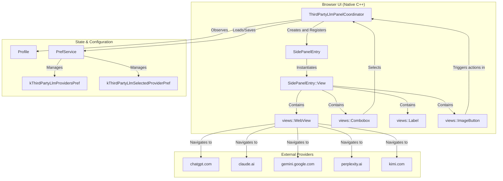
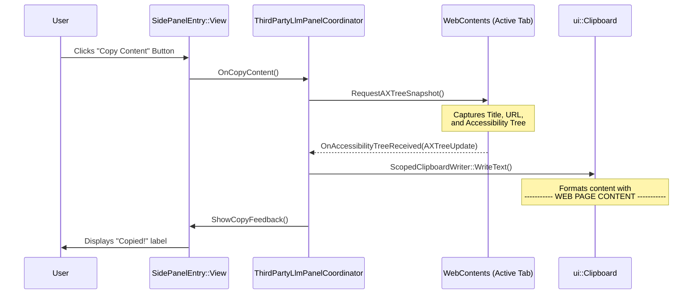

<!-- source: DeepWiki mcp.deepwiki.com · repo browseros-ai/BrowserOS · page 4.4 LLM Hub · fetched 2026-10-29 -->

# LLM Hub

Relevant source files

The following files were used as context for generating this wiki page:

- [docs/browserclaw/cockpit.mdx](docs/browserclaw/cockpit.mdx)
- [docs/browserclaw/tabs-and-isolation.mdx](docs/browserclaw/tabs-and-isolation.mdx)
- [docs/docs.json](docs/docs.json)
- [docs/features/bring-your-own-llm.mdx](docs/features/bring-your-own-llm.mdx)
- [docs/features/connect-mcps.mdx](docs/features/connect-mcps.mdx)
- [docs/features/cowork.mdx](docs/features/cowork.mdx)
- [docs/features/local-models.mdx](docs/features/local-models.mdx)
- [docs/features/scheduled-tasks.mdx](docs/features/scheduled-tasks.mdx)
- [docs/features/smart-nudges.mdx](docs/features/smart-nudges.mdx)
- [docs/features/use-with-claude-code.mdx](docs/features/use-with-claude-code.mdx)
- [packages/browseros-agent/.config/wt.toml](packages/browseros-agent/.config/wt.toml)
- [packages/browseros-agent/apps/app/screens/mcp-settings/QuickSetupSection.test.tsx](packages/browseros-agent/apps/app/screens/mcp-settings/QuickSetupSection.test.tsx)
- [packages/browseros-agent/apps/app/screens/mcp-settings/QuickSetupSection.tsx](packages/browseros-agent/apps/app/screens/mcp-settings/QuickSetupSection.tsx)
- [packages/browseros-agent/apps/app/screens/onboarding/features/Features.tsx](packages/browseros-agent/apps/app/screens/onboarding/features/Features.tsx)

The LLM Hub (internally referred to as the "Third-Party LLM Panel") is a multi-pane comparison interface that allows users to query multiple LLM providers simultaneously and view their responses side-by-side. It is implemented as a native Chromium feature that enables parallel evaluation of different models on the same prompt.

---

## Overview

The LLM Hub provides a dedicated comparison workspace where users can:

- Configure 1, 2, or 3 independent chat panes.
- Select different LLM providers for each pane (Claude, Gemini, ChatGPT, etc.).
- Submit prompts to each pane independently and compare responses.
- Access the interface via the **Hub** button in the toolbar or `Cmd+Shift+U`.

The Hub is distinct from the single-pane Chat feature, providing a separate window context for "LLM council" style decision-making.

**Sources:** [docs/docs.json:85-85](), [docs/features/bring-your-own-llm.mdx:39-46]()

---

## Technical Architecture

The LLM Hub is implemented as a native Chromium side panel coordinated by the `ThirdPartyLlmPanelCoordinator`. It bridges the native browser UI with web-based LLM providers.

### Component Relationship

The following diagram maps the high-level system names to specific C++ classes and preference keys found in the codebase.

Title: LLM Hub Native Component Mapping

**Sources:** [docs/features/bring-your-own-llm.mdx:89-93](), [docs/features/use-with-claude-code.mdx:43-46]()

---

## Implementation Details

### State Management
The `ThirdPartyLlmPanelCoordinator` manages the lifecycle and persistence of the Hub. It tracks the list of available LLM providers and the currently selected provider using Chromium's `PrefService`.

- `kThirdPartyLlmProvidersPref`: Stores a list of available LLM providers, including their display name and URL.
- `kThirdPartyLlmSelectedProviderPref`: Stores the index of the currently selected provider.

These preferences are registered via `ThirdPartyLlmPanelCoordinator::RegisterProfilePrefs`.

### UI Construction
The `CreateThirdPartyLlmWebView` method in `ThirdPartyLlmPanelCoordinator` is responsible for building the UI for the side panel. It uses a `views::FlexLayout` to arrange elements. Key UI elements include:
- A `views::Combobox` (`provider_selector_`) for selecting the LLM provider. This combobox uses `LlmProviderComboboxModel` to display provider names.
- A `views::WebView` (`web_view_`) which hosts the web content of the selected LLM provider.
- `views::ImageButton` instances for actions like "Copy Content", "Refresh", and "Open in New Tab".
- A `views::Label` (`copy_feedback_label_`) to provide feedback after copying content.

### Data Flow: Context Injection
A key feature of the Hub is the ability to inject the active tab's context into all comparison panes simultaneously.

Title: Context Injection Sequence

The `OnCopyContent` method in `ThirdPartyLlmPanelCoordinator` initiates the process by requesting an accessibility tree snapshot of the active web contents. Once the `AXTreeUpdate` is received, `OnAccessibilityTreeReceived` extracts text content and writes it to the clipboard. A feedback label is shown to the user for a short duration.

**Sources:** [docs/features/bring-your-own-llm.mdx:45-46](), [docs/features/use-with-claude-code.mdx:27-32]()

---

## Multi-Pane Interface

### Layout Configurations

| Layout | Panes | Use Case |
|--------|-------|----------|
| **Single** | 1 | Standard chat experience with one model. |
| **Dual** | 2 | Side-by-side comparison of two different models. |
| **Triple** | 3 | "Council" mode for cross-referencing three models. |

The number of panes is controlled by radio buttons in the UI, which update the `pane_count_` member in `ThirdPartyLlmPanelCoordinator` and trigger a UI rebuild.

### Default Providers
The system provides a set of hardcoded default providers if no user preferences are found. These typically include:
- ChatGPT (`https://chatgpt.com`)
- Claude (`https://claude.ai`)
- Gemini (`https://gemini.google.com`)
- Perplexity (`https://www.perplexity.ai`)
- Kimi (`https://kimi.com`) [docs/features/bring-your-own-llm.mdx:54-57]()

**Sources:** [docs/features/bring-your-own-llm.mdx:21-33](), [docs/features/bring-your-own-llm.mdx:54-57]()

---

## Integration with MCP

The LLM Hub can be used alongside the built-in MCP server to compare how different models interact with browser tools.

| Aspect | Chat Mode | LLM Hub |
|--------|------------|---------|
| **Primary Goal** | Task execution / Agentic workflows | Model comparison / Response evaluation |
| **Tool Access** | Full access to MCP tools and Cowork [docs/features/cowork.mdx:18-38]() | Limited to clipboard-based context injection |
| **Automation** | Supports multi-step browser automation [docs/features/scheduled-tasks.mdx:118-120]() | Primarily manual interaction with web views |

The LLM Hub is enabled by the `features::kThirdPartyLlmPanel` feature flag. Its side panel entry is registered by `ThirdPartyLlmPanelCoordinator::CreateAndRegisterEntry`.

**Sources:** [docs/features/use-with-claude-code.mdx:6-10](), [docs/features/cowork.mdx:18-38](), [packages/browseros-agent/apps/app/screens/mcp-settings/QuickSetupSection.tsx:129-142]()

---

## Customization

Users can control the visibility of the Hub through **Settings → Customization**:

- **Show Hub Button**: Toggles the toolbar icon for the multi-pane Hub.
- **Provider Management**: Users can add custom endpoints (e.g., local Ollama or LM Studio instances) to the Hub by configuring them in `chrome://browseros/settings` [docs/features/local-models.mdx:47-51]().

**Sources:** [docs/features/local-models.mdx:47-51](), [docs/features/local-models.mdx:70-75]()

---

