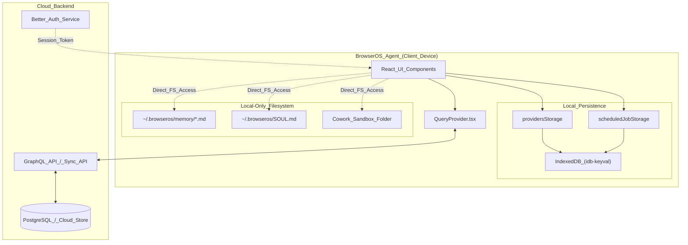
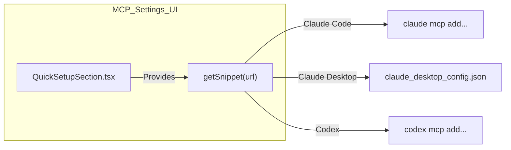

<!-- source: DeepWiki mcp.deepwiki.com · repo browseros-ai/BrowserOS · page 4.5 Sync to Cloud · fetched 2026-10-29 -->

# Sync to Cloud

<details>
<summary>Relevant source files</summary>

The following files were used as context for generating this wiki page:

- [docs/browserclaw/cockpit.mdx](docs/browserclaw/cockpit.mdx)
- [docs/browserclaw/tabs-and-isolation.mdx](docs/browserclaw/tabs-and-isolation.mdx)
- [docs/docs.json](docs/docs.json)
- [docs/features/bring-your-own-llm.mdx](docs/features/bring-your-own-llm.mdx)
- [docs/features/connect-mcps.mdx](docs/features/connect-mcps.mdx)
- [docs/features/cowork.mdx](docs/features/cowork.mdx)
- [docs/features/local-models.mdx](docs/features/local-models.mdx)
- [docs/features/scheduled-tasks.mdx](docs/features/scheduled-tasks.mdx)
- [docs/features/smart-nudges.mdx](docs/features/smart-nudges.mdx)
- [docs/features/use-with-claude-code.mdx](docs/features/use-with-claude-code.mdx)
- [packages/browseros-agent/.config/wt.toml](packages/browseros-agent/.config/wt.toml)
- [packages/browseros-agent/apps/app/screens/mcp-settings/QuickSetupSection.test.tsx](packages/browseros-agent/apps/app/screens/mcp-settings/QuickSetupSection.test.tsx)
- [packages/browseros-agent/apps/app/screens/mcp-settings/QuickSetupSection.tsx](packages/browseros-agent/apps/app/screens/mcp-settings/QuickSetupSection.tsx)
- [packages/browseros-agent/apps/app/screens/onboarding/features/Features.tsx](packages/browseros-agent/apps/app/screens/onboarding/features/Features.tsx)

</details>


This page documents the cloud sync system in BrowserOS, which enables users to sign in and synchronize their conversations, AI provider configurations, scheduled tasks, and profile data across multiple devices. The sync system uses a local-first architecture with background synchronization, ensuring privacy by keeping sensitive credentials and memory files strictly on the local machine.

---

## Authentication Architecture

The sync system requires user authentication to associate data with a cloud account. BrowserOS utilizes **Better Auth** [packages/browseros-agent/apps/agent/package.json:56]() for managing sessions and authentication flows.

**Authentication Methods:**
1.  **Magic link email authentication**: Users enter their email address and receive a one-time sign-in link.
2.  **Google OAuth**: Users sign in using their existing Google account.
3.  **LLM Provider OAuth**: While primarily for model access, signing in via ChatGPT Pro, GitHub Copilot, or Qwen Code also establishes identity within the agent environment [docs/features/bring-your-own-llm.mdx:16-32]().

**Key Implementation Details:**
*   **Session Management**: Handled via `auth-client.ts` [packages/browseros-agent/apps/agent/entrypoints/app/login/LogoutPage.tsx:14]().
*   **Sign-out Process**: The `LogoutPage` component orchestrates a complete local data wipe during sign-out, clearing `idb-keyval`, `queryClient` cache, and specific storage providers for LLMs and schedules [packages/browseros-agent/apps/agent/entrypoints/app/login/LogoutPage.tsx:24-33]().
*   **Identity Tracking**: Uses `resetIdentity()` to clear analytics identifiers upon logout [packages/browseros-agent/apps/agent/entrypoints/app/login/LogoutPage.tsx:30]().

Sources: [packages/browseros-agent/apps/agent/entrypoints/app/login/LogoutPage.tsx:14-51](), [packages/browseros-agent/apps/agent/package.json:56](), [docs/features/bring-your-own-llm.mdx:16-32]()

---

## Sync System Architecture

The following diagram bridges the "Natural Language Space" of user features to the "Code Entity Space" of the sync implementation, highlighting the separation between synced cloud data and local-only files.

**Sync Engine Data Flow**



**Local-First Design Principles**
The system prioritizes local availability. For instance, scheduled tasks are stored in `scheduledJobStorage` [packages/browseros-agent/apps/agent/entrypoints/app/login/LogoutPage.tsx:16]() which persists to IndexedDB via `idb-keyval`, ensuring tasks can trigger even if the cloud is temporarily unreachable [docs/features/scheduled-tasks.mdx:112-114]().

Sources: [packages/browseros-agent/apps/agent/entrypoints/app/login/LogoutPage.tsx:1-33](), [docs/features/scheduled-tasks.mdx:112-114]()

---

## Synced Data Categories

### Conversations and Chat History
BrowserOS synchronizes conversation metadata and messages to ensure continuity across devices.
*   **Implementation**: Uses GraphQL documents for fetching and updating history [packages/browseros-agent/apps/agent/entrypoints/sidepanel/history/graphql/chatHistoryDocument.ts:1-10]().
*   **UI Components**: `ConversationList` and `ChatHistory` handle the display of synced threads in the sidepanel [packages/browseros-agent/apps/agent/entrypoints/sidepanel/history/ChatHistory.tsx:1-20]().

### AI Model Provider Configurations
LLM provider settings sync to maintain a consistent "Bring Your Own LLM" experience [docs/features/bring-your-own-llm.mdx:6-14]().
*   **What syncs**: Provider type (e.g., Anthropic, OpenAI, Kimi), model IDs, and custom endpoints [docs/features/bring-your-own-llm.mdx:88-93]().
*   **What does NOT sync**: API keys. These are stored in `providersStorage` [packages/browseros-agent/apps/agent/entrypoints/app/login/LogoutPage.tsx:15]() but are excluded from cloud payloads for security.

### Scheduled Tasks
Task configurations are synchronized bidirectionally [docs/features/scheduled-tasks.mdx:130-136]().
*   **Storage**: Managed by `scheduledJobStorage` [packages/browseros-agent/apps/agent/entrypoints/app/login/LogoutPage.tsx:16]() which stores task details like `name`, `prompt`, `scheduleType`, and `timing` [docs/features/scheduled-tasks.mdx:130-136]().
*   **Execution History**: Unlike the configuration (name, prompt, schedule), task run results (logs and outputs) stay on the specific device where the task executed [docs/features/scheduled-tasks.mdx:134-135]().

Sources: [packages/browseros-agent/apps/agent/entrypoints/app/login/LogoutPage.tsx:15-16](), [docs/features/scheduled-tasks.mdx:130-136](), [docs/features/bring-your-own-llm.mdx:88-93]()

---

## Local-Only Data (Privacy & Security)

To ensure privacy and security, specific data categories never leave the user's machine.

| Data Category | Code Entity / Path | Reason for Local-Only |
| :--- | :--- | :--- |
| **API Keys** | `providersStorage` (Filtered) | Security: Raw keys are never transmitted to the cloud. |
| **Memory (CORE.md)** | `~/.browseros/memory/` | Privacy: Contains sensitive personal facts captured by the agent. |
| **Personality (SOUL.md)** | `~/.browseros/SOUL.md` | Privacy: User-defined assistant behavior rules. |
| **Cowork Files** | User-selected sandbox folder | Practicality: Filesystem access is device-specific [docs/features/cowork.mdx:61-63](). |
| **Task Run Results** | `scheduledJobStorage` (Results) | Execution logs are tied to the local environment [docs/features/scheduled-tasks.mdx:134-135](). |
| **MCP Server URL** | `serverUrl` [packages/browseros-agent/apps/app/screens/mcp-settings/QuickSetupSection.tsx:7]() | Local Networking: The MCP server listens on `127.0.0.1` and is specific to the local machine [docs/features/use-with-claude-code.mdx:133-134](). |

Sources: [docs/features/cowork.mdx:61-63](), [docs/features/scheduled-tasks.mdx:134-135](), [packages/browseros-agent/apps/agent/entrypoints/app/login/LogoutPage.tsx:25-28](), [packages/browseros-agent/apps/app/screens/mcp-settings/QuickSetupSection.tsx:7](), [docs/features/use-with-claude-code.mdx:133-134]()

---

## Implementation Details

### Data Persistence and Cleanup
The `performLogout` function in the Agent UI demonstrates how synced and local data are handled during a session termination:

```typescript
const performLogout = async () => {
  await providersStorage.removeValue() // Clears local provider cache
  await scheduledJobStorage.removeValue() // Clears local schedule cache
  queryClient.clear() // Wipes React Query cache (synced data)
  await clear() // Wipes all IndexedDB data (idb-keyval)
  resetIdentity() // Clears analytics
  await signOut() // Terminates remote session
  navigate('/home', { replace: true })
}
```
[packages/browseros-agent/apps/agent/entrypoints/app/login/LogoutPage.tsx:24-33]()

### Sync Triggers and Conflicts
*   **GraphQL Integration**: `QueryProvider` manages the lifecycle of remote data fetching and caching via React Query [packages/browseros-agent/apps/agent/lib/graphql/QueryProvider.tsx:1-15]().
*   **Conflict Resolution**: Uses timestamp-based resolution. For scheduled tasks, if a task is edited on two devices, the configuration with the latest `last_modified` timestamp wins [docs/features/scheduled-tasks.mdx:132-133]().
*   **Trigger Mechanism**: BrowserOS uses the browser's built-in alarm system to trigger tasks. If a device was offline, tasks trigger as soon as BrowserOS is opened and the sync identifies a missed run [docs/features/scheduled-tasks.mdx:112-114]().

### MCP Configuration Sync
While the **MCP Server URL** is local, the instructions for connecting various clients are generated dynamically in the `QuickSetupSection` [packages/browseros-agent/apps/app/screens/mcp-settings/QuickSetupSection.tsx:123-184](). This ensures that even if a user syncs their settings, the MCP setup remains specific to the `serverUrl` of the current machine.



Sources: [packages/browseros-agent/apps/agent/entrypoints/app/login/LogoutPage.tsx:24-33](), [docs/features/scheduled-tasks.mdx:112-136](), [packages/browseros-agent/apps/agent/lib/graphql/QueryProvider.tsx:1-15](), [packages/browseros-agent/apps/app/screens/mcp-settings/QuickSetupSection.tsx:153-180]()

---

