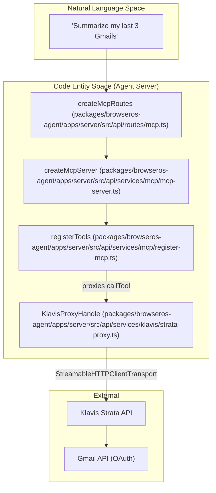
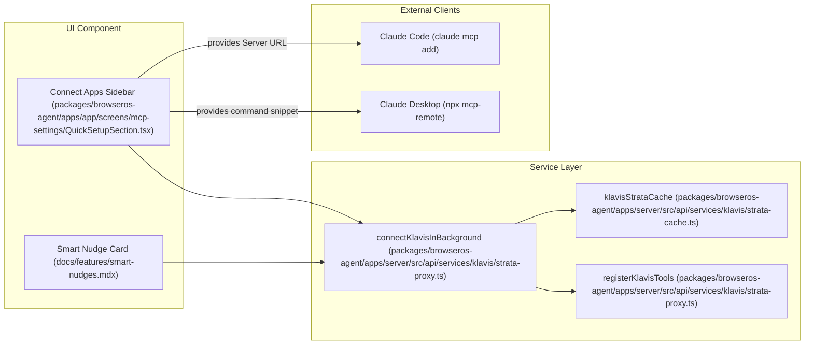

<!-- source: DeepWiki mcp.deepwiki.com · repo browseros-ai/BrowserOS · page 4.8 Connect Apps · fetched 2026-10-29 -->

# Connect Apps

Relevant source files

The following files were used as context for generating this wiki page:

- [docs/browserclaw/cockpit.mdx](docs/browserclaw/cockpit.mdx)
- [docs/browserclaw/tabs-and-isolation.mdx](docs/browserclaw/tabs-and-isolation.mdx)
- [docs/docs.json](docs/docs.json)
- [docs/features/bring-your-own-llm.mdx](docs/features/bring-your-own-llm.mdx)
- [docs/features/connect-mcps.mdx](docs/features/connect-mcps.mdx)
- [docs/features/cowork.mdx](docs/features/cowork.mdx)
- [docs/features/local-models.mdx](docs/features/local-models.mdx)
- [docs/features/scheduled-tasks.mdx](docs/features/scheduled-tasks.mdx)
- [docs/features/smart-nudges.mdx](docs/features/smart-nudges.mdx)
- [docs/features/use-with-claude-code.mdx](docs/features/use-with-claude-code.mdx)
- [packages/browseros-agent/.config/wt.toml](packages/browseros-agent/.config/wt.toml)
- [packages/browseros-agent/apps/app/screens/mcp-settings/QuickSetupSection.test.tsx](packages/browseros-agent/apps/app/screens/mcp-settings/QuickSetupSection.test.tsx)
- [packages/browseros-agent/apps/app/screens/mcp-settings/QuickSetupSection.tsx](packages/browseros-agent/apps/app/screens/mcp-settings/QuickSetupSection.tsx)
- [packages/browseros-agent/apps/app/screens/onboarding/features/Features.tsx](packages/browseros-agent/apps/app/screens/onboarding/features/Features.tsx)

The **Connect Apps** feature enables BrowserOS to integrate with over 40 external services (e.g., Gmail, Slack, GitHub, Notion) using the **Model Context Protocol (MCP)**. This integration allows the AI agent to perform cross-app actions like reading emails, scheduling calendar events, and updating project management tickets directly within a conversation [docs/features/connect-mcps.mdx:1-12]().

## Architecture and Data Flow

BrowserOS integrates external apps by acting as an MCP host that proxies requests to a specialized service called **Klavis**. The `createMcpServer` function initializes the server, and if a `KlavisProxyRef` is provided, it registers external tools via `registerKlavisTools` [packages/browseros-agent/apps/server/src/api/services/mcp/mcp-server.ts:28-55]().

### Integration Components
- **MCP Server**: A Hono-based implementation that uses `StreamableHTTPTransport` to handle JSON-RPC requests [packages/browseros-agent/apps/server/src/api/routes/mcp.ts:35-79]().
- **Klavis Proxy**: A background handle (`KlavisProxyHandle`) that connects the local agent to the remote Klavis strata server using `StreamableHTTPClientTransport` [packages/browseros-agent/apps/server/src/api/services/klavis/strata-proxy.ts:36-79]().
- **Tool Registry**: The `registerTools` function combines browser-native tools (like navigation and DOM snapshots) with app-specific tools discovered via the Klavis proxy [packages/browseros-agent/apps/server/src/api/services/mcp/register-mcp.ts:17-32]().

### Data Flow Diagram
The following diagram illustrates how a natural language request for an external app flows through the system entities.

**App Integration Data Flow**

Sources: [packages/browseros-agent/apps/server/src/api/routes/mcp.ts:63-79](), [packages/browseros-agent/apps/server/src/api/services/mcp/mcp-server.ts:50-53](), [packages/browseros-agent/apps/server/src/api/services/klavis/strata-proxy.ts:61-103]()

## Connection Flows

### 1. Smart Nudges (In-Conversation)
When a user makes a request requiring an unconnected app, the agent triggers a **Smart Nudge**. This is an interactive UI card that offers two paths [docs/features/connect-mcps.mdx:19-33]():
- **Connect**: Initiates the OAuth flow to grant the agent full integration access. Credentials are managed securely and never stored in BrowserOS [docs/features/use-with-claude-code.mdx:30-32]().
- **Do it manually**: The assistant skips the integration and navigates to the app's website directly using browser automation to perform the task visually [docs/features/connect-mcps.mdx:32-33]().

### 2. Manual Connection (Sidebar)
Users can pre-authenticate apps via the **Connect Apps** sidebar (`chrome://browseros/mcp`). The system uses `connectKlavisInBackground` to maintain the connection handle, attempting retries if the initial connection fails [packages/browseros-agent/apps/server/src/api/services/klavis/strata-proxy.ts:155-216]().

### 3. External MCP Client Integration
BrowserOS also allows external AI clients (like Claude Code or Gemini CLI) to connect to its built-in MCP server. The `QuickSetupSection` component provides snippets for these integrations [packages/browseros-agent/apps/app/screens/mcp-settings/QuickSetupSection.tsx:19-91]().

**External Connection Logic**

Sources: [packages/browseros-agent/apps/server/src/api/services/klavis/strata-proxy.ts:155-216](), [docs/features/connect-mcps.mdx:47-59](), [packages/browseros-agent/apps/app/screens/mcp-settings/QuickSetupSection.tsx:49-83]()

## Supported App Categories

BrowserOS connects to over 40 apps across every category, providing specialized MCP tools for each [docs/features/connect-mcps.mdx:65-177]().

| Category | Key Apps | Example Capabilities |
| :--- | :--- | :--- |
| **Email** | Gmail, Outlook, Resend | Send, read, search, and manage emails, drafts, and labels [docs/features/connect-mcps.mdx:70-76]() |
| **Calendar** | Google Calendar, Outlook Calendar, Cal.com | Create events, find free time, manage calendars and meetings [docs/features/connect-mcps.mdx:78-84]() |
| **Messaging** | Slack, Discord, WhatsApp, Microsoft Teams | Post messages, manage channels, send messages, chat, meet, and collaborate [docs/features/connect-mcps.mdx:86-93]() |
| **Development** | GitHub, GitLab, Vercel, Postman, Cloudflare, Supabase | Manage repos, issues, pull requests, deployments, APIs, domains, DNS, security, databases, and backend services [docs/features/connect-mcps.mdx:95-104]() |
| **Project Management** | Linear, Jira, Asana, Monday, ClickUp | Create issues, manage cycles, projects, sprints, tasks, and workflows [docs/features/connect-mcps.mdx:106-114]() |
| **Documents and Productivity** | Notion, Google Docs, Google Sheets, Google Drive, Google Forms, Confluence, Airtable | Create pages, manage databases, create and edit documents/spreadsheets, upload/download/manage files, create/manage forms/surveys, create/manage documentation, manage bases/tables/records [docs/features/connect-mcps.mdx:116-126]() |
| **File Storage** | Dropbox, OneDrive, Box | Store, share, and sync files [docs/features/connect-mcps.mdx:128-134]() |
| **Design** | Figma, Canva | Access and manage design files [docs/features/connect-mcps.mdx:136-141]() |
| **CRM and Marketing** | Salesforce, HubSpot | Manage leads, contacts, opportunities, deals, and marketing [docs/features/connect-mcps.mdx:143-148]() |
| **E-commerce and Payments** | Shopify, Stripe | Manage products, orders, store, payments, and subscriptions [docs/features/connect-mcps.mdx:150-155]() |
| **Analytics** | PostHog, Mixpanel | Query analytics, manage feature flags, analyze user behavior and metrics [docs/features/connect-mcps.mdx:157-162]() |
| **Support** | Zendesk, Intercom | Manage support tickets, customers, and customer messaging [docs/features/connect-mcps.mdx:164-169]() |
| **Search and AI** | Brave Search, Exa, Mem0 | Search the web privately, AI-powered semantic web search, store and retrieve AI memory [docs/features/connect-mcps.mdx:171-177]() |

## Technical Implementation Details

### Klavis Proxy Handling
The `connectKlavisProxy` function is responsible for initializing the bridge to external services. It performs the following steps:
1. **URL Resolution**: Fetches the strata server URL via `klavisStrataCache` [packages/browseros-agent/apps/server/src/api/services/klavis/strata-proxy.ts:66-70]().
2. **Transport Setup**: Creates a `StreamableHTTPClientTransport` to the resolved URL [packages/browseros-agent/apps/server/src/api/services/klavis/strata-proxy.ts:76-78]().
3. **Tool Discovery**: Calls `client.listTools()` to populate the local tool registry with external capabilities [packages/browseros-agent/apps/server/src/api/services/klavis/strata-proxy.ts:81-90]().

### MCP Request Scoping
The MCP route handler (`createMcpRoutes`) supports request pinning. It uses headers like `X-BrowserOS-Default-Window-Id` to ensure that tool calls (like opening a new page) occur within a specific browser context, preventing race conditions between concurrent agents [packages/browseros-agent/apps/server/src/api/routes/mcp.ts:49-60]().

### Manual Setup and Client Snippets
The `QuickSetupSection` component generates configuration snippets for various MCP clients:
- **Claude Code**: Generates a command using `claude mcp add --transport http` [packages/browseros-agent/apps/app/screens/mcp-settings/QuickSetupSection.tsx:54-55]().
- **Claude Desktop**: Generates a JSON block using `npx mcp-remote` as a command wrapper [packages/browseros-agent/apps/app/screens/mcp-settings/QuickSetupSection.tsx:70-82]().
- **Codex**: Generates a command for the OpenAI Codex CLI [packages/browseros-agent/apps/app/screens/mcp-settings/QuickSetupSection.tsx:89-89]().

Sources: [packages/browseros-agent/apps/server/src/api/routes/mcp.ts:35-71](), [packages/browseros-agent/apps/server/src/api/services/klavis/strata-proxy.ts:61-103](), [packages/browseros-agent/apps/app/screens/mcp-settings/QuickSetupSection.tsx:19-91]()

---

