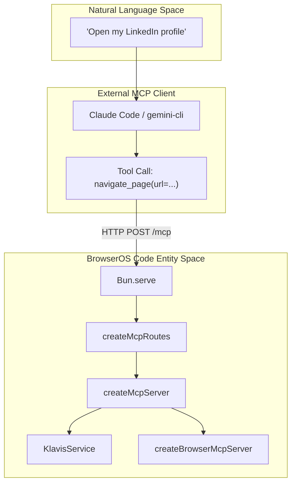
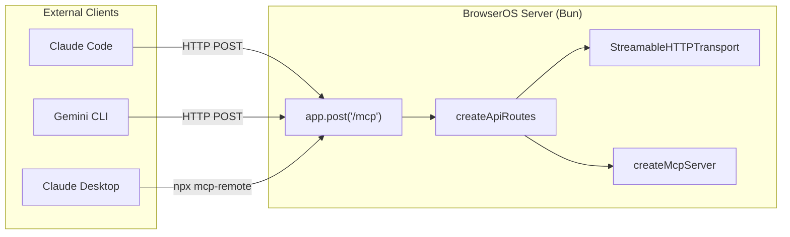

<!-- source: DeepWiki mcp.deepwiki.com · repo browseros-ai/BrowserOS · page 5 MCP Server · fetched 2026-10-29 -->

# MCP Server

Relevant source files

The following files were used as context for generating this wiki page:

- [docs/browserclaw/cockpit.mdx](docs/browserclaw/cockpit.mdx)
- [docs/browserclaw/tabs-and-isolation.mdx](docs/browserclaw/tabs-and-isolation.mdx)
- [docs/docs.json](docs/docs.json)
- [docs/features/bring-your-own-llm.mdx](docs/features/bring-your-own-llm.mdx)
- [docs/features/connect-mcps.mdx](docs/features/connect-mcps.mdx)
- [docs/features/cowork.mdx](docs/features/cowork.mdx)
- [docs/features/local-models.mdx](docs/features/local-models.mdx)
- [docs/features/scheduled-tasks.mdx](docs/features/scheduled-tasks.mdx)
- [docs/features/smart-nudges.mdx](docs/features/smart-nudges.mdx)
- [docs/features/use-with-claude-code.mdx](docs/features/use-with-claude-code.mdx)
- [packages/browseros-agent/.config/wt.toml](packages/browseros-agent/.config/wt.toml)
- [packages/browseros-agent/apps/app/screens/mcp-settings/QuickSetupSection.test.tsx](packages/browseros-agent/apps/app/screens/mcp-settings/QuickSetupSection.test.tsx)
- [packages/browseros-agent/apps/app/screens/mcp-settings/QuickSetupSection.tsx](packages/browseros-agent/apps/app/screens/mcp-settings/QuickSetupSection.tsx)
- [packages/browseros-agent/apps/app/screens/onboarding/features/Features.tsx](packages/browseros-agent/apps/app/screens/onboarding/features/Features.tsx)
- [packages/browseros-agent/apps/server/src/agent/mcp-builder.ts](packages/browseros-agent/apps/server/src/agent/mcp-builder.ts)
- [packages/browseros-agent/apps/server/src/api/routes/agents.ts](packages/browseros-agent/apps/server/src/api/routes/agents.ts)
- [packages/browseros-agent/apps/server/src/api/routes/chat.ts](packages/browseros-agent/apps/server/src/api/routes/chat.ts)
- [packages/browseros-agent/apps/server/src/api/routes/mcp.ts](packages/browseros-agent/apps/server/src/api/routes/mcp.ts)
- [packages/browseros-agent/apps/server/src/api/server.ts](packages/browseros-agent/apps/server/src/api/server.ts)
- [packages/browseros-agent/apps/server/src/api/services/agents/agent-harness-service.ts](packages/browseros-agent/apps/server/src/api/services/agents/agent-harness-service.ts)
- [packages/browseros-agent/apps/server/src/api/services/klavis/service.ts](packages/browseros-agent/apps/server/src/api/services/klavis/service.ts)
- [packages/browseros-agent/apps/server/src/api/services/klavis/tool-adapters.ts](packages/browseros-agent/apps/server/src/api/services/klavis/tool-adapters.ts)
- [packages/browseros-agent/apps/server/src/api/services/mcp/mcp-server.ts](packages/browseros-agent/apps/server/src/api/services/mcp/mcp-server.ts)
- [packages/browseros-agent/apps/server/src/lib/metrics.ts](packages/browseros-agent/apps/server/src/lib/metrics.ts)
- [packages/browseros-agent/apps/server/src/tools/filesystem/register-mcp.ts](packages/browseros-agent/apps/server/src/tools/filesystem/register-mcp.ts)
- [packages/browseros-agent/apps/server/tests/api/routes/agents.test.ts](packages/browseros-agent/apps/server/tests/api/routes/agents.test.ts)
- [packages/browseros-agent/apps/server/tests/api/routes/mcp.test.ts](packages/browseros-agent/apps/server/tests/api/routes/mcp.test.ts)
- [packages/browseros-agent/apps/server/tests/api/services/agents/agent-harness-service.test.ts](packages/browseros-agent/apps/server/tests/api/services/agents/agent-harness-service.test.ts)
- [packages/browseros-agent/apps/server/tests/api/services/mcp/mcp-server.test.ts](packages/browseros-agent/apps/server/tests/api/services/mcp/mcp-server.test.ts)
- [packages/browseros-agent/apps/server/tests/lib/agents/acpx-runtime.test.ts](packages/browseros-agent/apps/server/tests/lib/agents/acpx-runtime.test.ts)
- [packages/browseros-agent/apps/server/tests/lib/metrics.test.ts](packages/browseros-agent/apps/server/tests/lib/metrics.test.ts)

## Purpose and Scope

This page provides a high-level overview of the built-in **Model Context Protocol (MCP) Server** in BrowserOS. This server acts as a bridge, allowing external AI clients (like Claude Code, Gemini CLI, or IDEs) to programmatically control BrowserOS and access its extensive library of tools.

For deep technical details on the HTTP implementation, see [MCP Server Architecture](#5.1). To begin using the server with external agents, refer to [Connecting MCP Clients](#5.2).

---

## Overview

BrowserOS includes a native MCP server that exposes browser automation and app integration capabilities to external AI agents. Unlike standard Chrome which requires complex debug profiles and separate proxy servers, BrowserOS runs this server out-of-the-box as part of its consolidated sidecar API. [packages/browseros-agent/apps/server/src/api/server.ts:46-78]()

### Key Capabilities
*   **Full Browser Control**: Tools for managing tabs, navigation, clicks, typing, and screenshots via custom CDP domains integrated into the MCP server. [packages/browseros-agent/apps/server/src/api/services/mcp/mcp-server.ts:38-55]()
*   **40+ App Integrations**: Direct access to Gmail, Slack, GitHub, Notion, Jira, and more via the `KlavisService`. [packages/browseros-agent/apps/server/src/api/services/mcp/mcp-server.ts:57-57]()
*   **Zero-Config Auth**: Credentials for external services are managed securely by BrowserOS via OAuth; the MCP client simply calls the tools. [packages/browseros-agent/apps/server/src/api/server.ts:50-53]()
*   **Standardized Protocol**: Uses the Model Context Protocol (MCP) over HTTP via `@hono/mcp`, compatible with any modern AI orchestration layer. [packages/browseros-agent/apps/server/src/api/routes/mcp.ts:73-80]()

---

## Architecture

The MCP Server is part of the consolidated HTTP server running on a stable port (defaulting to `9239`). [packages/browseros-agent/apps/server/src/api/server.ts:117-127](). The server handles requests statelessly by creating a new `mcpServer` and `transport` instance per request to ensure security and prevent ID collisions. [packages/browseros-agent/apps/server/src/api/routes/mcp.ts:112-127]()

### System Mapping: NL Space to Code Entities

The following diagram shows how a Natural Language request from an external client flows through the BrowserOS architecture to trigger specific code entities.

**Diagram: MCP Request Flow**

**Sources:** [packages/browseros-agent/apps/server/src/api/routes/mcp.ts:88-137](), [packages/browseros-agent/apps/server/src/api/services/mcp/mcp-server.ts:28-64]()

---

## Tool Categories

The MCP server combines local browser capabilities with remote app integrations. [packages/browseros-agent/apps/server/src/api/services/mcp/mcp-server.ts:38-57]()

| Category | Source | Description | Reference |
| :--- | :--- | :--- | :--- |
| **Browser Automation** | `createBrowserMcpServer` | Tabs, navigation, clicks, typing, screenshots, and window management. | [Comparisons](#5.5) |
| **App Integrations** | `KlavisService` | 40+ integrations like Gmail, Slack, and GitHub via OAuth. | [Comparisons](#5.5) |

For details on how app tools are fetched and managed, see [MCP Server Architecture](#5.1).

---

## Integration Guides

BrowserOS is designed to work seamlessly with popular AI developer tools by exposing a standard HTTP endpoint. [docs/features/use-with-claude-code.mdx:42-53]()

*   **Claude Code**: Add BrowserOS as an MCP server using the proxy port. [Claude Code Integration](#5.3).
*   **Gemini CLI**: Connect via local-server configuration pointing to the `/mcp` route. [Other MCP Clients](#5.4).
*   **Claude Desktop**: Use `mcp-remote` to bridge the HTTP connection to the local server. [Other MCP Clients](#5.4).

### Connection Summary

**Diagram: MCP Client Connectivity**

**Sources:** [packages/browseros-agent/apps/server/src/api/routes/mcp.ts:74-80](), [docs/features/use-with-claude-code.mdx:55-130]()

---

## Comparison to Alternatives

BrowserOS provides a significant advantage over using the standard **Chrome DevTools MCP** or standalone automation scripts.

*   **Ease of Use**: No need to manually launch Chrome with remote debugging ports; BrowserOS runs the MCP server natively. [docs/features/use-with-claude-code.mdx:8-10]()
*   **Rich Toolset**: Standard DevTools MCP is limited; BrowserOS includes 53+ browser tools and 40+ third-party app integrations. [docs/features/use-with-claude-code.mdx:12-33]()
*   **Integrated Auth**: BrowserOS handles the OAuth flow for services like Gmail and Slack, so the external AI agent never sees your credentials. [docs/features/use-with-claude-code.mdx:30-32]()

For a head-to-head breakdown, see [Comparison to Chrome DevTools MCP](#5.6).

---

## Child Pages

*   [MCP Server Architecture](#5.1) — Detailed look at the HTTP implementation, `StreamableHTTPTransport`, and tool categories.
*   [Connecting MCP Clients](#5.2) — Step-by-step setup for various external AI tools.
*   [Claude Code Integration](#5.3) — Deep dive into using BrowserOS with Anthropic's Claude Code.
*   [Other MCP Clients](#5.4) — Configuration guides for Gemini CLI, Codex, and Claude Desktop.
*   [Comparisons](#5.5) — Head-to-head comparison with Chrome DevTools MCP, Claude Cowork, and OpenClaw.
*   [Comparison to Chrome DevTools MCP](#5.6) — Why BrowserOS's built-in server is the superior choice for AI agents.

---

