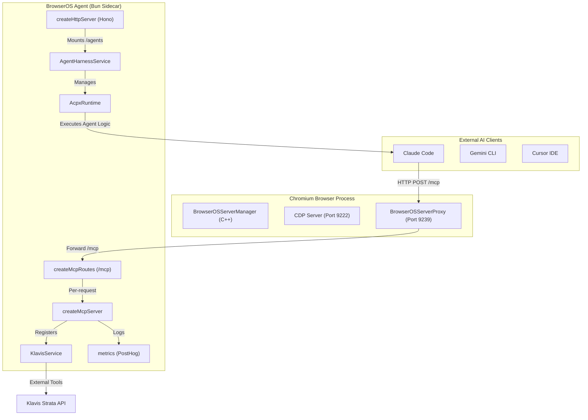
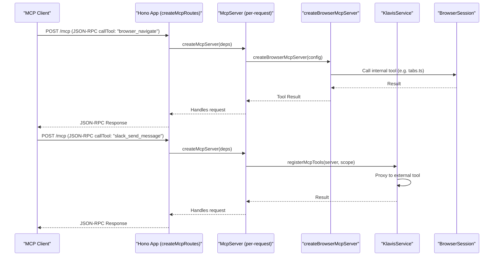

<!-- source: DeepWiki mcp.deepwiki.com · repo browseros-ai/BrowserOS · page 5.1 MCP Server Architecture · fetched 2026-10-29 -->

# MCP Server Architecture

Relevant source files

The following files were used as context for generating this wiki page:

- [packages/browseros-agent/apps/server/src/agent/mcp-builder.ts](packages/browseros-agent/apps/server/src/agent/mcp-builder.ts)
- [packages/browseros-agent/apps/server/src/api/routes/agents.ts](packages/browseros-agent/apps/server/src/api/routes/agents.ts)
- [packages/browseros-agent/apps/server/src/api/routes/chat.ts](packages/browseros-agent/apps/server/src/api/routes/chat.ts)
- [packages/browseros-agent/apps/server/src/api/routes/mcp.ts](packages/browseros-agent/apps/server/src/api/routes/mcp.ts)
- [packages/browseros-agent/apps/server/src/api/server.ts](packages/browseros-agent/apps/server/src/api/server.ts)
- [packages/browseros-agent/apps/server/src/api/services/agents/agent-harness-service.ts](packages/browseros-agent/apps/server/src/api/services/agents/agent-harness-service.ts)
- [packages/browseros-agent/apps/server/src/api/services/klavis/service.ts](packages/browseros-agent/apps/server/src/api/services/klavis/service.ts)
- [packages/browseros-agent/apps/server/src/api/services/klavis/tool-adapters.ts](packages/browseros-agent/apps/server/src/api/services/klavis/tool-adapters.ts)
- [packages/browseros-agent/apps/server/src/api/services/mcp/mcp-server.ts](packages/browseros-agent/apps/server/src/api/services/mcp/mcp-server.ts)
- [packages/browseros-agent/apps/server/src/lib/metrics.ts](packages/browseros-agent/apps/server/src/lib/metrics.ts)
- [packages/browseros-agent/apps/server/src/tools/filesystem/register-mcp.ts](packages/browseros-agent/apps/server/src/tools/filesystem/register-mcp.ts)
- [packages/browseros-agent/apps/server/tests/api/routes/agents.test.ts](packages/browseros-agent/apps/server/tests/api/routes/agents.test.ts)
- [packages/browseros-agent/apps/server/tests/api/routes/mcp.test.ts](packages/browseros-agent/apps/server/tests/api/routes/mcp.test.ts)
- [packages/browseros-agent/apps/server/tests/api/services/agents/agent-harness-service.test.ts](packages/browseros-agent/apps/server/tests/api/services/agents/agent-harness-service.test.ts)
- [packages/browseros-agent/apps/server/tests/api/services/mcp/mcp-server.test.ts](packages/browseros-agent/apps/server/tests/api/services/mcp/mcp-server.test.ts)
- [packages/browseros-agent/apps/server/tests/cli/browseros-cli.test.ts](packages/browseros-agent/apps/server/tests/cli/browseros-cli.test.ts)
- [packages/browseros-agent/apps/server/tests/lib/agents/acpx-runtime.test.ts](packages/browseros-agent/apps/server/tests/lib/agents/acpx-runtime.test.ts)
- [packages/browseros-agent/apps/server/tests/lib/metrics.test.ts](packages/browseros-agent/apps/server/tests/lib/metrics.test.ts)
- [packages/browseros-agent/apps/server/tests/tools/browser/grep.test.ts](packages/browseros-agent/apps/server/tests/tools/browser/grep.test.ts)
- [packages/browseros-agent/apps/server/tests/tools/browser/screenshot-tool.test.ts](packages/browseros-agent/apps/server/tests/tools/browser/screenshot-tool.test.ts)
- [packages/browseros-agent/apps/server/tests/tools/browser/screenshot.test.ts](packages/browseros-agent/apps/server/tests/tools/browser/screenshot.test.ts)
- [packages/browseros-agent/packages/browser-core/src/core/screenshot.ts](packages/browseros-agent/packages/browser-core/src/core/screenshot.ts)
- [packages/browseros-agent/packages/browser-mcp/src/mcp-server.test.ts](packages/browseros-agent/packages/browser-mcp/src/mcp-server.test.ts)
- [packages/browseros-agent/packages/browser-mcp/src/tools/grep.test.ts](packages/browseros-agent/packages/browser-mcp/src/tools/grep.test.ts)
- [packages/browseros-agent/packages/browser-mcp/src/tools/grep.ts](packages/browseros-agent/packages/browser-mcp/src/tools/grep.ts)
- [packages/browseros-agent/packages/browser-mcp/src/tools/register.test.ts](packages/browseros-agent/packages/browser-mcp/src/tools/register.test.ts)
- [packages/browseros-agent/packages/browser-mcp/src/tools/register.ts](packages/browseros-agent/packages/browser-mcp/src/tools/register.ts)
- [packages/browseros-agent/packages/browser-mcp/src/tools/screenshot.ts](packages/browseros-agent/packages/browser-mcp/src/tools/screenshot.ts)
- [packages/browseros-agent/packages/browser-mcp/src/tools/tabs.ts](packages/browseros-agent/packages/browser-mcp/src/tools/tabs.ts)
- [packages/browseros-agent/packages/browser-mcp/src/tools/windows.ts](packages/browseros-agent/packages/browser-mcp/src/tools/windows.ts)

The BrowserOS MCP server is a high-performance, HTTP-based service that exposes browser automation capabilities and extensive app integrations to external AI clients via the Model Context Protocol (MCP). It runs on port **9239** by default and is implemented as a Bun-based sidecar process managed by the Chromium core.

## Overview

The MCP server acts as a bridge between the "Natural Language Space" of AI agents and the "Code Entity Space" of the browser's internal APIs. It allows tools like Claude Code, Gemini CLI, and Cursor to perform actions such as navigating pages, clicking elements, and interacting with 40+ external services (Gmail, Slack, GitHub, etc.) through a unified interface.

## System Architecture

The architecture consists of a Chromium browser process that orchestrates a TypeScript/Bun server sidecar. The server uses the `Hono` framework to provide a consolidated HTTP interface for both Agent routes and MCP transport.

### Component Interaction Diagram

**Sources:** [packages/browseros-agent/apps/server/src/api/server.ts:46-78](), [packages/browseros-agent/apps/server/src/api/routes/mcp.ts:74-161](), [packages/browseros-agent/apps/server/src/api/services/mcp/mcp-server.ts:28-64](), [packages/browseros-agent/apps/server/src/api/services/agents/agent-harness-service.ts:117-166](), [packages/browseros-agent/apps/server/tests/lib/agents/acpx-runtime.test.ts:20-27]()

### Implementation Details

The server is initialized via `createHttpServer` [packages/browseros-agent/apps/server/src/api/server.ts:46]() in `packages/browseros-agent/apps/server/src/api/server.ts`. It mounts the MCP functionality under the `/mcp` route using `createMcpRoutes` [packages/browseros-agent/apps/server/src/api/routes/mcp.ts:74]().

- **Per-Request Isolation:** To comply with MCP security standards (specifically addressing ID collisions and race conditions), a new `McpServer` instance and `StreamableHTTPTransport` are created for every incoming POST request. [packages/browseros-agent/apps/server/src/api/routes/mcp.ts:114-127]()
- **Transport:** It uses `@hono/mcp` for the server-side transport and `StreamableHTTPTransport` to handle the request lifecycle. [packages/browseros-agent/apps/server/src/api/routes/mcp.ts:8-79]()
- **Context Pinning:** The server supports headers like `X-BrowserOS-Default-Window-Id` and `X-BrowserOS-Default-Tab-Group-Id` to pin browser tool calls to specific UI contexts. [packages/browseros-agent/apps/server/src/api/routes/mcp.ts:93-97]()
- **Managed Connectors:** The `X-BrowserOS-Managed-Mcp-Servers` header allows clients to request specific external tool scopes, which are parsed by `parseManagedMcpServersHeader`. [packages/browseros-agent/apps/server/src/api/routes/mcp.ts:52-71]()

## Tool Categories and Data Flow

BrowserOS categorizes tools into two primary domains: internal browser automation and external app integrations (via Klavis).

### Data Flow: Tool Execution

**Sources:** [packages/browseros-agent/apps/server/src/api/routes/mcp.ts:88-137](), [packages/browseros-agent/apps/server/src/api/services/mcp/mcp-server.ts:28-64](), [packages/browseros-agent/apps/server/src/api/services/klavis/service.ts:12-13]()

### 1. Browser Automation Tools
Internal tools are provided by `@browseros/browser-mcp`. These interact directly with the browser session to perform actions like tab management, screenshots, and page navigation.
- **Functions:** Window management [packages/browseros-agent/packages/browser-mcp/src/tools/windows.ts](), Tab management [packages/browseros-agent/packages/browser-mcp/src/tools/tabs.ts](), and Screenshots [packages/browseros-agent/packages/browser-mcp/src/tools/screenshot.ts]().
- **Registration:** Handled within `createMcpServer` which invokes `createBrowserMcpServer`. [packages/browseros-agent/apps/server/src/api/services/mcp/mcp-server.ts:38-55]()

### 2. Klavis App Integrations
External tools are provided via the `KlavisService`. This component manages the discovery and execution of tools for third-party applications.
- **Registration:** Tools are registered on the per-request server instance using `deps.klavis?.registerMcpTools(server, deps.connectorScope)`. [packages/browseros-agent/apps/server/src/api/services/mcp/mcp-server.ts:57]()
- **Lifecycle:** The `KlavisService` is started during HTTP server creation. [packages/browseros-agent/apps/server/src/api/server.ts:55-56]()

## Telemetry and Metrics

The MCP server includes a robust metrics system powered by PostHog to track usage and performance while maintaining privacy.

- **Aggregation:** High-volume events like `mcp.request` and `tool_executed` are aggregated into periodic rollups to reduce noise and network overhead. [packages/browseros-agent/apps/server/src/lib/metrics.ts:20-21]()
- **Rollup Buffer:** The `RollupBuffer` class accumulates request counts and tool execution success/failure rates, flushing every 30 minutes. [packages/browseros-agent/apps/server/src/lib/metrics.ts:29-68]()
- **Sampling:** Non-aggregated events are subject to a default sampling rate (1/5) to ensure performance. [packages/browseros-agent/apps/server/src/lib/metrics.ts:12-178]()

**Sources:** [packages/browseros-agent/apps/server/src/lib/metrics.ts:148-207](), [packages/browseros-agent/apps/server/tests/lib/metrics.test.ts:73-110]()

## Lifecycle and Health

The server is designed for high availability and clean recovery.

- **Startup:** The `createHttpServer` function first verifies that the target port is available using `assertPortAvailable`. [packages/browseros-agent/apps/server/src/api/server.ts:22-43]()
- **Error Handling:** The server includes a global `app.onError` handler that captures unhandled exceptions in Sentry and returns standardized JSON error responses. [packages/browseros-agent/apps/server/src/api/server.ts:80-115]()
- **Shutdown:** Graceful shutdown is supported via an `onShutdown` callback, which terminates OAuth managers and Klavis services. [packages/browseros-agent/apps/server/src/api/server.ts:73-77]()

**Sources:** [packages/browseros-agent/apps/server/src/api/server.ts:119-125](), [packages/browseros-agent/apps/server/src/api/server.ts:50-56]()

---

