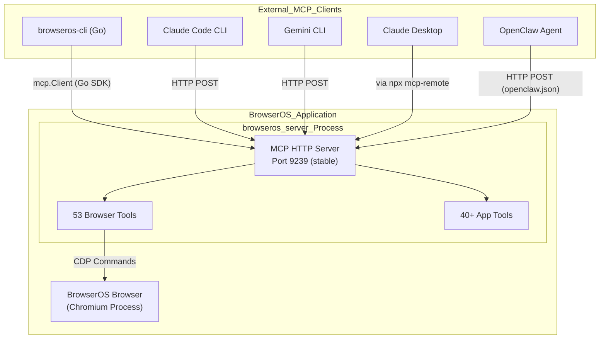
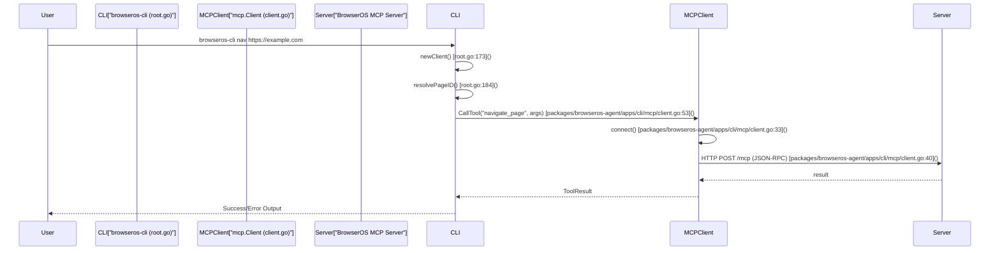

<!-- source: DeepWiki mcp.deepwiki.com · repo browseros-ai/BrowserOS · page 5.2 Connecting MCP Clients · fetched 2026-10-29 -->

# Connecting MCP Clients

<details>
<summary>Relevant source files</summary>

The following files were used as context for generating this wiki page:

- [docs/browserclaw/cockpit.mdx](docs/browserclaw/cockpit.mdx)
- [docs/browserclaw/how-it-works.mdx](docs/browserclaw/how-it-works.mdx)
- [docs/browserclaw/index.mdx](docs/browserclaw/index.mdx)
- [docs/browserclaw/install.mdx](docs/browserclaw/install.mdx)
- [docs/browserclaw/mcp/claude-desktop.mdx](docs/browserclaw/mcp/claude-desktop.mdx)
- [docs/browserclaw/mcp/index.mdx](docs/browserclaw/mcp/index.mdx)
- [docs/browserclaw/mcp/manual.mdx](docs/browserclaw/mcp/manual.mdx)
- [docs/browserclaw/privacy.mdx](docs/browserclaw/privacy.mdx)
- [docs/browserclaw/tabs-and-isolation.mdx](docs/browserclaw/tabs-and-isolation.mdx)
- [docs/docs.json](docs/docs.json)
- [docs/features/bring-your-own-llm.mdx](docs/features/bring-your-own-llm.mdx)
- [docs/features/connect-mcps.mdx](docs/features/connect-mcps.mdx)
- [docs/features/cowork.mdx](docs/features/cowork.mdx)
- [docs/features/local-models.mdx](docs/features/local-models.mdx)
- [docs/features/scheduled-tasks.mdx](docs/features/scheduled-tasks.mdx)
- [docs/features/smart-nudges.mdx](docs/features/smart-nudges.mdx)
- [docs/features/use-with-claude-code.mdx](docs/features/use-with-claude-code.mdx)
- [docs/images/browserclaw--dashboard-populated.png](docs/images/browserclaw--dashboard-populated.png)
- [docs/images/browserclaw--mcp-install-board.png](docs/images/browserclaw--mcp-install-board.png)
- [docs/images/browserclaw--replay-scrubber.png](docs/images/browserclaw--replay-scrubber.png)
- [packages/browseros-agent/.config/wt.toml](packages/browseros-agent/.config/wt.toml)
- [packages/browseros-agent/apps/app/screens/mcp-settings/QuickSetupSection.test.tsx](packages/browseros-agent/apps/app/screens/mcp-settings/QuickSetupSection.test.tsx)
- [packages/browseros-agent/apps/app/screens/mcp-settings/QuickSetupSection.tsx](packages/browseros-agent/apps/app/screens/mcp-settings/QuickSetupSection.tsx)
- [packages/browseros-agent/apps/app/screens/onboarding/features/Features.tsx](packages/browseros-agent/apps/app/screens/onboarding/features/Features.tsx)

</details>


This page provides technical instructions for connecting external MCP (Model Context Protocol) clients to BrowserOS's built-in MCP server. Supported clients include the BrowserOS CLI, Claude Code, Gemini CLI, Codex, OpenClaw, and Claude Desktop.

## Overview

BrowserOS includes an HTTP-based MCP server that exposes 53 browser automation tools and 40+ app integration tools to external AI clients [docs/features/use-with-claude-code.mdx:6-7](). The server runs as part of the BrowserOS application and listens on a stable port (default: `9239` or `9200` depending on the build configuration) [docs/features/use-with-claude-code.mdx:46-46](), [docs/browserclaw/mcp/index.mdx:14-15]().

External MCP clients connect to this server via HTTP transport to gain programmatic control over browser automation (tabs, navigation, DOM interaction, screenshots), bookmarks, and history [docs/features/use-with-claude-code.mdx:27-29]().

**MCP Client Architecture**


Sources: [packages/browseros-agent/apps/cli/cmd/root.go:113-119](), [docs/features/use-with-claude-code.mdx:113-122](), [docs/features/use-with-claude-code.mdx:92-102]()

## BrowserOS CLI (`browseros-cli`)

The `browseros-cli` is a dedicated Go-based client for interacting with the BrowserOS MCP server [packages/browseros-agent/apps/cli/README.md:1-8](). It allows users to launch the browser, verify health, and execute tools directly from the terminal [packages/browseros-agent/apps/cli/README.md:32-45]().

### Installation

The CLI can be installed via multiple methods depending on the platform:

| Platform | Command |
|----------|---------|
| **npm / npx** | `npm install -g browseros-cli` |
| **macOS / Linux** | `curl -fsSL https://cdn.browseros.com/cli/install.sh \| bash` |
| **Windows** | `irm https://cdn.browseros.com/cli/install.ps1 \| iex` |

Sources: [packages/browseros-agent/apps/cli/npm/README.md:13-17](), [packages/browseros-agent/apps/cli/README.md:9-21]()

### Configuration & Discovery

The CLI automatically attempts to discover the BrowserOS server URL. It can also be manually pointed to a server using the `--server` flag or `BROWSEROS_URL` environment variable [packages/browseros-agent/apps/cli/cmd/root.go:164-164]().

On startup, the BrowserOS application writes a discovery file to `~/.browseros/server.json` containing the active port and URL [packages/browseros-agent/apps/cli/cmd/launch.go:128-134](). The CLI `launch` command uses this to wait for the server to become ready [packages/browseros-agent/apps/cli/cmd/launch.go:57-64]().

**CLI Command Execution Flow**


Sources: [packages/browseros-agent/apps/cli/cmd/root.go:173-196](), [packages/browseros-agent/apps/cli/mcp/client.go:33-81]()

## Connecting AI Clients

BrowserOS provides a one-click setup board for common AI tools at `chrome://browseros/mcp` [docs/browserclaw/mcp/index.mdx:11-25]().

### Claude Code
Claude Code supports HTTP MCP transport natively [docs/features/use-with-claude-code.mdx:56-61]().
```bash
claude mcp add --transport http browseros <mcp_url> --scope user
# Example: claude mcp add --transport http browseros http://127.0.0.1:9239/mcp --scope user
```

### Claude Desktop
Claude Desktop requires `mcp-remote` as a bridge because it expects stdio-based commands in its configuration [docs/features/use-with-claude-code.mdx:106-125]().
**File**: `~/Library/Application Support/Claude/claude_desktop_config.json`
```json
{
  "mcpServers": {
    "browseros": {
      "command": "npx",
      "args": ["mcp-remote", "http://127.0.0.1:9239/mcp"]
    }
  }
}
```

### Gemini CLI and Codex
- **Gemini CLI**: `gemini mcp add local-server <mcp_url> --transport http --scope user` [docs/features/use-with-claude-code.mdx:79-83]()
- **Codex**: `codex mcp add browseros <mcp_url> --transport http` [docs/features/use-with-claude-code.mdx:86-90]()

### OpenClaw
OpenClaw connects via a JSON configuration entry [docs/features/use-with-claude-code.mdx:92-102]().
**File**: `openclaw.json`
```json
{
  "mcpServers": {
    "browseros": {
      "url": "http://127.0.0.1:9239/mcp"
    }
  }
}
```

## Remote Machine Connection

By default, the MCP server listens on `127.0.0.1` [docs/features/use-with-claude-code.mdx:134-134](). To connect from a VPS or remote agent, a tunnel is required.

| Method | Command | Security |
|--------|---------|----------|
| **Tailscale** | `tailscale serve --bg 9239` | **High** (Private Network) |
| **Cloudflare** | `cloudflared tunnel --url http://127.0.0.1:9239` | **Medium** (Public URL) |
| **ngrok** | `ngrok http 9239` | **Medium** (Public URL) |

Sources: [docs/features/use-with-claude-code.mdx:143-176]()

## Troubleshooting

1.  **Discovery**: Verify `~/.browseros/server.json` exists and contains the correct URL [packages/browseros-agent/apps/cli/cmd/launch.go:128-144]().
2.  **Health Check**: Run `browseros-cli health` to test the connection [packages/browseros-agent/apps/cli/README.md:44-44]().
3.  **Manual Init**: If the CLI cannot find the server, run `browseros-cli init <URL>` [packages/browseros-agent/apps/cli/README.md:54-54]().
4.  **Restart**: If the connection badge in `chrome://browseros/mcp` does not flip to **Connected**, restart the AI tool [docs/browserclaw/mcp/index.mdx:29-31]().

Sources: [packages/browseros-agent/apps/cli/README.md:44-54](), [docs/browserclaw/mcp/index.mdx:29-31]()

---

