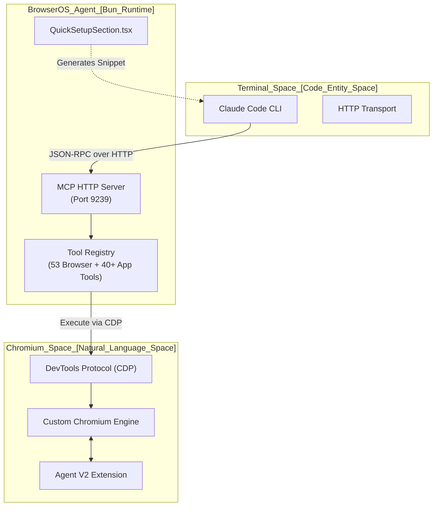
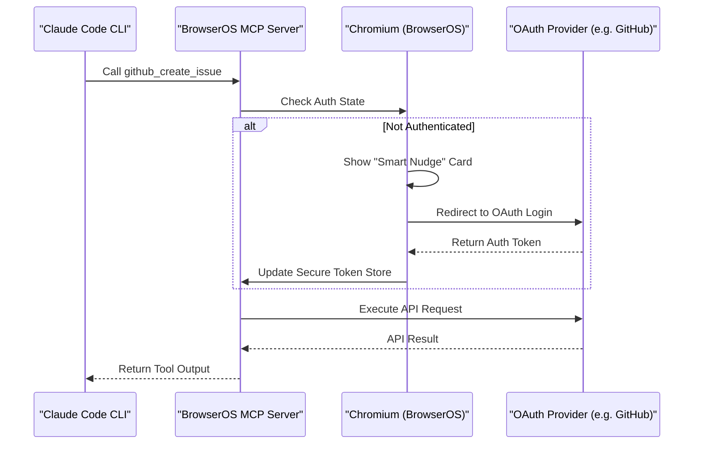

<!-- source: DeepWiki mcp.deepwiki.com · repo browseros-ai/BrowserOS · page 5.3 Claude Code Integration · fetched 2026-10-29 -->

# Claude Code Integration

<details>
<summary>Relevant source files</summary>

The following files were used as context for generating this wiki page:

- [docs/browserclaw/cockpit.mdx](docs/browserclaw/cockpit.mdx)
- [docs/browserclaw/tabs-and-isolation.mdx](docs/browserclaw/tabs-and-isolation.mdx)
- [docs/docs.json](docs/docs.json)
- [docs/features/bring-your-own-llm.mdx](docs/features/bring-your-own-llm.mdx)
- [docs/features/connect-mcps.mdx](docs/features/connect-mcps.mdx)
- [docs/features/cowork.mdx](docs/features/cowork.mdx)
- [docs/features/local-models.mdx](docs/features/local-models.mdx)
- [docs/features/scheduled-tasks.mdx](docs/features/scheduled-tasks.mdx)
- [docs/features/smart-nudges.mdx](docs/features/smart-nudges.mdx)
- [docs/features/use-with-claude-code.mdx](docs/features/use-with-claude-code.mdx)
- [packages/browseros-agent/.config/wt.toml](packages/browseros-agent/.config/wt.toml)
- [packages/browseros-agent/apps/app/screens/mcp-settings/QuickSetupSection.test.tsx](packages/browseros-agent/apps/app/screens/mcp-settings/QuickSetupSection.test.tsx)
- [packages/browseros-agent/apps/app/screens/mcp-settings/QuickSetupSection.tsx](packages/browseros-agent/apps/app/screens/mcp-settings/QuickSetupSection.tsx)
- [packages/browseros-agent/apps/app/screens/onboarding/features/Features.tsx](packages/browseros-agent/apps/app/screens/onboarding/features/Features.tsx)

</details>


This document provides detailed technical instructions for using BrowserOS with Claude Code (CLI) via the built-in Model Context Protocol (MCP) server.

## Overview

Claude Code can control BrowserOS through a built-in MCP server, providing the AI agent with **full browser control** and **direct access to 40+ external services**—including Gmail, Slack, GitHub, Google Calendar, and Notion—all through a single MCP connection [docs/features/use-with-claude-code.mdx:6-7](). This integration enables agentic coding workflows where Claude can test web applications, read console errors, fix bugs, and interact with tools directly from the terminal [docs/features/use-with-claude-code.mdx:12-26]().

The BrowserOS MCP server runs on a stable port (typically `9239`) and exposes 53 browser automation tools plus 40+ app integration tools through a single HTTP endpoint [docs/features/use-with-claude-code.mdx:46-48](), [docs/features/use-with-claude-code.mdx:27-29]().

**Sources:** [docs/features/use-with-claude-code.mdx:1-53](), [docs/features/use-with-claude-code.mdx:27-29]()

## Prerequisites

Before connecting Claude Code to BrowserOS:

1.  **BrowserOS Installed**: The MCP server starts automatically with the sidecar server process [docs/features/use-with-claude-code.mdx:6-10]().
2.  **Claude Code CLI**: Installed via `npm install -g @anthropic-ai/claude-cli`.
3.  **Network Access**: Ensure `localhost` connections are allowed on the MCP port shown in settings [docs/features/use-with-claude-code.mdx:46-48]().
4.  **Recommended Models**: For complex agentic tasks, use high-reasoning models like **Claude 3.5 Sonnet** or **Claude 3 Opus** [docs/features/bring-your-own-llm.mdx:45-46]().

**Sources:** [docs/features/bring-your-own-llm.mdx:44-46](), [docs/features/use-with-claude-code.mdx:6-10](), [docs/features/use-with-claude-code.mdx:39-53]()

## Setup Steps

### 1. Get the MCP URL
1.  Open BrowserOS.
2.  Navigate to `chrome://browseros/mcp` or click **Settings → BrowserOS as MCP** in the sidebar [docs/features/use-with-claude-code.mdx:42-44]().
3.  Copy the Server URL (e.g., `http://127.0.0.1:9239/mcp`) [docs/features/use-with-claude-code.mdx:45-46]().

### 2. Register with Claude Code
Run the following command in your terminal to add BrowserOS to your Claude Code configuration:

```bash
claude mcp add --transport http browseros <mcp_url> --scope user
```
*Example:* `claude mcp add --transport http browseros http://127.0.0.1:9239/mcp --scope user` [docs/features/use-with-claude-code.mdx:59-60]().

### 3. Verify Connection
Start Claude Code and issue a browser command:
```bash
claude
> Open google.com in BrowserOS
```
[docs/features/use-with-claude-code.mdx:64-67]().

**Tip:** Use `claude --dangerously-skip-permissions` to bypass confirmation prompts for every individual tool call [docs/features/use-with-claude-code.mdx:69-71]().

**Sources:** [docs/features/use-with-claude-code.mdx:41-71](), [packages/browseros-agent/apps/app/screens/mcp-settings/QuickSetupSection.tsx:54-56]()

## Architecture and Data Flow

The integration bridges the terminal-based "Code Entity Space" (Claude CLI) to the "Natural Language Space" of the browser agent through the `QuickSetupSection` logic and the MCP server.

### Diagram: Claude Code to BrowserOS Data Flow


**Sources:** [docs/features/use-with-claude-code.mdx:6-10](), [packages/browseros-agent/apps/app/screens/mcp-settings/QuickSetupSection.tsx:49-56]()

## Tool Capabilities

Claude Code gains access to two primary categories of tools through BrowserOS.

### 1. Browser Automation
Exposes low-level and high-level browser control:

| Category | Description |
| :--- | :--- |
| **Navigation** | Create tabs, navigate URLs, and close pages [docs/features/use-with-claude-code.mdx:28-29](). |
| **Observation** | Take screenshots, read page content, and capture snapshots [docs/features/use-with-claude-code.mdx:28-29](). |
| **Interaction** | Clicks, typing, scrolling, and form filling [docs/features/use-with-claude-code.mdx:24-25](). |
| **Management** | Tab groups, window management, history, and bookmarks [docs/features/use-with-claude-code.mdx:28-29](). |

### 2. App Integrations (40+ Services)
Direct API access via OAuth managed by BrowserOS [docs/features/use-with-claude-code.mdx:30-32]():

*   **Communication:** Gmail, Slack, Discord, WhatsApp [docs/features/connect-mcps:70-93]().
*   **Productivity:** Google Calendar, Notion, Linear, Jira [docs/features/connect-mcps:78-114]().
*   **Development:** GitHub, GitLab, Vercel, Supabase [docs/features/connect-mcps:95-104]().

**Sources:** [docs/features/use-with-claude-code.mdx:24-32](), [docs/features/connect-mcps:70-114]()

## Authentication and Security

When Claude Code attempts to use a tool for an external service (like Gmail), BrowserOS manages the OAuth state. If a service is not connected, BrowserOS can prompt the user via "Smart Nudges" in the browser UI [docs/features/connect-mcps:19-37]().

### Diagram: OAuth Interaction Flow


**Sources:** [docs/features/connect-mcps:19-37](), [docs/features/use-with-claude-code.mdx:30-32]()

## Troubleshooting

### Connection Issues
*   **Server URL**: Ensure the URL in Claude Code matches the one displayed in `chrome://browseros/mcp` [docs/features/use-with-claude-code.mdx:45-46]().
*   **Port Conflicts**: If the default port `9239` is taken, BrowserOS will pick an ephemeral port. Always copy the URL directly from the settings page [docs/features/use-with-claude-code.mdx:48-49]().
*   **Firewall**: On Windows, ensure the BrowserOS sidecar process is allowed to accept local HTTP connections [docs/features/use-with-claude-code.mdx:140-141]().

### Removal
To remove the integration from Claude Code:
```bash
claude mcp remove browseros --scope user
```
[docs/features/use-with-claude-code.mdx:73-76]().

**Sources:** [docs/features/use-with-claude-code.mdx:41-49](), [docs/features/use-with-claude-code.mdx:73-76](), [packages/browseros-agent/apps/app/screens/mcp-settings/QuickSetupSection.tsx:138-142]()

---

