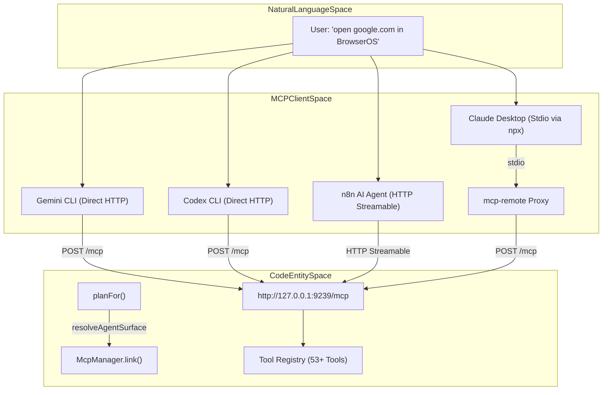
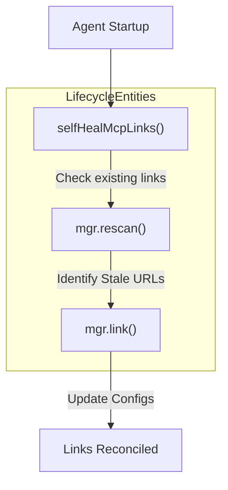

<!-- source: DeepWiki mcp.deepwiki.com · repo browseros-ai/BrowserOS · page 5.4 Other MCP Clients · fetched 2026-10-29 -->

# Other MCP Clients

<details>
<summary>Relevant source files</summary>

The following files were used as context for generating this wiki page:

- [docs/browserclaw/cockpit.mdx](docs/browserclaw/cockpit.mdx)
- [docs/browserclaw/tabs-and-isolation.mdx](docs/browserclaw/tabs-and-isolation.mdx)
- [docs/docs.json](docs/docs.json)
- [docs/features/bring-your-own-llm.mdx](docs/features/bring-your-own-llm.mdx)
- [docs/features/connect-mcps.mdx](docs/features/connect-mcps.mdx)
- [docs/features/cowork.mdx](docs/features/cowork.mdx)
- [docs/features/local-models.mdx](docs/features/local-models.mdx)
- [docs/features/scheduled-tasks.mdx](docs/features/scheduled-tasks.mdx)
- [docs/features/smart-nudges.mdx](docs/features/smart-nudges.mdx)
- [docs/features/use-with-claude-code.mdx](docs/features/use-with-claude-code.mdx)
- [packages/browseros-agent/.config/wt.toml](packages/browseros-agent/.config/wt.toml)
- [packages/browseros-agent/apps/app/components/ui/svgs/antigravity.tsx](packages/browseros-agent/apps/app/components/ui/svgs/antigravity.tsx)
- [packages/browseros-agent/apps/app/components/ui/svgs/opencode.tsx](packages/browseros-agent/apps/app/components/ui/svgs/opencode.tsx)
- [packages/browseros-agent/apps/app/screens/mcp-settings/QuickSetupSection.test.tsx](packages/browseros-agent/apps/app/screens/mcp-settings/QuickSetupSection.test.tsx)
- [packages/browseros-agent/apps/app/screens/mcp-settings/QuickSetupSection.tsx](packages/browseros-agent/apps/app/screens/mcp-settings/QuickSetupSection.tsx)
- [packages/browseros-agent/apps/app/screens/mcp-settings/agent-marks.tsx](packages/browseros-agent/apps/app/screens/mcp-settings/agent-marks.tsx)
- [packages/browseros-agent/apps/app/screens/mcp-settings/integrations-section.helpers.ts](packages/browseros-agent/apps/app/screens/mcp-settings/integrations-section.helpers.ts)
- [packages/browseros-agent/apps/app/screens/onboarding/features/Features.tsx](packages/browseros-agent/apps/app/screens/onboarding/features/Features.tsx)
- [packages/browseros-agent/apps/server/src/lib/mcp-manager/index.ts](packages/browseros-agent/apps/server/src/lib/mcp-manager/index.ts)
- [packages/browseros-agent/apps/server/src/lib/mcp-manager/manager.ts](packages/browseros-agent/apps/server/src/lib/mcp-manager/manager.ts)
- [packages/browseros-agent/apps/server/src/lib/mcp-manager/reconcile.ts](packages/browseros-agent/apps/server/src/lib/mcp-manager/reconcile.ts)
- [packages/browseros-agent/apps/server/src/lib/mcp-manager/service.ts](packages/browseros-agent/apps/server/src/lib/mcp-manager/service.ts)
- [packages/browseros-agent/apps/server/src/lib/mcp-manager/types.ts](packages/browseros-agent/apps/server/src/lib/mcp-manager/types.ts)
- [packages/browseros-agent/apps/server/tests/lib/mcp-manager/reconcile.test.ts](packages/browseros-agent/apps/server/tests/lib/mcp-manager/reconcile.test.ts)
- [packages/browseros-agent/apps/server/tests/lib/mcp-manager/service.test.ts](packages/browseros-agent/apps/server/tests/lib/mcp-manager/service.test.ts)

</details>


This page documents how to connect MCP clients beyond Claude Code to the BrowserOS MCP server, specifically focusing on the Gemini CLI, Codex, n8n, and Claude Desktop. BrowserOS exposes an HTTP-based MCP server that allows external AI agents to control the browser and integrated applications through a unified JSON-RPC 2.0 interface.

Sources: [docs/features/use-with-claude-code.mdx:1-4](), [packages/browseros-agent/apps/server/src/lib/mcp-manager/service.ts:6-15]()

---

## Connection Architecture

The BrowserOS MCP server typically operates on port `9239` and supports direct HTTP transport. The codebase manages these connections through the `mcp-manager` library, which handles manifest entries for different transport flavors.

### MCP Client Data Flow



**System Mapping**
- `MCPEndpoint`: The URL `http://127.0.0.1:9239/mcp` is the standard endpoint for the BrowserOS MCP server [docs/features/use-with-claude-code.mdx:46-46]().
- `planFor`: Internal function in `service.ts` that determines whether to use `http` or wrap in `npx mcp-remote` based on the client's capabilities [packages/browseros-agent/apps/server/src/lib/mcp-manager/service.ts:98-111]().
- `McpManager.link()`: The primary function used to upsert manifest entries and write agent configurations [packages/browseros-agent/apps/server/src/lib/mcp-manager/service.ts:182-186]().

Sources: [docs/features/use-with-claude-code.mdx:46-46](), [packages/browseros-agent/apps/server/src/lib/mcp-manager/service.ts:98-111](), [packages/browseros-agent/apps/server/src/lib/mcp-manager/service.ts:182-186]()

---

## n8n Integration

BrowserOS integrates with n8n to build automated workflows such as lead enrichment, price monitoring, and data extraction.

### Setup Steps
1. **Install Node**: Install `n8n-nodes-mcp` via **Settings → Community Nodes** in n8n.
2. **Workflow Configuration**:
   - Add a **Chat Trigger** node.
   - Add an **AI Agent** node and set **Source for Prompt** to the trigger.
   - Add an **MCP Client Tool** node.
3. **Connection**:
   - **Endpoint**: Use the URL from BrowserOS Settings (e.g., `http://127.0.0.1:9239/mcp`) [docs/features/use-with-claude-code.mdx:46-46]().
   - **Server Transport**: Must be set to `HTTP Streamable`.

Sources: [docs/features/use-with-claude-code.mdx:41-53]()

---

## Gemini CLI & Codex

Gemini CLI and OpenAI Codex can connect to BrowserOS using the direct HTTP transport. This allows terminal-based AI agents to use browser tools.

### Gemini CLI Setup
To add BrowserOS to Gemini CLI:
```bash
gemini mcp add local-server <mcp_url> --transport http --scope user
# Example: gemini mcp add local-server http://127.0.0.1:9239/mcp --transport http --scope user
```
Sources: [docs/features/use-with-claude-code.mdx:78-84]()

### Codex Setup
To add BrowserOS to OpenAI Codex CLI:
```bash
codex mcp add browseros <mcp_url> --transport http
# Example: codex mcp add browseros http://127.0.0.1:9239/mcp --transport http
```
Note: `codex` is included in the `CURATED_AGENTS` list for one-click installation support within the BrowserOS UI [packages/browseros-agent/apps/server/src/lib/mcp-manager/service.ts:63-71]().

Sources: [docs/features/use-with-claude-code.mdx:85-91](), [packages/browseros-agent/apps/server/src/lib/mcp-manager/service.ts:65-65]()

---

## Claude Desktop (via mcp-remote)

Claude Desktop natively uses `stdio` for MCP. To connect it to BrowserOS's HTTP endpoint, the system uses the `mcp-remote` bridge.

### Managed Server Names
The agent server differentiates between native HTTP and stdio-wrapped connections using two specific names:
- `BROWSEROS_MCP_SERVER_NAME`: `browseros` (HTTP) [packages/browseros-agent/apps/server/src/lib/mcp-manager/service.ts:34-34]()
- `BROWSEROS_MCP_STDIO_SERVER_NAME`: `browseros-stdio` (Stdio wrapper) [packages/browseros-agent/apps/server/src/lib/mcp-manager/service.ts:35-35]()

### Configuration
Edit your `claude_desktop_config.json` file:
- **macOS**: `~/Library/Application Support/Claude/claude_desktop_config.json` [docs/features/use-with-claude-code.mdx:109-109]()

Add the following to the `mcpServers` section:
```json
{
  "mcpServers": {
    "browseros": {
      "command": "npx",
      "args": ["mcp-remote", "http://127.0.0.1:9239/mcp"]
    }
  }
}
```
**Warning**: Claude Desktop's config parser only validates stdio entries. Raw `{ "url": "..." }` entries will fail, necessitating the `npx mcp-remote` wrapper [docs/features/use-with-claude-code.mdx:124-126](), [packages/browseros-agent/apps/server/src/lib/mcp-manager/service.ts:57-60]().

Sources: [docs/features/use-with-claude-code.mdx:106-129](), [packages/browseros-agent/apps/server/src/lib/mcp-manager/service.ts:57-60]()

---

## Boot-time Reconciler

BrowserOS includes a self-healing mechanism called `reconcileUrl` that runs at startup.



**Functionality**
- `reconcileUrl`: Repairs every present BrowserOS entry to point at the current URL, which is necessary if the browser restarts on a different port [packages/browseros-agent/apps/server/src/lib/mcp-manager/reconcile.ts:81-83]().
- `selfHealMcpLinks`: First cleans up non-curated links (like legacy Gemini or Claude Desktop entries) and then repairs the URL for all remaining curated agents [packages/browseros-agent/apps/server/src/lib/mcp-manager/reconcile.ts:147-153]().

Sources: [packages/browseros-agent/apps/server/src/lib/mcp-manager/reconcile.ts:8-34](), [packages/browseros-agent/apps/server/src/lib/mcp-manager/reconcile.ts:147-153]()

---

