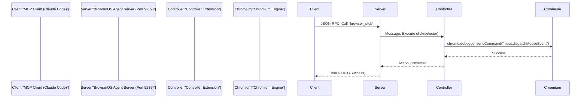
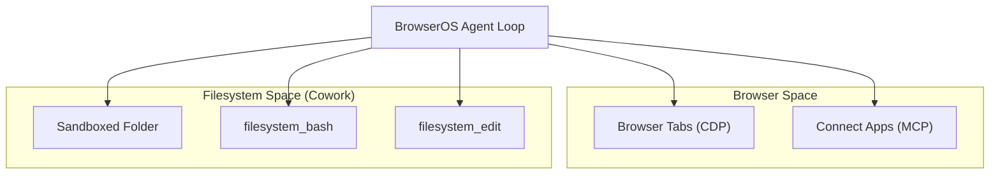

<!-- source: DeepWiki mcp.deepwiki.com · repo browseros-ai/BrowserOS · page 5.5 Comparisons · fetched 2026-10-29 -->

# Comparisons

Relevant source files

The following files were used as context for generating this wiki page:

- [.gitattributes](.gitattributes)
- [README.md](README.md)
- [docs/browserclaw/cockpit.mdx](docs/browserclaw/cockpit.mdx)
- [docs/browserclaw/tabs-and-isolation.mdx](docs/browserclaw/tabs-and-isolation.mdx)
- [docs/contributing.mdx](docs/contributing.mdx)
- [docs/docs.json](docs/docs.json)
- [docs/features/bring-your-own-llm.mdx](docs/features/bring-your-own-llm.mdx)
- [docs/features/connect-mcps.mdx](docs/features/connect-mcps.mdx)
- [docs/features/cowork.mdx](docs/features/cowork.mdx)
- [docs/features/local-models.mdx](docs/features/local-models.mdx)
- [docs/features/scheduled-tasks.mdx](docs/features/scheduled-tasks.mdx)
- [docs/features/smart-nudges.mdx](docs/features/smart-nudges.mdx)
- [docs/features/use-with-claude-code.mdx](docs/features/use-with-claude-code.mdx)
- [docs/images/checks-passed.png](docs/images/checks-passed.png)
- [docs/images/contributing--architecture.png](docs/images/contributing--architecture.png)
- [docs/images/hero-dark.png](docs/images/hero-dark.png)
- [docs/images/hero-light.png](docs/images/hero-light.png)
- [docs/images/switcher.png](docs/images/switcher.png)
- [docs/index.mdx](docs/index.mdx)
- [docs/videos/browserOS-agent-in-action.gif](docs/videos/browserOS-agent-in-action.gif)
- [packages/browseros-agent/.config/wt.toml](packages/browseros-agent/.config/wt.toml)
- [packages/browseros-agent/apps/app/screens/mcp-settings/QuickSetupSection.test.tsx](packages/browseros-agent/apps/app/screens/mcp-settings/QuickSetupSection.test.tsx)
- [packages/browseros-agent/apps/app/screens/mcp-settings/QuickSetupSection.tsx](packages/browseros-agent/apps/app/screens/mcp-settings/QuickSetupSection.tsx)
- [packages/browseros-agent/apps/app/screens/onboarding/features/Features.tsx](packages/browseros-agent/apps/app/screens/onboarding/features/Features.tsx)

This page provides a technical comparison of BrowserOS against alternative tools in the AI and browser automation space. It covers the architectural differences, tool capabilities, and integration models to help developers decide which tool fits their specific workflow.

## BrowserOS vs. Chrome DevTools MCP

The **Chrome DevTools MCP** is a developer-focused tool for connecting LLMs to a browser. BrowserOS provides a built-in MCP server that expands upon this by integrating privileged browser APIs and a suite of 40+ external application connectors (Connect Apps).

### Architectural Differences

Chrome DevTools MCP typically operates as a standalone server connecting to a standard Chrome instance via the remote debugging port (9222). BrowserOS integrates the MCP server directly into its architecture, allowing it to bypass the limitations of standard remote debugging and access internal browser states.

| Feature | Chrome DevTools MCP | BrowserOS MCP |
| :--- | :--- | :--- |
| **Setup** | Requires debug profiles & separate CLI | Built-in (Port 9239) [docs/features/use-with-claude-code.mdx:45-46]() |
| **Automation Surface** | Standard CDP (clicks, navigation) | Extended CDP + 53 Custom Tools [docs/features/use-with-claude-code.mdx:27-29]() |
| **App Integrations** | None (Browser only) | 40+ Apps (Gmail, Slack, GitHub, etc.) [docs/features/connect-mcps.mdx:65-67]() |
| **State Management** | Ephemeral | Persistent (History, Bookmarks, Tab Groups) |
| **Authentication** | Manual profile management | Native OAuth / Session reuse [docs/features/connect-mcps.mdx:30-32]() |

### Data Flow and Implementation

BrowserOS MCP uses an optimized observation model. Instead of sending raw HTML, it generates an indented Accessibility Tree, which is significantly more token-efficient for LLMs.

**MCP Request Lifecycle:**

1.  **Client Request**: A client like Claude Code sends a JSON-RPC request to `http://127.0.0.1:9239/mcp` [docs/features/use-with-claude-code.mdx:58-60]().
2.  **Tool Execution**: The server executes the requested browser tool (e.g., `click`, `type`, `take_snapshot`).
3.  **Privileged Access**: Unlike standard extensions, BrowserOS tools can interact with tab groups, window bounds, and internal history [docs/features/use-with-claude-code.mdx:27-29]().

#### Diagram: MCP Tool Execution Flow
Title: BrowserOS MCP Request Handling

Sources: [docs/features/use-with-claude-code.mdx:55-61](), [docs/contributing.mdx:33-37](), [README.md:84-86]()

---

## BrowserOS Cowork vs. Claude Cowork

**Claude Cowork** (and Claude Desktop's filesystem access) allows LLMs to read and write local files. BrowserOS **Cowork** expands this by combining filesystem access with browser automation in a unified agentic context.

### Comparison of Capabilities

| Capability | Claude Cowork / Desktop | BrowserOS Cowork |
| :--- | :--- | :--- |
| **Context** | Filesystem only | Filesystem + Live Browser + App APIs [docs/features/cowork.mdx:6-7]() |
| **Security** | Broad user-home access | Sandboxed folder gating [docs/features/cowork.mdx:61-62]() |
| **Execution** | Basic read/write | Full `filesystem_bash` execution [docs/features/cowork.mdx:109-110]() |
| **Workflow** | File manipulation | Research (Web) -> Process (FS) -> Report (App) |

### Implementation and Tools
BrowserOS Cowork provides 7 specific filesystem tools [docs/features/cowork.mdx:18-19](). The agent is explicitly sandboxed to the directory chosen by the user in the UI.

-   `filesystem_read`: Reads files with line-numbering for context [docs/features/cowork.mdx:76-77]().
-   `filesystem_edit`: Surgical string replacement with fuzzy matching [docs/features/cowork.mdx:97-98]().
-   `filesystem_bash`: Runs shell commands within the sandbox [docs/features/cowork.mdx:109-110]().

#### Diagram: Cowork Agent Context
Title: Unified Browser and Filesystem Agent Space

Sources: [docs/features/cowork.mdx:6-14](), [docs/features/cowork.mdx:71-74](), [docs/contributing.mdx:7-9]()

---

## BrowserOS vs. OpenClaw

**OpenClaw** is a self-hosted AI agent framework. While BrowserOS can act as an MCP server for OpenClaw [docs/features/use-with-claude-code.mdx:92-93](), BrowserOS itself provides a vertically integrated "AI-native browser" experience.

### Key Differentiators

1.  **Local vs. Cloud**: Unlike cloud-based automation tools (e.g., Browserbase), BrowserOS runs entirely on `127.0.0.1` [README.md:108-109]().
2.  **Session Persistence**: Tools like Playwright spin up fresh, unauthenticated instances. BrowserOS uses the user's existing logged-in sessions [README.md:107-108]().
3.  **Scheduled Automation**: BrowserOS includes a built-in scheduler that triggers tasks using the browser's alarm system, running them in hidden windows to avoid interrupting the user [docs/features/scheduled-tasks.mdx:109-116]().

### Comparison Table: Agent Architectures

| Feature | OpenClaw / Frameworks | BrowserOS |
| :--- | :--- | :--- |
| **Browsing** | Headless Driver (Playwright) | Native Chromium Fork [README.md:39-40]() |
| **Auth Handling** | Manual cookie management | Native Browser Profiles [README.md:102-103]() |
| **Observation** | HTML / Screenshots | Indented AXTree (Token Efficient) |
| **Scheduling** | External (Cron) | Internal (Chrome Alarms) [docs/features/scheduled-tasks.mdx:112-113]() |
| **UX** | CLI / Headless | Live Replay & Dashboard [README.md:75-98]() |

### Summary for Technical Decision Making

-   **Choose BrowserOS MCP** if you want to use tools like `Claude Code` but need them to access your actual browser history and 40+ authenticated apps (Gmail, Slack) without managing API keys [docs/features/use-with-claude-code.mdx:6-10]().
-   **Choose BrowserOS Cowork** if you need an agent that can simultaneously modify code in your local editor and test it in a live browser session [docs/features/cowork.mdx:6-7]().
-   **Choose Frameworks (OpenClaw/Playwright)** if you are building a custom, headless infrastructure where the browser is just a utility rather than a workspace.

Sources: [README.md:105-109](), [docs/features/use-with-claude-code.mdx:6-37](), [docs/features/scheduled-tasks.mdx:109-124](), [docs/features/cowork.mdx:6-41]()

---

