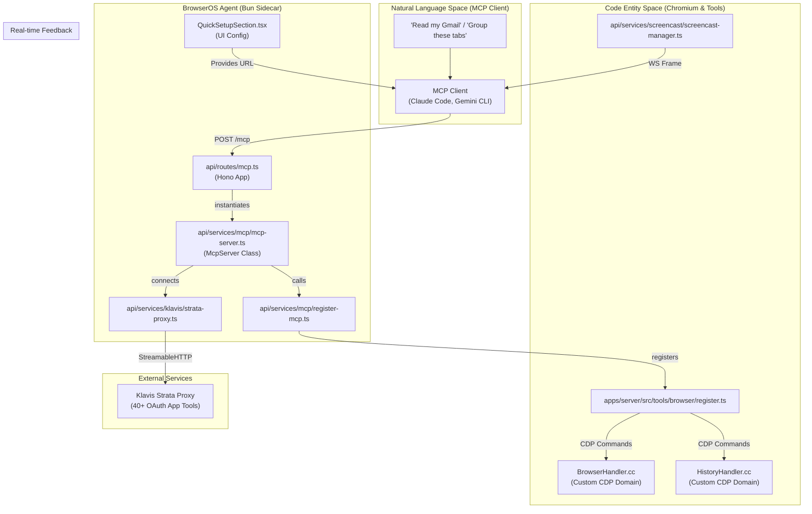
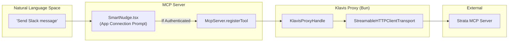

<!-- source: DeepWiki mcp.deepwiki.com · repo browseros-ai/BrowserOS · page 5.6 Comparison to Chrome DevTools MCP · fetched 2026-10-29 -->

# Comparison to Chrome DevTools MCP

Relevant source files

The following files were used as context for generating this wiki page:

- [docs/browserclaw/cockpit.mdx](docs/browserclaw/cockpit.mdx)
- [docs/browserclaw/tabs-and-isolation.mdx](docs/browserclaw/tabs-and-isolation.mdx)
- [docs/docs.json](docs/docs.json)
- [docs/features/bring-your-own-llm.mdx](docs/features/bring-your-own-llm.mdx)
- [docs/features/connect-mcps.mdx](docs/features/connect-mcps.mdx)
- [docs/features/cowork.mdx](docs/features/cowork.mdx)
- [docs/features/local-models.mdx](docs/features/local-models.mdx)
- [docs/features/scheduled-tasks.mdx](docs/features/scheduled-tasks.mdx)
- [docs/features/smart-nudges.mdx](docs/features/smart-nudges.mdx)
- [docs/features/use-with-claude-code.mdx](docs/features/use-with-claude-code.mdx)
- [packages/browseros-agent/.config/wt.toml](packages/browseros-agent/.config/wt.toml)
- [packages/browseros-agent/apps/app/screens/mcp-settings/QuickSetupSection.test.tsx](packages/browseros-agent/apps/app/screens/mcp-settings/QuickSetupSection.test.tsx)
- [packages/browseros-agent/apps/app/screens/mcp-settings/QuickSetupSection.tsx](packages/browseros-agent/apps/app/screens/mcp-settings/QuickSetupSection.tsx)
- [packages/browseros-agent/apps/app/screens/onboarding/features/Features.tsx](packages/browseros-agent/apps/app/screens/onboarding/features/Features.tsx)

This page provides a technical comparison of BrowserOS MCP and Chrome DevTools MCP for developers evaluating browser automation tools for AI agents. Both expose browser control via the Model Context Protocol (MCP), but differ significantly in architecture, scope, and tool coverage.

---

## Architecture Overview

### BrowserOS MCP Architecture

BrowserOS MCP is integrated directly into the browser runtime. The MCP server runs as part of the `browseros-agent` sidecar process and exposes tools through an HTTP endpoint at `http://127.0.0.1:9239/mcp` [docs/features/use-with-claude-code.mdx:42-46](). Unlike external implementations, it utilizes custom-patched CDP domains in the Chromium core and a dedicated server implementation in Bun.

The `QuickSetupSection` component in the Agent UI provides pre-configured snippets for connecting clients like Claude Code and Gemini CLI [packages/browseros-agent/apps/app/screens/mcp-settings/QuickSetupSection.tsx:19-91](). For clients like Claude Desktop that expect a local command, BrowserOS uses `npx mcp-remote` as a wrapper [packages/browseros-agent/apps/app/screens/mcp-settings/QuickSetupSection.tsx:70-82]().

**MCP Server Integration**

Sources: [packages/browseros-agent/apps/app/screens/mcp-settings/QuickSetupSection.tsx:123-184](), [docs/features/use-with-claude-code.mdx:42-49](), [packages/browseros-agent/apps/app/screens/mcp-settings/QuickSetupSection.test.tsx:47-73]()

### Chrome DevTools MCP Architecture

Chrome DevTools MCP runs as a separate Node.js process (`@anthropic-ai/chrome-devtools-mcp`) that connects to a standard Chrome instance via the remote debugging port (usually 9222). It is limited to the public CDP APIs provided by upstream Chromium and requires manual setup of debug profiles [docs/features/use-with-claude-code.mdx:8-10]().

---

## Tool Coverage Comparison

### Navigation and Tab Management
BrowserOS extends standard navigation with support for hidden tabs and windows used in background automation. [Scheduled Tasks](4.2) run in a hidden browser window to avoid interrupting user workflows [docs/features/scheduled-tasks.mdx:115-117]().

| Tool Function | BrowserOS MCP | Chrome DevTools MCP | Implementation Detail |
|---------------|:-------------:|:-------------------:|-----------------------|
| `navigate_page` | ✓ | ✓ | Standard CDP Page domain |
| `new_page` | ✓ | ✓ | Supports background/hidden modes |
| `new_hidden_page` | ✓ | - | Opens a hidden tab for background automation [docs/features/scheduled-tasks.mdx:115-117]() |
| `move_page` | ✓ | - | Move tabs between windows or positions |
| `get_active_page` | ✓ | - | Get currently focused page/tab |

Sources: [docs/features/use-with-claude-code.mdx:27-29](), [docs/features/scheduled-tasks.mdx:115-124](), [docs/browserclaw/tabs-and-isolation.mdx:16-21]()

### Content Extraction and Observation
BrowserOS provides high-level content extraction tools like Markdown conversion, which significantly reduces token usage for LLMs compared to raw HTML extraction [docs/features/use-with-claude-code.mdx:21-23](). It also provides live previews and activity cards in the "Running Now" section of the dashboard [docs/browserclaw/cockpit.mdx:22-33]().

| Tool Function | BrowserOS MCP | Chrome DevTools MCP |
|---------------|:-------------:|:-------------------:|
| `take_snapshot` | ✓ | ✓ |
| `get_page_content` | ✓ (Markdown) | - |
| `get_page_links` | ✓ (Deduplicated) | - |
| `watch_session` | ✓ (Live Preview) | - |

Sources: [docs/features/use-with-claude-code.mdx:21-23](), [docs/browserclaw/cockpit.mdx:26-31]()

---

## External App Integrations

A major differentiator is BrowserOS's built-in support for 40+ external apps [docs/features/connect-mcps.mdx:6-16](). Chrome DevTools MCP is limited strictly to browser-internal tools. BrowserOS connects to these services via OAuth and exposes them as native MCP tools [docs/features/connect-mcps.mdx:15-16]().

**App Integration Data Flow**

Sources: [docs/features/connect-mcps.mdx:19-37](), [docs/features/use-with-claude-code.mdx:18-32]()

| Service Category | Examples | Capability |
|-----------------|----------|-------------|
| Email | Gmail, Outlook | Send, read, search, manage drafts [docs/features/connect-mcps.mdx:73-75]() |
| Messaging | Slack, Discord | Post messages, manage channels [docs/features/connect-mcps.mdx:89-91]() |
| Development | GitHub, Vercel | Manage repos, issues, deployments [docs/features/connect-mcps.mdx:98-100]() |
| Productivity | Notion, Sheets | Create pages, edit spreadsheets [docs/features/connect-mcps.mdx:119-121]() |

Sources: [docs/features/connect-mcps.mdx:65-177]()

---

## Session and Environment Comparison

### BrowserOS MCP: Unified Session
BrowserOS MCP operates within your **active browser session**. This means the AI agent inherits your existing logins and cookies [docs/features/use-with-claude-code.mdx:30-32]().
- **Filesystem Access**: Via [Cowork](4.1), the agent can read/write files and run shell commands alongside browser automation using 7 dedicated filesystem tools [docs/features/cowork.mdx:18-39, 71-156]().
- **Privacy/Security**: All tasks run locally on your machine. For scheduled tasks, a hidden window is used so as not to interrupt the user [docs/features/scheduled-tasks.mdx:141-143]().

### Chrome DevTools MCP: Debug Session
Chrome DevTools MCP typically requires a profile launched with `--remote-debugging-port`.
- **Isolation**: Often requires a separate profile, meaning the agent doesn't have access to your saved passwords or history unless explicitly shared.
- **Background Work**: Limited support for truly "hidden" automation; usually requires a visible window or a headless mode that lacks extension support.

Sources: [docs/features/use-with-claude-code.mdx:8-10](), [docs/features/cowork.mdx:6-7](), [docs/features/scheduled-tasks.mdx:115-117]()

---

## Summary Table

| Dimension | BrowserOS MCP | Chrome DevTools MCP |
|-----------|---------------|---------------------|
| **Architecture** | Native Sidecar (Bun) | External Node.js Process |
| **Total Tools** | 53 (Browser) + 40+ (Apps) | ~29 (Browser only) |
| **Session State** | Shared with User Profile | Isolated/Debug instance |
| **Background Work**| Native Hidden Windows | Foreground/Headless only |
| **App Support** | 40+ Built-in Integrations | None |
| **Filesystem** | Full access via Cowork | Restricted to Node.js env |
| **CDP Extensions** | Custom (History, Bookmarks) | Upstream standard only |

Sources: [docs/features/use-with-claude-code.mdx:12-37](), [docs/features/cowork.mdx:71-156](), [docs/features/connect-mcps.mdx:65-68]()

---

